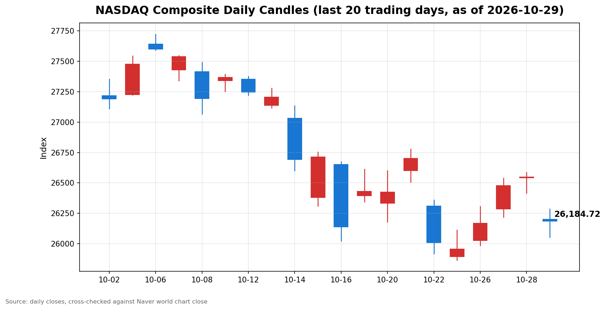

안녕하세요, [한국투자증권](https://securities.koreainvestment.com/main/Main.jsp)에서 [한투-한국투자증권](https://play.google.com/store/apps/details?id=com.truefriend.neosmartarenewal&hl=ko) 개발을 담당하고 있는 way입니다. 
2026년 10월 29일 나스닥 장중 흐름을 수치 중심으로 정리합니다. 

## 장중 요약

나스닥은 하락 흐름을 이어가고 있습니다. 
장 오픈 이후 소폭 반등했으나 전일 대비 하락 상태는 유지되고 있습니다. 
이날 하락의 중심에는 대형 기술기업 실적에 대한 실망이 있습니다. 
알파벳의 3분기 실적이 시장 예상치를 밑돌았다는 보도가 장 초반부터 전해졌습니다. 
인공지능 투자에 대한 수익성 우려도 기술주 전반의 심리를 압박하고 있습니다. 
반면 9월 개인소비지출 물가지수는 컨센서스에 부합했고 국내총생산은 컨센서스를 소폭 상회했다는 소식이 전해졌습니다. 
이 글은 교육과 해설 목적으로 작성되었으며 특정 종목의 매수나 매도를 권유하지 않습니다. 

## 오늘의 스냅샷

| 지수 | 현재가 | 전일 대비 | 등락률 | 전일 종가 | 시가 | 장중 고가 | 장중 저가 |
| --- | --- | --- | --- | --- | --- | --- | --- |
| 나스닥 종합 | 26,210.96 | -338.89 | -1.28% | 26,549.85 | 26,201.82 | 26,286.46 | 26,053.16 |

스냅샷 기준 시각은 미국 동부시간 2026년 10월 29일 12시 57분, 한국시간 2026년 10월 30일 01시 57분입니다. 
당일 수치는 장이 진행 중이라 계속 변하는 형성 중인 수치입니다. 
나스닥 종합 수치는 [네이버 월드 차트](https://stock.naver.com/worldstock/index/.IXIC/price)와 [네이버 금융 월드 시세](https://finance.naver.com/world/sise.naver?symbol=NAS@IXIC)에서 확인했습니다. 
한투 MTS 해외 대시보드 교차값도 같은 방향을 보여줍니다. 
한투 MTS 기준 나스닥 종합은 26,197.14, 전일 대비 -352.71, 등락률 -1.33%였습니다. 
한투 MTS 값으로 역산한 전일 종가는 26,549.85로 네이버 전일 종가와 일치합니다. 
한투 MTS 차트 배열 기준 장중 고가는 26,273.73, 장중 저가는 26,076.80이었습니다. 
두 출처의 현재가 차이는 조회 시각 차이로 설명됩니다. 

## 차트

최근 20거래일 일봉 차트입니다. 
빨간 봉은 종가가 시가보다 높은 날, 파란 봉은 종가가 시가보다 낮은 날입니다. 
당일 봉은 형성 중인 봉으로, 마감 전에는 계속 변합니다. 

## 다우와 S&P500 흐름

S&P500은 나스닥보다 낙폭이 작았습니다. 
한투 MTS 기준 S&P500은 7,715.09, 전일 대비 -28.89, 등락률 -0.37%였습니다. 
한투 MTS 값으로 역산한 S&P500 전일 종가는 7,743.98입니다. 
한투 MTS 차트 배열 기준 S&P500 장중 고가는 7,729.59, 장중 저가는 7,699.80이었습니다. 
다우지수는 이번 스냅샷에서 한투 MTS 해외 대시보드 지수 목록에 포함되지 않았습니다. 
다우지수의 장중 수치는 확인 필요로 표기합니다. 
S&P500의 낙폭이 나스닥보다 작았다는 점에서 하락 압력은 기술주 쪽에 더 집중됐습니다. 

## 오전과 오후 흐름 변화

시가 대비 방향 전환은 나타나지 않았습니다. 
나스닥은 시가 26,201.82에서 출발해 장중 현재가 26,210.96으로 시가 위에서 거래되고 있습니다. 
다만 전일 종가 대비로는 여전히 1% 넘는 하락 상태입니다. 
장 오픈 스냅샷(미국 동부시간 09시 59분)의 나스닥 종합은 26,170.19였습니다. 
장중 현재가는 오픈 스냅샷보다 올랐으나 하락 방향 자체는 바뀌지 않았습니다. 
장중 저가 26,053.16에서 반등해 고가 26,286.46까지 올랐으나 상승 전환으로 보기는 어렵습니다. 
한투 MTS 기준으로도 같은 흐름이 확인됩니다. 
한투 MTS 나스닥 종합은 장 오픈 당시 26,154.79에서 장중 26,197.14로 올랐습니다. 
한투 MTS 차트 배열 기준 장중 고가는 26,200.39에서 26,273.73으로 확대됐고 장중 저가는 26,076.80을 유지했습니다. 
S&P500도 장 오픈 당시 7,709.43에서 장중 7,715.09로 소폭 올랐습니다. 
오전의 하락이 오후 들어 완만해졌으나 방향이 바뀐 것은 아닙니다. 

## 마감까지 확인할 점

첫째, 알파벳 실적 실망에 따른 하락 압력이 마감까지 이어지는지 확인합니다. 
둘째, 나스닥이 장중 저가 26,053.16 부근을 지키는지 확인합니다. 
셋째, 개인소비지출 물가지수와 국내총생산 지표가 장 후반 심리에 미치는 영향을 확인합니다. 
넷째, S&P500과 나스닥의 낙폭 차이가 마감까지 좁혀지는지 확인합니다. 
다섯째, 장 마감 때까지 거래량과 고가와 저가의 범위가 어떻게 변하는지 확인합니다. 
장중 수치는 방향을 보여줄 뿐이며 확정된 결과가 아닙니다. 

## 마치며

나스닥은 실적 실망과 인공지능 투자 수익성 우려 속에 하락 흐름을 이어가고 있습니다. 
이 글은 매수나 매도 권유가 아니며 장중 흐름을 수치로 확인하는 데 목적이 있습니다. 
