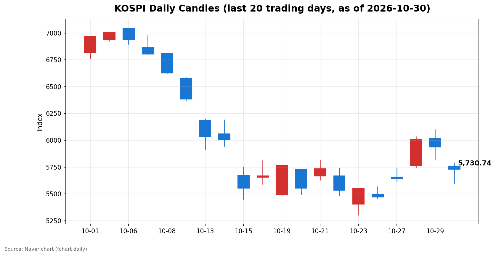
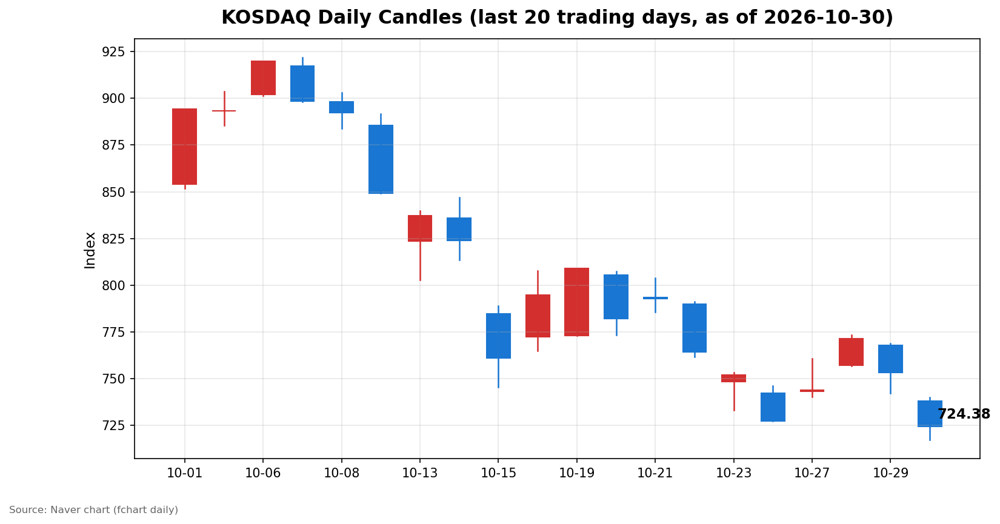

안녕하세요, [한국투자증권](https://securities.koreainvestment.com/main/Main.jsp)에서 [한투-한국투자증권](https://play.google.com/store/apps/details?id=com.truefriend.neosmartarenewal&hl=ko) 개발을 담당하고 있는 way입니다. 
2026년 10월 30일 국내 증시 장 마감 흐름을 수치 중심으로 정리합니다. 

## 마감 요약

코스피와 코스닥이 모두 큰 폭으로 하락 마감했습니다. 
코스피는 전일 대비 3.48% 하락한 5,730.74에 마감했습니다. 
코스닥은 전일 대비 3.83% 하락한 724.38에 마감했습니다. 
두 지수 모두 시가부터 종가까지 전일 종가를 회복하지 못했습니다. 
코스피는 장중 5,599.42까지 내려갔다가 5,730.74로 마감했습니다. 
코스닥은 장중 717.27까지 내려갔다가 724.38로 마감했습니다. 

## 오늘의 마감 스냅샷

| 지수 | 종가 | 전일 대비 | 등락률 | 시가 | 고가 | 저가 | 거래량 | 거래대금 |
| --- | --- | --- | --- | --- | --- | --- | --- | --- |
| 코스피 | 5,730.74 | -206.92 | -3.48% | 5,760.35 | 5,784.98 | 5,599.42 | 213,759천주 | 19조 2,687억원 |
| 코스닥 | 724.38 | -28.85 | -3.83% | 737.76 | 739.79 | 717.27 | 434,190천주 | 5조 7,416억원 |

전일 종가는 네이버 실시간 수치와 일봉 종가를 교차 확인했습니다. 
코스피 전일 종가는 5,937.66, 코스닥 전일 종가는 753.23입니다. 
지수 차트는 [코스피](https://finance.naver.com/sise/sise_index.naver?code=KOSPI)와 [코스닥](https://finance.naver.com/sise/sise_index.naver?code=KOSDAQ)에서 확인할 수 있습니다. 

## 차트

최근 20거래일 일봉 차트입니다. 
빨간 봉은 종가가 시가보다 높은 날, 파란 봉은 종가가 시가보다 낮은 날입니다. 

## 최근 5거래일 일봉

### 코스피

| 날짜 | 시가 | 고가 | 저가 | 종가 | 거래량(천주) |
| --- | --- | --- | --- | --- | --- |
| 2026-10-26 | 5,499.05 | 5,565.67 | 5,455.11 | 5,469.47 | 202,295 |
| 2026-10-27 | 5,658.65 | 5,737.61 | 5,612.92 | 5,638.34 | 196,172 |
| 2026-10-28 | 5,763.85 | 6,032.28 | 5,745.51 | 6,012.44 | 237,337 |
| 2026-10-29 | 6,017.22 | 6,100.11 | 5,817.92 | 5,937.66 | 296,495 |
| 2026-10-30 | 5,760.35 | 5,784.98 | 5,599.42 | 5,730.74 | 213,759 |

### 코스닥

| 날짜 | 시가 | 고가 | 저가 | 종가 | 거래량(천주) |
| --- | --- | --- | --- | --- | --- |
| 2026-10-26 | 742.17 | 745.95 | 727.20 | 727.21 | 476,231 |
| 2026-10-27 | 743.09 | 760.59 | 740.17 | 743.83 | 539,957 |
| 2026-10-28 | 756.90 | 773.28 | 756.57 | 771.28 | 560,627 |
| 2026-10-29 | 767.78 | 768.75 | 741.96 | 753.23 | 494,052 |
| 2026-10-30 | 737.76 | 739.79 | 717.27 | 724.38 | 434,190 |

코스피는 10월 28일 6,000선을 넘긴 뒤 이틀 연속 하락해 5,700선 초반으로 내려왔습니다. 
코스닥은 최근 5거래일 중 가장 낮은 종가로 마감했습니다. 

## 당일 수급

### 코스피

| 주체 | 순매수(억원) |
| --- | --- |
| 개인 | +6,197 |
| 외국인 | -16,167 |
| 기관 | +7,432 |
| 기타법인 | +2,538 |

### 코스닥

| 주체 | 순매수(억원) |
| --- | --- |
| 개인 | +1,688 |
| 외국인 | -267 |
| 기관 | -1,377 |
| 기타법인 | -44 |

코스피에서는 개인과 기관이 순매수했고 외국인이 큰 폭으로 순매도했습니다. 
코스닥에서는 개인이 순매수했고 외국인과 기관이 순매도했습니다. 
이날 코스피 수급에서는 외국인의 순매도 규모가 가장 컸습니다. 

## 강했던 테마와 흐름

지수 하락 속에서도 상승한 테마가 있었습니다. 
한국투자증권 MTS 기준 마감 테마 상승률은 다음과 같습니다. 

| 테마 | 등락률 |
| --- | --- |
| 백신여권 | +8.88% |
| 블록체인 | +5.47% |
| 보안(정보) | +3.38% |
| 주류판매 | +2.69% |
| 해운 | +1.69% |

상승 테마가 있었음에도 두 지수 모두 3% 넘게 하락한 점이 이날의 특징입니다. 
하락의 배경을 특정 재료 하나로 단정하기는 어려우며, 이는 참고용 흐름 정리입니다. 

## 내일 확인할 점

코스피가 5,700선에서 지지되는지 확인할 필요가 있습니다. 
코스닥이 720선 부근에서 지지되는지 확인할 필요가 있습니다. 
외국인의 코스피 순매도 흐름이 이어지는지 확인할 필요가 있습니다. 
상승 테마의 상대적 강세가 이어지는지 확인할 필요가 있습니다. 

## 마치며

이날 국내 증시는 두 지수 모두 큰 폭으로 하락 마감했습니다. 
이 글은 교육·해설 목적의 시장 정리이며, 매수·매도 권유가 아닙니다. 
