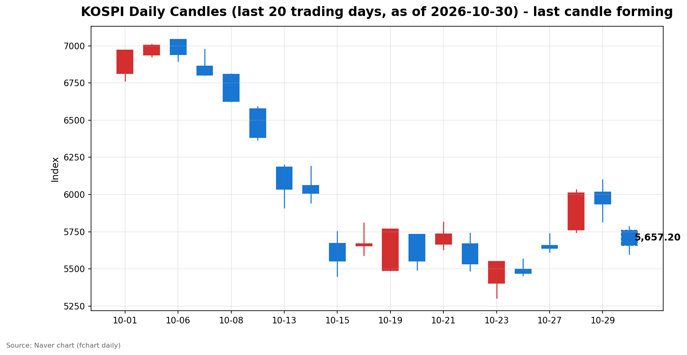
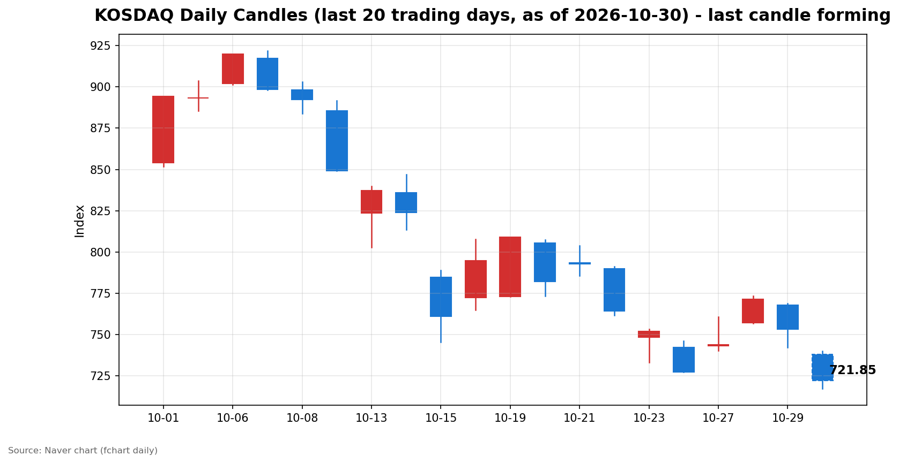

안녕하세요, [한국투자증권](https://securities.koreainvestment.com/main/Main.jsp)에서 [한투-한국투자증권](https://play.google.com/store/apps/details?id=com.truefriend.neosmartarenewal&hl=ko) 개발을 담당하고 있는 way입니다. 
2026년 10월 30일 국내 증시 오전장 흐름을 수치 중심으로 정리합니다. 

## 오전장 요약

코스피와 코스닥은 모두 큰 폭의 하락세를 보이며 오전장을 마쳤습니다. 
코스피는 장중 5,600선 아래까지 밀렸다가 낙폭을 일부 줄였습니다. 
코스닥도 장중 저점 이후 낙폭을 다소 축소했습니다. 
간밤 뉴욕 증시에서 인공지능 관련 기술주가 약세를 보인 여파가 국내 증시에도 이어졌습니다. 
관련 보도에서는 알파벳의 부진한 실적 이후 인공지능 투자 비용에 대한 우려가 확산했다고 전했습니다. 
장 마감 이후 실적을 발표한 아마존과 인텔이 시간 외 거래에서 하락했다는 보도도 이어졌습니다. 
국내 증시에서는 장 초반 프로그램 매도호가 일시효력정지, 이른바 매도 사이드카가 발동됐다는 보도가 나왔습니다. 
이러한 흐름은 오전장 하락의 배경으로 언급되고 있으며, 개별 종목의 흐름을 단정하기는 어렵습니다. 

## 오늘의 스냅샷

| 지수 | 현재가 | 전일 대비 | 등락률 | 시가 | 고가 | 저가 | 거래량 | 거래대금 | 스냅샷 기준 시각 |
| --- | --- | --- | --- | --- | --- | --- | --- | --- | --- |
| 코스피 | 5,662.39 | -275.27 | -4.64% | 5,760.35 | 5,784.98 | 5,599.42 | 120,598천주 | 9조 9,954억원 | 2026-10-30 12:29 KST |
| 코스닥 | 723.09 | -30.14 | -4.00% | 737.76 | 739.79 | 717.27 | 296,616천주 | 3조 5,088억원 | 2026-10-30 12:29 KST |

당일 봉은 형성 중인 봉이며, 스냅샷 시점 이후에도 계속 변합니다. 
코스피 전일 종가는 5,937.66, 코스닥 전일 종가는 753.23입니다. 
전일 종가는 네이버 실시간 수치와 일봉 종가를 교차 확인했습니다. 
지수 차트는 [코스피](https://finance.naver.com/sise/sise_index.naver?code=KOSPI)와 [코스닥](https://finance.naver.com/sise/sise_index.naver?code=KOSDAQ)에서 확인할 수 있습니다. 

## 차트

최근 20거래일 일봉 차트입니다. 
빨간 봉은 종가가 시가보다 높은 날, 파란 봉은 종가가 시가보다 낮은 날입니다. 
당일 봉은 형성 중인 봉으로, 마감 전에는 계속 변합니다. 

## 최근 5거래일 일봉

### 코스피

| 날짜 | 시가 | 고가 | 저가 | 종가 | 거래량(천주) |
| --- | --- | --- | --- | --- | --- |
| 2026-10-23 | 5,403.17 | 5,550.30 | 5,305.98 | 5,550.30 | 249,517 |
| 2026-10-26 | 5,499.05 | 5,565.67 | 5,455.11 | 5,469.47 | 202,295 |
| 2026-10-27 | 5,658.65 | 5,737.61 | 5,612.92 | 5,638.34 | 196,172 |
| 2026-10-28 | 5,763.85 | 6,032.28 | 5,745.51 | 6,012.44 | 237,337 |
| 2026-10-29 | 6,017.22 | 6,100.11 | 5,817.92 | 5,937.66 | 296,495 |
| 2026-10-30 | 5,760.35 | 5,784.98 | 5,599.42 | 5,657.20 | 119,727 |

### 코스닥

| 날짜 | 시가 | 고가 | 저가 | 종가 | 거래량(천주) |
| --- | --- | --- | --- | --- | --- |
| 2026-10-23 | 748.32 | 753.02 | 732.87 | 751.69 | 505,474 |
| 2026-10-26 | 742.17 | 745.95 | 727.20 | 727.21 | 476,231 |
| 2026-10-27 | 743.09 | 760.59 | 740.17 | 743.83 | 539,957 |
| 2026-10-28 | 756.90 | 773.28 | 756.57 | 771.28 | 560,627 |
| 2026-10-29 | 767.78 | 768.75 | 741.96 | 753.23 | 494,052 |
| 2026-10-30 | 737.76 | 739.79 | 717.27 | 721.85 | 295,045 |

2026년 10월 30일 봉은 장중 형성 중인 봉이며 종가는 확정값이 아닙니다. 
일봉 표의 당일 종가는 표 작성 시점의 형성 중 수치이며 실시간 현재가와 시차가 있을 수 있습니다. 
코스피는 전일 6,000선을 넘겼던 흐름에서 하루 만에 큰 폭으로 되돌림했습니다. 
코스닥은 전일 753.23에서 하락해 720선 부근에서 움직이고 있습니다. 

## 오전 강했던 테마와 흐름 변화

코스피는 시가 5,760.35에서 출발해 장중 저점 5,599.42까지 밀렸습니다. 
저점 대비로는 스냅샷 시점 5,662.39까지 낙폭을 일부 줄였습니다. 
코스닥은 시가 737.76에서 출발해 장중 저점 717.27까지 밀렸습니다. 
저점 대비로는 스냅샷 시점 723.09까지 낙폭을 다소 축소했습니다. 
두 지수 모두 시가 대비 하락 방향이 유지된 가운데, 저점에서의 반등 시도가 나타났습니다. 
한국투자증권 MTS 대시보드 조회 시점의 테마 항목은 비어 있어, 오전 강했던 테마는 확인 필요로 표기합니다. 
장중 상승률 상위에는 개별 종목 중심의 움직임이 있었으나, 지수 전체의 하락 흐름과는 별개로 해석할 필요가 있습니다. 

## 전일 수급

전일인 2026년 10월 29일 수급은 다음과 같습니다. 
장중 수급 확정치는 아직 집계 중이므로 확인이 필요합니다. 

### 코스피

| 주체 | 순매수(억원) |
| --- | --- |
| 개인 | -429 |
| 외국인 | +1,221 |
| 기관 | -4,132 |
| 기타법인 | +3,340 |

### 코스닥

| 주체 | 순매수(억원) |
| --- | --- |
| 개인 | +2,058 |
| 외국인 | -1,210 |
| 기관 | -740 |
| 기타법인 | -108 |

코스피에서는 외국인이 순매수했고 개인과 기관이 순매도했습니다. 
코스닥에서는 개인이 순매수했고 외국인과 기관이 순매도했습니다. 
코스피 기관 순매도 규모가 이날 수급에서 가장 컸습니다. 

## 오후에 확인할 점

코스피가 5,600선 부근에서 낙폭을 추가로 줄이는지 확인할 필요가 있습니다. 
코스닥이 720선 부근을 지키는지 확인할 필요가 있습니다. 
오전 저점 이후의 반등 시도가 오후에도 이어지는지 확인할 필요가 있습니다. 
간밤 미국 기술주 우려와 관련된 흐름이 오후에 완화되는지 확인할 필요가 있습니다. 
장중 수급 확정치가 집계되는 대로 외국인·기관의 방향을 확인할 필요가 있습니다. 

## 마치며

오전장 국내 증시는 두 지수 모두 큰 폭으로 하락했습니다. 
이 글은 교육·해설 목적의 시장 정리이며, 매수·매도 권유가 아닙니다. 
