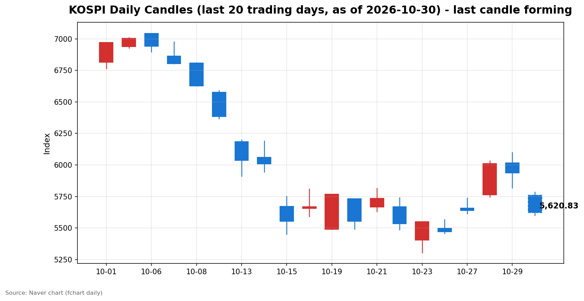
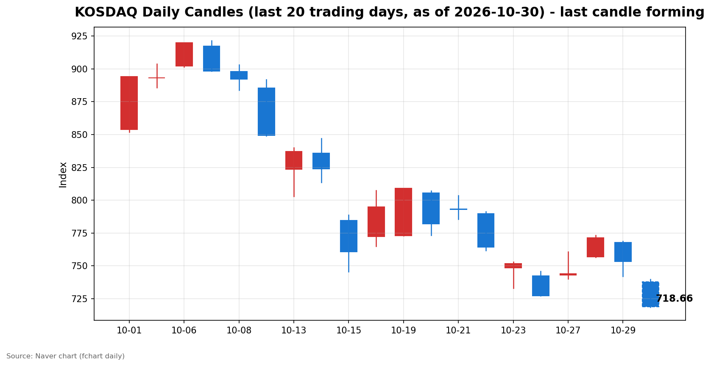

안녕하세요, [한국투자증권](https://securities.koreainvestment.com/main/Main.jsp)에서 [한투-한국투자증권](https://play.google.com/store/apps/details?id=com.truefriend.neosmartarenewal&hl=ko) 개발을 담당하고 있는 way입니다. 
2026년 10월 30일 국내 증시 장 오픈 흐름을 수치 중심으로 정리합니다. 

## 배경

간밤 미국 증시는 하락 마감했습니다. 
한국투자증권 MTS 기준 나스닥 종합은 26,184.72로 전일 대비 365.13포인트, 1.38% 하락했습니다. 
스탠더드앤드푸어스 500 지수는 7,720.39로 전일 대비 23.59포인트, 0.30% 하락했습니다. 
관련 보도에서는 알파벳의 부진한 실적이 인공지능 투자 비용 우려를 자극하며 뉴욕 증시 기술주 투자 심리를 위축시켰다고 전했습니다. 
이러한 흐름이 국내 증시 개장 초반 약세 출발의 배경으로 언급되고 있습니다. 
다만 개별 종목의 흐름을 단정하기는 어려우며, 이는 참고용 배경 정리입니다. 

## 오늘의 스냅샷

| 지수 | 현재가 | 전일 대비 | 등락률 | 시가 | 고가 | 저가 | 거래량 | 거래대금 | 스냅샷 기준 시각 |
| --- | --- | --- | --- | --- | --- | --- | --- | --- | --- |
| 코스피 | 5,719.05 | -218.61 | -3.68% | 5,760.35 | 5,784.98 | 5,679.80 | 37,046천주 | 3조 4,429억원 | 2026-10-30 09:29 KST |
| 코스닥 | 737.55 | -15.68 | -2.08% | 737.76 | 739.32 | 726.68 | 113,072천주 | 1조 2,259억원 | 2026-10-30 09:29 KST |

코스피와 코스닥은 모두 하락 출발했습니다. 
코스피는 시가 5,760.35에서 출발해 스냅샷 시점 5,719.05를 기록했습니다. 
코스닥은 시가 737.76에서 출발해 스냅샷 시점 737.55를 기록했습니다. 
전일 종가는 네이버 실시간 수치와 일봉 종가를 교차 확인했습니다. 
코스피 전일 종가는 5,937.66, 코스닥 전일 종가는 753.23입니다. 
지수 차트는 [코스피](https://finance.naver.com/sise/sise_index.naver?code=KOSPI)와 [코스닥](https://finance.naver.com/sise/sise_index.naver?code=KOSDAQ)에서 확인할 수 있습니다. 

## 차트

최근 20거래일 일봉 차트입니다. 
빨간 봉은 종가가 시가보다 높은 날, 파란 봉은 종가가 시가보다 낮은 날입니다. 
당일 봉은 형성 중인 봉으로, 마감 전에는 계속 변합니다. 

## 최근 5거래일 일봉

### 코스피

| 날짜 | 시가 | 고가 | 저가 | 종가 | 거래량(천주) |
| --- | --- | --- | --- | --- | --- |
| 2026-10-23 | 5,403.17 | 5,550.30 | 5,305.98 | 5,550.30 | 249,517 |
| 2026-10-26 | 5,499.05 | 5,565.67 | 5,455.11 | 5,469.47 | 202,295 |
| 2026-10-27 | 5,658.65 | 5,737.61 | 5,612.92 | 5,638.34 | 196,172 |
| 2026-10-28 | 5,763.85 | 6,032.28 | 5,745.51 | 6,012.44 | 237,337 |
| 2026-10-29 | 6,017.22 | 6,100.11 | 5,817.92 | 5,937.66 | 296,495 |
| 2026-10-30 | 5,760.35 | 5,784.98 | 5,679.80 | 5,728.65 | 36,366 |

### 코스닥

| 날짜 | 시가 | 고가 | 저가 | 종가 | 거래량(천주) |
| --- | --- | --- | --- | --- | --- |
| 2026-10-23 | 748.32 | 753.02 | 732.87 | 751.69 | 505,474 |
| 2026-10-26 | 742.17 | 745.95 | 727.20 | 727.21 | 476,231 |
| 2026-10-27 | 743.09 | 760.59 | 740.17 | 743.83 | 539,957 |
| 2026-10-28 | 756.90 | 773.28 | 756.57 | 771.28 | 560,627 |
| 2026-10-29 | 767.78 | 768.75 | 741.96 | 753.23 | 494,052 |
| 2026-10-30 | 737.76 | 739.32 | 726.68 | 739.05 | 111,266 |

2026년 10월 30일 봉은 장중 형성 중인 봉이며 종가는 확정값이 아닙니다. 
일봉 표의 당일 종가는 표 작성 시점의 형성 중 수치이며 실시간 현재가와 시차가 있을 수 있습니다. 
코스피는 전일 5,937.66에서 하락 출발해 5,700선 부근에서 움직이고 있습니다. 
코스닥은 전일 753.23에서 하락 출발해 740선 부근에서 움직이고 있습니다. 

## 전일 수급

전일인 2026년 10월 29일 수급은 다음과 같습니다. 

### 코스피

| 주체 | 순매수(억원) |
| --- | --- |
| 개인 | -429 |
| 외국인 | +1,221 |
| 기관 | -4,132 |
| 기타법인 | +3,340 |

### 코스닥

| 주체 | 순매수(억원) |
| --- | --- |
| 개인 | +2,058 |
| 외국인 | -1,210 |
| 기관 | -740 |
| 기타법인 | -108 |

코스피에서는 외국인이 순매수했고 개인과 기관이 순매도했습니다. 
코스닥에서는 개인이 순매수했고 외국인과 기관이 순매도했습니다. 
코스피 기관 순매도 규모가 이날 수급에서 가장 컸습니다. 

## 장 초반 확인할 점

코스피가 5,700선 부근에서 낙폭을 줄이는지 확인할 필요가 있습니다. 
코스닥이 740선 부근을 지키는지 확인할 필요가 있습니다. 
외국인과 기관의 장 초반 수급 방향이 이어지는지 확인할 필요가 있습니다. 
간밤 미국 기술주 우려와 관련된 흐름이 장중 완화되는지 확인할 필요가 있습니다. 

## 마치며

이날 장 초반 국내 증시는 두 지수 모두 하락 출발했습니다. 
이 글은 교육·해설 목적의 시장 정리이며, 매수·매도 권유가 아닙니다. 
