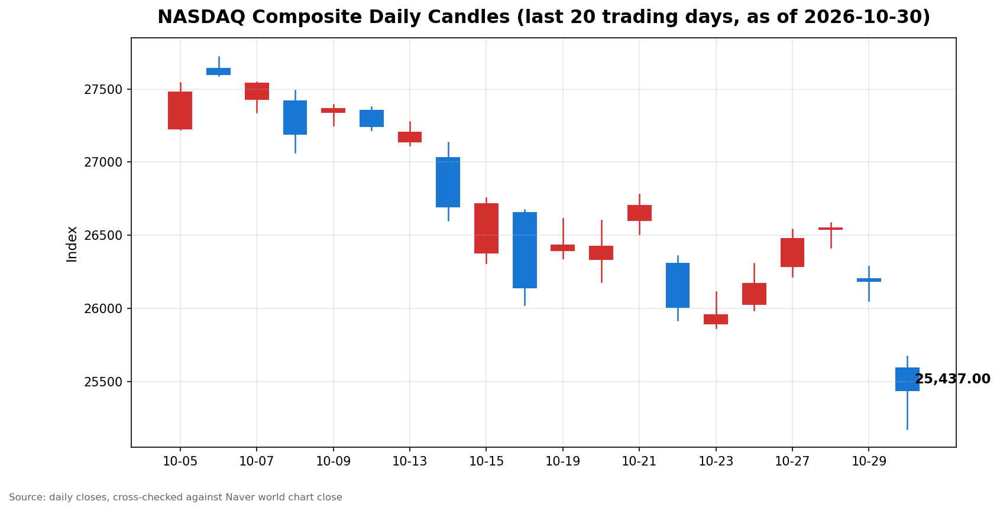

안녕하세요, [한국투자증권](https://securities.koreainvestment.com/main/Main.jsp)에서 [한투-한국투자증권](https://play.google.com/store/apps/details?id=com.truefriend.neosmartarenewal&hl=ko) 개발을 담당하고 있는 way입니다. 
2026년 10월 30일 나스닥 장 마감 흐름을 수치 중심으로 정리합니다. 

## 마감 요약

나스닥 종합은 전일 대비 하락으로 마감했습니다. 
하락률은 2.86%였습니다. 
S&P500도 하락으로 마감했으나 낙폭은 나스닥보다 작았습니다. 
이날 보도에서는 알파벳과 아마존 등 대형 기술주의 인공지능 투자 부담 우려가 거론됐습니다. 
이 글은 교육과 해설 목적으로 작성되었으며 특정 종목의 매수나 매도를 권유하지 않습니다. 

## 오늘의 마감 스냅샷

| 지수 | 종가 | 전일 대비 | 등락률 | 전일 종가 | 당일 고가 | 당일 저가 |
| --- | --- | --- | --- | --- | --- | --- |
| 나스닥 종합 | 25,437.00 | -747.72 | -2.86% | 26,184.72 | 25,657.97 | 25,191.32 |
| S&P500 | 7,580.07 | -140.32 | -1.82% | 7,720.39 | 7,635.77 | 7,529.84 |
| 다우지수 | 확인 필요 | 확인 필요 | 확인 필요 | 확인 필요 | 확인 필요 | 확인 필요 |

스냅샷 기준 시각은 미국 동부시간 2026년 10월 30일 16시 20분, 한국시간 2026년 10월 31일 05시 20분입니다. 
스냅샷 수치는 한투 MTS 해외 대시보드에서 확인한 마감 수치입니다. 
전일 종가는 종가에서 전일 대비 변동폭을 빼는 방식으로 역산했습니다. 
역산한 전일 종가는 전일 마감 글의 종가와 일치합니다. 
당일 고가와 저가는 한투 MTS 차트 배열의 최대값과 최소값으로 산출했습니다. 
네이버 월드 차트 페이지는 직접 조회에서 수치 추출이 되지 않았습니다. 
따라서 본문 스냅샷은 네이버 값이 아니라 한투 MTS 교차값으로 채웠습니다. 
네이버 월드 차트 출처는 [네이버 금융 월드 시세](https://finance.naver.com/world/sise.naver?symbol=NAS@IXIC)와 [네이버 월드 차트](https://stock.naver.com/worldstock/index/.IXIC/price)에서 확인할 수 있습니다. 
확인되지 않은 마감 원인은 본문에 쓰지 않았습니다. 

## 차트

최근 20거래일 일봉 차트입니다. 
빨간 봉은 종가가 시가보다 높은 날, 파란 봉은 종가가 시가보다 낮은 날입니다. 

## 다우와 S&P500 마감 흐름

S&P500은 7,580.07로 마감했습니다. 
전일 대비 변동폭은 -140.32, 등락률은 -1.82%였습니다. 
역산한 S&P500 전일 종가는 7,720.39입니다. 
한투 MTS 차트 배열 기준 S&P500 당일 고가는 7,635.77, 당일 저가는 7,529.84였습니다. 
다우지수는 이번 스냅샷에서 한투 MTS 해외 대시보드 지수 목록에 포함되지 않았습니다. 
다우지수의 마감 수치는 확인 필요로 표기합니다. 
S&P500의 낙폭이 나스닥보다 작았다는 점에서 하락 압력은 나스닥 쪽에 더 집중됐습니다. 

## 다음 거래일 확인할 점

첫째, 나스닥이 당일 저가 25,191.32 부근을 지키는지 확인합니다. 
둘째, 나스닥과 S&P500의 낙폭 차이가 다음 거래일에도 유지되는지 확인합니다. 
셋째, 나스닥이 전일 종가 26,184.72 부근으로 되돌리는지 확인합니다. 
넷째, 다우지수 마감 수치가 확인되는 대로 세 지수의 방향이 일치하는지 확인합니다. 
마감 수치는 방향을 보여줄 뿐이며 다음 거래일의 결과를 보장하지 않습니다. 

## 마치며

2026년 10월 30일 나스닥은 2.86% 하락으로 한 주를 마감했습니다. 
다음 거래일에는 저가 지지 여부와 지수 간 낙폭 차이를 함께 확인하는 것이 도움이 됩니다. 
