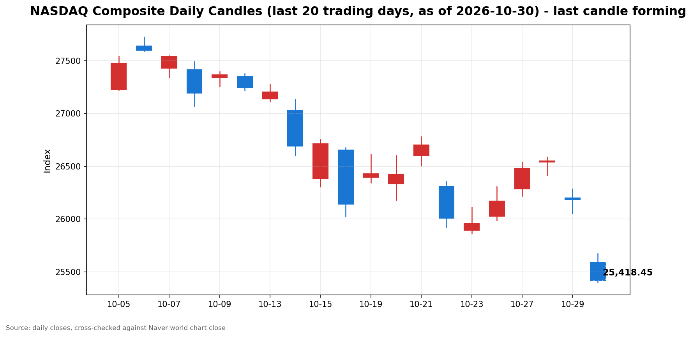

안녕하세요, [한국투자증권](https://securities.koreainvestment.com/main/Main.jsp)에서 [한투-한국투자증권](https://play.google.com/store/apps/details?id=com.truefriend.neosmartarenewal&hl=ko) 개발을 담당하고 있는 way입니다. 
2026년 10월 30일 나스닥 장중 흐름을 수치 중심으로 정리합니다. 

## 장중 요약

나스닥은 장중에도 하락 흐름을 이어가고 있습니다. 
오전 스냅샷보다 낙폭이 커졌으며 시가 대비 방향 전환은 나타나지 않았습니다. 
하락 압력은 나스닥이 S&P500보다 크게 받고 있습니다. 
배경으로는 인공지능 투자 부담에 대한 우려가 장중에도 이어지고 있습니다. 
이 글은 교육과 해설 목적으로 작성되었으며 특정 종목의 매수나 매도를 권유하지 않습니다. 

## 오늘의 스냅샷

| 지수 | 현재가 | 전일 대비 | 등락률 | 전일 종가 | 장중 고가 | 장중 저가 |
| --- | --- | --- | --- | --- | --- | --- |
| 나스닥 종합 | 25,412.36 | -772.36 | -2.95% | 26,184.72 | 25,673.00 | 25,397.52 |

스냅샷 기준 시각은 미국 동부시간 2026년 10월 30일 12시 56분, 한국시간 2026년 10월 31일 01시 56분입니다. 
당일 수치는 장이 진행 중이라 계속 변하는 형성 중인 수치입니다. 
나스닥 수치는 네이버 월드 차트 페이지에서 직접 확인한 값입니다. 
네이버 월드 차트 출처는 [네이버 월드 차트](https://stock.naver.com/worldstock/index/.IXIC/price)와 [네이버 금융 월드 시세](https://finance.naver.com/world/sise.naver?symbol=NAS@IXIC)입니다. 
한투 MTS 해외 대시보드 값으로 역산한 전일 종가도 26,184.72로 네이버 전일 종가와 일치합니다. 
네이버 장중 시가는 25,592.49였습니다. 

## 차트

최근 20거래일 일봉 차트입니다. 
빨간 봉은 종가가 시가보다 높은 날, 파란 봉은 종가가 시가보다 낮은 날입니다. 
당일 봉은 형성 중인 봉으로, 마감 전에는 계속 변합니다. 

차트의 직전 거래일인 2026년 10월 29일 종가는 26,184.72로 네이버 전일 종가와 일치합니다. 
형성 중인 당일 봉의 시가와 장중 고가, 장중 저가도 네이버 장중 값과 일치합니다. 

## 다우와 S&P500 흐름

S&P500은 나스닥보다 낙폭이 작았습니다. 
한투 MTS 기준 S&P500은 7,580.70, 전일 대비 -139.69, 등락률 -1.81%였습니다. 
한투 MTS 값으로 역산한 S&P500 전일 종가는 7,720.39입니다. 
한투 MTS 차트 배열 기준 S&P500 장중 고가는 7,635.77, 장중 저가는 7,579.27이었습니다. 
다우지수는 이번 스냅샷에서 한투 MTS 해외 대시보드 지수 목록에 포함되지 않았습니다. 
다우지수의 장중 수치는 확인 필요로 표기합니다. 
S&P500의 낙폭이 나스닥보다 작았다는 점에서 하락 압력은 기술주 쪽에 더 집중됐습니다. 

## 오전과 오후 흐름 변화

시가 대비 방향 전환은 나타나지 않았습니다. 
나스닥 현재가는 시가 25,592.49보다 180.13 낮습니다. 
오전 스냅샷인 미국 동부시간 10시 02분 기준 25,643.49보다도 231.13 낮아졌습니다. 
전일 대비 등락률도 오전 -2.07%에서 장중 -2.95%로 낙폭이 확대됐습니다. 
장중 고가는 시가보다 높았으나 현재가는 고가 부근을 지키지 못했습니다. 
오전 하락이 오후 들어 되돌려지지 않고 이어진 흐름입니다. 

## 마감까지 확인할 점

첫째, 나스닥이 장중 저가 25,397.52 부근을 지키는지 확인합니다. 
둘째, 전일 대비 낙폭이 마감까지 축소되는지 확대되는지 확인합니다. 
셋째, S&P500과 나스닥의 낙폭 차이가 마감까지 좁혀지는지 확인합니다. 
넷째, 인공지능 투자 부담에 대한 평가가 장 후반에도 이어지는지 확인합니다. 
장중 수치는 방향을 보여줄 뿐이며 확정된 결과가 아닙니다. 

## 마치며

나스닥은 인공지능 투자 부담에 대한 우려 속에 장중에도 하락 흐름을 이어가고 있습니다. 
이 글은 매수나 매도 권유가 아니며 장중 흐름을 수치로 확인하는 데 목적이 있습니다. 
