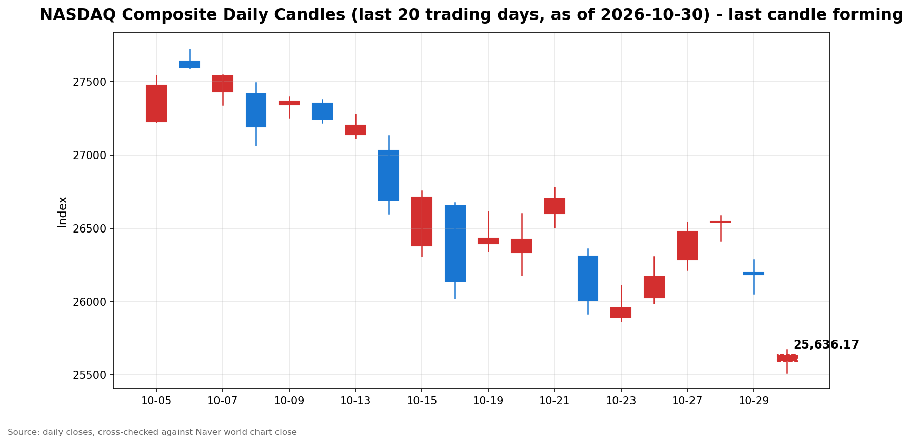

안녕하세요, [한국투자증권](https://securities.koreainvestment.com/main/Main.jsp)에서 [한투-한국투자증권](https://play.google.com/store/apps/details?id=com.truefriend.neosmartarenewal&hl=ko) 개발을 담당하고 있는 way입니다. 
2026년 10월 30일 나스닥 장 오픈 흐름을 수치 중심으로 정리합니다. 

## 개장 배경

나스닥은 하락 출발했습니다. 
개장 전 재료로는 인공지능 투자 부담에 대한 우려가 가장 컸습니다. 
알파벳은 3분기 자본지출이 전년 대비 114% 급증했다는 보도와 함께 실적 쇼크로 주가가 13% 급락했다는 보도가 나왔습니다. 
아마존은 2,200억 달러 규모 인공지능 인프라 투자 계획을 유지하면서 현금흐름 악화 우려가 제기됐습니다. 
인텔은 실적전망 악화가 함께 전해졌습니다. 
인공지능 투자 회의론이 다시 부각되면서 기술주 중심의 나스닥 초반 흐름을 압박했습니다. 
이 글은 교육과 해설 목적으로 작성되었으며 특정 종목의 매수나 매도를 권유하지 않습니다. 

## 오늘의 스냅샷

| 지수 | 현재가 | 전일 대비 | 등락률 | 전일 종가 | 장중 고가 | 장중 저가 |
| --- | --- | --- | --- | --- | --- | --- |
| 나스닥 종합 | 25,643.49 | -541.23 | -2.07% | 26,184.72 | 25,657.97 | 25,537.64 |

스냅샷 기준 시각은 미국 동부시간 2026년 10월 30일 10시 02분, 한국시간 2026년 10월 30일 23시 02분입니다. 
당일 수치는 장이 진행 중이라 계속 변하는 형성 중인 수치입니다. 
네이버 월드 차트 페이지는 직접 조회에서 가격 데이터를 담은 본문이 반환되지 않았습니다. 
이에 따라 스냅샷 수치는 한투 MTS 해외 대시보드 값으로 채웠으며 네이버 값인 것처럼 표기하지 않습니다. 
네이버 월드 차트 출처는 [네이버 월드 차트](https://stock.naver.com/worldstock/index/.IXIC/price)와 [네이버 금융 월드 시세](https://finance.naver.com/world/sise.naver?symbol=NAS@IXIC)입니다. 
한투 MTS 값으로 역산한 전일 종가는 26,184.72로 일봉 기준 2026년 10월 29일 종가와 일치합니다. 
한투 MTS 차트 배열 기준 장중 고가는 25,657.97, 장중 저가는 25,537.64였습니다. 

## 차트

최근 20거래일 일봉 차트입니다. 
빨간 봉은 종가가 시가보다 높은 날, 파란 봉은 종가가 시가보다 낮은 날입니다. 
당일 봉은 형성 중인 봉으로, 마감 전에는 계속 변합니다. 

## 다우와 S&P500 흐름

S&P500은 나스닥보다 낙폭이 작았습니다. 
한투 MTS 기준 S&P500은 7,628.20, 전일 대비 -92.19, 등락률 -1.19%였습니다. 
한투 MTS 값으로 역산한 S&P500 전일 종가는 7,720.39입니다. 
한투 MTS 차트 배열 기준 S&P500 장중 고가는 7,635.77, 장중 저가는 7,622.27이었습니다. 
다우지수는 이번 스냅샷에서 한투 MTS 해외 대시보드 지수 목록에 포함되지 않았습니다. 
다우지수의 장 오픈 수치는 확인 필요로 표기합니다. 
S&P500의 낙폭이 나스닥보다 작았다는 점에서 하락 압력은 기술주 쪽에 더 집중됐습니다. 

## 장 초반 확인할 점

첫째, 알파벳과 아마존, 인텔 관련 인공지능 투자 부담 평가가 장중에 이어지는지 확인합니다. 
둘째, 나스닥이 장중 저가 25,537.64 부근을 지키는지 확인합니다. 
셋째, S&P500과 나스닥의 낙폭 차이가 장중에 좁혀지는지 확인합니다. 
넷째, 장 마감 때까지 고가와 저가의 범위가 어떻게 변하는지 확인합니다. 
장 초반 수치는 방향을 보여줄 뿐이며 확정된 결과가 아닙니다. 

## 마치며

나스닥은 인공지능 투자 부담에 대한 우려 속에 하락 출발했습니다. 
이 글은 매수나 매도 권유가 아니며 장중 흐름을 수치로 확인하는 데 목적이 있습니다. 
