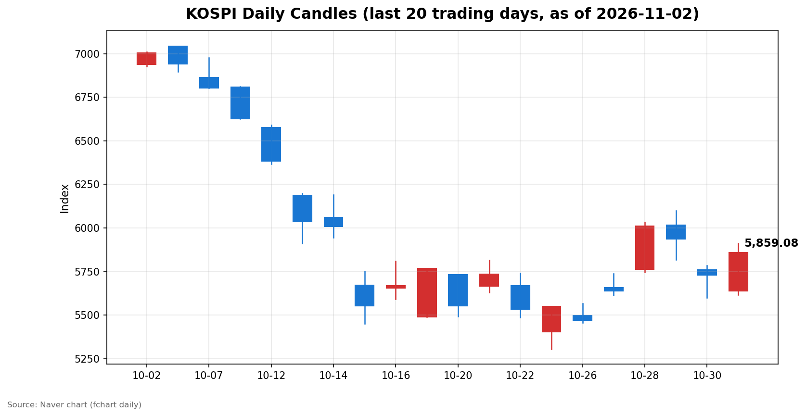
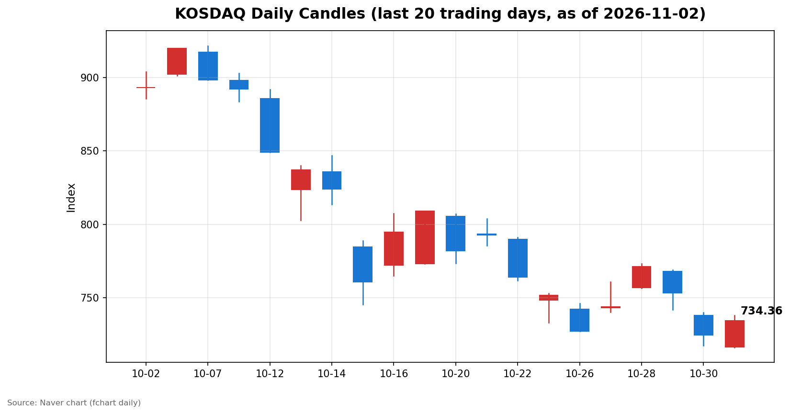

안녕하세요, [한국투자증권](https://securities.koreainvestment.com/main/Main.jsp)에서 [한투-한국투자증권](https://play.google.com/store/apps/details?id=com.truefriend.neosmartarenewal&hl=ko) 개발을 담당하고 있는 way입니다. 
2026년 11월 2일 국내 증시 장 마감 흐름을 수치 중심으로 정리합니다. 

## 마감 요약

코스피와 코스닥이 모두 상승 마감했습니다. 
코스피는 전일 대비 2.24% 상승한 5,859.08에 마감했습니다. 
코스닥은 전일 대비 1.38% 상승한 734.36에 마감했습니다. 
두 지수 모두 시가에서는 전일 종가를 밑돌았으나 장중 상승 전환해 양봉으로 마감했습니다. 
코스피는 장중 5,910.83까지 올랐다가 5,859.08로 마감했습니다. 
코스닥은 장중 738.01까지 올랐다가 734.36으로 마감했습니다. 
지난주 말 이틀 연속 하락 이후 반등하는 흐름이었습니다. 

## 오늘의 마감 스냅샷

| 지수 | 종가 | 전일 대비 | 등락률 | 시가 | 고가 | 저가 | 거래량 | 거래대금 |
| --- | --- | --- | --- | --- | --- | --- | --- | --- |
| 코스피 | 5,859.08 | +128.34 | +2.24% | 5,637.77 | 5,910.83 | 5,616.50 | 186,383천주 | 14조 8,702억원 |
| 코스닥 | 734.36 | +9.98 | +1.38% | 716.44 | 738.01 | 716.21 | 332,464천주 | 4조 8,000억원 |

전일 종가는 네이버 실시간 수치와 일봉 종가를 교차 확인했습니다. 
코스피 전일 종가는 5,730.74, 코스닥 전일 종가는 724.38입니다. 
지수 차트는 [코스피](https://finance.naver.com/sise/sise_index.naver?code=KOSPI)와 [코스닥](https://finance.naver.com/sise/sise_index.naver?code=KOSDAQ)에서 확인할 수 있습니다. 

## 차트

최근 20거래일 일봉 차트입니다. 
빨간 봉은 종가가 시가보다 높은 날, 파란 봉은 종가가 시가보다 낮은 날입니다. 

## 최근 5거래일 일봉

### 코스피

| 날짜 | 시가 | 고가 | 저가 | 종가 | 거래량(천주) |
| --- | --- | --- | --- | --- | --- |
| 2026-10-27 | 5,658.65 | 5,737.61 | 5,612.92 | 5,638.34 | 196,172 |
| 2026-10-28 | 5,763.85 | 6,032.28 | 5,745.51 | 6,012.44 | 237,337 |
| 2026-10-29 | 6,017.22 | 6,100.11 | 5,817.92 | 5,937.66 | 296,495 |
| 2026-10-30 | 5,760.35 | 5,784.98 | 5,599.42 | 5,730.74 | 228,294 |
| 2026-11-02 | 5,637.77 | 5,910.83 | 5,616.50 | 5,859.08 | 186,383 |

### 코스닥

| 날짜 | 시가 | 고가 | 저가 | 종가 | 거래량(천주) |
| --- | --- | --- | --- | --- | --- |
| 2026-10-27 | 743.09 | 760.59 | 740.17 | 743.83 | 539,957 |
| 2026-10-28 | 756.90 | 773.28 | 756.57 | 771.28 | 560,627 |
| 2026-10-29 | 767.78 | 768.75 | 741.96 | 753.23 | 494,052 |
| 2026-10-30 | 737.76 | 739.79 | 717.27 | 724.38 | 470,174 |
| 2026-11-02 | 716.44 | 738.01 | 716.21 | 734.36 | 332,464 |

코스피는 10월 30일 5,730.74까지 내려갔다가 오늘 5,859.08로 반등했습니다. 
코스닥은 10월 30일 724.38까지 내려갔다가 오늘 734.36으로 반등했습니다. 

## 당일 수급

### 코스피

| 주체 | 순매수(억원) |
| --- | --- |
| 개인 | -13,466 |
| 외국인 | -3,743 |
| 기관 | +12,331 |
| 기타법인 | +4,878 |

### 코스닥

| 주체 | 순매수(억원) |
| --- | --- |
| 개인 | -261 |
| 외국인 | -322 |
| 기관 | +623 |
| 기타법인 | -40 |

코스피에서는 기관과 기타법인이 순매수했고 개인과 외국인이 순매도했습니다. 
코스닥에서는 기관이 순매수했고 개인과 외국인이 순매도했습니다. 
수급 수치는 네이버 시장 수급 자료를 기준으로 했습니다. 

## 강했던 테마와 흐름

한국투자증권 MTS 기준 당일 강세 테마는 전력기기, 조선, 조선기자재였습니다. 
전력기기 테마는 7.91% 상승했고, 조선 테마는 5.62% 상승했으며, 조선기자재 테마는 4.98% 상승했습니다. 
관심이 컸던 대외 변수로는 미국 기술주 조정 우려와 미국 중간선거, 주요 경제지표 발표가 언급됐습니다. 
지수 상승에도 외국인이 순매도를 이어간 점은 수급 측면에서 확인되는 흐름입니다. 

## 내일 확인할 점

미국 중간선거 결과와 미국 고용지표 발표 일정이 남아 있습니다. 
외국인 순매도가 이어질지, 기관 순매수가 유지될지 확인이 필요합니다. 
코스피가 5,900선 안팎에서 어떤 흐름을 보일지 확인이 필요합니다. 
미국 기술주 조정 우려가 국내 대형주에 미치는 영향도 함께 확인이 필요합니다. 

## 마치며

오늘 국내 증시는 지난주 말 하락을 일부 되돌리며 상승 마감했습니다. 
이 글은 교육과 해설을 위한 수치 정리이며, 매수나 매도를 권유하는 내용이 아닙니다. 
