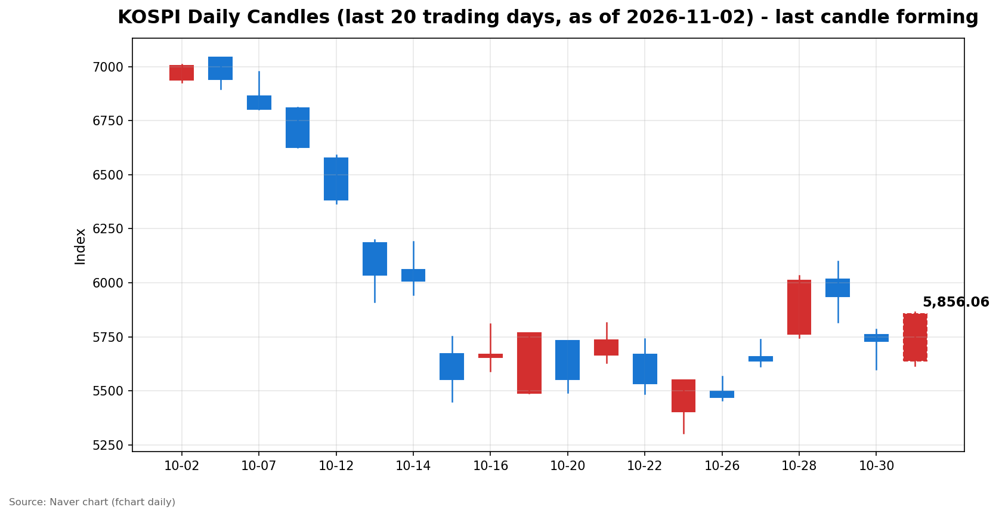
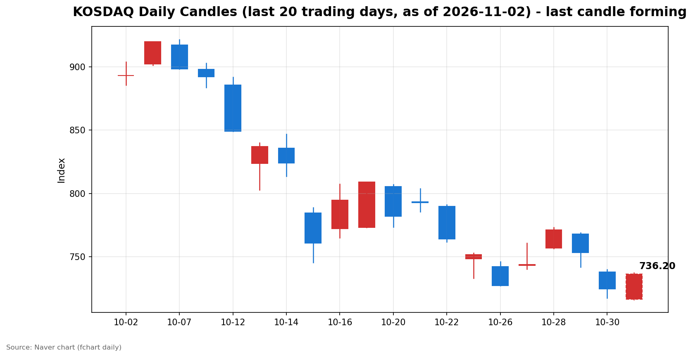

안녕하세요, [한국투자증권](https://securities.koreainvestment.com/main/Main.jsp)에서 [한투-한국투자증권](https://play.google.com/store/apps/details?id=com.truefriend.neosmartarenewal&hl=ko) 개발을 담당하고 있는 way입니다. 
2026년 11월 2일 국내 증시 장중 흐름을 수치 중심으로 정리합니다. 

## 오전장 요약

지난 주말 미국 증시에서는 인텔 주가 급락과 신용 우려가 언급됐습니다. 
관련 보도에서는 인텔 주가가 29% 하락하고 필라델피아 반도체지수가 7.20% 하락했다고 전했습니다. 
이러한 배경 속에서 코스피는 1.62% 하락한 5,637선에서 출발했습니다. 
그러나 장 초반 회복세를 보이며 오전 9시 36분께 상승 전환했다고 관련 보도는 전했습니다. 
정오 무렵에는 두 지수 모두 전일 대비 상승폭을 키우고 있습니다. 

## 오늘의 스냅샷

| 지수 | 현재가 | 전일 대비 | 등락률 | 시가 | 고가 | 저가 | 거래량 | 거래대금 | 스냅샷 기준 시각 |
| --- | --- | --- | --- | --- | --- | --- | --- | --- | --- |
| 코스피 | 5,857.57 | +126.83 | +2.21% | 5,637.77 | 5,863.88 | 5,616.50 | 117,103천주 | 8조 5,146억원 | 2026-11-02 12:28 KST |
| 코스닥 | 735.87 | +11.49 | +1.59% | 716.44 | 737.34 | 716.21 | 217,840천주 | 3조 1,164억원 | 2026-11-02 12:28 KST |

당일 봉은 형성 중인 봉이며 종가는 확정값이 아닙니다. 
코스피는 시가 5,637.77에서 출발해 스냅샷 시점 5,857.57을 기록했습니다. 
코스닥은 시가 716.44에서 출발해 스냅샷 시점 735.87을 기록했습니다. 
전일 종가는 네이버 실시간 수치와 일봉 종가를 교차 확인했습니다. 
코스피 전일 종가는 5,730.74, 코스닥 전일 종가는 724.38입니다. 
지수 차트는 [코스피](https://finance.naver.com/sise/sise_index.naver?code=KOSPI)와 [코스닥](https://finance.naver.com/sise/sise_index.naver?code=KOSDAQ)에서 확인할 수 있습니다. 

## 차트

최근 20거래일 일봉 차트입니다. 
빨간 봉은 종가가 시가보다 높은 날, 파란 봉은 종가가 시가보다 낮은 날입니다. 
당일 봉은 형성 중인 봉으로, 마감 전에는 계속 변합니다. 

## 최근 5거래일 일봉

### 코스피

| 날짜 | 시가 | 고가 | 저가 | 종가 | 거래량(천주) |
| --- | --- | --- | --- | --- | --- |
| 2026-10-26 | 5,499.05 | 5,565.67 | 5,455.11 | 5,469.47 | 202,295 |
| 2026-10-27 | 5,658.65 | 5,737.61 | 5,612.92 | 5,638.34 | 196,172 |
| 2026-10-28 | 5,763.85 | 6,032.28 | 5,745.51 | 6,012.44 | 237,337 |
| 2026-10-29 | 6,017.22 | 6,100.11 | 5,817.92 | 5,937.66 | 296,495 |
| 2026-10-30 | 5,760.35 | 5,784.98 | 5,599.42 | 5,730.74 | 228,294 |
| 2026-11-02 | 5,637.77 | 5,863.88 | 5,616.50 | 5,856.06 | 116,665 |

### 코스닥

| 날짜 | 시가 | 고가 | 저가 | 종가 | 거래량(천주) |
| --- | --- | --- | --- | --- | --- |
| 2026-10-26 | 742.17 | 745.95 | 727.20 | 727.21 | 476,231 |
| 2026-10-27 | 743.09 | 760.59 | 740.17 | 743.83 | 539,957 |
| 2026-10-28 | 756.90 | 773.28 | 756.57 | 771.28 | 560,627 |
| 2026-10-29 | 767.78 | 768.75 | 741.96 | 753.23 | 494,052 |
| 2026-10-30 | 737.76 | 739.79 | 717.27 | 724.38 | 470,174 |
| 2026-11-02 | 716.44 | 737.34 | 716.21 | 736.20 | 217,096 |

2026년 11월 2일 봉은 장중 형성 중인 봉이며 종가는 확정값이 아닙니다. 
일봉 표의 당일 종가는 표 작성 시점의 형성 중 수치이며 실시간 현재가와 시차가 있을 수 있습니다. 
코스피는 전일 5,730.74에서 하락 출발해 5,850선 부근에서 움직이고 있습니다. 
코스닥은 전일 724.38에서 하락 출발해 735선 부근에서 움직이고 있습니다. 

## 오전 강했던 테마와 흐름 변화

한국투자증권 MTS 기준 오전 강했던 테마는 다음과 같습니다. 
전력기기 테마가 7.21% 상승했고, 관이음쇠 테마가 6.98% 상승했습니다. 
조선 테마가 6.07%, 조선기자재 테마가 5.57% 상승했습니다. 
두 지수 모두 시가 대비 방향 전환이 확인됩니다. 
코스피는 시가 5,637.77보다 스냅샷 시점 5,857.57이 높습니다. 
코스닥은 시가 716.44보다 스냅샷 시점 735.87이 높습니다. 
당일 장중 수급 확정치는 아직 집계되지 않아 확인이 필요합니다. 

## 오후에 확인할 점

코스피가 5,850선 부근의 상승폭을 유지하는지 확인할 필요가 있습니다. 
코스닥이 735선 부근을 지키는지 확인할 필요가 있습니다. 
오전 강했던 테마의 상승세가 오후에도 이어지는지 확인할 필요가 있습니다. 
장 마감 무렵 수급 확정치가 어떻게 집계되는지 확인할 필요가 있습니다. 

## 마치며

이날 국내 증시는 하락 출발 뒤 상승 전환해 정오 무렵 두 지수 모두 전일 대비 상승하고 있습니다. 
이 글은 교육·해설 목적의 시장 정리이며, 매수·매도 권유가 아닙니다. 
