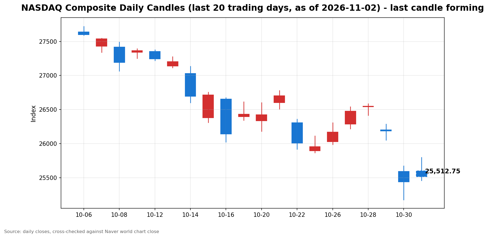

안녕하세요, [한국투자증권](https://securities.koreainvestment.com/main/Main.jsp)에서 [한투-한국투자증권](https://play.google.com/store/apps/details?id=com.truefriend.neosmartarenewal&hl=ko) 개발을 담당하고 있는 way입니다. 
2026년 11월 2일 나스닥 장중 흐름을 수치 중심으로 정리합니다. 

## 장중 요약

나스닥은 장중에도 전일 대비 상승 흐름을 유지하고 있습니다. 
다만 오전보다 상승 폭이 줄었고 현재가는 시가를 밑돌고 있습니다. 
오전 상승이 장중 들어 되돌려진 흐름입니다. 
S&P500도 나스닥과 비슷한 폭으로 상승하고 있습니다. 
이 글은 교육과 해설 목적으로 작성되었으며 특정 종목의 매수나 매도를 권유하지 않습니다. 

## 오늘의 스냅샷

| 지수 | 현재가 | 전일 대비 | 등락률 | 전일 종가 | 장중 고가 | 장중 저가 |
| --- | --- | --- | --- | --- | --- | --- |
| 나스닥 종합 | 25,513.85 | +76.85 | +0.30% | 25,437.00 | 25,799.46 | 25,456.59 |

스냅샷 기준 시각은 미국 동부시간 2026년 11월 2일 12시 56분, 한국시간 2026년 11월 3일 02시 56분입니다. 
당일 수치는 장이 진행 중이라 계속 변하는 형성 중인 수치입니다. 
나스닥 수치는 네이버 월드 차트 페이지에서 직접 확인한 값입니다. 
네이버 월드 차트 출처는 [네이버 월드 차트](https://stock.naver.com/worldstock/index/.IXIC/price)와 [네이버 금융 월드 시세](https://finance.naver.com/world/sise.naver?symbol=NAS@IXIC)입니다. 
한투 MTS 해외 대시보드 값으로 역산한 전일 종가도 25,437.00으로 네이버 전일 종가와 일치합니다. 
네이버 장중 시가는 25,600.17이었습니다. 

## 차트

최근 20거래일 일봉 차트입니다. 
빨간 봉은 종가가 시가보다 높은 날, 파란 봉은 종가가 시가보다 낮은 날입니다. 
당일 봉은 형성 중인 봉으로, 마감 전에는 계속 변합니다. 

차트의 직전 거래일인 2026년 10월 30일 종가는 25,437.00으로 네이버 전일 종가와 일치합니다. 
형성 중인 당일 봉의 시가와 장중 고가, 장중 저가도 네이버 장중 값과 일치합니다. 

## 다우와 S&P500 흐름

S&P500도 나스닥과 함께 상승하고 있습니다. 
한투 MTS 기준 S&P500은 7,602.85, 전일 대비 +22.78, 등락률 +0.30%였습니다. 
한투 MTS 값으로 역산한 S&P500 전일 종가는 7,580.07입니다. 
한투 MTS 차트 배열 기준 S&P500 장중 고가는 7,659.78, 장중 저가는 7,599.59였습니다. 
다우지수는 이번 스냅샷에서 한투 MTS 해외 대시보드 지수 목록에 포함되지 않았습니다. 
다우지수의 장중 수치는 확인 필요로 표기합니다. 
S&P500의 상승률이 나스닥과 같은 수준이라는 점에서 장중 상승은 기술주에만 국한되지 않았습니다. 

## 오전과 오후 흐름 변화

시가 대비 방향 전환이 나타났습니다. 
나스닥 현재가는 시가 25,600.17보다 86.32 낮습니다. 
오전 스냅샷인 미국 동부시간 10시 00분 기준 25,636.91보다도 123.06 낮아졌습니다. 
전일 대비 등락률도 오전 +0.79%에서 장중 +0.30%로 상승 폭이 축소됐습니다. 
장중 고가는 25,799.46까지 올랐으나 현재가는 고가 부근을 지키지 못했습니다. 
오전 상승이 오후 들어 되돌려진 흐름입니다. 

## 마감까지 확인할 점

첫째, 나스닥이 전일 종가 25,437.00 위를 지키는지 확인합니다. 
둘째, 나스닥이 시가 25,600.17을 다시 회복하는지 확인합니다. 
셋째, 전일 대비 상승 폭이 마감까지 확대되는지 축소되는지 확인합니다. 
넷째, S&P500과 나스닥의 상승률 차이가 마감까지 벌어지는지 확인합니다. 
장중 수치는 방향을 보여줄 뿐이며 확정된 결과가 아닙니다. 

## 마치며

나스닥은 오전 상승 폭을 일부 되돌렸으나 전일 대비 상승 흐름은 장중에도 유지되고 있습니다. 
이 글은 매수나 매도 권유가 아니며 장중 흐름을 수치로 확인하는 데 목적이 있습니다. 
