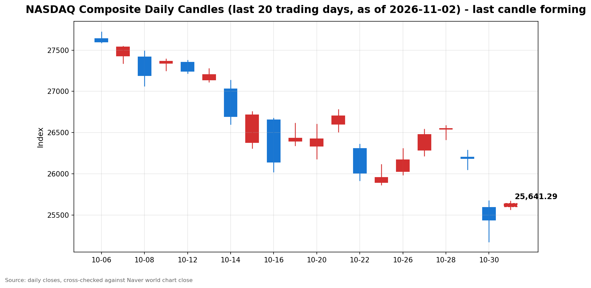

안녕하세요, [한국투자증권](https://securities.koreainvestment.com/main/Main.jsp)에서 [한투-한국투자증권](https://play.google.com/store/apps/details?id=com.truefriend.neosmartarenewal&hl=ko) 개발을 담당하고 있는 way입니다. 
2026년 11월 2일 나스닥 장 오픈 흐름을 수치 중심으로 정리합니다. 

## 개장 배경

나스닥은 상승 출발했습니다. 
전 거래일인 2026년 10월 30일 종가는 25,437.00으로, 2026년 10월 29일 종가 26,184.72보다 747.72 낮았습니다. 
전 거래일 등락률은 -2.86%였습니다. 
개장 전에는 인공지능 투자 관련 보도가 이어졌습니다. 
앤트로픽이 미국 기업공개 과정에서 일본에서 최대 35억 달러를 조달하기로 했다는 보도가 전해졌습니다. 
인공지능 설비투자 확대로 빅테크의 잉여현금흐름이 악화할 수 있다는 전망 보도도 전해졌습니다. 
데이터센터 규제와 중간선거 관련 보도도 개장 전 재료로 함께 전해졌습니다. 
주가 하락이나 기업 부도에 대비한 풋옵션과 신용부도스왑 수요가 늘고 있다는 보도도 전해졌습니다. 
이 글은 교육과 해설 목적으로 작성되었으며 특정 종목의 매수나 매도를 권유하지 않습니다. 

## 오늘의 스냅샷

| 지수 | 현재가 | 전일 대비 | 등락률 | 전일 종가 | 장중 고가 | 장중 저가 |
| --- | --- | --- | --- | --- | --- | --- |
| 나스닥 종합 | 25,636.91 | +199.92 | +0.79% | 25,437.00 | 25,668.77 | 25,567.38 |

스냅샷 기준 시각은 미국 동부시간 2026년 11월 2일 10시 00분, 한국시간 2026년 11월 3일 00시 00분입니다. 
당일 수치는 장이 진행 중이라 계속 변하는 형성 중인 수치입니다. 
네이버 월드 차트 페이지에서 확인한 수치이며, 한투 MTS 해외 대시보드 값으로 역산한 전일 종가 25,437.00과 일치합니다. 
네이버 월드 차트 출처는 [네이버 월드 차트](https://stock.naver.com/worldstock/index/.IXIC/price)와 [네이버 금융 월드 시세](https://finance.naver.com/world/sise.naver?symbol=NAS@IXIC)입니다. 
당일 시가는 네이버 월드 차트 기준 25,600.17이었습니다. 

## 차트

최근 20거래일 일봉 차트입니다. 
빨간 봉은 종가가 시가보다 높은 날, 파란 봉은 종가가 시가보다 낮은 날입니다. 
당일 봉은 형성 중인 봉으로, 마감 전에는 계속 변합니다. 

## 다우와 S&P500 흐름

S&P500도 나스닥과 함께 상승했습니다. 
한투 MTS 기준 S&P500은 7,627.86, 전일 대비 +47.79, 등락률 +0.63%였습니다. 
한투 MTS 값으로 역산한 S&P500 전일 종가는 7,580.07입니다. 
한투 MTS 차트 배열 기준 S&P500 장중 고가는 7,627.86, 장중 저가는 7,616.50이었습니다. 
다우지수는 이번 스냅샷에서 한투 MTS 해외 대시보드 지수 목록에 포함되지 않았습니다. 
다우지수의 장 오픈 수치는 확인 필요로 표기합니다. 
S&P500의 상승률이 나스닥보다 작았다는 점에서 초반 반등은 기술주 쪽에서 상대적으로 강했습니다. 

## 장 초반 확인할 점

첫째, 인공지능 투자 관련 보도 평가가 장중에 이어지는지 확인합니다. 
둘째, 나스닥이 장중 고가 25,668.77 부근을 지키는지 확인합니다. 
셋째, 나스닥이 장중 저가 25,567.38 부근을 지키는지 확인합니다. 
넷째, S&P500과 나스닥의 상승률 차이가 장중에 좁혀지는지 확인합니다. 
장 초반 수치는 방향을 보여줄 뿐이며 확정된 결과가 아닙니다. 

## 마치며

나스닥은 전 거래일 하락 뒤 상승 출발했습니다. 
이 글은 매수나 매도 권유가 아니며 장중 흐름을 수치로 확인하는 데 목적이 있습니다. 
