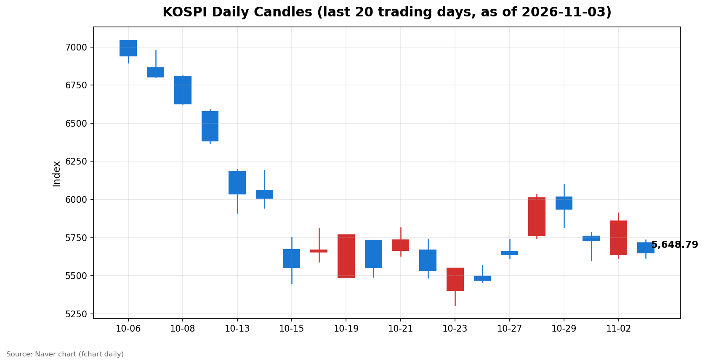
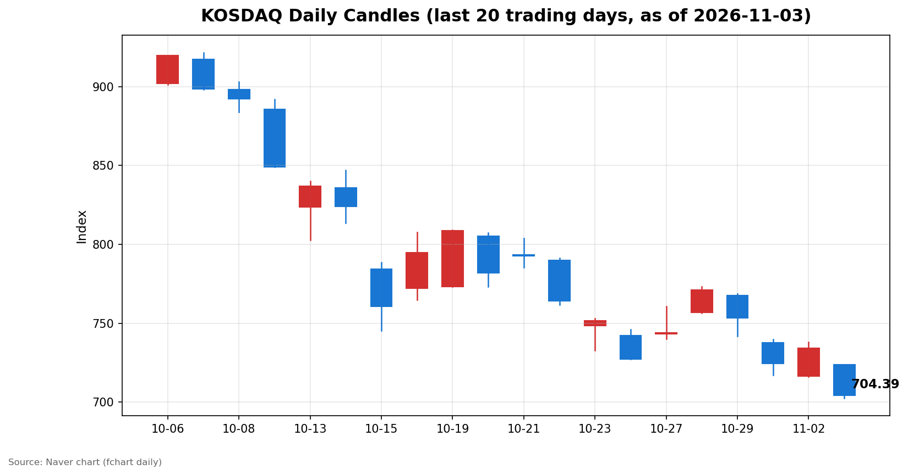

안녕하세요, [한국투자증권](https://securities.koreainvestment.com/main/Main.jsp)에서 [한투-한국투자증권](https://play.google.com/store/apps/details?id=com.truefriend.neosmartarenewal&hl=ko) 개발을 담당하고 있는 way입니다. 
2026년 11월 3일 국내 증시 장 마감 흐름을 수치 중심으로 정리합니다. 

## 마감 요약

코스피와 코스닥이 모두 크게 하락 마감했습니다. 
코스피는 전일 대비 3.59% 하락한 5,648.79에 마감했습니다. 
코스닥은 전일 대비 4.08% 하락한 704.39에 마감했습니다. 
두 지수 모두 시가부터 전일 종가를 밑돌았고, 장중 반등 없이 약세로 마감했습니다. 
코스피는 장중 5,735.92까지 올랐다가 5,615.80까지 내려간 뒤 5,648.79로 마감했습니다. 
코스닥은 시가가 곧 장중 고가였고, 702.34까지 내려간 뒤 704.39로 마감했습니다. 
전일 반등 흐름이 하루 만에 되돌려진 셈입니다. 

## 오늘의 마감 스냅샷

| 지수 | 종가 | 전일 대비 | 등락률 | 시가 | 고가 | 저가 | 거래량 | 거래대금 |
| --- | --- | --- | --- | --- | --- | --- | --- | --- |
| 코스피 | 5,648.79 | -210.29 | -3.59% | 5,715.19 | 5,735.92 | 5,615.80 | 192,393천주 | 14조 894억원 |
| 코스닥 | 704.39 | -29.97 | -4.08% | 723.92 | 723.92 | 702.34 | 404,464천주 | 5조 3,307억원 |

전일 종가는 네이버 실시간 수치와 일봉 종가를 교차 확인했습니다. 
코스피 전일 종가는 5,859.08, 코스닥 전일 종가는 734.36입니다. 
지수 차트는 [코스피](https://finance.naver.com/sise/sise_index.naver?code=KOSPI)와 [코스닥](https://finance.naver.com/sise/sise_index.naver?code=KOSDAQ)에서 확인할 수 있습니다. 

## 차트

최근 20거래일 일봉 차트입니다. 
빨간 봉은 종가가 시가보다 높은 날, 파란 봉은 종가가 시가보다 낮은 날입니다. 

## 최근 5거래일 일봉

### 코스피

| 날짜 | 시가 | 고가 | 저가 | 종가 | 거래량(천주) |
| --- | --- | --- | --- | --- | --- |
| 2026-10-28 | 5,763.85 | 6,032.28 | 5,745.51 | 6,012.44 | 237,337 |
| 2026-10-29 | 6,017.22 | 6,100.11 | 5,817.92 | 5,937.66 | 296,495 |
| 2026-10-30 | 5,760.35 | 5,784.98 | 5,599.42 | 5,730.74 | 228,294 |
| 2026-11-02 | 5,637.77 | 5,910.83 | 5,616.50 | 5,859.08 | 198,130 |
| 2026-11-03 | 5,715.19 | 5,735.92 | 5,615.80 | 5,648.79 | 192,393 |

### 코스닥

| 날짜 | 시가 | 고가 | 저가 | 종가 | 거래량(천주) |
| --- | --- | --- | --- | --- | --- |
| 2026-10-28 | 756.90 | 773.28 | 756.57 | 771.28 | 560,627 |
| 2026-10-29 | 767.78 | 768.75 | 741.96 | 753.23 | 494,052 |
| 2026-10-30 | 737.76 | 739.79 | 717.27 | 724.38 | 470,174 |
| 2026-11-02 | 716.44 | 738.01 | 716.21 | 734.36 | 355,750 |
| 2026-11-03 | 723.92 | 723.92 | 702.34 | 704.39 | 404,464 |

코스피는 10월 30일 5,730.74까지 내려갔다가 11월 2일 5,859.08로 반등했으나, 오늘 5,648.79로 다시 내려갔습니다. 
코스닥은 10월 30일 724.38에서 11월 2일 734.36으로 반등했으나, 오늘 704.39로 최근 5거래일 중 가장 낮게 마감했습니다. 

## 당일 수급

### 코스피

| 주체 | 순매수(억원) |
| --- | --- |
| 개인 | +16,606 |
| 외국인 | -15,151 |
| 기관 | -5,113 |
| 기타법인 | +3,657 |

### 코스닥

| 주체 | 순매수(억원) |
| --- | --- |
| 개인 | +3,197 |
| 외국인 | -747 |
| 기관 | -2,345 |
| 기타법인 | -105 |

코스피에서는 외국인과 기관이 함께 순매도했고, 개인이 이를 받아냈습니다. 
코스닥에서도 외국인과 기관이 순매도했고, 개인이 순매수했습니다. 
수급 수치는 네이버 투자자별 매매동향 당일 항목 기준이며, 최종 집계 과정에서 일부 조정될 수 있습니다. 

## 강했던 테마와 흐름

시장 전체가 하락한 가운데에서도 일부 테마는 상승했습니다. 
주류판매 테마는 5.27% 올랐고, 항공 테마는 3.56% 올랐습니다. 
전자상거래 테마는 3.25%, 재택근무 테마는 2.80%, 스포츠행사 수혜 테마는 2.74% 올랐습니다. 
개별 종목으로는 한진칼이 29.97%, AP위성이 29.98% 오르며 상한가에 근접했습니다. 
반면 시장 요약에서는 반도체와 전력기기가 실적 우려 속에 약세를 보인 것으로 정리됐습니다. 
지수 하락 속에서도 종목별 흐름이 크게 갈린 하루였습니다. 

## 내일 확인할 점

외국인과 기관의 순매도 흐름이 이어지는지 확인할 필요가 있습니다. 
코스피 5,615.80, 코스닥 702.34로 기록된 오늘 저점을 다음 거래일에 지켜내는지도 확인할 점입니다. 
미국 시장 흐름과 반도체 관련 소식이 다음 거래일 출발에 어떤 영향을 주는지도 함께 살펴볼 필요가 있습니다. 

## 마치며

오늘은 두 지수가 모두 3% 넘게 하락하며 전일 반등을 되돌린 하루였습니다. 
이 글은 수치와 흐름을 정리한 교육·해설 목적의 기록이며, 특정 종목의 매수나 매도를 권유하는 내용이 아닙니다. 
