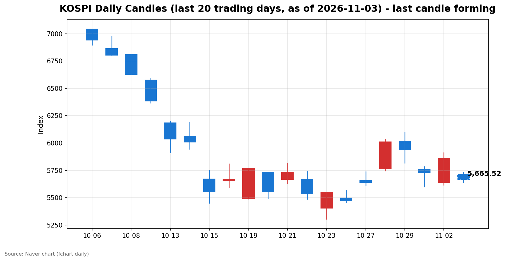
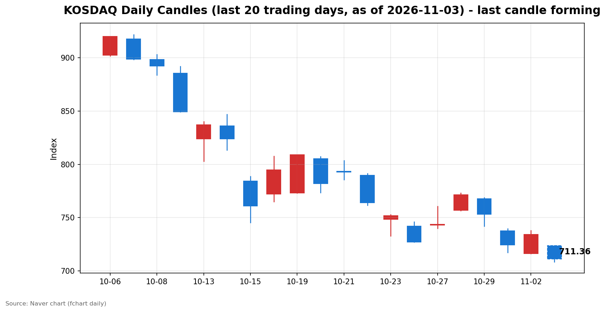

안녕하세요, [한국투자증권](https://securities.koreainvestment.com/main/Main.jsp)에서 [한투-한국투자증권](https://play.google.com/store/apps/details?id=com.truefriend.neosmartarenewal&hl=ko) 개발을 담당하고 있는 way입니다. 
2026년 11월 3일 국내 증시 장중 흐름을 수치 중심으로 정리합니다. 

## 오전장 요약

코스피는 전일 종가 5,859.08에서 5,715.19로 하락 출발했습니다. 
코스닥은 전일 종가 734.36에서 723.92로 하락 출발했습니다. 
장 초반 반등보다는 하락 흐름이 이어졌고, 정오 무렵 두 지수 모두 낙폭을 확대하고 있습니다. 
코스피는 스냅샷 시점 5,662.94로 전일 대비 3.35% 하락했습니다. 
코스닥은 스냅샷 시점 711.04로 전일 대비 3.18% 하락했습니다. 

## 오늘의 스냅샷

| 지수 | 현재가 | 전일 대비 | 등락률 | 시가 | 고가 | 저가 | 거래량 | 거래대금 | 스냅샷 기준 시각 |
| --- | --- | --- | --- | --- | --- | --- | --- | --- | --- |
| 코스피 | 5,662.94 | -196.14 | -3.35% | 5,715.19 | 5,735.92 | 5,638.06 | 114,202천주 | 7조 8,374억원 | 2026-11-03 12:28 KST |
| 코스닥 | 711.04 | -23.32 | -3.18% | 723.92 | 723.92 | 708.73 | 262,840천주 | 3조 3,667억원 | 2026-11-03 12:28 KST |

당일 봉은 형성 중인 봉이며 종가는 확정값이 아닙니다. 
코스피는 시가 5,715.19에서 출발해 스냅샷 시점 5,662.94를 기록했습니다. 
코스닥은 시가 723.92에서 출발해 스냅샷 시점 711.04를 기록했습니다. 
전일 종가는 네이버 실시간 수치와 일봉 종가를 교차 확인했습니다. 
코스피 전일 종가는 5,859.08, 코스닥 전일 종가는 734.36입니다. 
지수 차트는 [코스피](https://finance.naver.com/sise/sise_index.naver?code=KOSPI)와 [코스닥](https://finance.naver.com/sise/sise_index.naver?code=KOSDAQ)에서 확인할 수 있습니다. 

## 차트

최근 20거래일 일봉 차트입니다. 
빨간 봉은 종가가 시가보다 높은 날, 파란 봉은 종가가 시가보다 낮은 날입니다. 
당일 봉은 형성 중인 봉으로, 마감 전에는 계속 변합니다. 

## 최근 5거래일 일봉

### 코스피

| 날짜 | 시가 | 고가 | 저가 | 종가 | 거래량(천주) |
| --- | --- | --- | --- | --- | --- |
| 2026-10-27 | 5,658.65 | 5,737.61 | 5,612.92 | 5,638.34 | 196,172 |
| 2026-10-28 | 5,763.85 | 6,032.28 | 5,745.51 | 6,012.44 | 237,337 |
| 2026-10-29 | 6,017.22 | 6,100.11 | 5,817.92 | 5,937.66 | 296,495 |
| 2026-10-30 | 5,760.35 | 5,784.98 | 5,599.42 | 5,730.74 | 228,294 |
| 2026-11-02 | 5,637.77 | 5,910.83 | 5,616.50 | 5,859.08 | 198,130 |
| 2026-11-03 | 5,715.19 | 5,735.92 | 5,638.06 | 5,665.52 | 114,071 |

### 코스닥

| 날짜 | 시가 | 고가 | 저가 | 종가 | 거래량(천주) |
| --- | --- | --- | --- | --- | --- |
| 2026-10-27 | 743.09 | 760.59 | 740.17 | 743.83 | 539,957 |
| 2026-10-28 | 756.90 | 773.28 | 756.57 | 771.28 | 560,627 |
| 2026-10-29 | 767.78 | 768.75 | 741.96 | 753.23 | 494,052 |
| 2026-10-30 | 737.76 | 739.79 | 717.27 | 724.38 | 470,174 |
| 2026-11-02 | 716.44 | 738.01 | 716.21 | 734.36 | 355,750 |
| 2026-11-03 | 723.92 | 723.92 | 708.73 | 711.36 | 262,560 |

2026년 11월 3일 봉은 장중 형성 중인 봉이며 종가는 확정값이 아닙니다. 
일봉 표의 당일 종가는 표 작성 시점의 형성 중 수치이며 실시간 현재가와 시차가 있을 수 있습니다. 
코스피는 전일 5,859.08에서 하락 출발해 5,660선 부근에서 움직이고 있습니다. 
코스닥은 전일 734.36에서 하락 출발해 711선 부근에서 움직이고 있습니다. 

## 오전 강했던 테마와 흐름 변화

한국투자증권 MTS 기준 오전 강했던 테마는 다음과 같습니다. 
항공 테마가 4.67% 상승했고, 주류판매 테마가 4.30% 상승했습니다. 
재택근무 테마가 3.26% 상승했습니다. 
두 지수 모두 시가 대비 상승 전환은 확인되지 않습니다. 
코스피는 시가 5,715.19보다 스냅샷 시점 5,662.94가 낮습니다. 
코스닥은 시가 723.92보다 스냅샷 시점 711.04가 낮습니다. 
당일 장중 수급 확정치는 아직 집계되지 않아 확인이 필요합니다. 

## 오후에 확인할 점

코스피가 5,660선 부근에서 낙폭을 줄이는지 확인할 필요가 있습니다. 
코스닥이 711선 부근을 지키는지 확인할 필요가 있습니다. 
오전 강했던 테마의 상대적 강세가 오후에도 이어지는지 확인할 필요가 있습니다. 
장 마감 무렵 수급 확정치가 어떻게 집계되는지 확인할 필요가 있습니다. 

## 마치며

이날 국내 증시는 하락 출발 뒤 정오 무렵 두 지수 모두 전일 대비 3% 넘게 하락하고 있습니다. 
이 글은 교육·해설 목적의 시장 정리이며, 매수·매도 권유가 아닙니다. 
