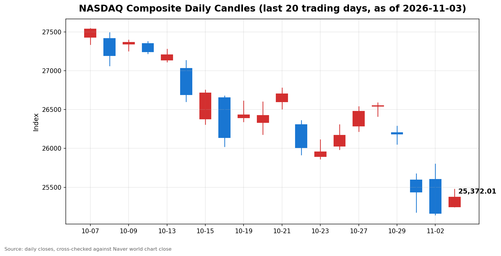

안녕하세요, [한국투자증권](https://securities.koreainvestment.com/main/Main.jsp)에서 [한투-한국투자증권](https://play.google.com/store/apps/details?id=com.truefriend.neosmartarenewal&hl=ko) 개발을 담당하고 있는 way입니다. 
2026년 11월 3일 나스닥 장 마감 흐름을 수치 중심으로 정리합니다. 

## 마감 요약

나스닥 종합은 전일 대비 상승으로 마감했습니다. 
상승률은 0.83%였습니다. 
S&P500도 상승으로 마감했으나 상승률은 나스닥보다 작았습니다. 
다우지수는 하락으로 마감해 지수 간 방향이 갈렸습니다. 
전 거래일 큰 폭으로 하락했던 기술주가 반등하면서 나스닥이 3거래일 만의 하락 흐름을 끊었습니다. 
이 글은 교육과 해설 목적으로 작성되었으며 특정 종목의 매수나 매도를 권유하지 않습니다. 

## 오늘의 마감 스냅샷

| 지수 | 종가 | 전일 대비 | 등락률 | 전일 종가 | 당일 고가 | 당일 저가 |
| --- | --- | --- | --- | --- | --- | --- |
| 나스닥 종합 | 25,372.01 | +207.65 | +0.83% | 25,164.36 | 25,474.46 | 25,246.64 |
| S&P500 | 7,568.92 | +27.52 | +0.36% | 7,541.40 | 7,594.24 | 7,557.60 |
| 다우지수 | 51,786.72 | -197.26 | -0.38% | 51,983.98 | 51,932.63 | 51,593.16 |

스냅샷 기준 시각은 미국 동부시간 2026년 11월 3일 16시 20분, 한국시간 2026년 11월 4일 06시 20분입니다. 
나스닥 종합 수치는 네이버 월드 차트 페이지에서 직접 확인한 마감 수치입니다. 
네이버 월드 차트 페이지에는 미국 11월 3일 16시 21분 장마감 기준으로 종가 25,372.01, 전일 대비 207.65, 등락률 0.83%가 표시되어 있습니다. 
한투 MTS 해외 대시보드의 나스닥 종합 값도 종가 25,372.01, 전일 대비 207.65, 등락률 0.83%로 네이버 값과 일치합니다. 
S&P500 수치는 한투 MTS 해외 대시보드에서 확인한 마감 수치입니다. 
전일 종가는 종가에서 전일 대비 변동폭을 빼는 방식으로 역산했습니다. 
역산한 S&P500 전일 종가 7,541.40과 다우지수 전일 종가 51,983.98은 전 거래일 마감 글의 종가와 일치합니다. 
역산한 나스닥 전일 종가 25,164.36은 전 거래일 마감 글의 종가 25,164.32와 0.04 차이이며, 이는 자료원 간 반올림 차이로 보입니다. 
나스닥 당일 고가와 저가는 네이버 월드 차트 페이지의 표시값입니다. 
S&P500 당일 고가와 저가는 한투 MTS 차트 배열의 최대값과 최소값으로 산출했습니다. 
다우지수는 한투 MTS 해외 대시보드 지수 목록에 포함되지 않았습니다. 
다우지수 수치는 Yahoo Finance 일봉으로 확인한 값입니다. 
네이버 월드 차트 출처는 [네이버 금융 월드 시세](https://finance.naver.com/world/sise.naver?symbol=NAS@IXIC)와 [네이버 월드 차트](https://stock.naver.com/worldstock/index/.IXIC/price)에서 확인할 수 있습니다. 
확인되지 않은 마감 원인은 본문에 쓰지 않았습니다. 

## 차트

최근 20거래일 일봉 차트입니다. 
빨간 봉은 종가가 시가보다 높은 날, 파란 봉은 종가가 시가보다 낮은 날입니다. 

## 원인·촉매 분석

이날 상승의 표면적 이유는 기술주 반등입니다. 
근본 촉매는 세 가지로 압축됩니다. 
첫째, 중간선거 당일이라는 정치 일정이 불확실성 해소 기대로 작용했습니다. 
선거 결과가 나오기 전부터 시장은 불확실성이 걷힌 뒤 자금이 다시 유입될 가능성을 가격에 반영하기 시작했습니다. 
둘째, 견조한 경제지표가 금리 인하 기대를 되돌렸음에도 주가는 버텼습니다. 
구인 건수와 공장주문 지표가 예상보다 강하게 나오면서 공격적인 금리 인하 기대는 후퇴했습니다. 
통상 금리 인하 기대 후퇴는 성장주 밸류에이션에 부담이지만, 이날은 기술주 반등 흐름이 그 부담을 눌렀습니다. 
셋째, 유가 하락이 투자 심리를 받쳤습니다. 
장중 브렌트유가 배럴당 107달러 부근에서 102달러 부근으로 내려오면서 에너지 비용 부담에 대한 우려가 완화됐습니다. 
이 세 가지가 겹치면서 전 거래일 급락 뒤 되돌림 매수와 숏커버가 기술주 쪽으로 집중됐습니다. 
전 거래일 지수 간 방향이 갈렸던 흐름은 이날도 이어졌습니다. 
나스닥이 0.83% 오르고 S&P500이 0.36% 오르는 동안 다우지수는 0.38% 내렸습니다. 
이는 상승 동력이 시장 전반이 아니라 기술주와 성장주에 편중됐다는 뜻입니다. 

## 핵심 사건 3가지

첫째, 미국 중간선거가 실시됐습니다. 
3일(현지시간)은 중간선거 투표일이었고, 시장은 선거 결과에 대한 경계감 속에서 출발했습니다. 
선거는 어느 정당이 의회를 장악할지를 가르는 사건이며, 이후 정책 방향과 자금 배분에 영향을 줍니다. 
이날 기술주가 반등한 배경에는 선거 불확실성이 정점을 지났다는 인식이 깔려 있습니다. 
다만 선거 결과가 시장에 미칠 실제 영향은 개표 결과가 나온 뒤에 확인해야 하며, 이날 상승만으로 결과를 단정할 수는 없습니다. 

둘째, 노동시장과 제조업 지표가 견조하게 나왔습니다. 
시장 보도에 따르면 구인 건수는 752만 3천 건, 공장주문은 전월 대비 1.8% 증가했습니다. 
두 지표 모두 금리 인하를 서두를 필요가 없다는 쪽으로 해석됐고, 공격적인 금리 인하 기대는 후퇴했습니다. 
그럼에도 주가가 오른 점은 시장이 경기 자체의 견조함을 긍정적으로 받아들였다는 신호로 볼 수 있습니다. 
다만 지표 해석은 보도 기준이며, 금리 경로에 대한 최종 판단은 연방준비제도의 발언과 다음 물가 지표에서 확인해야 합니다. 

셋째, 반도체주를 중심으로 한 기술주 되돌림이 나타났습니다. 
전 거래일 나스닥100 지수는 10월 고점 대비 10% 이상 하락해 조정 국면에 들어간 상태였습니다. 
반도체 지수는 앞선 3거래일 동안 10% 안팎으로 하락한 뒤 이날 장중 3% 이상 반등했습니다. 
이는 인공지능 인프라 투자에 대한 자금 조달 우려가 단기간에 과도하게 반영됐다가 되돌려진 흐름으로 해석됩니다. 
장 마감 뒤에는 주요 반도체 기업의 실적 발표가 예정되어 있어, 되돌림이 이어질지는 실적 확인 뒤에 갈릴 전망입니다. 

## 지수·섹터 영향 체인

나스닥의 상승은 반도체와 대형 기술주가 주도했습니다. 
반도체는 인공지능 밸류체인의 상류에 위치하며, 반도체 반등은 인공지능 투자에 대한 우려가 완화됐다는 신호로 읽힙니다. 
반도체 반등이 나스닥 전체로 번지면서 대형 기술주도 함께 올랐고, 이는 나스닥 상승률 0.83%로 나타났습니다. 
S&P500은 기술주 비중이 나스닥보다 낮고 산업재와 금융 등 가치주 비중이 높기 때문에 상승률이 0.36%에 그쳤습니다. 
다우지수는 산업재와 가치주 비중이 더 높아 기술주 반등의 수혜가 작았고, 0.38% 하락으로 마감했습니다. 
연결고리는 금리에서 시작됩니다. 
금리 인하 기대 후퇴는 성장주 밸류에이션에 부담이지만, 이날은 경기 견조함과 선거 불확실성 해소 기대가 그 부담을 상쇄했습니다. 
유가 하락은 에너지 섹터에는 부담이지만, 운송과 제조 등 에너지 소비 섹터의 비용 부담을 덜어주는 쪽으로 작용했습니다. 
정리하면 이날은 기술주와 반도체가 수혜를 입고, 다우지수에 편입된 전통 산업주가 상대적으로 소외된 날이었습니다. 

## 다우·S&P500 마감 흐름

S&P500은 7,568.92로 마감했습니다. 
전일 대비 변동폭은 +27.52, 등락률은 +0.36%였습니다. 
역산한 S&P500 전일 종가는 7,541.40입니다. 
한투 MTS 차트 배열 기준 S&P500 당일 고가는 7,594.24, 당일 저가는 7,557.60이었습니다. 
다우지수는 51,786.72로 마감했습니다. 
전일 대비 변동폭은 -197.26, 등락률은 -0.38%였습니다. 
다우지수 당일 고가는 51,932.63, 당일 저가는 51,593.16이었습니다. 
S&P500은 상승했지만 다우지수가 하락했다는 점에서 상승 동력은 시장 전반보다 기술주 쪽에 더 집중됐습니다. 

## 단기·중기 전망과 다음 거래일 확인할 시나리오

흐름 지속과 일시적 되돌림을 구분하는 기준은 세 가지입니다. 
첫째, 나스닥이 당일 저가 25,246.64 부근을 지키는지 확인합니다. 
이 구간이 지켜지면 되돌림이 아니라 반등 흐름으로 이어질 가능성이 커집니다. 
둘째, 나스닥이 당일 고가 25,474.46 부근을 넘어서는지 확인합니다. 
고가를 넘지 못하고 되밀리면 이날 상승은 단기 되돌림에 그칠 가능성이 있습니다. 
셋째, 중간선거 개표 결과와 장 마감 뒤 발표된 반도체 기업 실적이 다음 거래일 지수 방향을 가를 변수입니다. 
실적이 기대에 미치지 못하면 반도체 반등이 되돌려질 수 있고, 실적이 견조하면 반등 흐름이 이어질 수 있습니다. 
중기적으로는 나스닥100 지수가 10월 고점 대비 10% 이상 하락한 조정 국면에서 벗어나는지가 관건입니다. 
조정 국면 탈출 여부는 단 하루 반등이 아니라 며칠에 걸친 저가 지지 여부로 판단해야 합니다. 
금리 경로에 대해서는 다음 물가 지표와 연방준비제도 발언을 함께 확인해야 합니다. 
이 글의 전망은 시나리오 정리이며, 다음 거래일의 결과를 보장하지 않습니다. 

## 마치며

2026년 11월 3일 나스닥은 0.83% 상승으로 마감했습니다. 
다음 거래일에는 저가 지지 여부와 반도체 실적, 선거 결과의 영향을 함께 확인하는 것이 도움이 되며, 이 글은 매수나 매도 권유가 아닙니다. 
