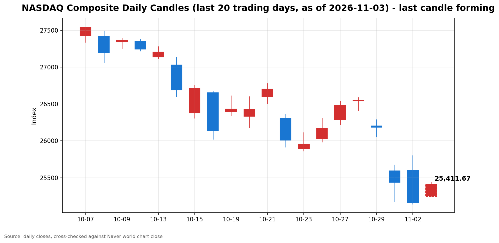

안녕하세요, [한국투자증권](https://securities.koreainvestment.com/main/Main.jsp)에서 [한투-한국투자증권](https://play.google.com/store/apps/details?id=com.truefriend.neosmartarenewal&hl=ko) 개발을 담당하고 있는 way입니다. 
2026년 11월 3일 나스닥 장중 흐름을 수치 중심으로 정리합니다. 

## 장중 요약

나스닥 종합은 장중 25,412.35로 전일 대비 247.99포인트, 0.99% 상승했습니다. 
스탠더드앤드푸어스 500 지수도 7,578.94로 0.50% 올랐습니다. 
이날은 미국 중간선거 투표일입니다. 
장은 정상 개장했고, 선거 결과는 장 마감 이후부터 윤곽이 드러납니다. 
전일 급락에 대한 되돌림이 장중까지 이어졌고, 오전보다 상승폭이 커졌습니다. 

## 오늘의 스냅샷

| 지수 | 현재가 | 전일 대비 | 등락률 | 전일 종가 | 장중 고가 | 장중 저가 | 스냅샷 기준 시각 |
| --- | --- | --- | --- | --- | --- | --- | --- |
| 나스닥 종합 | 25,412.35 | +247.99 | +0.99% | 25,164.36 | 25,438.23 | 25,304.02 | 미국 동부시간 2026-11-03 12:58, 한국시간 2026-11-04 02:58 |
| 스탠더드앤드푸어스 500 | 7,578.94 | +37.54 | +0.50% | 7,541.40 | 7,586.22 | 7,557.60 | 미국 동부시간 2026-11-03 12:58, 한국시간 2026-11-04 02:58 |
| 다우존스 산업평균지수 | 확인 필요 | 확인 필요 | 확인 필요 | 51,983.98 | 확인 필요 | 확인 필요 | 미국 동부시간 2026-11-03 12:58, 한국시간 2026-11-04 02:58 |

당일 수치는 형성 중인 수치로, 마감 전에는 계속 변합니다. 
나스닥 종합의 시가는 25,246.64였습니다. 
장중 고가와 저가는 한국투자증권 MTS 장중 시계열의 최대값과 최소값입니다. 
네이버 월드 차트 페이지는 직접 조회 시 가격 데이터를 포함한 본문을 확보하지 못했습니다. 
따라서 위 스냅샷은 한국투자증권 MTS 해외 대시보드 값으로 채웠습니다. 
나스닥 값은 [네이버 월드 차트 나스닥 종합](https://finance.naver.com/world/sise.naver?symbol=NAS@IXIC)과 [네이버 월드 차트 나스닥 종합 가격](https://stock.naver.com/worldstock/index/.IXIC/price)에서 확인할 수 있습니다. 
다우존스 산업평균지수의 장중 수치는 한국투자증권 MTS 해외 대시보드에 다우 항목이 포함되지 않아 확인 필요로 표기합니다. 

## 차트

최근 20거래일 일봉 차트입니다. 
빨간 봉은 종가가 시가보다 높은 날, 파란 봉은 종가가 시가보다 낮은 날입니다. 
당일 봉은 형성 중인 봉으로, 마감 전에는 계속 변합니다. 

## 원인·촉매 분석

표면적으로는 나스닥이 전일 대비 0.99% 반등했습니다. 
근본 촉매는 세 가지로 정리됩니다. 
첫째, 되돌림입니다. 
나스닥은 11월 2일까지 3거래일 연속 하락했고, 10월에는 2025년 3월 이후 가장 큰 월간 하락을 기록했습니다. 
낙폭이 누적된 뒤에는 단기 되돌림 매수가 들어오기 쉬운 구간입니다. 
둘째, 유가 급락에 따른 부담 완화입니다. 
11월 2일 서부텍사스산 원유는 약 8% 하락해 배럴당 95.80달러 안팎을 기록했고, 브렌트유는 7.6% 하락했습니다. 
유가 하락은 에너지 비용 부담을 낮추고, 인플레이션 압력 완화 기대를 통해 성장주 밸류에이션 부담을 덜어주는 방향으로 작용합니다. 
셋째, 선거 당일에도 장이 정상 개장했다는 점입니다. 
불확실성이 사라진 것은 아니지만, 휴장이 아니라는 사실 자체가 장중 거래를 정상 궤도에 올려놓았습니다. 
전일 지수 간 방향 차이도 의미를 가집니다. 
11월 2일 나스닥은 1.07% 하락했고 스탠더드앤드푸어스 500 지수는 0.51% 하락했지만, 다우존스 산업평균지수는 0.41% 상승했습니다. 
기술주와 성장주 중심의 조정이 진행되는 동안 방어적인 성격의 종목군이 상대적으로 버틴 구도였습니다. 
당일 장중은 이 구도가 뒤집혔습니다. 
나스닥 상승률 0.99%가 스탠더드앤드푸어스 500 지수 상승률 0.50%를 웃돌았고, 낙폭이 컸던 기술주의 되돌림이 지수 차별화를 주도했습니다. 
미국 국채수익률과 달러의 당일 장중 수치는 별도로 확인되지 않아 확인 필요로 표기합니다. 

## 핵심 사건 3가지

첫째, 미국 중간선거 투표일과 결과 대기입니다. 
연합뉴스 보도에 따르면 뉴욕증시는 중간선거 결과를 주시하며 혼조 출발했습니다. 
미국과 중국의 무역정책 전개 상황도 핵심 관심사로 함께 거론됐고, 트럼프 대통령의 낙관적 발언이 중간선거를 앞둔 선심성 발언일 수 있다는 지적도 시장 일부에서 제기됐습니다. 
이데일리 보도에 따르면 민주당이 상원과 하원을 모두 장악하면 뉴욕증시가 단기 충격을 받을 수 있다는 전망이 나왔습니다. 
JP모건은 민주당 압승 시 다음 날 스탠더드앤드푸어스 500 지수가 0.5% 하락할 수 있다고 전망했습니다. 
골드만삭스는 민주당 의회가 데이터센터 세제 혜택을 제한할 수 있지만, 어떤 선거 결과에서도 전국적인 건설 유예 조치는 가능성이 낮다고 평가했습니다. 
병원주와 보험주에 대한 지원 확대 기대, 카드금리 상한 논의, 이란전 변수도 함께 거론됐습니다. 
심리적으로는 결과에 따라 인공지능 인프라 정책과 규제 경로가 갈린다는 점이 핵심입니다. 
결과가 확인되기 전까지는 방향성 베팅이 자제되고, 결과 확인 이후에 섹터별 로테이션이 나타날 수 있는 구조입니다. 

둘째, 빌 애크먼의 레버리지와 투기 거래 경고입니다. 
이데일리 보도에 따르면 억만장자 투자자 빌 애크먼은 투기적 거래와 레버리지 확산으로 미국 주식시장이 카지노처럼 움직이고 있다고 경고했습니다. 
퍼싱스퀘어는 마이크로소프트와 아마존 하락 때 매수했고, 비자와 마스터카드, 넷플릭스에 긍정적 평가를 내렸습니다. 
애크먼은 시장의 가격 왜곡이 장기 투자자에게 매수 기회를 제공한다고 설명하면서도, 국가 전체로 보면 바람직하지 않다고 덧붙였습니다. 
구조적으로는 변동성 확대 구간에서 가격 발견 기능이 약해질 수 있다는 경고입니다. 
장중 반등 속에서도 고변동성 종목군의 급등락이 이어질 수 있다는 경계감을 함께 남겼습니다. 

셋째, 애플 실적 이후 마진 부담과 인공지능 종목 내 선별입니다. 
애플의 3분기 매출은 1,144억 8,000만 달러로 전년 동기 대비 약 12% 증가해 시장 예상치 1,133억 9,000만 달러를 웃돌았습니다. 
그러나 서비스 매출 성장률 전망이 8에서 9%로 시장 예상치 10.7%를 하회했고, 10월에서 12월 분기 매출총이익률은 45에서 46%로 9월 분기 47.9%보다 낮아질 것으로 전망됐습니다. 
메모리 가격 상승에 따른 원가 부담과 서비스 성장 둔화 우려가 겹치면서 주가는 시간외 거래에서 급락했습니다. 
반면 한국투자증권 MTS 뉴스 목록에 따르면 윌리엄 블레어는 팔란티어에 대해 인공지능 섹터 내에서도 펀더멘털이 견고하다고 평가했습니다. 
기술주 내부에서도 실적과 마진 증명이 되는 종목과 그렇지 않은 종목이 갈리는 선별 장세가 장중 반등의 질을 가르고 있습니다. 

## 지수·섹터 영향 체인

나스닥 상승률이 스탠더드앤드푸어스 500 지수 상승률을 웃돈 점이 가장 큰 차별점입니다. 
연결고리는 금리에서 성장주 밸류에이션으로 이어집니다. 
유가 하락이 인플레이션 압력 완화 기대로 이어지면, 장기 성장주의 할인율 부담이 덜어지고 나스닥 비중이 높은 기술주가 먼저 반응합니다. 
에너지 섹터는 반대 방향의 압력을 받았습니다. 
전일 마감에서는 유가 급락에 따른 에너지주 약세가 혼조 마감의 한 요인이었다는 보도가 있었습니다. 
당일 장중 에너지 섹터의 방향은 별도로 확인되지 않아 확인 필요로 표기합니다. 
금융 섹터는 선거 결과에 민감한 변수에 노출돼 있습니다. 
카드금리 상한 논의가 결과에 따라 달라질 수 있다는 점이 금융주 방향을 가르는 요인입니다. 
헬스케어 섹터는 민주당 승리 시 지원 확대 기대가 거론되는 쪽입니다. 
인공지능 인프라와 반도체 섹터는 데이터센터 세제 혜택 제한 가능성과 전국적 건설 유예 가능성 낮음이라는 두 가지 평가 사이에서 불확실성이 남아 있습니다. 
전면 중단 시나리오는 낮게 평가됐지만, 세제 혜택 축소 논의 자체는 관련 종목군의 변동성을 키울 수 있습니다. 

## 다우·S&P500 흐름

스탠더드앤드푸어스 500 지수는 7,578.94로 전일 대비 37.54포인트, 0.50% 상승했습니다. 
장중 고가는 7,586.22, 장중 저가는 7,557.60이었습니다. 
오전 09시 59분 기준 0.26% 상승에서 장중 0.50%로 상승폭이 커졌습니다. 
대형주 전반의 완만한 반등 흐름으로, 나스닥보다는 상승폭이 작았습니다. 
다우존스 산업평균지수의 장중 수치는 한국투자증권 MTS 해외 대시보드에 항목이 없어 확인 필요로 표기합니다. 
전일 종가는 51,983.98로 전일 대비 0.41% 상승했습니다. 
전일에는 다우만 올랐던 구도와 달리, 당일 장중은 기술주 주도 반등으로 지수 간 격차가 축소되는 방향입니다. 

## 오전과 오후 흐름 변화

오전 09시 59분 기준 나스닥 종합은 25,319.33으로 0.62% 상승했습니다. 
장중 12시 58분 기준 25,412.35로 0.99% 상승하면서 상승폭이 커졌습니다. 
시가 대비 방향 전환은 없었고, 상승 흐름이 그대로 이어졌습니다. 
오전 고점 25,385.18은 장중 고점 25,438.23으로 상향 돌파됐습니다. 
스탠더드앤드푸어스 500 지수도 오전 0.26%에서 장중 0.50%로 상승폭을 키웠습니다. 

## 마감까지 전망과 확인할 시나리오

장중 흐름이 지속되는 시나리오는 장중 고점 25,438.23 유지와 25,400선 안착입니다. 
이 구간이 지켜지면 반등 흐름이 마감까지 이어질 가능성이 커집니다. 
일시적 노이즈로 되돌려지는 시나리오는 오후 들어 선거 결과 발표를 앞둔 경계감에 차익 매물이 나오는 경우입니다. 
이 경우 오전 고점 25,385.18 이탈 여부를 먼저 확인하고, 아래로는 시가 25,246.64 부근이 지지 구간이 됩니다. 
저항 구간은 장중 고점 25,438.23입니다. 
확인할 이벤트는 중간선거 개표 윤곽으로, 한국시간 11월 4일 오전부터 윤곽이 드러납니다. 
유가 추가 움직임도 함께 확인할 수치입니다. 
국채수익률과 달러의 방향은 확인 필요로 표기합니다. 
선거 결과에 따라 장 마감 후 시간외 변동성이 커질 수 있어, 지수 단위에서도 갭 변동 가능성을 염두에 둔 리스크 관리 관점이 필요합니다. 
이 글은 교육과 해설 목적이며, 특정 종목의 매수나 매도를 권유하지 않습니다. 

## 마치며

중간선거 투표일 장중 흐름은 전일 급락에 대한 되돌림과 결과 대기 심리가 함께 작용한 모습입니다. 
마감까지는 개표 윤곽과 장중 고점 유지 여부를 확인하는 것이 순서입니다. 
이 글은 교육과 해설 목적이며, 특정 종목의 매수나 매도를 권유하지 않습니다. 
