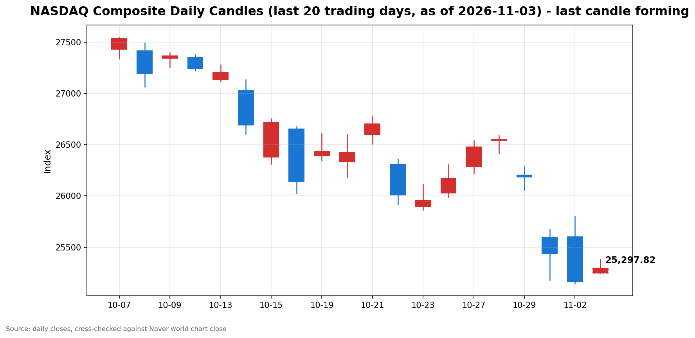

안녕하세요, [한국투자증권](https://securities.koreainvestment.com/main/Main.jsp)에서 [한투-한국투자증권](https://play.google.com/store/apps/details?id=com.truefriend.neosmartarenewal&hl=ko) 개발을 담당하고 있는 way입니다. 
2026년 11월 3일 나스닥 장 오픈 흐름을 수치 중심으로 정리합니다. 

## 개장 배경

간밤 미국 증시는 혼조 마감했습니다. 
2026년 11월 2일 나스닥 종합은 25,164.36으로 전일 대비 1.07% 하락했고, 스탠더드앤드푸어스 500 지수는 7,541.40으로 0.51% 하락했습니다. 
반면 다우존스 산업평균지수는 51,983.98로 0.41% 상승했습니다. 
오늘 11월 3일은 미국 중간선거 투표일이며, 뉴욕증권거래소와 나스닥은 정상 개장합니다. 
선거는 연방 공휴일이 아니므로 장은 정규 시간인 미국 동부시간 09시 30분부터 16시까지 열립니다. 
이러한 배경 속에서 나스닥은 반등 출발했습니다. 

## 오늘의 스냅샷

| 지수 | 현재가 | 전일 대비 | 등락률 | 전일 종가 | 장중 고가 | 장중 저가 | 스냅샷 기준 시각 |
| --- | --- | --- | --- | --- | --- | --- | --- |
| 나스닥 종합 | 25,319.33 | +154.96 | +0.62% | 25,164.36 | 25,385.18 | 25,246.64 | 미국 동부시간 2026-11-03 09:59, 한국시간 2026-11-03 23:59 |
| 스탠더드앤드푸어스 500 | 7,561.04 | +19.64 | +0.26% | 7,541.40 | 7,567.55 | 7,558.52 | 미국 동부시간 2026-11-03 09:59경, 한국시간 2026-11-03 23:59경 |
| 다우존스 산업평균지수 | 확인 필요 | 확인 필요 | 확인 필요 | 51,983.98 | 확인 필요 | 확인 필요 | 미국 동부시간 2026-11-03 09:59경, 한국시간 2026-11-03 23:59경 |

당일 수치는 형성 중인 수치로, 마감 전에는 계속 변합니다. 
나스닥 종합의 시가는 25,246.64였습니다. 
나스닥 값은 [네이버 월드 차트 나스닥 종합](https://finance.naver.com/world/sise.naver?symbol=NAS@IXIC)과 [네이버 월드 차트 나스닥 종합 가격](https://stock.naver.com/worldstock/index/.IXIC/price)에서 확인했습니다. 
네이버 월드 차트 페이지는 직접 텍스트 조회가 차단되어 브라우저로 값을 확인했고, 한국투자증권 MTS 해외 대시보드 값과 교차 검증했습니다. 
한국투자증권 MTS 기준 나스닥 종합은 25,311.67로 전일 대비 147.31포인트, 0.59% 상승했고, 스탠더드앤드푸어스 500 지수는 7,561.04로 0.26% 상승했습니다. 
두 출처의 나스닥 값 차이는 조회 시점 차이 범위 안에 있습니다. 
다우존스 산업평균지수의 장중 수치는 한국투자증권 MTS 해외 대시보드에 다우 항목이 포함되지 않아 확인 필요로 표기합니다. 
개장 전 선물 동향은 혼조였습니다. 
나스닥 100 선물은 0.28% 상승한 반면, 다우 선물은 0.75% 하락했고, 스탠더드앤드푸어스 500 선물은 0.12% 하락했습니다. 

## 차트

최근 20거래일 일봉 차트입니다. 
빨간 봉은 종가가 시가보다 높은 날, 파란 봉은 종가가 시가보다 낮은 날입니다. 
당일 봉은 형성 중인 봉으로, 마감 전에는 계속 변합니다. 

## 원인·촉매 분석

표면적으로는 나스닥이 전일 대비 0.62% 반등 출발했습니다. 
근본 촉매는 세 가지로 정리됩니다. 
첫째, 되돌림입니다. 
나스닥은 11월 2일까지 3거래일 연속 하락했고, 10월에는 2025년 3월 이후 가장 큰 월간 하락을 기록했습니다. 
낙폭이 누적된 뒤에는 단기 되돌림 매수가 들어오기 쉬운 구간입니다. 
둘째, 유가 급락에 따른 부담 완화 기대입니다. 
11월 2일 서부텍사스산 원유는 약 8% 하락해 배럴당 95.80달러 안팎을 기록했고, 브렌트유는 7.6% 하락했습니다. 
유가 하락은 에너지 비용 부담을 낮추고, 소비 여력과 운송 비용 측면에서 우호적인 요인으로 작용합니다. 
셋째, 선거 당일에도 장이 정상 개장한다는 점입니다. 
불확실성이 사라진 것은 아니지만, 휴장이 아니라는 사실 자체가 장 초반 거래를 정상 궤도에 올려놓았습니다. 
다만 반등의 질은 아직 확인 단계입니다. 
장 마감 후 발표된 애플 실적에서 매출과 주당순이익은 예상을 웃었으나, 12월 분기 매출총이익률 가이던스가 9월 분기 47.9%보다 낮은 45%에서 46%로 제시됐습니다. 
메모리 비용 상승이 직접적인 압박 요인으로 지목됐습니다. 
이 때문에 지수는 올랐지만, 기술주 밸류에이션에 대한 부담은 장 초반에도 그대로 남아 있습니다. 
지수 간 방향 차이도 의미가 있습니다. 
나스닥이 0.62% 오른 반면 스탠더드앤드푸어스 500 지수는 0.26% 오르는 데 그쳤고, 개장 전 다우 선물은 하락했습니다. 
이는 기술주 되돌림이 반등을 주도하고, 방어주 중심의 다우 강세는 되돌림 국면에 들어갔을 가능성을 보여줍니다. 
개장 전 국채수익률 상승 보도는 성장주 밸류에이션에 부담으로 작용할 수 있는 요인이나, 구체적인 수익률 수치는 확인 필요로 표기합니다. 

## 핵심 사건 3가지

### 첫째, 미국 중간선거 투표일입니다

11월 3일은 미국 중간선거 투표일입니다. 
하원의원과 상원의원, 주지사를 선출하는 선거이며, 결과는 장 마감 이후 개표와 함께 선물 시장에 먼저 반영됩니다. 
선거 결과가 재정 방향과 정책 불확실성에 영향을 줄 수 있기 때문에, 장중에는 결과를 예단하기보다 변동성 확대 가능성에 대비하는 흐름이 나타날 수 있습니다. 
딥서치 문서 검색에서도 11월 4일자 한국 신문 미리보기에서 중간선거를 심판대라는 표현으로 다루고 있어, 선거의 정치적 무게가 확인됩니다. 
시장 관점에서는 선거 자체보다 장 마감 후 개표 흐름이 더 큰 변수입니다. 

### 둘째, 애플 실적 발표와 마진 가이던스입니다

애플은 11월 2일 장 마감 후 2026 회계연도 4분기 실적을 발표했습니다. 
매출은 1,144억 8,000만 달러로 전년 대비 약 12% 증가했고, 주당순이익은 2.10달러를 기록했습니다. 
두 수치 모두 시장 예상인 매출 약 1,134억 달러와 주당순이익 1.99달러를 웃었습니다. 
아이폰 매출은 575억 8,000만 달러로 전년 대비 약 17% 증가했습니다. 
그러나 12월 분기 매출총이익률 가이던스는 45%에서 46%로 제시돼 9월 분기 47.9%보다 낮아졌습니다. 
경영진은 메모리 가격 상승과 인공지능 인프라 수요 경쟁을 압박 요인으로 설명했습니다. 
11월 3일 개장 전 애플 주가는 약 4% 하락한 323달러 안팎에서 거래됐습니다. 
실적 자체는 예상을 웃었으나, 마진 전망이 시장 심리를 누른 전형적인 가이던스 반응입니다. 
이는 개별 종목의 문제를 넘어, 메모리 비용이 하드웨어 전반의 수익성에 미치는 영향을 보여주는 사건입니다. 

### 셋째, 유가 급락과 기술주 매도 지속입니다

11월 2일 유가는 미국과 이란 간 외교 기대감에 급락했습니다. 
서부텍사스산 원유는 약 8% 하락했고, 브렌트유는 7.6% 하락했습니다. 
같은 날 에너지 섹터는 3.97% 하락했습니다. 
반면 항공과 운송 관련주는 유가 하락 수혜 기대에 상승했습니다. 
기술주 매도는 이날도 이어졌습니다. 
스탠더드앤드푸어스 500 기술 섹터는 2.66% 하락했고, 필라델피아 반도체지수는 3.37% 하락했습니다. 
인텔은 전 거래일 약 30% 급락에 이어 8.8% 추가 하락했고, 마벨 테크놀로지는 루멘텀 인수 소식에 12.7% 하락했습니다. 
오라클도 8.85% 하락했습니다. 
나스닥 100 지수는 10월 한 달 동안 2조 달러가 넘는 시가총액 감소를 기록한 것으로 보도됐습니다. 
유가 하락이 물가 부담을 덜어주는 재료인 동시에, 기술주 매도가 멈추지 않았다는 점이 11월 2일 장의 이중 구조였습니다. 

## 지수·섹터 영향 체인

금리에서 성장주 밸류에이션으로 이어지는 연결고리가 먼저 작동합니다. 
국채수익률이 오르면 미래 이익을 현재 가치로 환산하는 할인율이 높아져 성장주 밸류에이션에 부담이 커집니다. 
애플의 마진 가이던스처럼 이익의 질에 대한 의문이 더해지면, 같은 금리 수준에서도 기술주에 대한 요구 수익률은 높아집니다. 
유가에서 에너지와 운송으로 이어지는 연결고리는 정반대 방향으로 작용했습니다. 
유가 하락은 에너지 기업 실적에는 부정적이지만, 항공과 운송, 소비 관련 기업의 비용 부담을 낮춥니다. 
11월 2일 에너지 섹터 하락과 항공주 상승이 동시에 나타난 이유입니다. 
메모리 비용에서 반도체와 하드웨어로 이어지는 연결고리도 확인됩니다. 
인공지능 인프라 투자 경쟁이 메모리 수요를 끌어올리면서, 하드웨어 기업의 원가 부담이 커지고 있습니다. 
이는 반도체 업황 자체의 호조와 하드웨어 기업의 마진 압박이 공존할 수 있음을 보여줍니다. 
선거에서 정책 불확실성으로 이어지는 연결고리는 장 마감 후에 본격화됩니다. 
결과에 따라 재정과 규제 방향에 대한 기대가 바뀌고, 선물 시장이 먼저 반응하는 구조입니다. 
수혜와 타격을 단순히 나누기보다, 같은 재료가 섹터마다 다른 방향으로 작용한다는 점이 이번 장의 특징입니다. 

## 다우·스탠더드앤드푸어스 500 흐름

다우존스 산업평균지수는 11월 2일 0.41% 상승 마감했습니다. 
이는 나스닥과 스탠더드앤드푸어스 500 지수가 하락한 날 다우만 오른, 차별화된 흐름이었습니다. 
11월 2일 장에서는 소비재와 금융, 소재 관련주가 상대적으로 강했고, 에너지주는 유가 하락에 약했습니다. 
이는 기술주 매도 국면에서 자금이 방어적인 성격의 대형주로 이동했음을 보여줍니다. 
11월 3일 개장 전 다우 선물이 0.75% 하락한 점은, 전일의 방어주 강세가 되돌림 국면에 들어갔을 가능성을 시사합니다. 
스탠더드앤드푸어스 500 지수는 11월 2일 0.51% 하락 마감했습니다. 
장 초반에는 1.1%까지 올랐으나 오후 들어 기술주 약세에 밀려 하락 전환했습니다. 
지수 전체로 보면 약 70%에 가까운 종목이 상승했음에도 지수가 하락했다는 점이 특징입니다. 
이는 지수 하락이 시장 전반의 약세가 아니라, 시가총액 비중이 큰 기술주의 하락에 의해 주도됐음을 의미합니다. 
11월 3일 장 초반 스탠더드앤드푸어스 500 지수는 한국투자증권 MTS 기준 0.26% 상승 출발했습니다. 
나스닥보다는 상승 폭이 작아, 기술주 되돌림이 지수 상승을 주도하고 있음을 보여줍니다. 

## 단기·중기 전망과 장 초반 확인할 시나리오

단기적으로는 반등 지속과 일시적 노이즈를 구분하는 구간입니다. 
장 초반에 확인할 첫 번째 수치는 나스닥 종합의 전일 종가 25,164.36 안착 여부입니다. 
현재가 25,319.33은 전일 종가를 웃돌고 있으나, 이 수준을 장중 내내 유지하는지가 관건입니다. 
두 번째 수치는 장중 고가 25,385.18 돌파 지속 여부입니다. 
이 고가를 지켜내면 반등의 힘이 이어지는 신호로 볼 수 있고, 반납하면 되돌림의 힘이 약한 것으로 해석할 수 있습니다. 
세 번째 구간은 전일 장중 범위입니다. 
11월 2일 나스닥 종합의 장중 고가는 25,799.46, 저가는 25,145.95였습니다. 
전일 저가 아래로 내려가면 반등이 무너지는 신호로 볼 수 있습니다. 
스탠더드앤드푸어스 500 지수는 전일 종가 7,541.40, 다우존스 산업평균지수는 전일 종가 51,983.98을 기준으로 같은 판단을 적용할 수 있습니다. 
중기적으로는 10월 급락 이후의 되돌림인지 추세 전환인지를 가리는 국면입니다. 
선거 결과와 이번 주 실적 발표, 거시지표가 그 판단 재료를 제공합니다. 
장 마감 후 개표 흐름과 선물 반응, 그리고 기술주 마진 압박이 실적 전반으로 확산되는지를 확인해야 합니다. 
리스크 관리 관점에서는 지수 단위에서 전일 종가와 장중 고저를 기준으로 흐름을 점검하고, 단일 재료에 의한 급등락에 과도하게 반응하지 않는 태도가 필요합니다. 
이 글은 지수와 섹터 단위의 해설이며, 특정 종목의 매수나 매도를 권유하지 않습니다. 

## 마치며

오늘 장은 반등 출발과 기술주 부담이 공존하는 구간에서 시작되었습니다. 
장 초반에는 전일 종가 안착 여부와 장중 고가 돌파 지속 여부를 중심으로 흐름을 확인하시기 바랍니다. 
이 글은 교육과 해설 목적의 정리이며, 특정 종목의 매수나 매도 권유가 아닙니다. 
