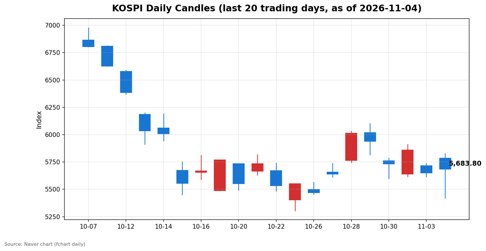
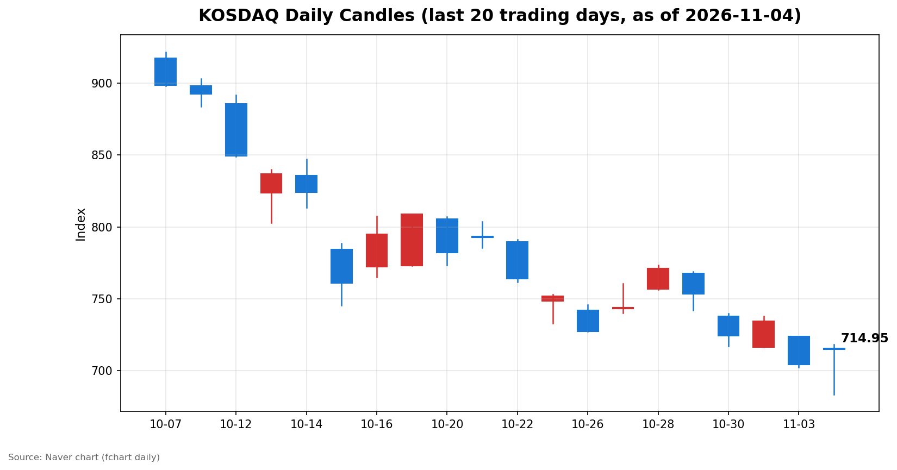

안녕하세요, [한국투자증권](https://securities.koreainvestment.com/main/Main.jsp)에서 [한투-한국투자증권](https://play.google.com/store/apps/details?id=com.truefriend.neosmartarenewal&hl=ko) 개발을 담당하고 있는 way입니다. 
2026년 11월 4일 국내 증시 장 마감 흐름을 수치 중심으로 정리합니다. 

## 마감 요약

코스피와 코스닥이 모두 상승 마감했습니다. 
코스피는 전일 대비 0.62% 오른 5,683.80에 마감했습니다. 
코스닥은 전일 대비 1.50% 오른 714.95에 마감했습니다. 
종가만 보면 평온한 반등처럼 보이지만, 장중 흐름은 전혀 그렇지 않았습니다. 
코스피는 장 초반 5,828.13까지 올랐다가 장중 5,421.72까지 밀렸습니다. 
고가와 저가의 차이는 406.41포인트에 달합니다. 
전일 종가 기준으로는 고가에서 3.17% 상승했다가 저가에서 4.02% 하락한 셈입니다. 
코스닥도 718.34에서 683.66까지 오가며 장중 34.68포인트의 변동폭을 보였습니다. 
결국 두 지수는 장 후반 저가 매수세에 힘입어 상승으로 돌아섰습니다. 
전일 급락을 하루 만에 되돌린 반등이지만, 전전일 종가에는 아직 미치지 못했습니다. 
코스피 전전일 종가는 5,859.08, 코스닥 전전일 종가는 734.36이었습니다. 

## 오늘의 마감 스냅샷

| 지수 | 종가 | 전일 대비 | 등락률 | 시가 | 고가 | 저가 | 거래량 | 거래대금 |
| --- | --- | --- | --- | --- | --- | --- | --- | --- |
| 코스피 | 5,683.80 | +35.01 | +0.62% | 5,786.13 | 5,828.13 | 5,421.72 | 258,778천주 | 22조 5,140억원 |
| 코스닥 | 714.95 | +10.56 | +1.50% | 715.74 | 718.34 | 683.66 | 509,755천주 | 5조 8,098억원 |

전일 종가는 네이버 실시간 수치와 일봉 종가를 교차 확인했습니다. 
코스피 전일 종가는 5,648.79, 코스닥 전일 종가는 704.39입니다. 
교차 검증은 현재가를 등락률로 나눈 역산값으로 수행했습니다. 
지수 차트는 [코스피](https://finance.naver.com/sise/sise_index.naver?code=KOSPI)와 [코스닥](https://finance.naver.com/sise/sise_index.naver?code=KOSDAQ)에서 확인할 수 있습니다. 

## 차트

최근 20거래일 일봉 차트입니다. 
빨간 봉은 종가가 시가보다 높은 날, 파란 봉은 종가가 시가보다 낮은 날입니다. 

## 원인·촉매 분석

오늘 반등의 출발점은 전일 급락과 간밤 미국 기술주 반등이었습니다. 
전일 코스피는 3.59%, 코스닥은 4.08% 하락했습니다. 
간밤 나스닥 종합은 25,372.01로 0.83% 상승했고, 스탠더드앤드푸어스 500 지수는 7,568.92로 0.36% 상승했습니다. 
이 조합은 오늘 장 오픈에서 강한 되돌림 출발로 이어졌습니다. 
코스피는 전일 종가보다 2.43% 높은 5,786.13에 출발했고, 코스닥은 1.61% 높은 715.74에 출발했습니다. 
그러나 출발 강도는 장중 그대로 유지되지 않았습니다. 
보도에서는 미국 중간선거 결과에 대한 경계감이 장중 변동성의 배경으로 지목됐습니다. 
선거 결과가 정책 기대를 어떻게 바꿀지 확정되지 않은 상태에서는, 상승 출발 뒤 차익 매물이 나오기 쉬운 구조였습니다. 
실제로 코스피에서는 외국인이 2조 5,094억원 규모의 순매도를 기록했습니다. 
외국인 매도가 쏟아지자 지수는 전일 종가 아래로 밀렸습니다. 
오후 들어서는 개인과 기관의 저가 매수가 낙폭을 되돌렸습니다. 
코스피에서 개인은 1조 1,465억원, 기관은 1조 136억원을 순매수했습니다. 
외국인이 판 물량을 국내 투자자가 받아낸 구도입니다. 
이 구도는 추세 전환의 신호라기보다, 급락 뒤 저가 매수가 유입된 되돌림에 가깝습니다. 
거래량이 전일보다 늘어난 점도 같은 해석을 뒷받침합니다. 
코스피 거래량은 258,778천주로 전일 일봉 기준 207,371천주보다 늘었습니다. 
코스닥 거래량도 509,755천주로 전일 일봉 기준 430,571천주보다 늘었습니다. 
조용한 상승이 아니라, 매도와 매수가 맞부딪힌 하루였습니다. 
원/달러 환율은 한국투자증권 MTS 기준 1,342.00원으로 0.23% 내린 수준이었습니다. 
환율 급변동이 장중 급락을 직접 촉매했다고 볼 근거는 이날 수치에서는 확인되지 않았습니다. 
결국 오늘 장세의 핵심 촉매는 새로운 호재보다, 전일 급락과 미국 증시 반등, 그리고 중간선거 경계감이 맞물린 포지션 조정이었습니다. 

## 핵심 사건 3가지

### 1. 미국 중간선거 경계감과 간밤 미국 증시 반등

미국 중간선거를 전후해 정책 방향에 대한 불확실성이 커졌습니다. 
간밤 미국 증시는 혼조 속에서 나스닥이 0.83% 반등했습니다. 
이 반등이 국내 장 오픈의 상승 출발을 이끌었습니다. 
그러나 선거 결과의 시장 함의가 확정되지 않은 상태에서는, 상승이 곧바로 추세로 이어지지 않았습니다. 
장 초반 강세가 장중 급락으로 바뀐 점이 이를 보여줍니다. 
선거 결과 해석이 정리되는 과정 자체가 단기 변동성의 원인이 되는 국면입니다. 

### 2. 쿠팡 3분기 영업손실 6,423억원, 3분기 연속 적자

딥서치 트렌딩 토픽 기준, 쿠팡은 3분기 매출이 처음으로 14조원을 넘겼음에도 영업손실 6,423억원을 기록했습니다. 
적자는 3분기 연속으로 이어졌습니다. 
성장 지표와 수익 지표가 반대 방향을 가리킨 사례입니다. 
시장 심리에 주는 충격은 성장주 밸류에이션에 대한 의문으로 이어질 수 있습니다. 
다만 쿠팡은 미국 상장 기업이므로, 국내 지수에 대한 직접적인 구성 효과보다 심리적인 파급으로 이해하는 편이 적절합니다. 
국내 성장주에 대한 기대를 일괄적으로 낮추는 근거로 삼을 수는 없습니다. 

### 3. 현대백화점 3분기 영업이익 30% 증가와 현대차그룹 수소 생태계 비전

딥서치 트렌딩 토픽 1위는 현대백화점 3분기 실적이었습니다. 
백화점과 면세점 호조 속에 영업이익이 30% 증가한 것으로 정리됐습니다. 
소비 관련 실적이 예상보다 견조하다는 신호로 읽을 수 있습니다. 
다만 단일 기업의 실적이 지수 전체를 움직이는 촉매라고 단정할 수는 없습니다. 
같은 날 트렌딩 2위는 현대차그룹의 수소 생태계 비전 공개였습니다. 
5MW급 수전해 모듈 공개와 새만금 수소 생태계 청사진이 포함됐습니다. 
이는 당일 실적보다 중장기 에너지 전환 밸류체인에 대한 기대를 자극하는 사건입니다. 
단기 지수 방향보다는 전력망과 수소 관련 테마의 관심 지속 여부를 가늠하는 재료로 보는 편이 적절합니다. 

## 섹터·테마 영향 체인

오늘 강세의 중심은 2차전지와 에너지 전환 밸류체인이었습니다. 
한국투자증권 MTS 기준 폴리실리콘 테마는 8.76% 올랐습니다. 
ESS 테마는 6.21% 올랐고, 포함된 17개 종목이 모두 상승했습니다. 
전고체배터리는 6.15%, 태양광발전은 6.10% 올랐습니다. 
2차전지 생산 테마는 5.50%, 2차전지 LFP 테마는 4.81%, 배터리 테마는 4.77% 올랐습니다. 
이 연결고리는 ESS 수요 기대에서 출발합니다. 
ESS 수요가 커지면 배터리 셀과 소재, 전력 저장 시스템이 함께 주목받습니다. 
엘앤에프의 LG에너지솔루션 대상 1조원대 LFP 공급계약 소식이 같은 맥락에서 정리됐습니다. 
폴리실리콘과 태양광 강세는 에너지 전환의 다른 축입니다. 
전력망 확충과 태양광 설비 수요가 맞물리면, 소재와 전력기기 쪽으로 관심이 확산됩니다. 
한국투자증권 MTS 시장 브리핑은 ESS와 LFP, HBM 기판이 지수를 견인했다고 정리했습니다. 
전력망과 태양광 강세 속에서는 로봇 테마의 종목별 온도차가 있었다고도 정리했습니다. 
코스닥이 코스피보다 강했던 점도 같은 흐름과 맞닿아 있습니다. 
대형 지수보다 중소형 성장주와 테마주 쪽으로 자금이 분산된 하루였습니다. 
반면 지수 상단은 외국인의 대규모 순매도 속에 제한됐습니다. 
테마 강세가 지수 전체의 강세로 곧바로 확산되지는 않았습니다. 

## 최근 5거래일 일봉

### 코스피

| 날짜 | 시가 | 고가 | 저가 | 종가 | 거래량(천주) |
| --- | --- | --- | --- | --- | --- |
| 2026-10-29 | 6,017.22 | 6,100.11 | 5,817.92 | 5,937.66 | 296,495 |
| 2026-10-30 | 5,760.35 | 5,784.98 | 5,599.42 | 5,730.74 | 228,294 |
| 2026-11-02 | 5,637.77 | 5,910.83 | 5,616.50 | 5,859.08 | 198,130 |
| 2026-11-03 | 5,715.19 | 5,735.92 | 5,615.80 | 5,648.79 | 207,371 |
| 2026-11-04 | 5,786.13 | 5,828.13 | 5,421.72 | 5,683.80 | 258,778 |

### 코스닥

| 날짜 | 시가 | 고가 | 저가 | 종가 | 거래량(천주) |
| --- | --- | --- | --- | --- | --- |
| 2026-10-29 | 767.78 | 768.75 | 741.96 | 753.23 | 494,052 |
| 2026-10-30 | 737.76 | 739.79 | 717.27 | 724.38 | 470,174 |
| 2026-11-02 | 716.44 | 738.01 | 716.21 | 734.36 | 355,750 |
| 2026-11-03 | 723.92 | 723.92 | 702.34 | 704.39 | 430,571 |
| 2026-11-04 | 715.74 | 718.34 | 683.66 | 714.95 | 509,755 |

코스피는 11월 2일 5,859.08에서 11월 3일 5,648.79로 급락한 뒤, 오늘 5,683.80으로 일부만 되돌렸습니다. 
코스닥도 11월 2일 734.36에서 11월 3일 704.39로 급락한 뒤, 오늘 714.95로 일부만 되돌렸습니다. 
두 지수 모두 전일 급락폭을 완전히 회복하지는 못했습니다. 
오늘 일봉은 시가보다 종가가 낮지 않지만, 장중 저점이 깊었다는 점에서 변동성 자체가 컸습니다. 

## 당일 수급

### 코스피

| 주체 | 순매수(억원) |
| --- | --- |
| 개인 | +11,465 |
| 외국인 | -25,094 |
| 기관 | +10,136 |
| 기타법인 | +3,493 |

### 코스닥

| 주체 | 순매수(억원) |
| --- | --- |
| 개인 | -522 |
| 외국인 | +9 |
| 기관 | +635 |
| 기타법인 | -122 |

코스피에서는 외국인이 대규모로 순매도했고, 개인과 기관이 이를 받아냈습니다. 
외국인 순매도는 전일에 이어 이어졌습니다. 
외국인이 돌아온 반등이 아니라, 외국인이 판 물량을 국내 투자자가 흡수한 반등입니다. 
이 구도가 바뀌지 않으면 상승의 지속력은 제한될 수밖에 없습니다. 
코스닥에서는 구도가 달랐습니다. 
기관이 635억원을 순매수하며 반등을 이끌었고, 개인은 522억원을 순매도했습니다. 
외국인은 9억원 순매수로 사실상 중립이었습니다. 
코스닥 상승은 외국인 주도가 아니라 기관 중심의 되돌림이었습니다. 
수급 수치는 네이버 투자자별 매매동향 당일 항목 기준이며, 최종 집계 과정에서 일부 조정될 수 있습니다. 

## 강했던 테마와 흐름

시장 전체가 출렁인 가운데에서도 에너지 전환 테마는 뚜렷하게 강했습니다. 
폴리실리콘 테마는 8.76%, ESS 테마는 6.21% 올랐습니다. 
전고체배터리 테마는 6.15%, 태양광발전 테마는 6.10% 올랐습니다. 
2차전지 생산 테마는 5.50%, MLCC 테마는 4.89%, 통신사 테마는 4.88% 올랐습니다. 
2차전지 LFP 테마는 4.81%, 배터리 테마는 4.77% 올랐습니다. 
지수 상승률보다 테마 상승률이 훨씬 컸다는 점이 오늘의 특징입니다. 
자금이 지수 전체가 아니라 특정 밸류체인으로 집중된 하루였습니다. 

## 단기·중기 전망과 내일 확인할 시나리오

단기적으로 오늘 장세는 변동성 국면이 끝나지 않았다는 신호입니다. 
코스피 기준으로 오늘 저점 5,421.72가 첫 지지 구간입니다. 
다음 거래일에 이 저점을 지켜내면, 급락 뒤 저점 확인 과정으로 해석할 수 있습니다. 
저점을 다시 밑돌면 전일 급락 흐름이 이어지는 것으로 봐야 합니다. 
위쪽에서는 오늘 고점 5,828.13이 첫 저항 구간입니다. 
종가 5,683.80이 고점보다 144.33포인트 낮다는 점은, 되돌림의 힘이 아직 제한적임을 보여줍니다. 
코스닥 기준으로도 오늘 저점 683.66과 고점 718.34를 같은 방식으로 확인할 수 있습니다. 
다음 거래일에 확인할 첫 번째 수치는 외국인의 순매도 지속 여부입니다. 
오늘 코스피 외국인 순매도 2조 5,094억원이 하루 만에 축소되는지가 관건입니다. 
두 번째로 확인할 점은 미국 중간선거 결과 해석과 간밤 미국 증시 흐름입니다. 
세 번째로 확인할 점은 원/달러 환율의 1,342원 수준 유지 여부입니다. 
중기적으로는 ESS와 LFP, 태양광 테마의 강세가 기대만으로 이어지는지 확인할 필요가 있습니다. 
공급계약과 실적 같은 실제 수치로 뒷받침되지 않으면, 테마 상승은 변동성만 키울 수 있습니다. 
반대로 실제 수주가 확인되면 에너지 전환 밸류체인에 대한 관심은 지수보다 오래 지속될 수 있습니다. 
변동성이 큰 국면에서는 지수 방향을 단정하기보다, 저점과 고점 같은 가격 레벨을 기준으로 흐름을 확인하는 편이 안전합니다. 

## 마치며

오늘은 400포인트가 넘는 장중 변동 끝에 두 지수가 모두 상승 마감한 하루였습니다. 
이 글은 수치와 흐름을 정리한 교육·해설 목적의 기록이며, 특정 종목의 매수나 매도를 권유하는 내용이 아닙니다. 
