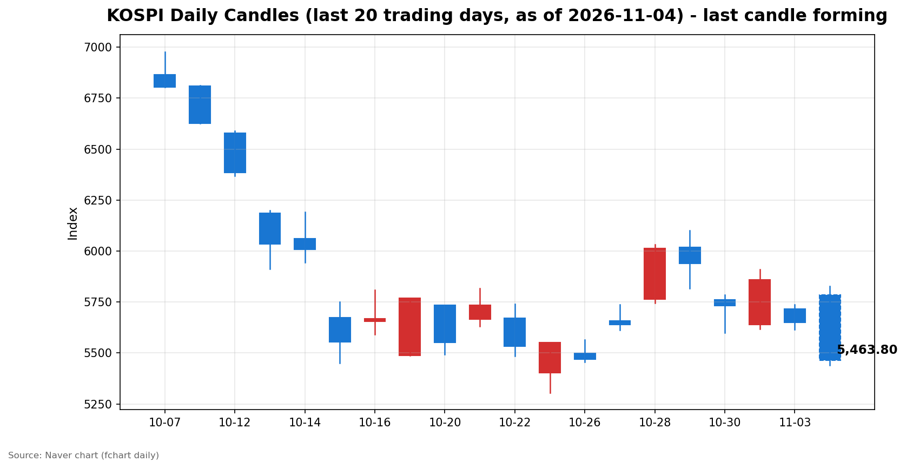
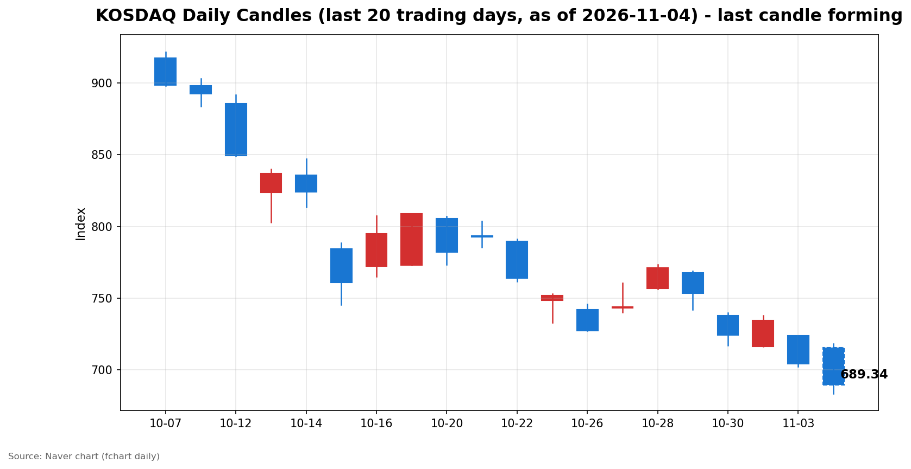

안녕하세요, [한국투자증권](https://securities.koreainvestment.com/main/Main.jsp)에서 [한투-한국투자증권](https://play.google.com/store/apps/details?id=com.truefriend.neosmartarenewal&hl=ko) 개발을 담당하고 있는 way입니다. 
2026년 11월 4일 국내 증시 장중 흐름을 수치 중심으로 정리합니다. 

## 오전장 요약

코스피는 전일 종가 5,648.79에서 5,786.13으로 2.43% 상승 출발했습니다. 
코스닥은 전일 종가 704.39에서 715.74로 상승 출발했습니다. 
장 초반 코스피는 5,828.13까지 올랐으나, 이후 하락으로 전환했습니다. 
정오 무렵 코스피는 시가 대비 5.57% 낮은 5,463.80 부근에서 움직이고 있습니다. 
코스닥은 시가 대비 3.69% 낮은 689.34 부근에서 움직이고 있습니다. 
이날 오전장의 핵심은 상승 출발이 아니라 출발 뒤의 반전입니다. 

## 오늘의 스냅샷

| 지수 | 현재가 | 전일 대비 | 등락률 | 시가 | 고가 | 저가 | 거래량 | 거래대금 | 스냅샷 기준 시각 |
| --- | --- | --- | --- | --- | --- | --- | --- | --- | --- |
| 코스피 | 5,463.80 | -184.99 | -3.27% | 5,786.13 | 5,828.13 | 5,439.54 | 141,387천주 | 12조 1,134억원 | 2026-11-04 12:29 KST |
| 코스닥 | 689.34 | -15.05 | -2.14% | 715.74 | 718.34 | 683.66 | 357,899천주 | 3조 7,598억원 | 2026-11-04 12:29 KST |

당일 봉은 형성 중인 봉이며 종가는 확정값이 아닙니다. 
코스피는 시가 5,786.13에서 출발해 스냅샷 시점 5,463.80을 기록했습니다. 
코스닥은 시가 715.74에서 출발해 스냅샷 시점 689.34를 기록했습니다. 
전일 종가는 네이버 실시간 수치와 일봉 종가를 교차 확인했습니다. 
코스피 전일 종가는 5,648.79, 코스닥 전일 종가는 704.39입니다. 
지수 차트는 [코스피](https://finance.naver.com/sise/sise_index.naver?code=KOSPI)와 [코스닥](https://finance.naver.com/sise/sise_index.naver?code=KOSDAQ)에서 확인할 수 있습니다. 

## 차트

최근 20거래일 일봉 차트입니다. 
빨간 봉은 종가가 시가보다 높은 날, 파란 봉은 종가가 시가보다 낮은 날입니다. 
당일 봉은 형성 중인 봉으로, 마감 전에는 계속 변합니다. 

## 원인·촉매 분석

출발 재료와 장중 반전 재료가 정반대 방향으로 작용했습니다. 
출발 재료는 간밤 미국 반도체 강세와 국제유가 하락이었습니다. 
간밤 뉴욕증시에서 나스닥 종합지수는 25,372.01로 0.83% 올랐습니다. 
스탠더드앤드푸어스 500 지수는 7,568.92로 0.36% 올랐습니다. 
다우존스 지수는 51,786.72로 0.38% 내리며 혼조세를 보였습니다. 
반도체 저가 매수세가 유입되면서 국내 증시도 상승 출발했습니다. 
그러나 상승 출발은 오래 유지되지 않았습니다. 
미국 중간선거 개표 경계감이 장중에 커지면서 위험 회피 심리가 강화됐습니다. 
인공지능 투자 수익성에 대한 의구심도 성장주 밸류에이션에 부담으로 작용했습니다. 
전일 수급 구도는 이러한 반전에 취약한 상태였습니다. 
11월 3일 코스피에서 외국인은 1조 5,799억원 순매도를 기록했습니다. 
같은 날 기관은 7,300억원 순매도를 기록했습니다. 
같은 날 개인은 1조 9,568억원 순매수를 기록했습니다. 
외국인과 기관이 판 물량을 개인이 받은 구도였습니다. 
이 구도는 상승장에서 받쳐주는 힘이 아니라 하락장에서 부담이 되는 구조입니다. 
당일 장중 수급 확정치는 아직 집계되지 않아 확인이 필요합니다. 
한국투자증권 MTS 장중 집계 기준으로는 외국인 순매도 방향이 이어지는 것으로 표시됩니다. 
해당 수치는 확정치가 아니므로 방향 참고용으로만 이해할 필요가 있습니다. 
원·달러 환율은 1,338.10원 수준으로 확인됩니다. 
환율 자체는 이날 급락의 직접 촉매로 단정하기 어렵습니다. 

## 핵심 사건 3가지

첫째, 국내 증시의 장중 반전입니다. 
코스피는 2.43% 상승 출발해 장 초반 5,800선을 회복했습니다. 
이후 하락으로 전환해 정오 무렵 전일 대비 3% 넘게 하락했습니다. 
코스닥도 700선을 밑돌며 689선 부근에서 움직이고 있습니다. 
상승 출발 뒤 하락 전환은 추격 매수 심리를 빠르게 위축시킵니다. 
고가에서 산 물량이 손실을 떠안는 구조가 되기 때문입니다. 
이날 반전은 단순한 차익 실현을 넘어 수급 부담이 겹친 결과로 보입니다. 

둘째, 미국 중간선거 개표 경계감입니다. 
4일 오전 기준 미국 주가지수 선물은 하락세를 보였습니다. 
나스닥100 선물은 0.81% 하락한 것으로 전해졌습니다. 
민주당의 상·하원 장악 가능성이 부각되면서 정책 불확실성이 커졌습니다. 
인공지능 데이터센터 규제 강화 우려도 기술주에 부담으로 거론됐습니다. 
개표 결과가 나오기 전까지 시장은 방향을 확정 짓기 어렵습니다. 
이 불확실성은 장중 외국인 매도와 맞물려 하락 압력을 키웠습니다. 

셋째, 쿠팡의 3분기 대규모 영업손실입니다. 
쿠팡 모회사는 3분기 영업손실 6,423억원을 기록했습니다. 
분기 최대 매출에도 3분기 연속 적자가 이어졌습니다. 
물류센터 화재에 따른 손실 비용 약 3,540억원이 반영됐습니다. 
과징금 부담도 실적 회복을 더디게 하는 요인으로 거론됩니다. 
쿠팡은 국내 증시 직접 구성 종목이 아니므로 지수 하락의 직접 원인으로 보기는 어렵습니다. 
다만 대형 플랫폼 기업의 적자 지속은 소비·유통 관련 투자 심리에 부담으로 작용합니다. 
이날 하락의 중심축은 반도체·성장주 조정과 외국인 매도이며, 쿠팡 실적은 심리 요인으로 이해할 필요가 있습니다. 

## 섹터·테마 영향 체인

인공지능 투자 수익성 우려는 반도체와 성장주 밸류에이션을 직접 압박했습니다. 
밸류에이션이 높은 종목일수록 금리·성장 기대 변화에 민감하게 반응합니다. 
기대 수익에 대한 의구심이 커지면 할인율 부담이 먼저 가격에 반영됩니다. 
코스피200이 3% 넘게 하락한 점은 대형주 전반으로 조정이 확산됐음을 보여줍니다. 
선물 지수도 비슷한 폭으로 하락해 단기 방향에 대한 경계감이 확인됩니다. 
국제유가 하락은 에너지 관련주에 부담이 되는 반면, 운송·소비 비용 부담은 덜어주는 방향입니다. 
그러나 이날은 유가 하락의 긍정적 효과가 하락장 분위기에 묻혔습니다. 
상대적으로 강했던 쪽은 통신사와 태양광·폴리실리콘 관련 테마였습니다. 
통신사는 하락장에서 방어적 성격이 부각되는 경향이 있습니다. 
태양광·폴리실리콘 테마는 미국 중간선거를 앞둔 정책 기대와 미국 현지 생산 수혜 기대가 거론됩니다. 
농업·제분 테마의 상승도 지수 하락 속 일부 자금이 방어·정책 테마로 이동했음을 시사합니다. 
다만 테마 상승이 지수 하락을 상쇄할 규모는 아닙니다. 
지수 하락이 주도하는 장에서는 테마 강세도 변동성이 커질 수 있습니다. 

## 최근 5거래일 일봉

### 코스피

| 날짜 | 시가 | 고가 | 저가 | 종가 | 거래량(천주) |
| --- | --- | --- | --- | --- | --- |
| 2026-10-28 | 5,763.85 | 6,032.28 | 5,745.51 | 6,012.44 | 237,337 |
| 2026-10-29 | 6,017.22 | 6,100.11 | 5,817.92 | 5,937.66 | 296,495 |
| 2026-10-30 | 5,760.35 | 5,784.98 | 5,599.42 | 5,730.74 | 228,294 |
| 2026-11-02 | 5,637.77 | 5,910.83 | 5,616.50 | 5,859.08 | 198,130 |
| 2026-11-03 | 5,715.19 | 5,735.92 | 5,615.80 | 5,648.79 | 207,371 |
| 2026-11-04 | 5,786.13 | 5,828.13 | 5,439.54 | 5,463.80 | 141,387 |

### 코스닥

| 날짜 | 시가 | 고가 | 저가 | 종가 | 거래량(천주) |
| --- | --- | --- | --- | --- | --- |
| 2026-10-28 | 756.90 | 773.28 | 756.57 | 771.28 | 560,627 |
| 2026-10-29 | 767.78 | 768.75 | 741.96 | 753.23 | 494,052 |
| 2026-10-30 | 737.76 | 739.79 | 717.27 | 724.38 | 470,174 |
| 2026-11-02 | 716.44 | 738.01 | 716.21 | 734.36 | 355,750 |
| 2026-11-03 | 723.92 | 723.92 | 702.34 | 704.39 | 430,571 |
| 2026-11-04 | 715.74 | 718.34 | 683.66 | 689.34 | 357,899 |

2026년 11월 4일 봉은 장중 형성 중인 봉이며 종가는 확정값이 아닙니다. 
일봉 표의 당일 종가는 표 작성 시점의 형성 중 수치이며 실시간 현재가와 시차가 있을 수 있습니다. 
코스피는 10월 28일 6,012.44 고점 이후 하락 흐름이 이어지고 있습니다. 
코스닥은 10월 28일 771.28 이후 하락 흐름이 이어지고 있습니다. 

## 오전 강했던 테마와 흐름 변화

한국투자증권 MTS 기준 오전 강했던 테마는 다음과 같습니다. 
통신사 테마가 4.38% 상승했습니다. 
폴리실리콘 테마가 2.61% 상승했습니다. 
제분 테마가 2.29% 상승했습니다. 
태양광발전 테마가 1.92% 상승했습니다. 
건설기계 테마가 1.66% 상승했습니다. 
두 지수 모두 시가 대비 상승 전환은 확인되지 않습니다. 
코스피는 시가 5,786.13보다 스냅샷 시점 5,463.80이 낮습니다. 
코스닥은 시가 715.74보다 스냅샷 시점 689.34가 낮습니다. 
당일 장중 수급 확정치는 아직 집계되지 않아 확인이 필요합니다. 

## 오후 전망과 확인할 시나리오

오전 흐름이 지속되는지, 일시적 과매도에 그치는지를 구분할 필요가 있습니다. 
코스피는 당일 저가 5,439.54 부근을 지키는지가 첫 확인 지점입니다. 
저가를 지키지 못하면 5,400선 아래 구간이 다음 지지 구간으로 거론될 수 있습니다. 
반등한다면 시가 5,786.13 회복이 아니라 5,500선 안착 여부가 먼저 확인돼야 합니다. 
코스닥은 683.66 저가 부근과 690선 안착 여부를 확인할 필요가 있습니다. 
미국 중간선거 개표 결과와 미국 주가지수 선물 방향이 오후 심리를 좌우할 수 있습니다. 
외국인 매도 방향이 오후에도 이어지는지 확인할 필요가 있습니다. 
장 마감 무렵 수급 확정치가 어떻게 집계되는지 확인할 필요가 있습니다. 
오전 강했던 통신사·태양광 관련 테마의 상대적 강세가 오후에도 이어지는지 확인할 필요가 있습니다. 
반등이 나와도 거래량과 외국인 매도 축소가 동반되지 않으면 되돌림으로 볼 필요가 있습니다. 

## 마치며

이날 국내 증시는 급등 출발 뒤 반전해 정오 무렵 두 지수 모두 전일 대비 2% 넘게 하락하고 있습니다. 
이 글은 교육·해설 목적의 시장 정리이며, 매수·매도 권유가 아닙니다. 
