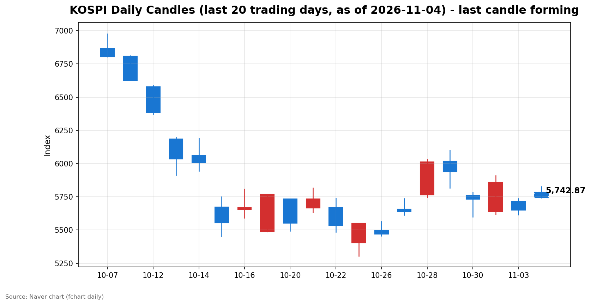
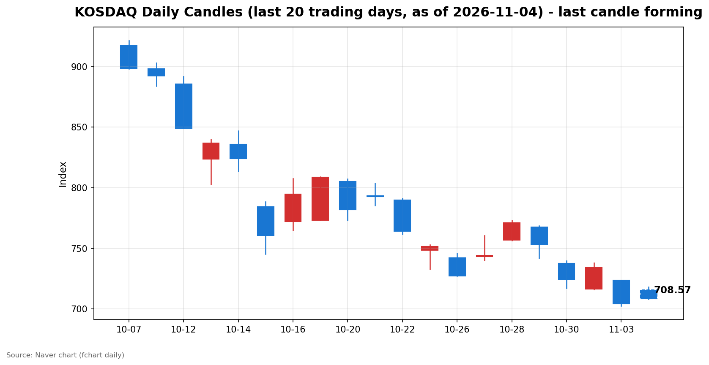

안녕하세요, [한국투자증권](https://securities.koreainvestment.com/main/Main.jsp)에서 [한투-한국투자증권](https://play.google.com/store/apps/details?id=com.truefriend.neosmartarenewal&hl=ko) 개발을 담당하고 있는 way입니다. 
2026년 11월 4일 국내 증시 장 오픈 흐름을 수치 중심으로 정리합니다. 

## 배경

간밤 미국 증시는 혼조 속에서 나스닥이 반등 마감했습니다. 
한국투자증권 MTS 기준 나스닥 종합은 25,372.01로 전일 대비 207.65포인트, 0.83% 상승했습니다. 
스탠더드앤드푸어스 500 지수는 7,568.92로 전일 대비 27.52포인트, 0.36% 상승했습니다. 
전일인 2026년 11월 3일 국내 증시는 크게 하락 마감했습니다. 
코스피는 5,648.79로 전일 대비 3.59% 하락했고, 코스닥은 704.39로 전일 대비 4.08% 하락했습니다. 
이러한 배경 속에서 오늘 국내 증시는 두 지수 모두 상승 출발했습니다. 
다만 장 초반 상승폭이 시가보다 축소되고 있어, 반등의 지속 여부는 장중 흐름으로 확인할 필요가 있습니다. 

## 오늘의 스냅샷

| 지수 | 현재가 | 전일 대비 | 등락률 | 시가 | 고가 | 저가 | 거래량 | 거래대금 | 스냅샷 기준 시각 |
| --- | --- | --- | --- | --- | --- | --- | --- | --- | --- |
| 코스피 | 5,741.56 | +92.77 | +1.64% | 5,786.13 | 5,828.13 | 5,738.73 | 36,484천주 | 2조 6,797억원 | 2026-11-04 09:30 KST |
| 코스닥 | 707.73 | +3.34 | +0.47% | 715.74 | 718.34 | 707.73 | 133,878천주 | 1조 2,669억원 | 2026-11-04 09:30 KST |

코스피와 코스닥은 모두 상승 출발했습니다. 
코스피는 시가 5,786.13에서 출발해 스냅샷 시점 5,741.56을 기록했습니다. 
코스닥은 시가 715.74에서 출발해 스냅샷 시점 707.73을 기록했습니다. 
전일 종가는 네이버 실시간 수치와 일봉 종가를 교차 확인했습니다. 
코스피 전일 종가는 5,648.79, 코스닥 전일 종가는 704.39입니다. 
교차 검증은 현재가를 등락률로 나눈 역산값으로 수행했습니다. 
지수 차트는 [코스피](https://finance.naver.com/sise/sise_index.naver?code=KOSPI)와 [코스닥](https://finance.naver.com/sise/sise_index.naver?code=KOSDAQ)에서 확인할 수 있습니다. 

## 차트

최근 20거래일 일봉 차트입니다. 
빨간 봉은 종가가 시가보다 높은 날, 파란 봉은 종가가 시가보다 낮은 날입니다. 
당일 봉은 형성 중인 봉으로, 마감 전에는 계속 변합니다. 

## 원인·촉매 분석

오늘 장 오픈 반등의 직접적인 촉매는 간밤 미국 반도체주 반등과 전일 급락에 따른 저가 매수 유인입니다. 
미국 중간선거 당일 뉴욕 증시는 혼조였지만, 반도체주가 반등하면서 나스닥이 0.83% 상승했습니다. 
이 흐름은 국내 장 오픈에서 대형 기술주 중심의 상승 출발로 이어졌습니다. 
전일 국내 지수가 3% 넘게 하락한 뒤라는 점도 반등의 배경입니다. 
급락 다음 날에는 하락폭이 컸던 지수일수록 기술적 되돌림이 나타나기 쉽습니다. 
다만 시가 대비 상승폭이 축소된 점은 되돌림의 강도를 가늠하는 첫 신호입니다. 
코스피는 전일 종가 대비 2.43% 높은 수준에서 출발했지만, 스냅샷 시점 상승률은 1.64%로 줄었습니다. 
코스닥은 전일 종가 대비 1.61% 높은 수준에서 출발했지만, 스냅샷 시점 상승률은 0.47%로 줄었습니다. 
원/달러 환율은 한국투자증권 MTS 기준 1,343.60원 수준으로, 전일 대비 큰 변동은 확인되지 않았습니다. 
환율 급변동이 장 오픈을 흔든 흔적은 스냅샷 시점에서는 확인되지 않았습니다. 
10월 외환보유액 증가 소식은 거시적인 완충 여력을 보여주지만, 장 오픈 당일의 직접 촉매로 단정하기는 어렵습니다. 
결국 오늘 반등은 새로운 호재보다, 전일 급락과 간밤 미국 기술주 반등이 맞물린 되돌림 성격이 강합니다. 
되돌림인지 추세 전환인지는 장중 수급과 상승폭 유지 여부로 가릴 필요가 있습니다. 

## 핵심 사건 3가지

### 1. 미국 중간선거 당일, 반도체주 반등에 나스닥 상승

간밤 뉴욕 증시는 미국 중간선거 당일에 혼조를 보였습니다. 
나스닥 종합은 25,372.01로 0.83% 상승했고, 스탠더드앤드푸어스 500 지수는 7,568.92로 0.36% 상승했습니다. 
반도체주가 4거래일 만에 반등한 점이 나스닥 상승을 이끌었습니다. 
선거 결과의 불확실성 속에서도 대기하던 자금이 기술주로 먼저 움직였다는 점이 중요합니다. 
국내 시장에는 개장 전부터 기술주 중심의 반등 기대가 전달됐습니다. 
다만 선거 이후 정책 방향이 확정되기 전까지는 불확실성이 완전히 해소된 것이 아닙니다. 
이 사건의 심리적 충격은 공포 완화 쪽에 가깝고, 구조적인 방향 전환으로 단정하기는 이릅니다. 

### 2. 전일 국내 급락과 개인의 대규모 저가 매수

전일 국내 증시는 코스피 3.59%, 코스닥 4.08% 하락이라는 강한 조정을 겪었습니다. 
이 조정 국면에서 개인은 코스피에서 1조 6,388억원을 순매수했습니다. 
코스닥에서도 개인은 3,180억원을 순매수했습니다. 
반면 외국인은 코스피에서 1조 5,086억원을 순매도했습니다. 
급락 당일 개인이 물량을 받았다는 점이 오늘 반등의 국내 수급 배경입니다. 
개인 매수가 추세의 바닥을 보장하는 것은 아닙니다. 
다만 전일 매도 주체와 매수 주체가 뚜렷하게 갈렸다는 점은 오늘 장 초반 수급 해석의 기준이 됩니다. 

### 3. 10월 외환보유액 증가와 대외 완충 여력 확인

한국은행 발표에 따르면 10월 말 외환보유액은 4,431억 6천만 달러였습니다. 
9월 말보다 26억 달러 증가했고, 외화자산 운용수익과 금융기관 외화 예수금 증가가 원인으로 설명됐습니다. 
한국의 외환보유액 규모는 9월 말 기준 세계 9위 수준으로 집계됐습니다. 
이 소식은 당일 지수를 직접 끌어올리는 재료라기보다, 대외 충격에 대한 완충 여력을 확인하는 재료입니다. 
원/달러 환율이 1,343원대에서 안정된 흐름을 보인 점과 함께 읽을 수 있습니다. 
시장 심리가 불안할 때에는 이러한 거시 지표가 변동성 확대를 제한하는 심리적 지지선이 됩니다. 
다만 외환보유액 자체가 주가 방향을 결정하지는 않으므로, 과도한 의미를 부여하지 않는 것이 적절합니다. 

## 섹터·테마 영향 체인

장 오픈 테마 흐름은 특정 업종만의 강세가 아니라, 되돌림이 여러 테마로 번진 모습입니다. 
한국투자증권 MTS 기준 오전 테마 상승률 상위에는 방산 관련 테마가 4.23%, 건설기계가 4.17%를 기록했습니다. 
전선업체는 4.03%, 전력기기는 3.52%, PCB는 3.40% 상승했습니다. 
우주 관련 테마도 3.22% 상승했습니다. 
연결고리는 AI 데이터센터 투자에서 시작됩니다. 
데이터센터 확충은 전력기기와 전선 수요로 이어지고, 전력 인프라 기대는 관련 테마로 번집니다. 
반도체 업황 기대는 기판과 장비 쪽으로 연결되며, PCB 테마 상승과 같은 방향을 보입니다. 
방산과 우주 테마는 수주 기대라는 별개의 축으로 움직이지만, 오늘은 되돌림 국면에서 함께 상승했습니다. 
반대로 전일 급락의 충격이 컸던 성장주 영역은 반등폭이 시가보다 축소되는 양상을 보였습니다. 
이는 금리와 밸류에이션 부담이 완전히 해소되지 않았다는 신호로 읽을 수 있습니다. 
테마 등락률만으로 업종 전환을 단정하지 않고, 장중에도 이 연결고리가 유지되는지 확인할 필요가 있습니다. 

## 최근 5거래일 일봉

### 코스피

| 날짜 | 시가 | 고가 | 저가 | 종가 | 거래량(천주) |
| --- | --- | --- | --- | --- | --- |
| 2026-10-28 | 5,763.85 | 6,032.28 | 5,745.51 | 6,012.44 | 237,337 |
| 2026-10-29 | 6,017.22 | 6,100.11 | 5,817.92 | 5,937.66 | 296,495 |
| 2026-10-30 | 5,760.35 | 5,784.98 | 5,599.42 | 5,730.74 | 228,294 |
| 2026-11-02 | 5,637.77 | 5,910.83 | 5,616.50 | 5,859.08 | 198,130 |
| 2026-11-03 | 5,715.19 | 5,735.92 | 5,615.80 | 5,648.79 | 207,371 |
| 2026-11-04 | 5,786.13 | 5,828.13 | 5,738.73 | 5,743.73 | 36,342 |

### 코스닥

| 날짜 | 시가 | 고가 | 저가 | 종가 | 거래량(천주) |
| --- | --- | --- | --- | --- | --- |
| 2026-10-28 | 756.90 | 773.28 | 756.57 | 771.28 | 560,627 |
| 2026-10-29 | 767.78 | 768.75 | 741.96 | 753.23 | 494,052 |
| 2026-10-30 | 737.76 | 739.79 | 717.27 | 724.38 | 470,174 |
| 2026-11-02 | 716.44 | 738.01 | 716.21 | 734.36 | 355,750 |
| 2026-11-03 | 723.92 | 723.92 | 702.34 | 704.39 | 430,571 |
| 2026-11-04 | 715.74 | 718.34 | 707.81 | 707.90 | 133,301 |

2026년 11월 4일 봉은 장중 형성 중인 봉이며 종가는 확정값이 아닙니다. 
일봉 표의 당일 종가는 표 작성 시점의 형성 중 수치이며 실시간 현재가와 시차가 있을 수 있습니다. 
코스피는 전일 5,648.79에서 상승 출발해 5,740선 부근에서 움직이고 있습니다. 
코스닥은 전일 704.39에서 상승 출발해 707선 부근에서 움직이고 있습니다. 

## 전일 수급

전일인 2026년 11월 3일 수급은 다음과 같습니다. 

### 코스피

| 주체 | 순매수(억원) |
| --- | --- |
| 개인 | +16,388 |
| 외국인 | -15,086 |
| 기관 | -4,941 |
| 기타법인 | +3,639 |

### 코스닥

| 주체 | 순매수(억원) |
| --- | --- |
| 개인 | +3,180 |
| 외국인 | -713 |
| 기관 | -2,359 |
| 기타법인 | -108 |

코스피에서는 개인이 순매수했고 외국인과 기관이 순매도했습니다. 
코스닥에서도 개인이 순매수했고 외국인과 기관이 순매도했습니다. 
코스피 개인 순매수 규모가 이날 수급에서 가장 컸습니다. 
구도로 보면, 급락 당일 외국인이 던진 물량을 개인이 받았다는 해석이 가능합니다. 
기관까지 순매도에 가세했다는 점은 급락 당일 기관이 하락을 방어하지 않았다는 의미입니다. 
이는 전일 하락이 특정 주체의 일시적 매도라기보다, 외국인과 기관이 함께 물량을 줄인 날이었음을 보여줍니다. 
오늘 반등이 이어지려면 외국인과 기관의 매도세가 약해지는지가 핵심 확인 지표입니다. 

## 단기·중기 전망과 확인할 시나리오

단기적으로는 되돌림 지속과 되돌림 소멸이라는 두 시나리오가 갈립니다. 
되돌림이 지속되는 경우, 코스피는 스냅샷 시점 5,741선 위를 유지하며 전일 고점 부근을 시험하게 됩니다. 
전일 고점은 5,735.92였고, 오늘 시가는 이미 이를 웃돌았습니다. 
코스닥은 710선 안착 여부가 첫 관문입니다. 
스냅샷 시점 코스닥은 707.73으로 710선을 밑돌고 있어, 710선 회복이 단기 확인 수치입니다. 
되돌림이 소멸되는 경우, 코스피는 전일 종가 5,648.79 부근으로 되돌아가고, 코스닥은 전일 저점 702.34 부근을 시험하게 됩니다. 
중기적으로는 11월 2일 종가가 기준이 됩니다. 
코스피 5,859.08과 코스닥 734.36 회복 여부가 중기 방향의 분기점입니다. 
이 수준을 회복하지 못하면 전일 급락은 단순 조정이 아니라, 고점 이후의 변동성 확대 국면으로 해석될 수 있습니다. 
확인할 이벤트는 미국 중간선거 이후 정책 방향, 국내외 실적 발표, 원/달러 환율의 1,340원대 유지 여부입니다. 
금리 방향에 대한 새로운 수치나 발언이 나오면 성장주 밸류에이션에 대한 해석이 다시 바뀔 수 있습니다. 
이 글은 지수·섹터 단위의 시나리오 정리이며, 특정 종목에 대한 판단은 포함하지 않습니다. 

## 장 초반 확인할 점

코스피가 5,740선 부근에서 상승폭을 지키는지 확인할 필요가 있습니다. 
코스닥이 710선을 회복하는지 확인할 필요가 있습니다. 
외국인과 기관의 장 초반 수급 방향이 전일과 달라지는지 확인할 필요가 있습니다. 
간밤 미국 기술주 반등 흐름이 장중에도 이어지는지 확인할 필요가 있습니다. 
원/달러 환율이 1,343원대에서 안정되는지 확인할 필요가 있습니다. 

## 마치며

이날 장 초반 국내 증시는 전일 급락 뒤 두 지수 모두 반등 출발했습니다. 
이 글은 교육·해설 목적의 시장 정리이며, 매수·매도 권유가 아닙니다. 
