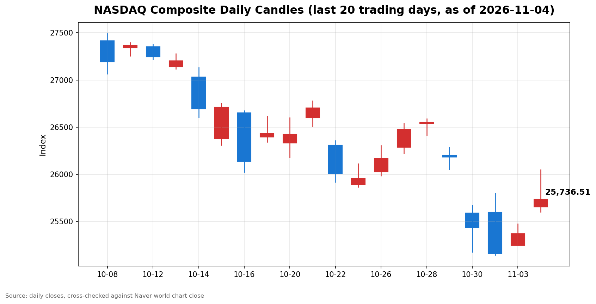

안녕하세요, [한국투자증권](https://securities.koreainvestment.com/main/Main.jsp)에서 [한투-한국투자증권](https://play.google.com/store/apps/details?id=com.truefriend.neosmartarenewal&hl=ko) 개발을 담당하고 있는 way입니다. 
2026년 11월 4일 나스닥 장 마감 흐름을 수치 중심으로 정리합니다. 

## 마감 요약

나스닥 종합은 전일 대비 상승으로 마감했습니다. 
상승률은 1.44%였습니다. 
S&P500도 상승으로 마감했으며 상승률은 1.58%였습니다. 
다우지수는 3.03% 상승해 세 지수 가운데 상승률이 가장 컸습니다. 
전 거래일에는 나스닥이 오르고 다우지수가 내렸던 것과 달리, 이날은 세 지수가 함께 올랐고 다우지수가 상승을 주도했습니다. 
이 글은 교육과 해설 목적으로 작성되었으며 특정 종목의 매수나 매도를 권유하지 않습니다. 

## 오늘의 마감 스냅샷

| 지수 | 종가 | 전일 대비 | 등락률 | 전일 종가 | 당일 고가 | 당일 저가 |
| --- | --- | --- | --- | --- | --- | --- |
| 나스닥 종합 | 25,736.51 | +364.50 | +1.44% | 25,372.01 | 26,048.83 | 25,602.14 |
| S&P500 | 7,688.62 | +119.70 | +1.58% | 7,568.92 | 7,712.12 | 7,649.39 |
| 다우지수 | 53,356.12 | +1,569.40 | +3.03% | 51,786.72 | 53,492.40 | 52,410.23 |

스냅샷 기준 시각은 미국 동부시간 2026년 11월 4일 16시 20분, 한국시간 2026년 11월 5일 06시 20분입니다. 
나스닥 종합 수치는 네이버 월드 차트 페이지에서 직접 확인한 마감 수치입니다. 
네이버 월드 차트 페이지에는 미국 11월 4일 16시 21분 장마감 기준으로 종가 25,736.51, 전일 대비 364.50, 등락률 1.44%가 표시되어 있습니다. 
한투 MTS 해외 대시보드의 나스닥 종합 값도 종가 25,736.51, 전일 대비 364.50, 등락률 1.44%로 네이버 값과 일치합니다. 
S&P500 수치는 한투 MTS 해외 대시보드에서 확인한 마감 수치입니다. 
전일 종가는 종가에서 전일 대비 변동폭을 빼는 방식으로 역산했습니다. 
역산한 전일 종가는 나스닥 25,372.01, S&P500 7,568.92, 다우지수 51,786.72이며, 세 값 모두 전 거래일 마감 글의 종가와 일치합니다. 
나스닥 당일 고가와 저가는 네이버 월드 차트 페이지의 표시값입니다. 
S&P500 당일 고가와 저가는 한투 MTS 차트 배열의 최대값과 최소값으로 산출했습니다. 
다우지수는 한투 MTS 해외 대시보드 지수 목록에 포함되지 않았습니다. 
다우지수 수치는 Yahoo Finance 일봉으로 확인한 값이며, 같은 일봉의 나스닥 수치가 네이버 마감 수치와 시가와 고가와 저가와 종가까지 일치해 일봉 기준의 정합성을 확인했습니다. 
네이버 월드 차트 출처는 [네이버 금융 월드 시세](https://finance.naver.com/world/sise.naver?symbol=NAS@IXIC)와 [네이버 월드 차트](https://stock.naver.com/worldstock/index/.IXIC/price)에서 확인할 수 있습니다. 
확인되지 않은 마감 원인은 본문에 쓰지 않았습니다. 

## 차트

최근 20거래일 일봉 차트입니다. 
빨간 봉은 종가가 시가보다 높은 날, 파란 봉은 종가가 시가보다 낮은 날입니다. 

## 원인·촉매 분석

이날 상승의 표면적 이유는 중간선거 결과 확정 이후의 안도감입니다. 
근본 촉매는 세 가지로 압축됩니다. 
첫째, 민주당이 상원과 하원을 모두 장악하면서 분점 정부에 대한 기대가 커졌습니다. 
여당과 의회가 나뉘면 급격한 정책 변화가 줄어들 것이라는 기대가 불확실성 프리미엄을 낮췄습니다. 
둘째, 국제유가가 큰 폭으로 하락하면서 인플레이션과 비용 부담에 대한 우려가 완화됐습니다. 
브렌트유는 배럴당 94.62달러로 8.7% 하락해 마감했고, 서부텍사스산 원유는 배럴당 88.12달러로 8.3% 하락해 마감했습니다. 
셋째, 금리 안정 기대가 성장주 밸류에이션 부담을 덜었습니다. 
딥서치로 확인한 국내 증권가 분석에서는 민주당의 의회 장악이 국채금리 하락으로 이어질 경우 증시에 긍정적이라는 평가가 나왔습니다. 
다만 장 마감 시점의 미국 10년물 국채수익률 종가는 확인되지 않았으므로, 금리 경로에 대한 최종 판단은 확인 필요로 남겨둡니다. 
전 거래일과 비교하면 지수 간 힘의 배치가 뒤집혔습니다. 
전 거래일에는 나스닥이 0.83% 오르고 다우지수가 0.38% 내렸지만, 이날은 다우지수가 3.03% 오르며 나스닥 상승률 1.44%를 웃돌았습니다. 
이는 상승 동력이 기술주에만 편중되지 않고 대형 우량주와 방어 섹터까지 넓게 퍼졌다는 뜻입니다. 

## 핵심 사건 3가지

첫째, 미국 중간선거에서 민주당이 상원과 하원을 모두 석권했습니다. 
3일(현지시간) 투표 뒤 4일에는 민주당의 양원 장악 흐름이 시장 가격에 본격적으로 반영됐습니다. 
시장이 주목한 것은 특정 정당의 승패 자체보다 분점 정부로 인한 정책 변화 속도 둔화입니다. 
정책 불확실성이 줄어들면 기업 투자와 소비 계획의 가정이 안정되고, 이는 위험자산 전반의 할인율을 낮추는 쪽으로 작용합니다. 
다만 의회 장악 이후 실제 입법 방향이 어떻게 정해질지는 아직 확인되지 않았으므로, 이날 상승만으로 중기 정책 효과를 단정할 수는 없습니다. 

둘째, 국제유가가 8% 안팎으로 급락했습니다. 
브렌트유 선물은 8.98달러 하락한 배럴당 94.62달러로 마감했고, 서부텍사스산 원유 선물은 7.97달러 하락한 배럴당 88.12달러로 마감했습니다. 
두 유종 모두 8월 31일 이후 최저 수준으로 마감했습니다. 
하락의 배경으로는 민주당 의회 장악 이후 미국과 이스라엘의 이란 전쟁 종결 기대가 거론됐습니다. 
유가 하락은 에너지 섹터에는 부담이지만, 운송과 제조와 소비 섹터의 비용 부담을 덜어주는 쪽으로 작용합니다. 
유가 하락이 전쟁 종결 기대에 기반한 것인 만큼, 실제 외교 전개가 확인되지 않으면 되돌림이 나타날 수 있습니다. 

셋째, 자금이 대형주와 방어 섹터로 이동하면서 인공지능 데이터센터 관련주는 압박을 받았습니다. 
장중 보도 기준으로는 대형 플랫폼 기업과 소매와 필수소비 관련주가 강세를 보인 반면, 일부 반도체와 데이터센터 관련주는 하락했습니다. 
민주당 의회 아래에서 데이터센터 규제 강화 가능성이 거론된 점이 인공지능 인프라 투자에 대한 우려로 연결됐습니다. 
이는 인공지능 투자 자체가 꺾였다는 신호라기보다, 투자 속도와 규제 비용에 대한 재평가가 진행 중이라는 신호로 보는 것이 적절합니다. 
규제 방향이 구체화되기 전에는 관련 섹터의 변동성이 이어질 수 있습니다. 

## 지수·섹터 영향 체인

나스닥의 상승은 대형 플랫폼 기업의 강세가 받쳤습니다. 
장중 보도 기준으로는 대형 기술 플랫폼 기업의 상승률이 두드러졌고, 이는 나스닥 상승률 1.44%로 이어졌습니다. 
S&P500은 기술주 비중이 나스닥보다 낮지만 금융과 필수소비와 통신서비스 등 넓은 섹터가 함께 오르면서 1.58% 상승했습니다. 
다우지수는 산업재와 가치주와 우량주 비중이 높아 방어 섹터로의 자금 이동 수혜가 가장 컸고, 3.03% 상승으로 마감했습니다. 
연결고리는 정치에서 시작해 금리와 유가로 이어집니다. 
분점 정부 기대는 정책 불확실성을 낮추고 금리 안정 기대로 연결됐으며, 이는 성장주 밸류에이션 부담을 덜었습니다. 
유가 급락은 에너지 섹터에는 부담이지만, 에너지 소비 섹터의 비용 부담을 낮추는 쪽으로 작용했습니다. 
반대로 인공지능 데이터센터 관련주는 규제 우려라는 새로운 연결고리를 만났습니다. 
규제 비용 우려가 커지면 인공지능 인프라 투자 속도에 대한 가정이 바뀌고, 이는 반도체와 데이터센터 밸류체인 전반의 변동성으로 번집니다. 
정리하면 이날은 기술주만의 상승이 아니라, 정치 불확실성 해소와 유가 하락이라는 두 가지 완화가 우량주와 방어 섹터까지 넓게 퍼진 날이었습니다. 

## 다우·S&P500 마감 흐름

S&P500은 7,688.62로 마감했습니다. 
전일 대비 변동폭은 +119.70, 등락률은 +1.58%였습니다. 
역산한 S&P500 전일 종가는 7,568.92입니다. 
한투 MTS 차트 배열 기준 S&P500 당일 고가는 7,712.12, 당일 저가는 7,649.39였습니다. 
다우지수는 53,356.12로 마감했습니다. 
전일 대비 변동폭은 +1,569.40, 등락률은 +3.03%였습니다. 
Yahoo Finance 일봉 기준 다우지수 당일 고가는 53,492.40, 당일 저가는 52,410.23이었습니다. 
S&P500과 다우지수가 나스닥보다 더 크게 올랐다는 점에서, 이날 상승 동력은 기술주보다 시장 전반과 우량주 쪽에 더 넓게 퍼졌습니다. 

## 단기·중기 전망과 다음 거래일 확인할 시나리오

흐름 지속과 일시적 안도 랠리를 구분하는 기준은 세 가지입니다. 
첫째, 나스닥이 당일 저가 25,602.14 부근을 지키는지 확인합니다. 
이 구간이 지켜지면 반등 흐름이 이어질 가능성이 커집니다. 
둘째, 나스닥이 당일 고가 26,048.83 부근과 26,000 구간을 회복해 유지하는지 확인합니다. 
고가 구간을 회복하지 못하고 되밀리면 이날 상승은 단기 안도 랠리에 그칠 가능성이 있습니다. 
셋째, 국제유가가 94달러 부근에서 안정되는지, 다시 반등하는지 확인합니다. 
유가 되돌림이 나타나면 비용 부담 완화 효과도 함께 약해질 수 있습니다. 
다음 거래일 이후 확인할 이벤트로는 11월 6일로 예정된 10월 고용지표와 연방준비제도 관계자 발언이 있습니다. 
고용지표가 예상을 크게 벗어나면 금리 경로에 대한 가정이 다시 바뀌면서 지수 방향도 달라질 수 있습니다. 
중기적으로는 중간선거 이후 실제 입법 방향과 인공지능 데이터센터 규제 논의가 관건입니다. 
정책 방향이 구체화되기 전에는 하루의 급등만으로 추세 전환을 단정하지 않고, 저가 지지 여부와 섹터 확산 여부를 함께 확인해야 합니다. 
이 글에서 제시한 구간과 시나리오는 지수와 섹터 단위의 참고 기준이며, 특정 종목의 매수나 매도 판단 근거가 아닙니다. 

## 마치며

2026년 11월 4일 나스닥 장은 정치 불확실성 해소와 유가 급락이 겹치면서 세 지수가 함께 상승한 날이었습니다. 
다음 거래일에는 저가 지지 여부와 유가 안정 여부와 고용지표 발표를 함께 확인하는 것이 중요합니다. 
