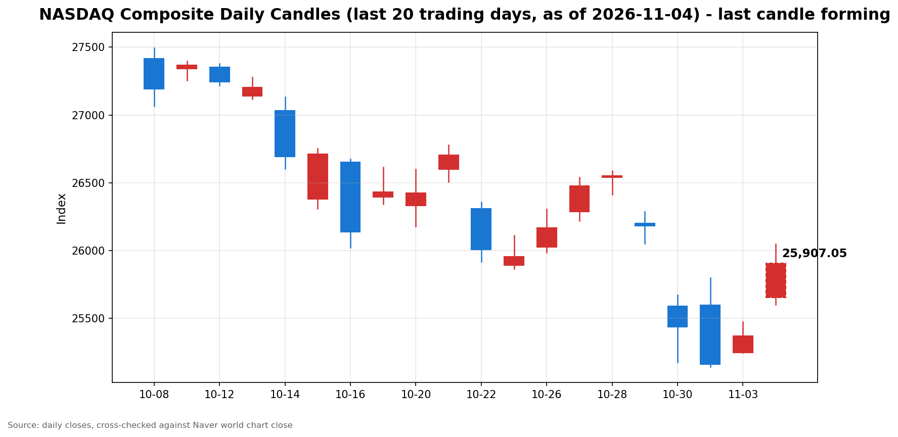

안녕하세요, [한국투자증권](https://securities.koreainvestment.com/main/Main.jsp)에서 [한투-한국투자증권](https://play.google.com/store/apps/details?id=com.truefriend.neosmartarenewal&hl=ko) 개발을 담당하고 있는 way입니다. 
2026년 11월 4일 나스닥 장중 흐름을 수치 중심으로 정리합니다. 

## 장중 요약

나스닥 종합은 장중 25,913.52로 전일 대비 541.51포인트, 2.13% 상승했습니다. 
스탠더드앤드푸어스 500 지수도 7,710.23으로 141.31포인트, 1.87% 올랐습니다. 
이날은 미국 중간선거 결과 확정 다음 날의 장입니다. 
민주당이 상원과 하원을 모두 장악했다는 결과가 확정되면서, 장 초반의 강세가 장중까지 이어졌습니다. 
개표 초반 선물 급락이라는 변동성을 거친 뒤의 반전이라는 점이 이날 흐름의 특징입니다. 

## 오늘의 스냅샷

| 지수 | 현재가 | 전일 대비 | 등락률 | 전일 종가 | 장중 고가 | 장중 저가 | 스냅샷 기준 시각 |
| --- | --- | --- | --- | --- | --- | --- | --- |
| 나스닥 종합 | 25,913.52 | +541.51 | +2.13% | 25,372.01 | 26,028.32 | 25,602.14 | 미국 동부시간 2026-11-04 12:57, 한국시간 2026-11-05 02:57 |
| 스탠더드앤드푸어스 500 | 7,710.23 | +141.31 | +1.87% | 7,568.92 | 7,710.76 | 7,649.39 | 미국 동부시간 2026-11-04 12:57, 한국시간 2026-11-05 02:57 |
| 다우존스 산업평균지수 | 확인 필요 | 확인 필요 | 확인 필요 | 51,786.72 | 확인 필요 | 확인 필요 | 미국 동부시간 2026-11-04 12:57, 한국시간 2026-11-05 02:57 |

당일 수치는 형성 중인 수치로, 마감 전에는 계속 변합니다. 
나스닥 종합의 시가는 25,652.78이었습니다. 
장중 고가와 저가는 한국투자증권 MTS 장중 시계열의 최대값과 최소값입니다. 
네이버 월드 차트 페이지는 직접 조회 시 가격 데이터를 포함한 본문을 확보하지 못했습니다. 
따라서 위 스냅샷은 한국투자증권 MTS 해외 대시보드 값으로 채웠습니다. 
나스닥 값은 [네이버 월드 차트 나스닥 종합](https://finance.naver.com/world/sise.naver?symbol=NAS@IXIC)과 [네이버 월드 차트 나스닥 종합 가격](https://stock.naver.com/worldstock/index/.IXIC/price)에서 확인할 수 있습니다. 
다우존스 산업평균지수의 장중 수치는 한국투자증권 MTS 해외 대시보드에 다우 항목이 포함되지 않아 확인 필요로 표기합니다. 

## 차트

최근 20거래일 일봉 차트입니다. 
빨간 봉은 종가가 시가보다 높은 날, 파란 봉은 종가가 시가보다 낮은 날입니다. 
당일 봉은 형성 중인 봉으로, 마감 전에는 계속 변합니다. 

## 원인·촉매 분석

표면적으로는 나스닥이 전일 대비 2.13% 강세입니다. 
근본 촉매는 네 가지로 정리됩니다. 
첫째, 선거 결과의 확정입니다. 
민주당이 상원과 하원을 모두 장악했다는 결과가 확정되면서, 분단 정부에 대한 기대가 정책 불확실성 해소 요인으로 작용했습니다. 
최종 의석수는 아직 집계 중인 부분도 있으므로, 의석수 자체를 확정 수치로 단정하지 않습니다. 
둘째, 선물 급락 후 반전입니다. 
개표 초반에는 나스닥 100 선물이 2.4%까지 하락하고 스탠더드앤드푸어스 500 선물이 1.4%까지 하락했다는 보도가 있었습니다. 
이후 낙폭은 대부분 되돌려졌고, 개장 이후에는 강세 흐름이 장중까지 이어졌습니다. 
셋째, 인공지능 수요 증거입니다. 
11월 3일 장 마감 후 인공지능 수요 강세를 보여주는 실적 재료가 이어졌고, 이는 데이터센터 규제 우려와 정반대 방향의 재료입니다. 
장중에는 수요 증거 쪽이 더 강하게 반영됐습니다. 
넷째, 되돌림입니다. 
나스닥은 11월 3일 반등하기 전까지 3거래일 연속 하락했고, 나스닥 100 지수는 11월 2일에 기술적 조정 구간 진입이 확인됐다는 보도가 있었습니다. 
낙폭이 누적된 뒤에는 단기 되돌림 매수가 들어오기 쉬운 구간입니다. 
전일 지수 간 방향 차이도 의미를 가집니다. 
11월 3일 나스닥은 0.83% 상승했고 스탠더드앤드푸어스 500 지수는 0.36% 상승했지만, 다우존스 산업평균지수는 0.38% 하락했습니다. 
당일 장중은 이 구도가 바뀌었습니다. 
나스닥 상승률 2.13%가 스탠더드앤드푸어스 500 지수 상승률 1.87%를 웃돌았고, 외신 보도에 따르면 다우도 장 초반 2.5% 안팎의 강세를 보였습니다. 
기술주 중심의 반등이 지수 전반의 상승으로 확산되는 구도입니다. 
미국 국채수익률과 달러의 당일 장중 확정 수치는 별도로 확인되지 않았습니다. 
다만 보도에 따르면 10년물 국채수익률은 4.92% 안팎으로 하락 방향이었고, 변동성 지수는 16% 하락했다는 보도가 있었습니다. 
수익률 하락과 변동성 축소는 성장주 밸류에이션 부담을 덜어주는 방향으로 작용합니다. 

## 핵심 사건 3가지

첫째, 민주당 양원 장악 확정과 트럼프 대통령의 결과 수용입니다. 
로이터 보도에 따르면 민주당은 상원과 하원을 모두 장악했고, 텍사스와 오하이오 등 공화당 강세 지역에서도 의석을 뒤집었습니다. 
트럼프 대통령은 선거 결과를 수용하겠다는 입장을 밝혔고, 이란과의 전쟁에 따른 고유가 부담이 공화당 패배의 한 요인이라고 언급했다는 보도가 있었습니다. 
심리적으로는 결과 불복에 대한 우려가 잦아들면서, 개표 초반의 선물 급락이 반전되는 계기가 됐습니다. 
구조적으로는 분단 정부가 들어서면서, 인공지능 인프라와 데이터센터에 대한 규제 경로가 의회 논의에 더 크게 좌우되는 구조가 됐습니다. 
결과가 확정되기 전까지는 방향성 베팅이 자제됐고, 결과 확인 이후에는 눌렸던 매수가 한꺼번에 들어오는 흐름이 나타났습니다. 

둘째, AMD의 3분기 실적 서프라이즈와 2027년 성장 전망 상향입니다. 
AMD의 3분기 매출은 133억 8,000만 달러로 전년 동기 대비 45% 증가했고, 시장 예상치 약 130억 9,000만 달러를 웃돌았습니다. 
조정 주당순이익은 2.09달러로 예상치 약 1.95달러를 웃돌았습니다. 
데이터센터 매출은 85억 5,000만 달러로 전년 동기 대비 97% 증가해 분기 매출의 64%를 차지했습니다. 
4분기 매출 가이던스는 약 170억 달러로 제시됐고, 리사 수 최고경영자는 2027년 매출이 80% 이상 증가할 것으로 전망했습니다. 
주가는 11월 3일 정규장에서 3.65% 오른 483.90달러로 마감한 뒤, 시간외 거래에서 7%에서 8% 안팎으로 추가 상승했다는 보도가 있었습니다. 
심리적으로는 인공지능 지출 지속 가능성에 대한 의구심을 덜어주는 재료입니다. 
구조적으로는 데이터센터용 프로세서와 인공지능 가속기 수요가 실적 수치로 확인됐다는 점이 중요하고, 이는 반도체 섹터 전반의 밸류에이션 논쟁에 실물 증거를 더했습니다. 
다만 AMD 측은 고대역폭 메모리 부족이 출하를 제약하는 요인이라고 밝혔으므로, 수요 강세와 공급 제약을 함께 봐야 합니다. 

셋째, 금리 하락과 변동성 축소, 정책 기대 섹터의 반응입니다. 
보도에 따르면 10년물 국채수익률은 4.92% 안팎으로 하락 방향을 보였고, 변동성 지수는 16% 하락했습니다. 
태양광 종목군에서는 퍼스트솔라가 15.1%, 엔페이즈 에너지가 12.1% 상승했다는 보도가 있었습니다. 
러셀 2000 지수도 1.3% 안팎의 상승을 보였고, 수익이 없는 기술주 바스켓은 3.0% 올랐다는 보도가 있었습니다. 
심리적으로는 선거 불확실성이 사라진 뒤 위험 선호가 중소형주와 성장주까지 확산되는 모습입니다. 
구조적으로는 금리 하락이 성장주 할인율 부담을 낮추는 경로와, 분단 정부 하의 정책 기대가 특정 섹터에 먼저 반영되는 경로가 동시에 작용했습니다. 
다만 정책 기대만으로 오른 종목군은 실제 의회 논의가 확인되기 전까지 변동성이 클 수 있습니다. 

## 지수·섹터 영향 체인

나스닥 상승률이 스탠더드앤드푸어스 500 지수 상승률을 웃돈 점이 가장 큰 차별점입니다. 
연결고리는 금리에서 성장주 밸류에이션으로 이어집니다. 
수익률 하락이 장기 성장주의 할인율 부담을 덜어주면, 나스닥 비중이 높은 기술주와 반도체주가 먼저 반응합니다. 
반도체 섹터는 AMD 실적을 계기로 직접적인 수혜를 받았습니다. 
데이터센터 매출이 두 배 가까이 늘었다는 수치는 인공지능 인프라 투자 사이클이 아직 진행 중이라는 신호로 읽혔습니다. 
기술주 전반도 같은 경로로 반등했지만, 실적과 마진 증명이 되는 종목과 그렇지 않은 종목이 갈리는 선별 흐름은 이어지고 있습니다. 
태양광 등 정책 기대 섹터는 선거 결과에 가장 민감하게 반응했습니다. 
분단 정부 하에서는 대규모 정책 전환보다는 기존 정책 경로 유지에 대한 기대가 먼저 반영되는 경향이 있습니다. 
금융 섹터는 카드금리 상한 논의 등 선거 결과에 따라 달라질 수 있는 변수에 노출돼 있습니다. 
당일 장중 금융 섹터의 방향은 별도로 확인되지 않아 확인 필요로 표기합니다. 
에너지 섹터의 당일 장중 방향도 별도로 확인되지 않아 확인 필요로 표기합니다. 
헬스케어 섹터는 민주당 승리 시 지원 확대 기대가 거론되는 쪽이지만, 당일 장중 방향은 확인 필요로 표기합니다. 

## 다우·S&P500 흐름

스탠더드앤드푸어스 500 지수는 7,710.23으로 전일 대비 141.31포인트, 1.87% 상승했습니다. 
장중 고가는 7,710.76, 장중 저가는 7,649.39였습니다. 
오전 10시경 1.64% 상승에서 장중 1.87%로 상승폭이 커졌습니다. 
대형주 전반의 완만한 반등 흐름으로, 나스닥보다는 상승폭이 작았습니다. 
다우존스 산업평균지수의 장중 수치는 한국투자증권 MTS 해외 대시보드에 항목이 없어 확인 필요로 표기합니다. 
전일 종가는 51,786.72로 전일 대비 0.38% 하락했습니다. 
외신 보도에 따르면 다우는 장 초반 1,300포인트 안팎, 2.5% 안팎의 상승을 보이며 4월 이후 가장 강한 하루를 향했다는 보도가 있었습니다. 
전일에는 다우만 하락했던 구도와 달리, 당일 장중은 세 지수가 함께 오르는 확산 흐름입니다. 

## 오전과 오후 흐름 변화

오전 10시 3분 기준 나스닥 종합은 네이버 값 기준 25,951.62로 2.28% 상승했습니다. 
한국투자증권 MTS 기준으로는 오전 10시경 25,908.09로 2.11% 상승했습니다. 
장중 12시 57분 기준 25,913.52로 2.13% 상승하면서 상승 흐름이 그대로 유지됐습니다. 
시가 대비 방향 전환은 없었고, 상승 흐름이 이어졌습니다. 
오전 고점 25,983.98은 장중 고점 26,028.32로 상향 돌파됐습니다. 
다만 현재가 기준으로는 오전 네이버 스냅샷보다 소폭 낮아, 고점은 높였지만 상승폭은 오전보다 다소 좁혀진 상태입니다. 
스탠더드앤드푸어스 500 지수도 오전 1.64%에서 장중 1.87%로 상승폭을 키웠습니다. 

## 마감까지 전망과 확인할 시나리오

장중 흐름이 지속되는지, 일시적 노이즈인지를 가르는 기준은 고점 유지 여부입니다. 
첫째, 나스닥 종합이 장중 고점 26,028.32 부근을 지키는지 확인합니다. 
고점을 지키면 상승 흐름이 유지되는 쪽이고, 25,900선 아래로 밀리면 오전 상승폭을 반납하는 쪽으로 해석할 수 있습니다. 
둘째, 스탠더드앤드푸어스 500 지수가 7,700선을 지키는지 확인합니다. 
장중 고점 7,710.76 부근 안착 여부가 대형주 전반의 강도를 가릅니다. 
셋째, 민주당의 정책 우선순위 발언을 확인합니다. 
데이터센터 세제 혜택과 인공지능 규제 관련 발언이 나올 경우, 반도체와 기술주의 변동성이 다시 커질 수 있습니다. 
넷째, 금리와 변동성 방향을 확인합니다. 
10년물 국채수익률이 4.92% 안팎에서 더 하락하는지, 변동성 지수가 낮은 수준을 유지하는지가 성장주 강세의 지속 조건입니다. 
다섯째, 장 마감 후 추가 개표 결과와 의석 확정 소식을 확인합니다. 
최종 의석수가 확정되는 과정에서 정책 경로에 대한 해석이 달라질 수 있습니다. 
이 글은 특정 종목의 매수나 매도를 권유하지 않습니다. 
지수와 섹터 단위의 흐름 정리와 마감까지 확인할 기준을 제시하는 것이 목적입니다. 

## 마치며

민주당 양원 장악 확정과 AMD 실적이라는 두 가지 재료가 맞물리며, 나스닥의 장중 강세가 이어졌습니다. 
마감까지는 고점 유지 여부와 정책 발언, 금리 방향을 함께 확인하는 것이 필요합니다. 
이 글은 교육과 해설 목적이며, 특정 종목의 매수나 매도를 권유하지 않습니다. 
