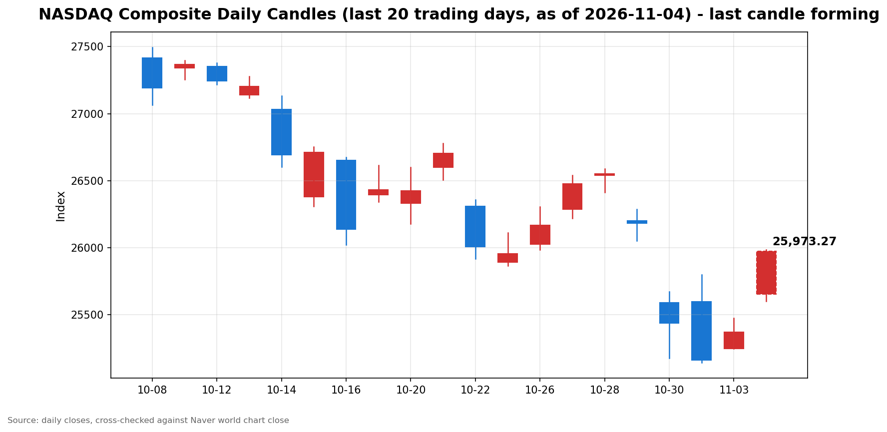

안녕하세요, [한국투자증권](https://securities.koreainvestment.com/main/Main.jsp)에서 [한투-한국투자증권](https://play.google.com/store/apps/details?id=com.truefriend.neosmartarenewal&hl=ko) 개발을 담당하고 있는 way입니다. 
2026년 11월 4일 나스닥 장 오픈 흐름을 수치 중심으로 정리합니다. 

## 개장 배경

간밤 미국 증시는 혼조 마감했습니다. 
2026년 11월 3일 나스닥 종합은 25,372.01로 전일 대비 0.83% 상승했고, 스탠더드앤드푸어스 500 지수는 7,568.92로 0.36% 상승했습니다. 
반면 다우존스 산업평균지수는 51,786.72로 0.38% 하락했습니다. 
나스닥과 스탠더드앤드푸어스 500 지수는 3거래일 하락을 멈췄고, 다우만 하락한 차별화된 마감였습니다. 
11월 3일은 미국 중간선거 투표일이었고, 장 마감 이후 개표가 진행되면서 11월 4일 장 오픈의 재료는 선거 결과로 옮겨갔습니다. 
개표 초반에는 인공지능과 데이터센터 규제 우려가 부각되며 선물이 급락했으나, 장 오픈 무렵에는 낙폭을 되돌리고 강세로 출발했습니다. 

## 오늘의 스냅샷

| 지수 | 현재가 | 전일 대비 | 등락률 | 전일 종가 | 장중 고가 | 장중 저가 | 스냅샷 기준 시각 |
| --- | --- | --- | --- | --- | --- | --- | --- |
| 나스닥 종합 | 25,951.62 | +579.61 | +2.28% | 25,372.01 | 25,983.98 | 25,602.14 | 미국 동부시간 2026-11-04 10:03, 한국시간 2026-11-05 00:03 |
| 스탠더드앤드푸어스 500 | 7,693.30 | +124.38 | +1.64% | 7,568.92 | 7,701.84 | 7,649.39 | 미국 동부시간 2026-11-04 10:00경, 한국시간 2026-11-05 00:00경 |
| 다우존스 산업평균지수 | 확인 필요 | 확인 필요 | 확인 필요 | 51,786.72 | 확인 필요 | 확인 필요 | 미국 동부시간 2026-11-04 10:00경, 한국시간 2026-11-05 00:00경 |

당일 수치는 형성 중인 수치로, 마감 전에는 계속 변합니다. 
나스닥 종합의 시가는 25,652.78이었고, 거래량은 310,394천주로 표시됐습니다. 
나스닥 값은 [네이버 월드 차트 나스닥 종합](https://finance.naver.com/world/sise.naver?symbol=NAS@IXIC)과 [네이버 월드 차트 나스닥 종합 가격](https://stock.naver.com/worldstock/index/.IXIC/price)에서 확인했습니다. 
한국투자증권 MTS 해외 대시보드 값과 교차 검증했습니다. 
한국투자증권 MTS 기준 나스닥 종합은 미국 동부시간 10시경 25,908.09로 전일 대비 536.08포인트, 2.11% 상승했고, 스탠더드앤드푸어스 500 지수는 7,693.30으로 1.64% 상승했습니다. 
네이버 값과 한국투자증권 MTS 값의 차이는 조회 시점 차이 범위 안에 있습니다. 
다우존스 산업평균지수의 장중 수치는 한국투자증권 MTS 해외 대시보드에 다우 항목이 포함되지 않아 확인 필요로 표기합니다. 

## 차트

최근 20거래일 일봉 차트입니다. 
빨간 봉은 종가가 시가보다 높은 날, 파란 봉은 종가가 시가보다 낮은 날입니다. 
당일 봉은 형성 중인 봉으로, 마감 전에는 계속 변합니다. 

## 원인·촉매 분석

표면적으로는 나스닥이 전일 대비 2.28% 강세 출발했습니다. 
근본 촉매는 선거 결과의 확정, 선물 급락 후 되돌림, 인공지능 수요 증거의 결합으로 정리됩니다. 
첫째, 선거 결과의 확정입니다. 
민주당이 상원과 하원을 모두 장악했다는 보도가 이어지면서, 분단 정부에 대한 기대가 정책 불확실성 해소 요인으로 작용했습니다. 
최종 의석수는 아직 집계 중이므로, 의석수 자체를 확정 수치로 단정하지 않습니다. 
둘째, 선물 급락 후 반전입니다. 
개표 초반에는 나스닥 100 선물이 2.4%까지 하락하고 스탠더드앤드푸어스 500 선물이 1.4%까지 하락했다는 보도가 있었습니다. 
이후 낙폭은 대부분 되돌려졌고, 개장 전에는 다우 선물이 1.5%에서 2.1% 안팎, 스탠더드앤드푸어스 500 선물이 1.1% 안팎, 나스닥 100 선물이 0.4%에서 1% 안팎 상승했다는 보도가 이어졌습니다. 
보도 시점이 달라 선물 상승 폭에 범위가 있는 점은 참고할 필요가 있습니다. 
셋째, 인공지능 수요 증거입니다. 
11월 3일 장 마감 후 인공지능 수요 강세를 보여주는 실적 재료가 이어졌고, 개장 전에는 AMD가 2027년 성장 전망 강화로 7% 이상 상승했다는 보도가 있었습니다. 
이는 데이터센터 규제 우려와 정반대 방향의 재료로, 장 초반에는 수요 증거 쪽이 더 강하게 반영됐습니다. 
교차 자산 흐름도 같은 방향을 보여줍니다. 
보도에 따르면 금 현물은 2.93% 상승해 온스당 4,043.45달러를 기록했고, 달러와 국채수익률은 하락했습니다. 
달러 약세와 수익률 하락은 성장주 밸류에이션 부담을 덜어주는 요인으로 작용합니다. 
지수 간 방향 차이도 의미가 있습니다. 
나스닥이 2.28% 오른 반면 스탠더드앤드푸어스 500 지수는 1.64% 오르는 데 그쳤습니다. 
이는 기술주와 반도체 중심의 되돌림이 장 초반 상승을 주도하고 있음을 보여줍니다. 
다만 상승 폭이 크다는 사실 자체가 추세 전환을 확정하지는 않습니다. 
선거 결과가 실제 법안과 규제 변화로 이어지는지는 앞으로 확인할 사안입니다. 

## 핵심 사건 3가지

### 첫째, 민주당의 상원과 하원 동시 장악입니다

미국 중간선거에서 민주당이 상원과 하원을 모두 장악했다는 보도가 이어졌습니다. 
이는 트럼프 행정부의 경제 의제에 대한 의회 견제가 강해졌음을 의미합니다. 
시장 관점에서는 두 가지 해석이 동시에 작동했습니다. 
하나는 분단 정부로 정책 불확실성이 줄어든다는 해석이고, 다른 하나는 데이터센터 건설 규제와 인공지능 규제 강화 가능성이라는 해석입니다. 
개표 초반에는 두 번째 해석이 선물을 끌어내렸고, 장 오픈 무렵에는 첫 번째 해석과 저가 매수가 우위를 점했습니다. 
딥서치 문서 검색에서도 민주당 상원과 하원 장악을 전제로 관세 정책에 대한 압박이 커질 수 있다는 관측이 확인됩니다. 
다만 관세 정책이 실제로 바뀌었다고 보기는 어렵다는 신중한 관측도 함께 확인됩니다. 
따라서 선거 결과는 방향을 바꾼 사건이지, 정책 변화를 확정하는 사건은 아닙니다. 

### 둘째, 장 마감 후 인공지능 수요 강세 재료입니다

11월 3일 장 마감 후 AMD와 아리스타 네트웍스, 슈퍼 마이크로 컴퓨터가 인공지능 수요 강세에 상승했다는 보도가 있었습니다. 
개장 전에는 AMD가 2027년 성장 전망을 강화하면서 7% 이상 상승했다는 보도도 이어졌습니다. 
딥서치 문서 검색에서도 AMD의 실적과 데이터센터 매출 증가 전망이 중국 인공지능 반도체 기업의 투자심리 개선으로 이어졌다는 보도가 확인됩니다. 
이 재료가 중요한 이유는 10월 말 나스닥 100 지수가 조정 구간에 들어갈 만큼 인공지능 투자 과잉 우려가 커졌기 때문입니다. 
우려가 커진 상태에서 수요 증거가 나오면, 매도 논리와 매수 논리가 정면으로 충돌합니다. 
11월 4일 장 초반에는 수요 증거가 우위를 점했으나, 이는 하루의 흐름일 뿐 수요 둔화 논쟁이 끝났음을 의미하지 않습니다. 

### 셋째, 아시아 시장의 롤러코스터입니다

11월 4일 아시아 시장에서는 선거 결과에 대한 반응이 극심한 변동성으로 나타났습니다. 
코스피는 장중 4% 넘게 급락했다가 강보합으로 마감했다는 보도가 있습니다. 
딥서치 문서 검색에서도 삼성전자와 SK하이닉스가 장 초반 상승분을 반납하고 약보합으로 마감했다는 분석이 확인됩니다. 
원인으로는 민주당 승리 가능성에 따른 인공지능 데이터센터 규제 강화와 건설 둔화 우려가 지목됐습니다. 
반면 같은 분석에서는 메모리 재고가 10일치 미만이고, 내년 HBM 생산 비중 확대가 범용 메모리 공급 절벽을 심화시킬 수 있다는 전망도 함께 제시됐습니다. 
아시아 시장의 변동성은 미국 장 오픈의 공포가 아니라, 미국 장 오픈 전에 이미 한 차례 소화됐다는 신호로 볼 수 있습니다. 
미국 장이 강세로 출발한 것은 아시아의 공포가 미국에서도 그대로 반복되지 않았음을 보여줍니다. 

## 지수·섹터 영향 체인

금리에서 성장주 밸류에이션으로 이어지는 연결고리가 먼저 작동합니다. 
달러와 국채수익률이 하락하면 미래 이익을 현재 가치로 환산하는 할인율 부담이 완화되고, 성장주에 우호적인 환경이 됩니다. 
반대로 데이터센터 규제 우려는 같은 성장주 안에서도 인공지능 인프라 관련주의 밸류에이션에 부담을 줍니다. 
11월 4일 장 초반에는 할인율 완화와 수요 증거가 규제 우려를 앞질렀습니다. 
반도체에서 하드웨어로 이어지는 연결고리도 확인됩니다. 
인공지능 수요 증거는 반도체 수요 전망을 지지하지만, 데이터센터 인허가 지연 우려는 건설과 인프라 투자 속도를 늦출 수 있습니다. 
수요와 공급 제약이 동시에 거론되는 구간에서는, 실적 증거와 규제 신호 중 어느 쪽이 먼저 확인되는지가 섹터 방향을 가릅니다. 
청정에너지에서 전통 에너지로 이어지는 연결고리는 정반대 방향으로 작용했습니다. 
민주당 승리가 청정에너지 공급망에 우호적이라는 해석 속에 재생에너지 관련주가 아시아와 유럽, 미국 개장 전 시장에서 강세를 보였다는 보도가 있습니다. 
방산 관련주는 군사 지출 확대 기대가 낮아질 수 있다는 해석 속에 개장 전 약세를 보였다는 보도가 있습니다. 
관세에서 소비 심리로 이어지는 연결고리는 아직 기대 단계입니다. 
관세로 촉발된 미국 소비자의 물가 부담이 선거 쟁점이었던 만큼, 관세 정책에 대한 압박이 커질 수 있다는 관측이 있습니다. 
그러나 실제 관세 변화가 확인되기 전에는 소비 관련주에 대한 직접적인 수혜로 단정하지 않습니다. 
수혜와 타격을 단순히 나누기보다, 같은 선거 결과가 섹터마다 다른 방향으로 작용한다는 점이 이번 장의 특징입니다. 

## 다우·스탠더드앤드푸어스 500 흐름

다우존스 산업평균지수는 11월 3일 0.38% 하락 마감했습니다. 
애플이 1.9% 하락하면서 가격 가중 방식의 다우에 부담을 준 것으로 보도됐습니다. 
같은 날 나스닥과 스탠더드앤드푸어스 500 지수가 상승한 것과 대비되는, 다우만 하락한 흐름이었습니다. 
11월 4일 개장 전에는 다우 선물이 가장 강하게 반등했다는 보도가 있었습니다. 
이는 전일의 방어주 약세가 되돌림 국면에 들어갔을 가능성을 보여줍니다. 
다만 다우의 장중 수치는 확인 필요로 표기하므로, 개장 후 다우의 실제 상승 폭은 별도로 확인해야 합니다. 
스탠더드앤드푸어스 500 지수는 11월 3일 0.36% 상승 마감했습니다. 
11월 4일 장 초반에는 한국투자증권 MTS 기준 1.64% 상승 출발했습니다. 
나스닥보다는 상승 폭이 작아, 기술주 되돌림이 지수 상승을 주도하고 있음을 보여줍니다. 
스탠더드앤드푸어스 500 지수의 장중 고가는 7,701.84, 저가는 7,649.39였습니다. 
지수 전체의 상승이 기술주에 집중된 것인지, 종목 전반으로 확산되는 것인지는 장중 흐름에서 확인해야 합니다. 

## 단기·중기 전망과 장 초반 확인할 시나리오

단기적으로는 강세 출발 지속과 일시적 노이즈를 구분하는 구간입니다. 
장 초반에 확인할 첫 번째 수치는 나스닥 종합의 전일 종가 25,372.01 안착 여부입니다. 
현재가 25,951.62는 전일 종가를 크게 웃돌고 있으나, 이 수준을 장중 내내 유지하는지가 관건입니다. 
두 번째 수치는 장중 고가 25,983.98 돌파 지속 여부입니다. 
이 고가를 지켜내면 강세의 힘이 이어지는 신호로 볼 수 있고, 반납하면 급반전의 힘이 약한 것으로 해석할 수 있습니다. 
세 번째 구간은 당일 시가 25,652.78과 장중 저가 25,602.14입니다. 
이 구간 아래로 내려가면 강세 출발이 무너지는 신호로 볼 수 있습니다. 
스탠더드앤드푸어스 500 지수는 전일 종가 7,568.92와 장중 고가 7,701.84를 기준으로 같은 판단을 적용할 수 있습니다. 
다우존스 산업평균지수는 전일 종가 51,786.72를 기준으로 흐름을 점검하되, 장중 수치는 확인되는 대로 대입해야 합니다. 
중기적으로는 선거 결과의 정책 전환 여부를 가리는 국면입니다. 
데이터센터 규제와 관세, 재정 방향에 대한 실제 법안과 행정 조치가 그 판단 재료를 제공합니다. 
이번 주 후반에는 11월 6일 고용지표 발표가 예정돼 있고, 다음 주에는 물가 지표가 이어진다는 보도도 있습니다. 
이 지표들이 금리 기대를 바꾸면, 선거 재료와 별개로 지수 방향이 다시 조정될 수 있습니다. 
리스크 관리 관점에서는 지수 단위에서 전일 종가와 장중 고저를 기준으로 흐름을 점검하고, 단일 재료에 의한 급등락에 과도하게 반응하지 않는 태도가 필요합니다. 
이 글은 지수와 섹터 단위의 해설이며, 특정 종목의 매수나 매도를 권유하지 않습니다. 

## 마치며

오늘 장은 선거 결과 확정과 선물 급락 후 반전이 겹친, 변동성이 큰 강세 출발로 시작되었습니다. 
장 초반에는 전일 종가 안착 여부와 장중 고가 돌파 지속 여부를 중심으로 흐름을 확인하시기 바랍니다. 
이 글은 교육과 해설 목적의 정리이며, 특정 종목의 매수나 매도 권유가 아닙니다. 
