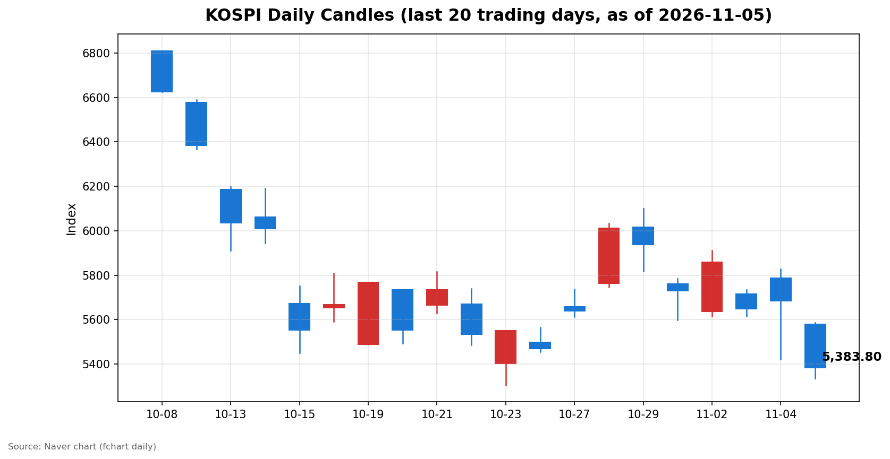
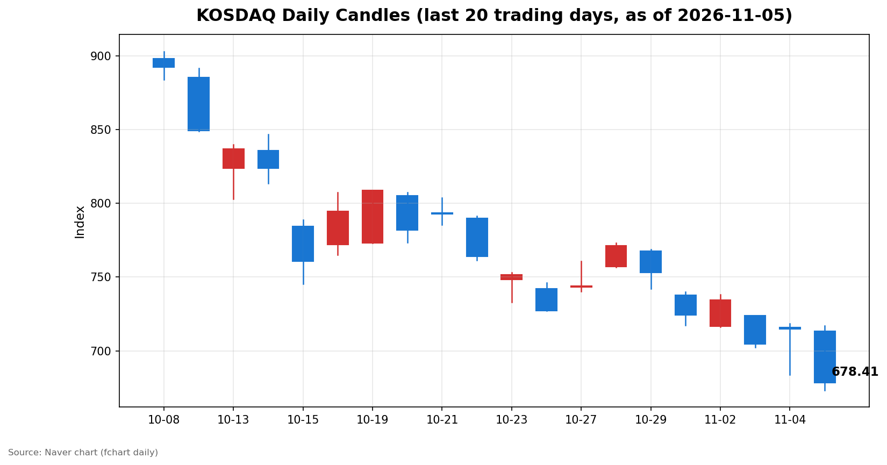

안녕하세요, [한국투자증권](https://securities.koreainvestment.com/main/Main.jsp)에서 [한투-한국투자증권](https://play.google.com/store/apps/details?id=com.truefriend.neosmartarenewal&hl=ko) 개발을 담당하고 있는 way입니다. 
2026년 11월 5일 국내 증시 장 마감 흐름을 수치 중심으로 정리합니다. 

## 마감 요약

코스피와 코스닥이 모두 5% 넘게 급락했습니다. 
코스피는 전일 대비 5.28% 내린 5,383.80에 마감했습니다. 
코스닥은 전일 대비 5.11% 내린 678.41에 마감했습니다. 
두 지수 모두 장중 매도 사이드카가 발동했습니다. 
코스피는 5,400선을 내줬고, 코스닥은 700선을 내줬습니다. 
전일 장중 급락 뒤 상승 마감했던 흐름은 하루 만에 다시 급락으로 돌아섰습니다. 
코스피는 10월 29일 종가 5,937.66 대비 9.33% 내려왔습니다. 
코스닥도 같은 기간 753.23에서 678.41로 9.93% 내려왔습니다. 
일주일 사이 지수 레벨 자체가 한 단계 낮아진 하루였습니다. 

## 오늘의 마감 스냅샷

| 지수 | 종가 | 전일 대비 | 등락률 | 시가 | 고가 | 저가 | 거래량 | 거래대금 |
| --- | --- | --- | --- | --- | --- | --- | --- | --- |
| 코스피 | 5,383.80 | -300.00 | -5.28% | 5,580.09 | 5,586.46 | 5,336.88 | 256,819천주 | 22조 6,176억원 |
| 코스닥 | 678.41 | -36.54 | -5.11% | 713.49 | 717.06 | 673.38 | 408,677천주 | 4조 9,124억원 |

전일 종가는 네이버 실시간 수치와 일봉 종가를 교차 확인했습니다. 
코스피 전일 종가는 5,683.80, 코스닥 전일 종가는 714.95입니다. 
교차 검증은 현재가를 등락률로 나눈 역산값으로 수행했습니다. 
지수 차트는 [코스피](https://finance.naver.com/sise/sise_index.naver?code=KOSPI)와 [코스닥](https://finance.naver.com/sise/sise_index.naver?code=KOSDAQ)에서 확인할 수 있습니다. 
스냅샷은 2026년 11월 5일 16시 장 마감 기준입니다. 

## 차트

최근 20거래일 일봉 차트입니다. 
빨간 봉은 종가가 시가보다 높은 날, 파란 봉은 종가가 시가보다 낮은 날입니다. 

## 원인·촉매 분석

오늘 급락의 직접 촉매는 미국 중간선거 결과의 해석이었습니다. 
민주당이 상원과 하원을 모두 장악하는 블루웨이브가 확정됐습니다. 
미국 증시는 같은 결과를 불확실성 완화로 받아들였습니다. 
11월 4일 미국 다우존스 지수는 3.03%, 스탠더드앤드푸어스 500 지수는 1.58%, 나스닥 종합은 1.44% 상승 마감했습니다. 
그러나 한국 시장은 같은 결과를 전혀 다르게 해석했습니다. 
민주당의 의회 장악 이후 데이터센터 건설 규제 강화 가능성이 부각됐습니다. 
매경이코노미 보도에 따르면 이 우려가 반도체주 약세로 직결됐습니다. 
같은 선거 결과가 미국에서는 상승 재료, 한국에서는 하락 재료로 작용한 셈입니다. 
차이는 지수 구성에 있습니다. 
코스피에서 반도체 밸류체인이 차지하는 비중이 크기 때문에, 반도체 약세는 곧 지수 약세로 이어졌습니다. 
코스피200 지수는 5.79% 내렸고, 코스피 선물은 5.91% 내렸습니다. 
현물보다 선물 낙폭이 컸다는 점은 단기 매도 심리가 강했음을 보여줍니다. 
수급 구도도 같은 방향을 가리킵니다. 
코스피에서 외국인은 3조 3,934억원을 순매도했습니다. 
외국인 매도는 11월 들어 계속 커지고 있습니다. 
11월 2일 3,845억원, 11월 3일 1조 5,086억원, 11월 4일 2조 4,528억원에 이어 오늘 3조 3,934억원으로 늘었습니다. 
나흘 연속 매도 규모가 커지는 흐름입니다. 
개인과 기관이 매수에 나섰지만 물량을 소화하지 못했습니다. 
코스피에서 개인은 2조 2,768억원, 기관은 8,417억원을 순매수했습니다. 
외국인이 판 물량의 대부분을 국내 투자자가 받았지만, 지수는 5% 넘게 밀렸습니다. 
받는 쪽의 매수세가 약했다기보다, 파는 쪽의 물량과 속도가 압도했다는 해석이 맞습니다. 
원/달러 환율은 한국투자증권 MTS 기준 1,341.00원으로 보합 수준이었습니다. 
환율 급등이 장세를 직접 촉매했다고 볼 근거는 이날 수치에서는 확인되지 않았습니다. 
유가도 장세의 한 축이었습니다. 
미국 서부텍사스산 원유 선물은 전일 대비 8.29% 급락해 배럴당 88.12달러에 마감했습니다. 
이란 종전 기대가 유가를 끌어내렸다는 보도가 이어졌습니다. 
유가 급락은 항공처럼 연료비 부담이 큰 쪽에는 우호적이지만, 에너지와 화학 밸류체인에는 수요 둔화 신호로 읽혔습니다. 
결국 오늘 장세는 단일 악재가 아니라, 선거 결과 해석과 반도체 규제 우려, 외국인 매도 가속이 겹친 하루였습니다. 

## 핵심 사건 3가지

### 1. 미국 중간선거 블루웨이브 확정과 데이터센터 규제 우려

민주당이 미국 상원과 하원을 모두 장악했습니다. 
미국 증시는 이를 정치적 불확실성 완화로 받아들여 11월 4일 3대 지수가 일제히 상승했습니다. 
그러나 데이터센터 건설 규제 강화 가능성이 함께 부각됐습니다. 
매경이코노미 보도에 따르면 이 우려가 반도체주 약세로 이어졌습니다. 
장중 삼성전자 7.5%, SK하이닉스 9.3% 하락했다는 보도 수치입니다. 
같은 선거 결과가 미국 본토에서는 상승 재료, 한국에서는 하락 재료가 된 지점입니다. 
정책 변화의 방향이 아직 확정되지 않은 만큼, 규제 관련 후속 발언이 나올 때마다 반도체 밸류체인 심리가 흔들릴 수 있는 국면입니다. 

### 2. 양 시장 매도 사이드카 발동

오후 들어 코스피에 이어 코스닥에도 매도 사이드카가 발동했습니다. 
코스피는 14시 37분 기준 전일 대비 5.39% 내린 5,377.56을 기록했습니다. 
코스닥도 같은 오후 매도 사이드카가 발동했다는 보도가 이어졌습니다. 
매도 사이드카는 선물 가격이 급락할 때 프로그램 매도 호가의 효력을 일시 정지하는 제도입니다. 
발동 자체가 추세를 바꾸지는 않지만, 시장의 매도 압력이 제도 개입 수준에 도달했음을 보여주는 신호입니다. 
코스피200 지수가 5.79% 내렸다는 점은, 대형주 중심의 매도가 지수 전반을 끌어내렸음을 확인해 줍니다. 

### 3. 2차전지 실적 쇼크

에코프로의 3분기 영업이익이 전년 대비 90% 이상 감소했습니다. 
딥서치 트렌딩 토픽에서도 당일 경제 분야 3위 이슈로 올랐습니다. 
LG화학도 3분기 영업이익 5,612억원을 기록해 전년 대비 17% 감소했습니다. 
2차전지와 화학 밸류체인에 실적 부담이 겹친 하루였습니다. 
반도체 약세와 별개로, 실적이 확인된 쪽에서도 매도 명분이 쌓였습니다. 
실적 시즌에 확인된 수치가 기대에 못 미치면, 지수 하락 국면에서는 낙폭이 더 커지기 쉽습니다. 

## 섹터·테마 영향 체인

반도체 밸류체인이 직접 타격을 받았습니다. 
데이터센터 규제 우려는 메모리 수요 전망과 직결됩니다. 
수요 전망이 흔들리면 메모리와 장비, 소부장까지 같은 방향으로 움직입니다. 
이 연결고리가 코스피 낙폭을 5%대로 키운 핵심 경로입니다. 
2차전지 밸류체인도 약세 압력을 받았습니다. 
에코프로 실적 쇼크가 확인된 데다, 유가 급락이 수요 둔화 신호로 읽히면서 투자 심리가 위축됐습니다. 
반대로 강했던 쪽은 분명했습니다. 
항공 테마는 한국투자증권 MTS 기준 4.60% 올랐습니다. 
유가 급락이 연료비 부담 완화 기대로 연결된 흐름입니다. 
자동차 관련주도 강했습니다. 
한국투자증권 MTS AI 요약에 따르면 기아 4.49%, 현대차 3.00%, 현대모비스 2.25% 상승했습니다. 
전기차 생산 세액공제 도입 검토가 재료로 지목됐습니다. 
바이오도 선별 강세를 보였습니다. 
셀트리온은 6.50% 올랐고, 프로티나는 24.21% 올랐습니다. 
해외 진출 성과와 자금 조달 소식이 배경으로 꼽혔습니다. 
목재 테마는 5.54% 올랐고, 타이어 4.50%, 주류판매 4.07%, 위탁생산 3.20%, 엔터테인먼트 3.10%, 통신사 2.78%도 상승했습니다. 
다만 이들 테마의 상승은 지수 하락을 상쇄할 규모가 아니었습니다. 
지수 하락 국면에서 소수 테마만 오르는 구조는, 자금이 방어처를 찾아 움직였다는 해석에 가깝습니다. 

## 최근 5거래일 일봉

### 코스피

| 날짜 | 시가 | 고가 | 저가 | 종가 | 등락률 | 거래량 |
| --- | --- | --- | --- | --- | --- | --- |
| 2026-10-30 | 5,760.35 | 5,784.98 | 5,599.42 | 5,730.74 | -3.48% | 228,294천주 |
| 2026-11-02 | 5,637.77 | 5,910.83 | 5,616.50 | 5,859.08 | +2.24% | 198,130천주 |
| 2026-11-03 | 5,715.19 | 5,735.92 | 5,615.80 | 5,648.79 | -3.59% | 207,371천주 |
| 2026-11-04 | 5,786.13 | 5,828.13 | 5,421.72 | 5,683.80 | +0.62% | 276,889천주 |
| 2026-11-05 | 5,580.09 | 5,586.46 | 5,336.88 | 5,383.80 | -5.28% | 256,819천주 |

### 코스닥

| 날짜 | 시가 | 고가 | 저가 | 종가 | 등락률 | 거래량 |
| --- | --- | --- | --- | --- | --- | --- |
| 2026-10-30 | 737.76 | 739.79 | 717.27 | 724.38 | -3.83% | 470,174천주 |
| 2026-11-02 | 716.44 | 738.01 | 716.21 | 734.36 | +1.38% | 355,750천주 |
| 2026-11-03 | 723.92 | 723.92 | 702.34 | 704.39 | -4.08% | 430,571천주 |
| 2026-11-04 | 715.74 | 718.34 | 683.66 | 714.95 | +1.50% | 539,758천주 |
| 2026-11-05 | 713.49 | 717.06 | 673.38 | 678.41 | -5.11% | 408,677천주 |

최근 5거래일 동안 코스피는 세 번 하락하고 두 번 올랐습니다. 
다만 하락일의 낙폭이 상승일의 상승폭보다 훨씬 큽니다. 
오늘 저가 5,336.88은 전일 장중 저가 5,421.72를 밑돌았습니다. 
전일 종가 기준으로 오늘 고가는 1.71% 낮았고, 저가는 6.10% 낮았습니다. 
장 초반부터 전일 종가를 회복하지 못한 채 밀린 하루였습니다. 

## 당일 수급

코스피 수급은 외국인의 대규모 매도가 중심이었습니다. 
외국인은 3조 3,934억원을 순매도했습니다. 
이 중 외국인(9000)이 3조 4,248억원을 순매도했고, 기타외국인(9001)은 314억원을 순매수했습니다. 
개인은 2조 2,768억원을 순매수했고, 기관은 8,417억원을 순매수했습니다. 
기관 매수는 금융투자 1조 1,088억원과 연기금 1,607억원이 이끌었습니다. 
투신은 3,131억원, 사모는 1,545억원을 순매도해 기관 내부에서도 방향이 갈렸습니다. 
기타법인은 2,749억원을 순매수했습니다. 
구도를 한 문장으로 정리하면, 외국인이 던진 물량을 개인과 금융투자 중심의 기관이 받았지만 지수 하락을 막지 못한 하루입니다. 
코스닥 수급은 코스피와 결이 달랐습니다. 
외국인은 731억원을 순매도했고, 기관도 1,029억원을 순매도했습니다. 
개인은 1,721억원을 순매수했습니다. 
기관 내부에서는 금융투자가 1,438억원을 순매수했지만, 투신 1,140억원과 연기금 784억원의 순매도가 이를 웃돌았습니다. 
코스닥에서는 개인 홀로 매수에 나선 구도였습니다. 
선물 시장에서는 외국인이 1조 257억원을 순매수했고, 기관이 1조 1,538억원을 순매도했습니다. 
외국인이 현물은 팔고 선물은 산 모습이지만, 현물 매도 규모가 훨씬 커 전체 방향은 매도 우위였습니다. 
수급만으로 내일 흐름을 단정할 수는 없습니다. 
다만 외국인 매도 규모가 나흘 연속 커지고 있다는 점은 다음 거래일에도 확인할 첫 번째 수치입니다. 

## 강했던 테마와 흐름

지수 급락 속에서도 오른 테마가 있었습니다. 
한국투자증권 MTS 기준 목재 테마는 5.54% 올랐습니다. 
항공 테마는 4.60%, 타이어 테마는 4.50% 올랐습니다. 
주류판매 4.07%, P2E 3.73%, 선크림 3.41%, 위탁생산 3.20%, 엔터테인먼트 3.10%, 통신사 2.78%도 상승했습니다. 
자동차와 바이오 관련주도 지수 하락과 다른 방향을 보였습니다. 
기아와 현대차, 현대모비스가 올랐고 셀트리온과 프로티나도 올랐습니다. 
이들 종목의 강세에는 각각의 재료가 있었습니다. 
전기차 세액공제 검토, 해외 진출 성과 같은 개별 재료가 지수 하락과 분리돼 작용한 흐름입니다. 
다만 테마 상승이 지수 하락 국면의 방어 흐름인지, 재료에 따른 선별 매수인지 구분하기는 아직 이릅니다. 
내일도 같은 테마가 강세를 이어가는지가 확인 포인트입니다. 

## 단기·중기 전망과 내일 확인할 시나리오

단기적으로는 하락 흐름이 이어지는지, 되돌림이 나오는지가 관건입니다. 
코스피는 5,400선을 내준 채 5,383.80에 마감했습니다. 
당일 저가 5,336.88이 1차 지지 구간으로 작용하는지가 첫 번째 확인 수치입니다. 
5,336.88을 밑돌면 전일 장중 저가 5,421.72 회복은 더 멀어집니다. 
반대로 저가를 지키고 외국인 매도 규모가 줄어들면 단기 되돌림 여지가 생깁니다. 
외국인 현물 순매도 규모는 반드시 확인할 수치입니다. 
오늘 3조 3,934억원을 기록했고, 나흘 연속 규모가 커지고 있습니다. 
내일 매도 규모가 줄어드는지, 3조원대가 이어지는지가 흐름 지속 여부를 가르는 기준입니다. 
미국 시간외와 선물 시장에서 반도체주 흐름도 확인할 대상입니다. 
데이터센터 규제 관련 후속 발언이 나오는지가 반도체 밸류체인 심리를 좌우합니다. 
원/달러 환율도 확인할 수치입니다. 
오늘 1,341.00원으로 보합이었지만, 환율이 다시 오르면 외국인 매도 압력이 커질 수 있습니다. 
중기적으로는 조정 국면의 깊이를 가늠하는 단계입니다. 
코스피는 10월 29일 종가 5,937.66에서 553.86포인트, 9.33% 내려왔습니다. 
코스닥은 같은 기간 74.82포인트, 9.93% 내려왔습니다. 
단기 낙폭이 커진 만큼 기술적 되돌림이 나올 수 있는 구간이지만, 촉매가 된 정책 불확실성이 해소되지 않았습니다. 
되돌림이 추세 전환인지, 하락 과정의 일시적 반등인지 구분하려면 외국인 수급과 규제 관련 후속 소식을 함께 확인해야 합니다. 
시나리오를 정리하면 세 가지입니다. 
첫째, 외국인 매도가 줄고 반도체 규제 우려가 완화되면 지수가 저가를 지키며 되돌림을 시도합니다. 
둘째, 외국인 매도가 이어지고 규제 우려가 커지면 5,336.88 저가를 다시 시험합니다. 
셋째, 미국 증시와 국내 증시의 해석 차이가 좁혀지지 않으면 변동성이 큰 박스 흐름이 이어집니다. 
어느 시나리오가 맞는지는 내일 수치로 확인해야 합니다. 

## 마치며

오늘은 미국 중간선거 결과라는 같은 재료가 미국과 한국에서 정반대 해석을 받은 하루였습니다. 
내일은 외국인 매도 규모와 반도체 규제 관련 후속 소식, 그리고 코스피 5,336.88 저가 방어 여부를 확인해야 합니다. 
이 글은 시장 해설을 위한 교육 목적의 정리이며, 특정 종목의 매수나 매도를 권유하지 않습니다. 
