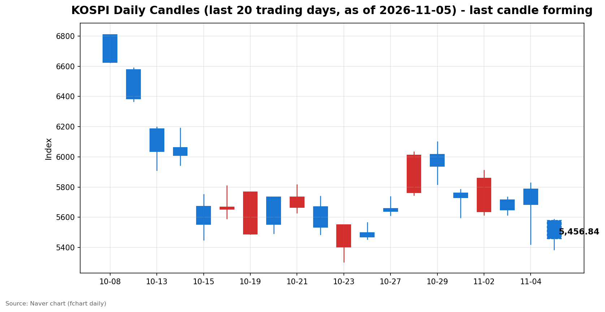
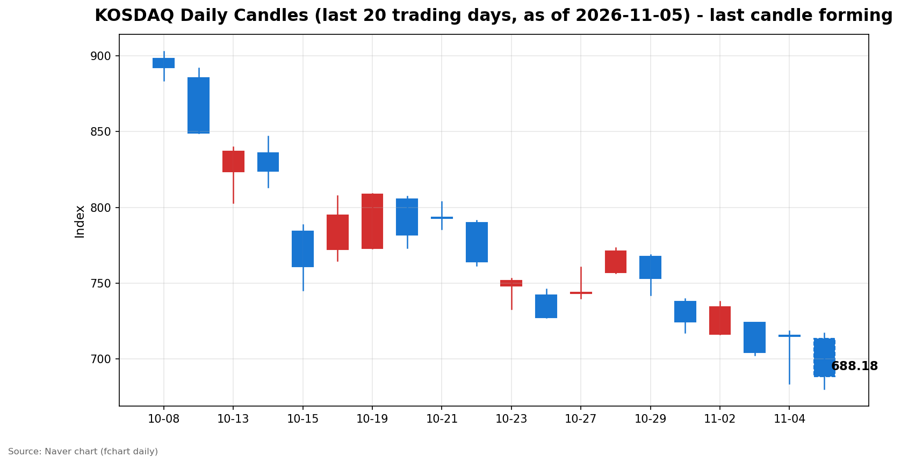

안녕하세요, [한국투자증권](https://securities.koreainvestment.com/main/Main.jsp)에서 [한투-한국투자증권](https://play.google.com/store/apps/details?id=com.truefriend.neosmartarenewal&hl=ko) 개발을 담당하고 있는 way입니다. 
2026년 11월 5일 국내 증시 장중 흐름을 수치 중심으로 정리합니다. 

## 오전장 요약

코스피와 코스닥은 장 오픈부터 급락한 뒤 장중 낙폭을 더 키웠고, 이후 일부 회복하는 흐름을 보였습니다. 
코스피는 시가 5,580.09에서 출발해 장중 저점 5,386.29까지 밀렸습니다. 
저점 기준 전일 종가 대비 낙폭은 5.24%에 달했습니다. 
코스닥은 시가 713.49에서 출발해 장중 저점 679.97까지 밀렸습니다. 
저점 기준 전일 종가 대비 낙폭은 4.89%였습니다. 
낙폭 확대 과정에서 코스피 시장에 매도 사이드카가 발동했습니다. 
코스닥은 거래 중단 조치 없이 거래를 이어갔습니다. 
코스피 시장의 매도 사이드카 발동은 10월 30일 이후 약 1주일 만입니다. 
스냅샷 시점에는 저점 대비 반등이 나타나며 낙폭이 다소 축소됐습니다. 
다만 두 지수 모두 시가와 전일 종가를 크게 밑도는 수준에 머물고 있습니다. 

## 오늘의 스냅샷

| 지수 | 현재가 | 전일 대비 | 등락률 | 시가 | 고가 | 저가 | 거래량 | 거래대금 | 스냅샷 기준 시각 |
| --- | --- | --- | --- | --- | --- | --- | --- | --- | --- |
| 코스피 | 5,456.84 | -226.96 | -3.99% | 5,580.09 | 5,586.46 | 5,386.29 | 152,197천주 | 12조 1,904억원 | 2026-11-05 12:28 KST |
| 코스닥 | 688.18 | -26.77 | -3.74% | 713.49 | 717.06 | 679.97 | 269,749천주 | 3조 1,033억원 | 2026-11-05 12:28 KST |

코스피는 스냅샷 시점 5,456.84로, 전일 종가 5,683.80 대비 226.96포인트, 3.99% 하락했습니다. 
코스닥은 스냅샷 시점 688.18로, 전일 종가 714.95 대비 26.77포인트, 3.74% 하락했습니다. 
코스닥은 장 오픈 직후 700선을 밑돌았고, 스냅샷 시점에도 700선을 회복하지 못했습니다. 
전일 종가는 네이버 실시간 수치와 일봉 종가를 교차 확인했습니다. 
교차 검증은 현재가를 등락률로 나눈 역산값으로 수행했습니다. 
역산값은 코스피 약 5,683.7, 코스닥 약 714.9로 일봉 전일 종가와 일치했습니다. 
당일 봉은 형성 중인 봉으로, 마감 전에는 계속 변합니다. 
지수 차트는 [코스피](https://finance.naver.com/sise/sise_index.naver?code=KOSPI)와 [코스닥](https://finance.naver.com/sise/sise_index.naver?code=KOSDAQ)에서 확인할 수 있습니다. 

## 차트

최근 20거래일 일봉 차트입니다. 
빨간 봉은 종가가 시가보다 높은 날, 파란 봉은 종가가 시가보다 낮은 날입니다. 
당일 봉은 형성 중인 봉으로, 마감 전에는 계속 변합니다. 

## 원인·촉매 분석

오늘 오전장 급락의 근본 촉매는 미국 중간선거 결과에서 비롯된 인공지능 인프라 규제 불확실성입니다. 
미국 중간선거에서 민주당이 상원과 하원을 모두 장악하는 블루 웨이브가 현실화됐습니다. 
정치적 불확실성 해소라는 해석에 간밤 뉴욕 증시 3대 지수는 상승 마감했습니다. 
한국투자증권 MTS 기준 나스닥 종합은 25,736.51로 전일 대비 1.44% 상승했습니다. 
그런데 같은 결과는 인공지능 데이터센터 건설에 대한 규제 강화 가능성으로 이어졌습니다. 
간밤 미국 시장에서도 반도체와 데이터센터 관련주는 지수 상승과 따로 약세를 보였습니다. 
국내 시장에서는 그 약세가 장 오픈 직후 대형 반도체주를 중심으로 확대됐습니다. 
보도에 따르면 삼성전자는 4% 넘게 하락했고, SK하이닉스는 7% 넘게 하락해 130만원 선 아래로 내려갔습니다. 
지수의 무게 중심이 반도체에 쏠려 있는 국내 시장에서는 이 매도만으로도 지수 전체가 크게 흔들립니다. 
한국투자증권 MTS 기준 코스피200은 스냅샷 시점 851.68로 전일 대비 4.22% 하락했습니다. 
코스피 선물도 4.30% 하락했습니다. 
대형주 중심의 하락이라는 점이 수치로 확인됩니다. 
원/달러 환율은 한국투자증권 MTS 기준 1,343.80원으로 전일 대비 0.21% 상승에 그쳤습니다. 
환율 급변동이 오늘 하락을 주도한 흔적은 스냅샷 시점에서는 확인되지 않았습니다. 
보도에 따르면 미국 10년물 국채 금리는 중간선거 결과 반영 과정에서 8bp에서 9bp 수준 하락했습니다. 
금리 하락은 통상 성장주 밸류에이션에 우호적입니다. 
그럼에도 반도체 규제 우려가 밸류에이션 호재를 압도한 것이 오늘 오전장의 특징입니다. 
전일 수급 구도도 오늘 하락의 배경을 설명합니다. 
네이버 시장동향 API 기준 전일인 11월 4일 코스피에서 외국인은 24,528억원 순매도를 기록했습니다. 
같은 날 개인은 9,629억원 순매수, 기관은 11,334억원 순매수를 기록했습니다. 
상승 마감에도 불구하고 매도 주체가 외국인이었다는 점이 중요합니다. 
개인과 기관이 물량을 받아냈지만, 수급의 방향은 매도 쪽에 무게가 실려 있었습니다. 
오늘 오전장 하락은 미국 증시 상승이라는 표면적 호재보다, 반도체 규제 우려와 외국인 매도 흐름이 더 강하게 작용한 결과입니다. 
장중 수급 확정치는 아직 나오지 않으므로, 당일 장중 수급은 확인 필요로 표기합니다. 

## 핵심 사건 3가지

### 1. 미국 중간선거 블루 웨이브와 데이터센터 규제 우려

미국 중간선거에서 민주당이 상원과 하원을 모두 장악했습니다. 
정치적 불확실성 해소에 뉴욕 증시는 상승했지만, 인공지능 데이터센터 건설 규제 강화 가능성이 함께 부각됐습니다. 
규제 강화는 데이터센터 투자 속도와 반도체 수요 전망에 직접적인 하방 요인으로 작용합니다. 
국내 시장에서는 이 우려가 장 오픈 직후 반도체주를 중심으로 한 매도로 이어졌습니다. 
낙폭 확대 과정에서 코스피 시장에 매도 사이드카가 발동됐습니다. 
코스닥은 거래 중단 조치 없이 거래를 이어갔습니다. 
사이드카는 프로그램 매매 호가를 일시적으로 제한하는 장치입니다. 
발동 자체가 낙폭의 속도와 강도를 보여주는 신호로 해석됩니다. 
코스피 시장의 매도 사이드카 발동은 10월 30일 이후 약 1주일 만입니다. 

### 2. 장중 5%대 낙폭 이후 부분 회복

코스피는 장중 저점 5,386.29에서 전일 대비 5.24%까지 밀렸습니다. 
코스닥은 장중 저점 679.97에서 전일 대비 4.89%까지 밀렸습니다. 
이후 저점 매수세 유입으로 두 지수 모두 낙폭을 일부 축소했습니다. 
보도에 따르면 코스피는 오전 11시 20분 기준 5,500선 재진입을 노리는 흐름을 보였습니다. 
스냅샷 시점 코스피 5,456.84는 저점 대비 약 70포인트 반등한 수준입니다. 
반등이 나타났다는 사실과 하락 추세가 끝났다는 사실은 다릅니다. 
시가 5,580.09와 5,500선을 동시에 회복하지 못한 상태에서는 반등의 지속 여부를 단정할 수 없습니다. 
이 사건은 오전장의 변동성이 단순한 조정이 아니라, 매도 속도가 빨랐던 충격 장세였음을 보여줍니다. 

### 3. 9월 경상수지 614억달러, 사상 첫 600억달러 돌파

9월 경상수지는 614억달러 흑자로 사상 첫 600억달러 돌파를 기록했습니다. 
수출 호조에 힘입은 경상수지 흑자는 대외 건전성의 버팀목으로 평가됩니다. 
이 소식은 장중 하락을 막지 못했습니다. 
거시 건전성 지표와 반도체 규제 충격은 서로 다른 시간축에서 작용합니다. 
경상수지 흑자는 구조적 지지 요인이고, 규제 우려는 당장의 가격 충격 요인입니다. 
오늘 오전장은 단기 충격이 구조적 지지 요인보다 먼저 가격에 반영된 사례입니다. 
다만 경상수지 흑자 규모 자체가 훼손된 것은 아니므로, 오후 이후 시장의 해석이 달라질 여지는 남아 있습니다. 
이 사건의 의미를 단정하지 않고, 오후 흐름에서 확인할 재료로 남겨둡니다. 

## 섹터·테마 영향 체인

반도체 충격은 지수 전체로 확산되는 연결고리를 가집니다. 
반도체 대형주가 지수에서 차지하는 비중이 크기 때문에, 반도체 매도는 코스피200과 선물을 함께 끌어내렸습니다. 
코스피200이 4.22% 하락한 점은 하락이 일부 종목에 국한되지 않았음을 보여줍니다. 
2차전지 체인에는 별도의 실적 악재가 겹쳤습니다. 
에코프로비엠의 3분기 영업이익은 120억원으로 전년 대비 76.2% 감소했습니다. 
실적 악화는 배터리 소재 체인의 투자 심리를 추가로 위축시키는 요인입니다. 
유가 하락은 반대 방향의 연결고리를 만듭니다. 
보도에 따르면 지정학적 리스크 축소 기대에 국제유가는 8%대 급락했습니다. 
유가 하락은 항공과 운송의 연료비 부담을 낮추는 방향으로 작용합니다. 
한국투자증권 MTS 테마 기준 항공 테마는 장중 4.16% 상승했습니다. 
관세 완화 기대는 또 다른 연결고리입니다. 
일부 보도에서는 트럼프 영향력 약화에 따른 관세 완화 기대에 자동차주가 상대적으로 선전했다고 전했습니다. 
같은 보도에서는 방산 관련주가 약세를 보였다고 전했습니다. 
금리 하락은 성장주 밸류에이션에 우호적이지만, 오늘은 규제 우려가 그 효과를 덮었습니다. 
결국 오늘 오전장의 영향 체인은 반도체 규제 우려가 중심이고, 유가 하락과 관세 기대가 부분적인 상쇄 요인으로 작용한 구도입니다. 

## 최근 5거래일 일봉 표

최근 5거래일 일봉은 오늘 급락이 단기 조정 범위를 벗어났음을 보여줍니다. 
코스피는 11월 4일 종가 5,683.80에서 오늘 장중 저점 5,386.29까지 밀렸습니다. 
코스닥은 11월 4일 종가 714.95에서 오늘 장중 저점 679.97까지 밀렸습니다. 

| 날짜 | 코스피 시가 | 코스피 고가 | 코스피 저가 | 코스피 종가 | 코스피 거래량 |
| --- | --- | --- | --- | --- | --- |
| 2026-10-29 | 6,017.22 | 6,100.11 | 5,817.92 | 5,937.66 | 296,495천주 |
| 2026-10-30 | 5,760.35 | 5,784.98 | 5,599.42 | 5,730.74 | 228,294천주 |
| 2026-11-02 | 5,637.77 | 5,910.83 | 5,616.50 | 5,859.08 | 198,130천주 |
| 2026-11-03 | 5,715.19 | 5,735.92 | 5,615.80 | 5,648.79 | 207,371천주 |
| 2026-11-04 | 5,786.13 | 5,828.13 | 5,421.72 | 5,683.80 | 276,889천주 |

| 날짜 | 코스닥 시가 | 코스닥 고가 | 코스닥 저가 | 코스닥 종가 | 코스닥 거래량 |
| --- | --- | --- | --- | --- | --- |
| 2026-10-29 | 767.78 | 768.75 | 741.96 | 753.23 | 494,052천주 |
| 2026-10-30 | 737.76 | 739.79 | 717.27 | 724.38 | 470,174천주 |
| 2026-11-02 | 716.44 | 738.01 | 716.21 | 734.36 | 355,750천주 |
| 2026-11-03 | 723.92 | 723.92 | 702.34 | 704.39 | 430,571천주 |
| 2026-11-04 | 715.74 | 718.34 | 683.66 | 714.95 | 539,758천주 |

## 오전 강했던 테마와 흐름 변화

지수 급락 속에서도 일부 테마는 상승 흐름을 보였습니다. 
한국투자증권 MTS 테마 기준 장중 상승 테마는 목재 5.96%, 주류판매 5.25%, 타이어 4.79%, P2E 4.76%, 항공 4.16%, 위탁생산 3.94%, 엔터테인먼트 3.49%, 비만치료제 3.14% 순이었습니다. 
이 테마들은 구성 종목 수가 적은 소규모 테마가 많습니다. 
지수 하락 국면에서는 방어적 성격의 소규모 테마로 자금이 이동하는 흐름이 나타날 수 있습니다. 
타이어 상승은 관세 완화 기대와 연결되는 흐름으로 해석할 수 있습니다. 
항공 상승은 유가 하락에 따른 비용 부담 완화 기대와 연결됩니다. 
다만 테마 상승이 지수 하락을 상쇄하는 규모는 아닙니다. 
시가 대비 방향 전환 여부를 보면, 두 지수 모두 시가 대비 하락 방향을 유지하고 있습니다. 
코스피는 시가 5,580.09에서 저점 5,386.29까지 밀린 뒤 5,456.84까지 반등했습니다. 
코스닥은 시가 713.49에서 저점 679.97까지 밀린 뒤 688.18까지 반등했습니다. 
저점 대비 반등은 확인되지만, 시가 회복에는 이르지 못했습니다. 
오전장의 흐름 변화는 급락 후 부분 반등이지, 방향 전환이 아닙니다. 

## 오후 전망과 확인할 시나리오

오후에는 오전 급락이 일시적 충격이었는지, 하락 추세의 시작인지를 구분하는 구간입니다. 
첫 번째로 확인할 수치는 코스피 5,500선 재진입 여부입니다. 
5,500선을 회복하고 유지하면 반등이 이어질 여지가 커집니다. 
5,500선 아래에 머물면 오후에도 매도 우위 흐름이 이어질 수 있습니다. 
두 번째로 확인할 구간은 당일 저점입니다. 
코스피 저점 5,386.29와 코스닥 저점 679.97이 지지되는지가 중요합니다. 
저점을 다시 밑돌면 오전 반등이 실패한 것으로 해석됩니다. 
세 번째로 확인할 수치는 코스닥 700선 회복 여부입니다. 
700선은 심리적 기준선으로, 회복 여부가 투자 심리 판단에 참고가 됩니다. 
네 번째로 확인할 재료는 반도체 관련 추가 소식입니다. 
데이터센터 규제 논의의 구체적인 내용과 미국 반도체주 야간 흐름이 오후 심리에 영향을 줄 수 있습니다. 
다섯 번째로 확인할 재료는 외국인 수급입니다. 
장중 수급 확정치는 아직 나오지 않으므로, 마감 수급에서 외국인 매도 지속 여부를 확인해야 합니다. 
위 시나리오는 지수와 섹터 단위의 관찰 기준이며, 특정 종목의 매수나 매도를 권유하는 내용이 아닙니다. 

## 마치며

오늘 오전장은 미국 정치 지형 변화가 반도체 규제 우려로 이어지며 코스피 시장에 매도 사이드카가 발동한 충격 장세였습니다. 
오후에는 5,500선과 당일 저점 등 구체적인 가격 레벨을 기준으로 반등 지속 여부를 확인하는 것이 중요합니다. 
이 글은 교육과 해설 목적의 시황 정리이며, 특정 종목의 매수나 매도를 권유하지 않습니다. 
정정(2026년 11월 5일 오후): 초판에서 코스닥에도 매도 사이드카가 발동했다고 썼으나, 당일 발동된 것은 코스피 매도 사이드카뿐이며 코스닥은 거래 중단 조치 없이 거래를 이어갔습니다. 
전일 수급 수치도 네이버 시장동향 API 최종값(외국인 -24,528억원, 개인 +9,629억원, 기관 +11,334억원)으로 바로잡았습니다. 
