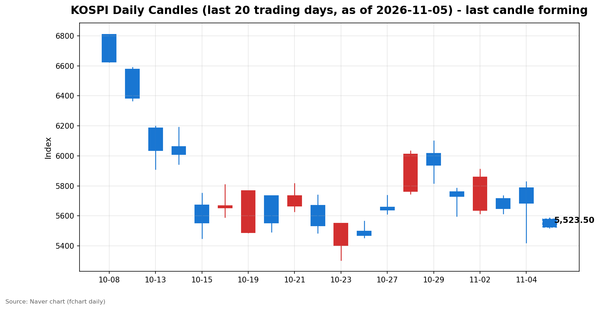
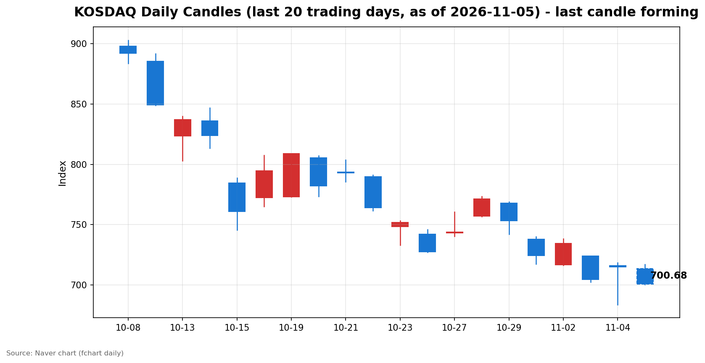

안녕하세요, [한국투자증권](https://securities.koreainvestment.com/main/Main.jsp)에서 [한투-한국투자증권](https://play.google.com/store/apps/details?id=com.truefriend.neosmartarenewal&hl=ko) 개발을 담당하고 있는 way입니다. 
2026년 11월 5일 국내 증시 장 오픈 흐름을 수치 중심으로 정리합니다. 

## 배경

간밤 미국 증시는 상승 마감했습니다. 
한국투자증권 MTS 기준 나스닥 종합은 25,736.51로 전일 대비 364.50포인트, 1.44% 상승했습니다. 
스탠더드앤드푸어스 500 지수는 7,688.62로 전일 대비 119.70포인트, 1.58% 상승했습니다. 
미국 중간선거에서 민주당이 압승했다는 소식이 뉴욕 증시 상승의 배경으로 거론됐습니다. 
그런데 같은 소식은 국내 장 오픈에서는 정반대의 방향으로 작용했습니다. 
민주당 승리 이후 인공지능 데이터센터 건설에 대한 규제 강화 가능성이 부각되면서, 간밤 미국 시장에서도 반도체와 데이터센터 관련주는 약세를 보였습니다. 
국내 시장에서는 그 약세가 장 오픈 직후 반도체와 인공지능 관련주를 중심으로 확대됐습니다. 
전일인 2026년 11월 4일 국내 증시는 장중 큰 변동 끝에 상승 마감했습니다. 
코스피는 5,683.80으로 전일 대비 0.62% 상승했고, 코스닥은 714.95로 전일 대비 1.50% 상승했습니다. 
다만 전일 장중 코스피는 고가 5,828.13에서 저가 5,421.72까지 400포인트 넘게 흔들렸습니다. 
상승 마감에도 불구하고 변동성이 컸던 하루였다는 점이 오늘 급락 출발의 배경이 됩니다. 

## 오늘의 스냅샷

| 지수 | 현재가 | 전일 대비 | 등락률 | 시가 | 고가 | 저가 | 거래량 | 거래대금 | 스냅샷 기준 시각 |
| --- | --- | --- | --- | --- | --- | --- | --- | --- | --- |
| 코스피 | 5,537.21 | -146.59 | -2.58% | 5,580.09 | 5,586.46 | 5,520.92 | 50,538천주 | 3조 6,418억원 | 2026-11-05 09:30 KST |
| 코스닥 | 699.94 | -15.01 | -2.10% | 713.49 | 717.06 | 699.94 | 92,903천주 | 1조 1,555억원 | 2026-11-05 09:30 KST |

코스피와 코스닥은 모두 급락 출발했습니다. 
코스피는 시가 5,580.09에서 출발해 스냅샷 시점 5,537.21을 기록했습니다. 
코스닥은 시가 713.49에서 출발해 스냅샷 시점 699.94를 기록했습니다. 
코스닥은 스냅샷 시점에 700선을 밑돌았습니다. 
전일 종가는 네이버 실시간 수치와 일봉 종가를 교차 확인했습니다. 
코스피 전일 종가는 5,683.80, 코스닥 전일 종가는 714.95입니다. 
교차 검증은 현재가를 등락률로 나눈 역산값으로 수행했습니다. 
역산값은 코스피 약 5,683.7, 코스닥 약 714.9로 일봉 전일 종가와 일치했습니다. 
지수 차트는 [코스피](https://finance.naver.com/sise/sise_index.naver?code=KOSPI)와 [코스닥](https://finance.naver.com/sise/sise_index.naver?code=KOSDAQ)에서 확인할 수 있습니다. 

## 차트

최근 20거래일 일봉 차트입니다. 
빨간 봉은 종가가 시가보다 높은 날, 파란 봉은 종가가 시가보다 낮은 날입니다. 
당일 봉은 형성 중인 봉으로, 마감 전에는 계속 변합니다. 

## 원인·촉매 분석

오늘 급락 출발의 근본 촉매는 미국 정치 지형 변화가 인공지능 인프라 투자에 던진 규제 불확실성입니다. 
뉴욕 증시 전체가 오른 날에도 반도체와 데이터센터 관련주는 따로 약세를 보였습니다. 
보도에 따르면 마이크론과 엔비디아, 코어위브 등 반도체와 데이터센터 관련주가 간밤 약세를 보였습니다. 
민주당 승리 이후 데이터센터 건설을 둘러싼 지역 규제 강화 가능성이 거론된 것이 직접적인 이유입니다. 
국내 시장에서는 이 우려가 프리마켓 단계부터 삼성전자와 SK하이닉스 등 대형 반도체주에 대한 매도로 이어졌습니다. 
보도에 따르면 두 종목은 프리마켓에서 2%에서 4% 수준의 하락을 보였습니다. 
지수의 무게 중심이 반도체에 쏠려 있는 국내 시장에서는 이 매도만으로도 지수 전체가 크게 흔들립니다. 
코스피200이 스냅샷 시점 3% 넘게 하락하고 코스피 선물이 3% 넘게 하락한 점도 대형주 중심의 하락임을 보여줍니다. 
원/달러 환율은 한국투자증권 MTS 기준 1,342원 수준으로, 전일 대비 0.10% 수준의 소폭 상승에 그쳤습니다. 
환율 급변동이 오늘 하락을 주도한 흔적은 스냅샷 시점에서는 확인되지 않았습니다. 
전일 수급 구도도 오늘 하락의 배경을 설명합니다. 
전일 외국인은 코스피에서 대규모 매도를 이어갔고, 개인과 기관이 그 물량을 받아냈습니다. 
상승 마감에도 불구하고 매도 주체가 외국인이었다는 점은, 수급의 방향이 아직 매도 쪽에 무게가 실려 있음을 보여줍니다. 
결국 오늘 하락은 미국 증시 상승이라는 표면적 호재보다, 반도체와 인공지능 인프라에 대한 규제 우려와 외국인 매도 흐름이 더 강하게 작용한 결과입니다. 
미국 증시가 올랐다는 사실만으로 국내 시장이 따라 오른다고 단정할 수 없는 하루입니다. 

## 핵심 사건 3가지

### 1. 미국 중간선거 민주당 압승과 데이터센터 규제 우려

미국 중간선거에서 민주당이 압승하면서 뉴욕 증시 3대 지수는 동반 상승했습니다. 
나스닥 종합은 1.44%, 스탠더드앤드푸어스 500 지수는 1.58% 상승 마감했습니다. 
그런데 선거 결과의 해석은 업종별로 갈렸습니다. 
민주당 승리 이후 인공지능 데이터센터 건설 프로젝트에 차질이 생길 수 있다는 우려가 커졌습니다. 
데이터센터 확대로 전기요금 상승과 환경 훼손을 우려하는 지역 주민의 목소리가 커진 점도 배경으로 거론됐습니다. 
이 우려는 반도체와 데이터센터 관련주의 약세로 이어졌고, 국내 장 오픈에서는 대형 반도체주 매도로 전달됐습니다. 
선거 결과가 정책으로 확정되기 전까지는 이 불확실성이 완전히 해소된 것이 아닙니다. 
이 사건의 심리적 충격은 지수 전체의 방향보다, 인공지능 인프라 밸류체인에 대한 재평가 쪽에 가깝습니다. 
구조적인 방향 전환으로 단정하기는 이르지만, 장 오픈의 하락을 설명하는 가장 직접적인 촉매입니다. 

### 2. 9월 경상수지 614억 달러, 사상 첫 월간 600억 달러 돌파

한국은행 발표에 따르면 9월 경상수지 흑자는 614억 6천만 달러로 집계됐습니다. 
월간 기준 사상 처음으로 600억 달러를 넘었고, 종전 최대였던 6월 478억 9천만 달러를 크게 웃돌았습니다. 
1월부터 9월까지 누적 흑자는 3,406억 6천만 달러로, 지난해 같은 기간의 4배가 넘는 수준입니다. 
흑자를 이끈 것은 반도체 수출 급증으로, 반도체 수출이 1년 새 260% 넘게 증가했습니다. 
상품수지 흑자는 627억 5천만 달러로 역대 최대를 기록했습니다. 
이 소식은 당일 지수를 끌어올리는 재료라기보다, 한국 경제의 대외 건전성과 수출 경쟁력을 보여주는 중기적인 배경입니다. 
오늘 하락이 펀더멘털 악화에서 비롯된 것이 아니라, 규제 우려와 수급 흐름에서 비롯됐다는 점을 구분하는 기준이 됩니다. 
다만 경상수지 호조가 당일 반도체주 매도를 막아주지는 못했습니다. 
거시 지표의 강함과 당일 주가의 방향이 다를 수 있다는 점이 오늘 장의 교훈입니다. 

### 3. 금융권 정보 유출과 580곳 전수점검

금융 당국은 금융사 보안 점검을 연 2회로 확대하고, 580개 금융사를 전수점검하기로 했습니다. 
37곳의 금융권에서 47만 건이 넘는 정보가 유출된 사실이 이번 조치의 배경으로 거론됐습니다. 
이 사건은 지수를 직접 끌어내리는 재료라기보다, 금융 업종 전반에 대한 신뢰와 규제 비용을 다시 보게 만드는 재료입니다. 
전수점검과 점검 횟수 확대는 단기적으로 금융사의 컴플라이언스 부담을 키울 수 있습니다. 
반면 보안 투자와 관리 체계 강화는 중기적으로 금융 시스템의 신뢰를 보강하는 방향입니다. 
시장에서는 이 사건을 금융주 개별 악재보다, 금융 업종 전반의 규제 환경 변화로 받아들일 가능성이 큽니다. 
오늘 장 오픈에서는 반도체 하락에 가려 금융 업종의 움직임이 상대적으로 덜 부각됐습니다. 
그러나 장중 금융주의 상대 강도가 유지되는지는 오늘 확인할 점 중 하나입니다. 

## 섹터·테마 영향 체인

하락의 출발점은 반도체와 인공지능 인프라입니다. 
데이터센터 규제 우려는 반도체 수요 전망에 직접 닿고, 반도체는 국내 지수와 수출의 중심축입니다. 
반도체가 흔들리면 전기·전자 업종 전체가 함께 흔들리고, 데이터센터와 전력 설비 관련 기대도 함께 조정받습니다. 
보도에 따르면 장 오픈에서 의료정밀기기와 전기·전자 업종이 큰 폭으로 하락했습니다. 
반대로 자동차와 일부 금융주는 상대적으로 선방하는 등 업종별 차별화가 뚜렷했습니다. 
이는 규제 우려가 모든 업종에 동일하게 작용하지 않는다는 점을 보여줍니다. 
자동차는 전기차 생산 지원 검토와 로봇 사업 확장 기대라는 별개의 재료가 버팀목이 됐습니다. 
금융은 보안 점검이라는 자체 재료가 있지만, 반도체 하락의 직접적인 전염 경로에서는 한 발짝 떨어져 있습니다. 
바이오와 비만치료제, 뇌질환 등 일부 테마가 한국투자증권 MTS 테마 화면에서 상승 상위권에 오른 점도 눈에 띕니다. 
다만 지수 하락 국면에서 소규모 테마의 상승이 지수 전체를 받쳐주는 힘은 아닙니다. 
영향 체인을 정리하면, 규제 우려는 반도체와 인공지능 인프라에서 시작해 지수 전체로 번지고, 내수·정책 수혜가 있는 업종은 상대적으로 버티는 구도입니다. 
이 구도가 유지되는지, 아니면 하락이 전 업종으로 확산되는지가 장중 확인할 핵심입니다. 

## 최근 5거래일 일봉

| 날짜 | 시가 | 고가 | 저가 | 종가 | 거래량 |
| --- | --- | --- | --- | --- | --- |
| 2026-10-30 | 5,760.35 | 5,784.98 | 5,599.42 | 5,730.74 | 228,294천주 |
| 2026-11-02 | 5,637.77 | 5,910.83 | 5,616.50 | 5,859.08 | 198,130천주 |
| 2026-11-03 | 5,715.19 | 5,735.92 | 5,615.80 | 5,648.79 | 207,371천주 |
| 2026-11-04 | 5,786.13 | 5,828.13 | 5,421.72 | 5,683.80 | 276,889천주 |
| 2026-11-05 | 5,580.09 | 5,586.46 | 5,520.92 | 형성 중 | 48,383천주 |

위 표는 코스피 기준입니다. 
코스닥 최근 5거래일은 다음과 같습니다. 

| 날짜 | 시가 | 고가 | 저가 | 종가 | 거래량 |
| --- | --- | --- | --- | --- | --- |
| 2026-10-30 | 737.76 | 739.79 | 717.27 | 724.38 | 470,174천주 |
| 2026-11-02 | 716.44 | 738.01 | 716.21 | 734.36 | 355,750천주 |
| 2026-11-03 | 723.92 | 723.92 | 702.34 | 704.39 | 430,571천주 |
| 2026-11-04 | 715.74 | 718.34 | 683.66 | 714.95 | 539,758천주 |
| 2026-11-05 | 713.49 | 717.06 | 700.14 | 형성 중 | 88,476천주 |

당일 봉은 형성 중인 봉으로, 마감 전에는 계속 변합니다. 
전일인 2026년 11월 4일 코스피는 장중 저가 5,421.72까지 밀렸다가 5,683.80으로 마감했습니다. 
전일 저가가 오늘 하락의 첫 번째 지지 구간이 됩니다. 
코스닥 전일 저가는 683.66으로, 오늘 스냅샷 시점 699.94는 아직 그 위를 유지하고 있습니다. 

## 전일 수급

전일인 2026년 11월 4일 코스피 수급은 외국인의 매도와 개인·기관의 매수가 맞선 구도였습니다. 
외국인은 코스피에서 2조 4,528억원을 순매도했습니다. 
개인은 9,629억원을 순매수했고, 기관은 1조 1,134억원을 순매수했습니다. 
코스닥에서는 외국인이 113억원을 순매수했고, 개인은 706억원을 순매도했으며, 기관은 704억원을 순매수했습니다. 
코스피 구도를 해석하면, 외국인이 던진 물량을 개인과 기관이 나눠 받은 하루였습니다. 
지수가 상승 마감했다는 사실만 보면 수급이 안정된 것처럼 보입니다. 
그러나 매도 주체가 외국인이고 매수 주체가 개인과 기관이라는 점은, 상승의 주도권이 아직 외국인 쪽에 있지 않다는 뜻입니다. 
외국인 매도가 이어지는 동안 개인과 기관의 매수는 하락을 떠받치는 방파제 역할을 합니다. 
방파제가 버티는 동안에는 장중 변동성이 커지기 쉽습니다. 
오늘 급락 출발은 전일 외국인 매도 흐름이 장 오픈까지 이어진 것으로 해석할 수 있습니다. 
오늘 장중 외국인 매도 규모가 전일 수준으로 이어지는지, 아니면 축소되는지가 반등 여부를 가르는 첫 번째 신호입니다. 

## 단기·중기 전망과 확인할 시나리오

단기적으로는 일시적 조정인지, 하락 추세의 시작인지를 가르는 구간입니다. 
코스피는 전일 종가 5,683.80에서 2% 넘게 밀린 채 출발했습니다. 
코스피가 전일 장중 저가 5,421.72를 지켜내는지가 단기 지지 확인의 기준이 됩니다. 
이 구간을 지켜내면 오늘 하락은 규제 우려에 따른 일시적 조정으로 정리될 수 있습니다. 
이 구간을 밑돌면 조정 폭이 더 커지는 시나리오를 열어두어야 합니다. 
코스닥은 700선이 단기 심리적 기준입니다. 
스냅샷 시점 699.94는 700선을 밑돈 수준이지만, 장 초반 이탈이 확정된 것은 아닙니다. 
700선을 회복하는지, 아니면 전일 저가 683.66 쪽으로 밀리는지가 코스닥 단기 방향의 기준이 됩니다. 
중기적으로는 9월 경상수지 흑자라는 펀더멘털 배경과, 데이터센터 규제라는 정책 불확실성이 맞서고 있습니다. 
반도체 수출 호조가 이어지는 한 중기 펀더멘털은 여전히 견고한 편입니다. 
그러나 규제 우려가 실제 정책으로 구체화되면 인공지능 인프라 투자 속도에 대한 재평가가 이어질 수 있습니다. 
확인할 시나리오는 두 가지입니다. 
첫 번째는 규제 우려가 구두 수준에 머물고 외국인 매도가 축소되면서 지수가 전일 종가 쪽으로 되돌리는 시나리오입니다. 
두 번째는 외국인 매도가 이어지고 반도체 약세가 전 업종으로 확산되면서 전일 저가를 시험하는 시나리오입니다. 
어느 쪽이든 특정 종목에 대한 매수나 매도 판단이 아니라, 지수와 섹터 단위의 흐름으로 확인할 문제입니다. 
리스크 관리 관점에서는 장 초반 하락폭을 추격하기보다, 지지 구간과 수급 축소 여부를 확인한 뒤 판단하는 것이 안전합니다. 

## 장 초반 확인할 점

코스피가 전일 장중 저가 5,421.72를 지켜내는지 확인합니다. 
코스닥이 700선을 회복하는지, 아니면 전일 저가 683.66 쪽으로 밀리는지 확인합니다. 
외국인 매도 규모가 전일 코스피 2조 4,528억원 수준에서 축소되는지 확인합니다. 
반도체와 인공지능 인프라 관련주의 하락폭이 축소되는지, 아니면 확산되는지 확인합니다. 
자동차와 금융 등 상대적으로 선방한 업종의 강도가 유지되는지 확인합니다. 
원/달러 환율이 1,342원 수준에서 급변하지 않는지 확인합니다. 

## 마치며

미국 증시 상승에도 국내 증시는 반도체 규제 우려와 외국인 매도 흐름에 급락 출발했습니다. 
오늘 장은 지지 구간과 수급 축소 여부를 확인하는 하루가 될 것으로 보입니다. 
이 글은 매수나 매도 권유가 아니며, 교육과 해설을 목적으로 작성됐습니다. 
