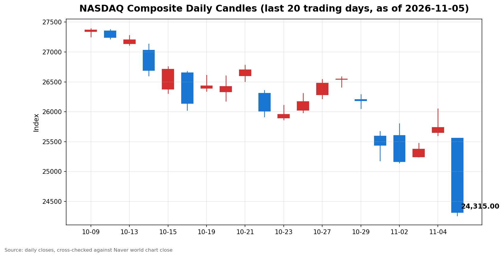

안녕하세요, [한국투자증권](https://securities.koreainvestment.com/main/Main.jsp)에서 [한투-한국투자증권](https://play.google.com/store/apps/details?id=com.truefriend.neosmartarenewal&hl=ko) 개발을 담당하고 있는 way입니다. 
2026년 11월 5일 나스닥 장 마감 흐름을 수치 중심으로 정리합니다. 

## 마감 요약

나스닥 종합은 전일 대비 5.52% 하락해 24,315.00으로 마감했습니다. 
하락 폭은 1,421.51이었습니다. 
나스닥은 지난 10월 6일 기록한 사상 최고 종가 27,599.89 대비 11.90% 낮아져 조정 구간에 들어갔습니다. 
S&P500은 4.36% 하락해 7,353.73으로 마감했습니다. 
다우지수는 3.44% 하락해 51,523.06으로 마감했습니다. 
전 거래일의 상승분을 세 지수 모두 되돌렸고, 나스닥과 S&P500은 전일 상승분을 웃도는 폭으로 밀렸습니다. 
이 글은 교육과 해설 목적으로 작성되었으며 특정 종목의 매수나 매도를 권유하지 않습니다. 

## 오늘의 마감 스냅샷

| 지수 | 종가 | 전일 대비 | 등락률 | 전일 종가 | 당일 고가 | 당일 저가 |
| --- | --- | --- | --- | --- | --- | --- |
| 나스닥 종합 | 24,315.00 | -1,421.51 | -5.52% | 25,736.51 | 25,559.03 | 24,262.14 |
| S&P500 | 7,353.73 | -334.89 | -4.36% | 7,688.62 | 7,681.29 | 7,350.35 |
| 다우지수 | 51,523.06 | -1,833.06 | -3.44% | 53,356.12 | 53,710.61 | 51,486.82 |

스냅샷 기준 시각은 미국 동부시간 2026년 11월 5일 16시 20분, 한국시간 2026년 11월 6일 06시 20분입니다. 
나스닥 종합 수치는 네이버 월드 차트 페이지에서 직접 확인한 마감 수치입니다. 
네이버 월드 차트 페이지는 curl 직접 조회가 막혀 브라우저로 직접 확인했습니다. 
네이버 월드 차트 페이지에는 미국 11월 5일 16시 21분 장마감 기준으로 종가 24,315.00, 전일 대비 1,421.52, 등락률 5.52%가 표시되어 있습니다. 
전일 대비 표시값은 반올림에 따라 1,421.52로 보이며, 종가에서 전일 종가를 뺀 값은 1,421.51입니다. 
한투 MTS 해외 대시보드의 나스닥 종합 값도 종가 24,315.00, 전일 대비 1,421.51, 등락률 5.52%로 네이버 값과 일치합니다. 
S&P500 수치는 한투 MTS 해외 대시보드에서 확인한 마감 수치입니다. 
전일 종가는 종가에서 전일 대비 변동폭을 빼는 방식으로 역산했습니다. 
역산한 전일 종가는 나스닥 25,736.51, S&P500 7,688.62, 다우지수 53,356.12이며, 세 값 모두 전 거래일 마감 글의 종가와 일치합니다. 
나스닥 당일 고가와 저가는 네이버 월드 차트 페이지의 표시값이며, Yahoo Finance 일봉과도 시가와 고가와 저가와 종가까지 일치합니다. 
S&P500 당일 고가와 저가는 Yahoo Finance 일봉 기준입니다. 
다우지수는 한투 MTS 해외 대시보드 지수 목록에 포함되지 않았습니다. 
다우지수 수치는 Yahoo Finance 일봉으로 확인한 값이며, 같은 일봉의 나스닥 수치가 네이버 마감 수치와 시가와 고가와 저가와 종가까지 일치해 일봉 기준의 정합성을 확인했습니다. 
원/달러 환율은 한투 MTS 해외 대시보드 기준 1,355.50원으로 전일 대비 14.50원, 1.08% 상승했습니다. 
네이버 월드 차트 출처는 [네이버 금융 월드 시세](https://finance.naver.com/world/sise.naver?symbol=NAS@IXIC)와 [네이버 월드 차트](https://stock.naver.com/worldstock/index/.IXIC/price)에서 확인할 수 있습니다. 
확인되지 않은 마감 원인은 본문에 쓰지 않았습니다. 

## 차트

최근 20거래일 일봉 차트입니다. 
빨간 봉은 종가가 시가보다 높은 날, 파란 봉은 종가가 시가보다 낮은 날입니다. 

## 원인·촉매 분석

이날 하락의 표면적 이유는 전일 랠리에 대한 되돌림입니다. 
근본 촉매는 세 가지로 압축됩니다. 
첫째, 민주당의 의회 장악 이후 인공지능 데이터센터 규제 우려가 본격화됐습니다. 
규제 방향이 구체화되기 전부터 투자자들이 데이터센터 건설 속도와 전력과 환경 비용에 대한 가정을 다시 쓰기 시작했고, 이는 성장주 전반의 할인율을 높이는 쪽으로 작용했습니다. 
둘째, 반도체 실적과 수요에 대한 우려가 겹쳤습니다. 
퀄컴의 4분기 가이던스 약화와 마이크론의 대만 공장 계획 중단 보도가 반도체 밸류체인 전반의 투자 심리를 압박했습니다. 
셋째, 금리 하락이 주가 방어로는 이어지지 않았습니다. 
미국 10년물 국채수익률은 4.89%에서 4.84%로 낮아졌지만, 이날 하락은 금리 경로보다 규제와 수요 우려가 우세했음을 보여줍니다. 
원/달러 환율이 1.08% 오르며 달러 강세가 나타난 점도 위험자산 회피 심리와 같은 방향이었습니다. 
전 거래일과 비교하면 지수 간 힘의 배치도 뒤집혔습니다. 
전 거래일에는 다우지수가 3.03% 오르며 상승을 주도했지만, 이날은 나스닥이 5.52% 하락해 낙폭이 가장 컸고 다우지수는 3.44% 하락으로 낙폭이 가장 작았습니다. 
이는 매도 압력이 기술주와 성장주에 집중됐고, 우량주와 가치주 비중이 높은 다우지수는 상대적으로 덜 밀렸다는 뜻입니다. 

## 핵심 사건 3가지

첫째, 민주당 의회 장악 이후 인공지능 데이터센터 규제 우려가 확산됐습니다. 
민주당 소속 야사민 안사리 하원의원이 인공지능 개발 일시중단과 산업 규제, 초지능 금지를 촉구했다는 보도가 나왔습니다. 
이번 주 주민투표에서는 데이터센터 관련 40개 안건 중 39건에서 제한 결정이 나왔다는 집계도 보도됐습니다. 
텍사스 주지사 선거 이변도 주목받았으며, 텍사스는 골드만삭스 추산 기준 계획된 데이터센터 용량의 약 25%를 차지한다는 보도가 있습니다. 
규제 우려가 커지면 데이터센터 건설 속도와 전력 조달 비용에 대한 가정이 바뀌고, 이는 반도체와 데이터센터 밸류체인 전반의 변동성으로 번집니다. 
이날 나스닥이 사상 최고 종가 대비 11.90% 낮아져 조정 구간에 들어간 점은 이 우려가 단기 노이즈를 넘어 재평가 국면으로 번졌음을 보여줍니다. 

둘째, 반도체 실적과 공급 우려가 겹치며 반도체주가 동반 급락했습니다. 
퀄컴은 실적이 예상을 웃돌았지만 4분기 가이던스가 약화되며 종가 기준 9.49% 하락했습니다. 
AMD는 17.26%, 마이크론은 17.46%, 브로드컴은 10.43%, 엔비디아는 9.26% 하락했습니다. 
마이크론이 장기 노사 분쟁을 이유로 대만 메모리 공장 45억 달러 투자 계획을 중단했다는 보도도 나왔습니다. 
필라델피아 반도체지수는 장중 최대 11% 하락했다는 보도도 있어, 반도체 섹터의 낙폭이 2020년 3월 이후 가장 컸다는 평가가 나왔습니다. 
이는 인공지능 투자 자체가 꺾였다는 신호라기보다, 투자 속도와 수익성에 대한 재평가가 진행 중이라는 신호로 보는 것이 적절합니다. 

셋째, 국제유가가 반등했고 고용지표는 호조를 보였지만 지수 하락을 막지는 못했습니다. 
서부텍사스산 원유는 배럴당 90.58달러로 2.79% 올랐고, 브렌트유는 배럴당 98.47달러로 4.07% 올랐습니다. 
두 유종 모두 전일 8% 안팎의 급락을 일부 되돌렸습니다. 
미국 노동부가 발표한 신규 실업수당 청구 건수는 18만 9천 건으로 7월 중순 이후 최저 수준이었다는 보도가 있습니다. 
다만 에너지주도 종가 기준으로는 하락했습니다. 
엑손모빌은 2.35%, 셰브론은 1.86% 하락해, 유가 반등이 에너지주 방어로 이어지지는 않았습니다. 

## 지수·섹터 영향 체인

나스닥의 낙폭이 가장 컸던 것은 반도체와 인공지능 인프라주의 비중이 높기 때문입니다. 
엔비디아와 브로드컴, AMD, 마이크론이 두 자릿수에 가까운 폭으로 밀리며 나스닥 하락을 주도했습니다. 
대형 기술주도 함께 밀렸습니다. 
마이크로소프트는 3.58%, 메타는 3.96%, 아마존은 2.19% 하락했고, 애플은 1.53% 하락으로 상대적으로 덜 밀렸습니다. 
딥서치로 확인한 국내 증권가 분석에서는 빅테크의 막대한 인공지능 데이터센터 투자에 대한 우려가 커지는 가운데 애플이 기술주 내 안전자산으로 평가받고 있다는 분석이 나왔습니다. 
테슬라는 10.77%, 오라클은 6.93% 하락했습니다. 
S&P500은 기술주 비중이 나스닥보다 낮지만, 반도체와 대형 기술주의 하락이 넓게 번지면서 4.36% 하락했습니다. 
다우지수는 산업재와 가치주와 우량주 비중이 높아 낙폭이 3.44%로 상대적으로 작았습니다. 
에너지 섹터는 유가 반등에도 불구하고 주가가 하락했습니다. 
이는 원유 가격과 에너지주 사이의 연결고리가 이날은 끊어졌고, 시장 전반의 위험 회피 심리가 유가 효과를 웃돌았음을 보여줍니다. 
연결고리는 정치에서 시작해 규제와 수요 우려로 이어집니다. 
규제 우려는 데이터센터 건설 속도에 대한 가정을 바꾸고, 이는 반도체 수요 전망과 성장주 밸류에이션 부담으로 함께 번집니다. 
정리하면 이날은 특정 섹터만의 조정이 아니라, 인공지능 투자 논쟁이 지수 전반으로 확산된 날이었습니다. 

## 다우·S&P500 마감 흐름

S&P500은 7,353.73으로 마감했습니다. 
전일 대비 변동폭은 -334.89, 등락률은 -4.36%였습니다. 
역산한 S&P500 전일 종가는 7,688.62입니다. 
Yahoo Finance 일봉 기준 S&P500 당일 고가는 7,681.29, 당일 저가는 7,350.35였습니다. 
다우지수는 51,523.06으로 마감했습니다. 
전일 대비 변동폭은 -1,833.06, 등락률은 -3.44%였습니다. 
Yahoo Finance 일봉 기준 다우지수 당일 고가는 53,710.61, 당일 저가는 51,486.82였습니다. 
전일 상승분과 비교하면 세 지수 모두 상승분을 초과해 반납했습니다. 
다우지수는 전일 1,569.40 올랐던 것보다 263.66 더 밀렸고, S&P500은 전일 119.70 올랐던 것보다 215.19 더 밀렸으며, 나스닥은 전일 364.50 올랐던 것보다 1,057.01 더 밀렸습니다. 
이는 전일 랠리가 안도성 반등에 그쳤고, 하루 만에 규제와 수요 우려가 다시 우세해졌다는 뜻입니다. 

## 단기·중기 전망과 다음 거래일 확인할 시나리오

흐름 지속과 일시적 급락을 구분하는 기준은 세 가지입니다. 
첫째, 나스닥이 당일 저가 24,262.14 부근을 지키는지 확인합니다. 
이 구간이 무너지면 조정 구간에서의 하락이 이어질 가능성이 커집니다. 
둘째, 나스닥이 25,000 구간과 당일 시가 25,558.11 부근을 회복하는지 확인합니다. 
이 구간을 회복하지 못하고 되밀리면 반등 동력이 약하다는 뜻입니다. 
셋째, 반도체주의 낙폭이 진정되는지 확인합니다. 
반도체주가 추가로 크게 밀리면 지수 전반의 변동성도 이어질 가능성이 있습니다. 
다음 거래일 이후 확인할 이벤트로는 11월 6일로 예정된 10월 고용지표와 연방준비제도 관계자 발언이 있습니다. 
고용지표가 예상을 크게 벗어나면 금리 경로에 대한 가정이 다시 바뀌면서 지수 방향도 달라질 수 있습니다. 
나스닥 선물은 한투 MTS 해외 대시보드 기준 26,679.50으로 전일 대비 6.61% 하락한 상태이며, 선물 시장의 약세가 이어지는지도 확인할 지점입니다. 
중기적으로는 인공지능 데이터센터 규제 논의와 반도체 수요 전망이 관건입니다. 
규제 방향이 구체화되기 전에는 하루의 급락만으로 추세 전환을 단정하지 않고, 저가 지지 여부와 섹터 확산 여부를 함께 확인해야 합니다. 

## 마치며

이날은 전일 랠리가 하루 만에 되돌려진 날이었습니다. 
규제와 수요 우려가 가라앉는지, 고용지표가 방향을 바꾸는지를 다음 거래일에서 확인하는 것이 순서입니다. 
이 글은 교육과 해설 목적으로 작성되었으며 특정 종목의 매수나 매도를 권유하지 않습니다. 
