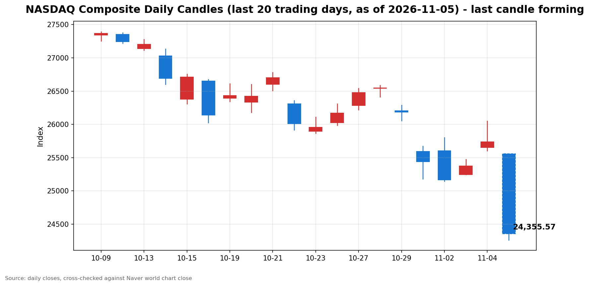

안녕하세요, [한국투자증권](https://securities.koreainvestment.com/main/Main.jsp)에서 [한투-한국투자증권](https://play.google.com/store/apps/details?id=com.truefriend.neosmartarenewal&hl=ko) 개발을 담당하고 있는 way입니다. 
2026년 11월 5일 미국 동부시간 장중 나스닥 흐름을 정리합니다. 

## 장중 요약

나스닥 종합지수는 장중 5% 넘게 하락하고 있습니다. 
미국 동부시간 12시 56분 기준 24,443.71로, 전일 종가 대비 1,292.80포인트 내렸습니다. 
전일 3대 지수가 동반 상승 마감한 지 하루 만에 흐름이 급반전했습니다. 
하락의 중심에는 미국 중간선거 결과 이후 불거진 인공지능 산업 규제 강화 우려가 있습니다. 
공포지수는 전일 대비 30% 넘게 뛰며 투자 심리가 빠르게 위축된 모습을 보여주고 있습니다. 

## 오늘의 스냅샷

| 지수 | 현재가 | 전일 대비 | 등락률 | 전일 종가 | 장중 고가 | 장중 저가 |
| --- | --- | --- | --- | --- | --- | --- |
| 나스닥 종합 | 24,443.71 | -1,292.80 | -5.02% | 25,736.51 | 25,559.03 | 24,262.14 |
| S&P500 | 7,399.40 | -289.22 | -3.76% | 7,688.62 | 7,681.29 | 7,392.00 |
| 다우존스 | 51,777.48 | -1,578.64 | -2.96% | 53,356.12 | 53,710.61 | 51,762.78 |

스냅샷 기준 시각은 미국 동부시간 2026년 11월 5일 12시 56분, 한국시간 2026년 11월 6일 2시 56분입니다. 
나스닥 수치는 [네이버 월드 차트](https://finance.naver.com/world/sise.naver?symbol=NAS@IXIC)와 [네이버 월드 차트 가격 페이지](https://stock.naver.com/worldstock/index/.IXIC/price)에서 확인했으며, 한국투자증권 해외 대시보드 교차값과도 일치합니다. 
다우존스 수치도 네이버 월드 차트 가격 페이지에서 직접 확인했습니다. 
S&P500 수치는 한국투자증권 해외 대시보드와 야후 파이낸스 시세로 교차 확인했습니다. 
네이버 S&P500 가격 페이지는 Npay 증권 홈페이지로 리디렉션되어 직접 확인하지 못했습니다. 
당일 수치는 장중 형성 중인 값으로, 마감 전까지 계속 변합니다. 
나스닥 장중 거래량은 990,416천주로 집계됐습니다. 

## 차트

최근 20거래일 일봉 차트입니다. 
빨간 봉은 종가가 시가보다 높은 날, 파란 봉은 종가가 시가보다 낮은 날입니다. 
당일 봉은 형성 중인 봉으로, 마감 전에는 계속 변합니다. 

## 원인·촉매 분석

이번 하락은 금리나 실적 같은 전통적 요인보다 정치·규제 변수가 촉매가 됐습니다. 
미국 중간선거에서 민주당이 압승했다는 보도가 나온 뒤, 인공지능 산업에 대한 규제 강화 우려가 시장을 덮쳤습니다. 
민주당이 상원과 하원의 다수당 지위를 탈환했다는 보도와 함께, 데이터센터가 밀집한 지역의 주지사 선거에서도 민주당이 승리했다는 소식이 전해졌습니다. 
시장에서는 데이터센터 건설과 인공지능 인프라 확충에 제동이 걸릴 수 있다는 해석이 확산했습니다. 
규제 우려는 단기 재료가 아니라 인공지능 투자 사이클 전체의 지속 가능성을 묻는 질문으로 번졌습니다. 
빅테크 기업들의 막대한 데이터센터 투자에 대한 우려가 커지는 가운데, 기업 고객들의 지출이 계속 늘어나야 투자를 정당화할 수 있다는 지적이 나왔습니다. 
지역사회의 동의와 전력 비용 부담이 앞으로 중요한 투자 변수가 될 것이라는 분석도 함께 나왔습니다. 
금리 흐름은 이번 하락이 금리 요인이 아님을 보여줍니다. 
미국 10년물 국채금리는 4.83%로 전일 4.93%보다 0.10%포인트가량 내렸습니다. 
안전자산 선호로 금리가 내렸는데도 주가가 급락했다는 점은, 이번 매도가 금리 부담이 아니라 규제·심리 요인에서 비롯됐음을 시사합니다. 
달러지수는 101.40으로 전일 101.75보다 소폭 내렸고, 원·달러 환율은 1,353.40원으로 0.92% 올랐습니다. 
유가도 하락 흐름을 이어가며 위험자산 전반의 투자 심리가 위축됐습니다. 
전일 3대 지수가 나스닥 1.44%, S&P500 1.58%, 다우존스 3.03% 오른 뒤 하루 만에 급반전했다는 점도 눈에 띕니다. 
상승분을 하루 만에 되돌린 것은 포지션 되돌림 성격이 강함을 보여줍니다. 

## 핵심 사건 3가지

### 1. 미국 중간선거 민주당 압승과 인공지능 규제 우려

미국 중간선거에서 민주당이 압승했다는 보도가 장중 하락의 직접적인 계기가 됐습니다. 
민주당이 상원과 하원의 다수당 지위를 모두 탈환했다는 보도와 함께, 주요 주지사 선거에서도 승리했다는 소식이 전해졌습니다. 
시장에서는 인공지능 산업에 대한 규제 강화 가능성에 주목하는 모습입니다. 
데이터센터가 밀집한 텍사스와 조지아 등에서 민주당이 승리하면서 규제 강화와 반도체 수요 감소 우려가 강해졌다는 분석이 나왔습니다. 
이 사건이 중요한 이유는 선거 결과가 인공지능 투자 사이클의 전제 자체를 흔들 수 있기 때문입니다. 
데이터센터 건설이 늦어지면 인공지능 인프라 확충 속도가 떨어지고, 반도체와 장비 수요 전망도 함께 낮아집니다. 
선거 결과의 정책 함의가 아직 구체화되지 않은 만큼, 불확실성 자체가 매도 심리를 키우고 있습니다. 

### 2. 인공지능 데이터센터 투자 지속 가능성 논쟁 확산

빅테크 기업들의 막대한 인공지능 데이터센터 투자에 대한 의문이 장중 내내 매도세를 키웠습니다. 
인공지능 기업들이 모델 개발과 서비스 확대를 위해 데이터센터를 빠르게 확충해야 하지만, 지역사회의 동의와 전력 비용 부담이 중요한 투자 변수가 될 것이라는 분석이 나왔습니다. 
투자 비용을 정당화하려면 기업 고객들의 지출이 계속 늘어나야 한다는 지적도 함께 제기됐습니다. 
보도에 따르면 기술주 안에서는 애플이 상대적으로 선방하며 안전자산 성격으로 평가받는 모습도 나타났습니다. 
이 사건이 중요한 이유는 투자 사이클의 속도와 규모에 대한 시장의 믿음이 흔들리고 있기 때문입니다. 
인공지능 수요가 꺾이는 것이 아니라 투자 회수 기간에 대한 의문이 커졌다는 점에서, 조정은 실적이 아니라 밸류에이션 논쟁의 성격을 띠고 있습니다. 
국내 증시에서도 삼성전자와 SK하이닉스가 각각 7.57%와 9.46% 급락하며 같은 우려가 확산됐습니다. 

### 3. 영란은행 기준금리 인상과 유가 급락

영란은행은 기준금리를 연 3.75%에서 4.00%로 0.25%포인트 올렸습니다. 
2023년 8월 이후 3년 3개월 만의 인상이며, 통화정책위원 9명 전원이 찬성했습니다. 
중동 분쟁에 따른 물가 압력이 인상 배경으로 지목됐고, 추가 인상 가능성도 시사됐습니다. 
세계 주요 중앙은행의 긴축 기조가 여전히 살아있다는 신호로 읽힙니다. 
국제유가는 전일 8% 넘게 급락한 데 이어 당일에도 하락세를 이어갔습니다. 
서부텍사스산원유는 전일 8.3% 내린 88.12달러에 마감한 뒤 당일 87달러 안팎에서 거래되고 있습니다. 
브렌트유도 전일 8.7% 내린 94.62달러에 마감한 뒤 93달러 후반에서 거래되고 있습니다. 
유가 하락의 배경으로는 미국과 이란 간 외교적 해법에 대한 기대가 거론됐습니다. 
유가 하락은 인플레이션 압력을 낮추는 요인인 동시에, 경기 둔화 우려와 전쟁 프리미엄 소멸이 겹친 신호로도 읽힙니다. 

## 지수·섹터 영향 체인

나스닥이 5.02% 내린 반면 S&P500은 3.76%, 다우존스는 2.96% 내렸습니다. 
기술주 비중이 높은 나스닥의 낙폭이 가장 크다는 점이 이번 하락의 성격을 보여줍니다. 
규제 우려가 인공지능과 반도체, 데이터센터 관련 기업에 직접 닿기 때문입니다. 
기술·반도체 섹터는 이번 하락의 직격탄을 맞았습니다. 
데이터센터 건설 규제 우려는 반도체 수요 전망을 낮추고, 투자 회수 기간에 대한 의문은 성장주 밸류에이션을 압박합니다. 
금리가 내렸는데도 성장주가 급락했다는 점은, 밸류에이션 부담이 아니라 수요·규제 경로가 작용하고 있음을 보여줍니다. 
에너지 섹터는 유가 급락의 직접적인 영향을 받았습니다. 
국제유가가 이틀 연속 큰 폭으로 내리면서 에너지 관련 기업의 수익 전망이 함께 낮아졌습니다. 
다만 유가 하락은 에너지 비용을 낮추는 요인이기도 해서, 제조업과 운송 등 에너지 소비 업종에는 중립적인 신호로 작용할 수 있습니다. 
금융 섹터는 엇갈린 신호를 받고 있습니다. 
영란은행의 금리 인상은 글로벌 금리 경로의 불확실성을 키우는 요인이지만, 미국 10년물 금리 하락은 안전자산 선호를 반영합니다. 
방어주와 필수소비재 등 경기방어 섹터의 상대적 흐름은 확인이 필요합니다. 
다우존스의 낙폭이 가장 작았다는 점은 전통 제조업과 가치주 중심 지수의 방어적 성격이 일부 작용했음을 시사합니다. 

## 다우·S&P500 흐름

다우존스는 51,777.48로 전일 대비 2.96% 내렸습니다. 
시가 53,679.01로 전일 종가보다 높게 출발한 뒤 장중 저가 51,762.78까지 밀렸습니다. 
개장 초반의 상승 시도가 유지되지 못하고 하락으로 전환된 모습입니다. 
S&P500은 7,399.40으로 전일 대비 3.76% 내렸습니다. 
시가 7,678.72로 전일 종가에 근접해 출발했지만, 장중 저가 7,392.00까지 하락했습니다. 
두 지수 모두 나스닥보다 낙폭이 작지만, 장 초반 수준을 지키지 못하고 밀렸다는 점은 공통적입니다. 
다우존스의 낙폭이 가장 작았다는 점은 기술주 중심의 매도세가 지수별로 다르게 작용했음을 보여줍니다. 

## 오전과 오후 흐름 변화

나스닥은 시가 25,558.11로 전일 종가보다 0.69% 낮게 출발했습니다. 
장중 고가 25,559.03은 시가와 거의 같아, 개장 직후부터 하락 일변도의 흐름이 이어졌습니다. 
장중 저가 24,262.14까지 밀린 뒤 24,400선 안팎에서 거래되고 있습니다. 
오전 개장부터 장중 현재까지 방향 전환은 나타나지 않았습니다. 
장중 한때 24,600선 안팎에서 소폭 안정을 시도했으나, 다시 24,300선 아래로 밀리는 등 하락 압력이 이어졌습니다. 
시가 대비 방향 전환이 없다는 점은 매도세가 일시적인 충격이 아니라 장중 내내 지속되고 있음을 보여줍니다. 

## 마감까지 전망과 확인할 시나리오

장중 흐름이 이어지는지, 일시적인 충격에 그치는지를 가르는 기준은 마감 종가의 위치입니다. 
나스닥이 장중 저가 24,262.14를 이탈하면 하락세가 마감까지 이어질 가능성이 커집니다. 
반대로 24,400선을 지켜내고 25,000선 방향으로 회복하면 저가 매수 유입을 확인할 수 있습니다. 
다우존스와 S&P500의 마감 등락률도 함께 확인해야 합니다. 
나스닥만 낙폭이 큰 흐름이 유지되면 기술·성장주 중심의 조정으로, 세 지수의 낙폭이 비슷해지면 시장 전반의 위험 회피로 해석할 수 있습니다. 
미국 10년물 국채금리의 마감 수준도 확인할 수치입니다. 
금리가 추가로 내리면 안전자산 선호가 이어지고 있다는 신호로, 금리가 반등하면 위험 회피 심리가 진정되고 있다는 신호로 읽을 수 있습니다. 
국제유가의 마감가도 확인할 수치입니다. 
서부텍사스산원유가 87달러 선을 지키는지, 추가 하락하는지에 따라 에너지 섹터와 인플레이션 전망이 달라집니다. 
공포지수는 26.14로 전일 19.42보다 크게 올랐고 장중 고가는 28.09였습니다. 
공포지수가 마감까지 높은 수준을 유지하면 투자 심리의 회복이 더딜 수 있습니다. 
선거 결과의 정책 함의는 아직 구체화되지 않았습니다. 
규제 관련 발언이나 주 정부 차원의 움직임이 추가로 전해지면 기술주 변동성이 이어질 수 있습니다. 
반대로 선거 결과의 정책 영향이 과도하게 반영됐다는 인식이 확산되면 저가 매수 유입 가능성도 열려 있습니다. 
이 글은 교육과 해설을 목적으로 하며, 특정 종목의 매수나 매도를 권유하지 않습니다. 

## 마치며

나스닥은 중간선거 이후 인공지능 규제 우려를 촉매로 장중 5% 넘게 하락하고 있습니다. 
마감까지는 장중 저가 이탈 여부와 10년물 금리, 유가 마감 수준을 함께 확인해야 합니다. 
