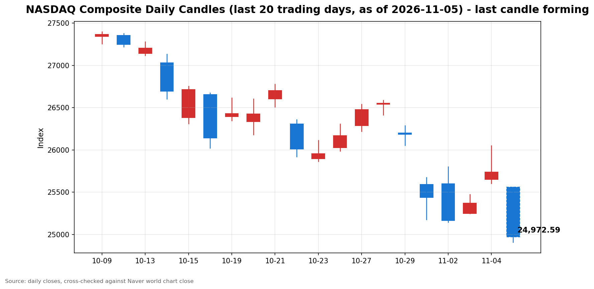

안녕하세요, [한국투자증권](https://securities.koreainvestment.com/main/Main.jsp)에서 [한투-한국투자증권](https://play.google.com/store/apps/details?id=com.truefriend.neosmartarenewal&hl=ko) 개발을 담당하고 있는 way입니다. 
2026년 11월 5일 나스닥 장 오픈 흐름을 수치 중심으로 정리합니다. 

## 개장 배경

간밤 미국 증시는 3대 지수가 함께 상승 마감했습니다. 
2026년 11월 4일 나스닥 종합은 25,736.51로 전일 대비 1.44% 상승했고, 스탠더드앤드푸어스 500 지수는 7,688.62로 1.58% 상승했습니다. 
다우존스 산업평균지수는 53,356.12로 3.03% 상승해 세 지수 가운데 상승률이 가장 컸습니다. 
전 거래일에는 나스닥이 오르고 다우가 내렸던 것과 달리, 11월 4일에는 세 지수가 함께 올랐습니다. 
상승의 표면적 이유는 미국 중간선거 결과 확정 이후의 안도감이었습니다. 
민주당이 상원과 하원을 모두 장악하면서, 분점 정부에 대한 기대가 불확실성 프리미엄을 낮췄습니다. 
그러나 장 마감 이후부터 밤사이 해석이 뒤집혔습니다. 
데이터센터 규제 강화 우려가 부각되면서, 11월 5일 장 오픈은 급락 출발이 됐습니다. 

## 오늘의 스냅샷

| 지수 | 현재가 | 전일 대비 | 등락률 | 전일 종가 | 장중 고가 | 장중 저가 | 스냅샷 기준 시각 |
| --- | --- | --- | --- | --- | --- | --- | --- |
| 나스닥 종합 | 24,931.07 | -805.45 | -3.13% | 25,736.51 | 25,559.03 | 24,891.08 | 미국 동부시간 2026-11-05 10:03, 한국시간 2026-11-06 00:03 |
| 스탠더드앤드푸어스 500 | 7,562.89 | -125.73 | -1.64% | 7,688.62 | 7,645.47 | 7,562.89 | 미국 동부시간 2026-11-05 10:00경, 한국시간 2026-11-06 00:00경 |
| 다우존스 산업평균지수 | 확인 필요 | 확인 필요 | 확인 필요 | 53,356.12 | 확인 필요 | 확인 필요 | 미국 동부시간 2026-11-05 10:00경, 한국시간 2026-11-06 00:00경 |

당일 수치는 형성 중인 수치로, 마감 전에는 계속 변합니다. 
나스닥 종합의 시가는 25,558.11이었습니다. 
전일 종가와 비교하면 시가 기준으로는 0.69% 하락 출발했고, 이후 낙폭이 3.13%까지 확대됐습니다. 
나스닥 값은 [네이버 월드 차트 나스닥 종합](https://finance.naver.com/world/sise.naver?symbol=NAS@IXIC)과 [네이버 월드 차트 나스닥 종합 가격](https://stock.naver.com/worldstock/index/.IXIC/price)에서 확인했습니다. 
한국투자증권 MTS 해외 대시보드 값과 교차 검증했습니다. 
한국투자증권 MTS 기준 나스닥 종합은 미국 동부시간 10시경 24,968.18로 전일 대비 768.33포인트, 2.99% 하락했고, 스탠더드앤드푸어스 500 지수는 7,562.89로 1.64% 하락했습니다. 
네이버 값과 한국투자증권 MTS 값의 차이는 조회 시점 차이 범위 안에 있습니다. 
스탠더드앤드푸어스 500 지수의 장중 고가와 저가는 한국투자증권 MTS 차트 배열의 최대값과 최소값으로 산출했습니다. 
다우존스 산업평균지수의 장중 수치는 한국투자증권 MTS 해외 대시보드에 다우 항목이 포함되지 않아 확인 필요로 표기합니다. 
전일 종가는 네이버 월드 차트와 한국투자증권 MTS 값으로 교차 검증했습니다. 

## 차트

최근 20거래일 일봉 차트입니다. 
빨간 봉은 종가가 시가보다 높은 날, 파란 봉은 종가가 시가보다 낮은 날입니다. 
당일 봉은 형성 중인 봉으로, 마감 전에는 계속 변합니다. 

## 원인·촉매 분석

표면적으로는 나스닥이 전일 대비 3.13% 급락 출발했습니다. 
근본 촉매는 선거 결과에 대한 해석의 반전입니다. 
11월 4일 장 마감 무렵에는 민주당의 양원 장악이 정책 불확실성 해소로 읽혔습니다. 
그러나 밤사이에는 같은 결과가 데이터센터 규제 강화라는 방향으로 다시 읽혔습니다. 
인공지능 인프라 확장에 제동이 걸릴 수 있다는 우려가, 기술주 중심의 매도로 이어졌습니다. 
전일 장에서도 균열은 이미 보였습니다. 
보도에 따르면 11월 4일 필라델피아 반도체지수는 3.13% 급락했습니다. 
나스닥이 1.44% 오르던 같은 날, 반도체는 정반대로 움직였습니다. 
광범위한 지수 상승 속에 반도체만 빠졌다는 점은, 인공지능 투자에 대한 의구심이 장 마감 전부터 커지고 있었음을 보여줍니다. 
개장 전에는 개별 재료도 매도 쪽에 힘을 보탰습니다. 
퀄컴이 실망스러운 가이던스에 개장 전 급락했다는 보도가 있었습니다. 
영란은행이 기준금리를 연 4%로 인상한 것도 밤사이 확인된 거시 재료입니다. 
3년 3개월 만의 인상으로, 글로벌 금리 인하 기대와는 결이 다른 신호입니다. 
교차 자산 흐름도 위험 회피 쪽을 가리킵니다. 
원·달러 환율은 한국투자증권 MTS 기준 1,349.2원으로 전일 대비 0.61% 상승했습니다. 
달러 강세와 원화 약세는 위험자산에서 자금이 빠져나가는 흐름과 같은 방향입니다. 
전일에는 국제유가도 큰 폭으로 하락했습니다. 
브렌트유는 배럴당 94.62달러로 8.7% 하락했고, 서부텍사스산 원유는 배럴당 88.12달러로 8.3% 하락했습니다. 
유가 하락은 비용 부담을 덜어주는 요인이지만, 수요 둔화 신호로 읽힐 여지도 있습니다. 
미국 10년물 국채수익률과 금값의 당일 수치는 확인되지 않았으므로, 금리와 안전자산 경로에 대한 최종 판단은 확인 필요로 남겨둡니다. 
지수 간 방향 차이도 의미가 있습니다. 
나스닥이 3.13% 내린 반면 스탠더드앤드푸어스 500 지수는 1.64% 내리는 데 그쳤습니다. 
이는 매도가 시장 전반이 아니라 기술주와 반도체에 집중되고 있음을 보여줍니다. 
전일 다우가 3.03% 오르며 상승을 주도했던 것과 대비되는, 기술주 중심의 되돌림입니다. 
다만 하루의 급락만으로 추세 전환을 확정할 수는 없습니다. 
규제 우려가 실제 법안과 정책 변화로 이어지는지는 앞으로 확인할 사안입니다. 

## 핵심 사건 3가지

### 첫째, 민주당의 양원 장악과 데이터센터 규제 우려입니다

미국 중간선거에서 민주당이 상원과 하원을 모두 장악했습니다. 
보도에서는 이를 블루 쓰나미라고 부릅니다. 
시장이 주목한 것은 의석 자체보다 데이터센터 규제 강화 가능성입니다. 
증권가에서는 데이터센터 건설 규제 리스크가 투자심리에 부담을 줄 것이라는 관측이 나왔습니다. 
이데일리 11월 6일자 신문 예고에서는 미국 데이터센터 절반에 제동이 걸릴 수 있다는 제목으로 이 우려를 다뤘습니다. 
다만 구체적인 법안이나 규제안이 확정된 것은 아닙니다. 
우려가 정책으로 굳어지는지, 아니면 단기 심리에 그치는지가 앞으로의 관건입니다. 
이 사건이 중요한 이유는 인공지능 투자 논쟁의 중심에 데이터센터가 있기 때문입니다. 
데이터센터 건설 속도가 늦어지면 인공지능 인프라 투자 규모 자체에 대한 의문이 커집니다. 
이는 밸류에이션 논쟁을 넘어, 수요 전망 자체를 흔드는 재료입니다. 

### 둘째, 아시아 증시의 급락과 외국인 투매입니다

11월 5일 국내 증시는 5% 넘게 급락했습니다. 
코스피는 전 거래일 대비 300.00포인트, 5.28% 내린 5,383.80에 마감했습니다. 
코스닥도 36.54포인트, 5.11% 내린 678.41에 마감했습니다. 
코스피와 코스닥에서는 나란히 매도 사이드카가 발동됐습니다. 
외국인은 3.4조 원대를 순매도했고, 삼성전자와 SK하이닉스는 각각 7.57%와 9.46% 급락했습니다. 
SK그룹 최태원 회장은 중간선거 결과가 반도체에 좋지 않다고 시장이 평가한 것 같다고 언급했습니다. 
시장 변동성이 앞으로도 반복될 수 있다는 경고도 함께 나왔습니다. 
이 사건이 중요한 이유는 미국 장 오픈 전에 이미 한 차례 매도가 소화됐다는 점입니다. 
아시아의 급락은 미국 투자자에게도 같은 우려가 전이되고 있음을 보여줍니다. 
미국 장이 아시아와 같은 방향으로 출발한 것은, 우려가 지역을 넘어 확산되고 있다는 신호입니다. 

### 셋째, 영란은행 금리 인상과 개장 전 개별 재료입니다

영란은행은 기준금리를 연 4%로 인상했습니다. 
3년 3개월 만의 인상입니다. 
주요국 중앙은행의 금리 인하 기대가 우세하던 흐름과는 다른 방향의 결정입니다. 
금리 인상 자체가 미국 증시의 직접 재료는 아닙니다. 
그러나 글로벌 유동성 환경에 대한 기대를 되돌아보게 만드는 신호로 작용합니다. 
개장 전에는 퀄컴이 실망스러운 가이던스에 급락했다는 보도도 있었습니다. 
인공지능 수요 증거와 공급 우려가 충돌하는 구간에서는, 개별 기업의 가이던스 하나도 섹터 심리를 좌우합니다. 
이 두 재료는 규모는 다르지만 같은 방향을 가리킵니다. 
낙관적인 전망을 되돌아보게 만드는 재료가 밤사이에 쌓였다는 점입니다. 

## 지수·섹터 영향 체인

규제에서 인공지능 인프라로 이어지는 연결고리가 먼저 작동합니다. 
데이터센터 건설 규제 우려는 인공지능 인프라 확장의 속도를 늦출 수 있습니다. 
이는 반도체와 메모리 수요 전망에 직접적인 부담을 줍니다. 
11월 4일 필라델피아 반도체지수가 3.13% 급락한 것이나, 11월 5일 국내 반도체 대형주가 7% 넘게 급락한 것이 같은 연결고리입니다. 
반도체에서 하드웨어와 전력으로 이어지는 연결고리도 확인됩니다. 
데이터센터 건설이 늦어지면 냉각과 전력기기, 서버용 부품 수요에도 속도 조절 압력이 생깁니다. 
반대로 인공지능 전력망 비용을 빅테크가 더 부담해야 한다는 압박이 커질 수 있다는 관측도 나왔습니다. 
이는 빅테크의 비용 구조에 대한 새로운 변수입니다. 
금리에서 성장주 밸류에이션으로 이어지는 연결고리는 아직 확인이 필요합니다. 
영란은행의 금리 인상은 금리 인하 기대를 되돌아보게 하지만, 미국 10년물 국채수익률의 당일 수치는 확인되지 않았습니다. 
달러 강세는 성장주에 우호적이지 않은 환경입니다. 
원·달러 환율 상승과 외국인 매도는 같은 방향의 자금 흐름을 보여줍니다. 
유가에서 에너지로 이어지는 연결고리는 양면적입니다. 
전일 유가 하락은 에너지주의 매출 전망에는 부담이지만, 물가와 비용 부담을 덜어주는 요인입니다. 
어느 쪽 해석이 우위를 점하는지는 당일 에너지 섹터의 움직임으로 확인할 수 있습니다. 
수혜와 타격을 단순히 나누기보다, 같은 선거 결과가 섹터마다 다른 방향으로 작용한다는 점이 이번 장의 특징입니다. 
다만 11월 5일 장 초반에는 타격 쪽 해석이 우위를 점하고 있습니다. 

## 다우·스탠더드앤드푸어스 500 흐름

스탠더드앤드푸어스 500 지수는 11월 4일 7,688.62로 1.58% 상승 마감했습니다. 
11월 5일 장 오픈 무렵에는 7,562.89로 1.64% 하락했습니다. 
나스닥 하락률 3.13%의 절반 수준으로, 낙폭이 상대적으로 작습니다. 
이는 매도가 기술주에 집중되고, 시장 전반으로 고르게 확산되지는 않았음을 보여줍니다. 
다우존스 산업평균지수는 11월 4일 53,356.12로 3.03% 상승했습니다. 
세 지수 가운데 상승률이 가장 컸고, 가치주와 산업주가 상승을 주도했습니다. 
11월 5일 장중 수치는 한국투자증권 MTS 해외 대시보드에 다우 항목이 포함되지 않아 확인 필요로 표기합니다. 
전일 다우가 가장 강했던 만큼, 당일 다우의 낙폭이 나스닥보다 작은지가 확인할 지점입니다. 

## 단기·중기 전망과 장 초반 확인할 시나리오

흐름 지속과 일시적 노이즈를 구분하는 것이 관건입니다. 
규제 우려가 실제 정책으로 이어지면 인공지능 인프라 투자 논쟁은 중기 재료가 됩니다. 
반대로 우려가 심리에 그치면, 급락 이후 되돌림이 나올 여지도 있습니다. 
장 초반에 확인할 수치는 전일 종가와 장중 저가입니다. 
나스닥은 전일 종가 25,736.51을 이미 밑돌고 있습니다. 
장중 저가 24,891.08을 지켜내는지, 아니면 더 밑으로 밀리는지가 단기 방향을 가릅니다. 
심리적 지지선으로는 25,000선이 있으며, 스냅샷 기준으로는 이미 밑으로 내려간 상태입니다. 
되돌림이 나온다면 전 거래일 종가 25,372.01 회복 여부가 첫 번째 확인 지점입니다. 
섹터 단위에서는 반도체지수의 움직임이 관건입니다. 
전일 3.13% 급락한 반도체가 당일 낙폭을 더 키우는지, 아니면 저가 매수로 되돌리는지가 중요합니다. 
달러와 원·달러 환율의 움직임도 함께 확인할 필요가 있습니다. 
달러 강세가 이어지면 외국인 자금 이탈 압력이 이어질 수 있습니다. 
중기적으로는 민주당의 데이터센터 규제 관련 입법 움직임과 빅테크의 자본지출 계획을 확인할 필요가 있습니다. 
실제 법안이나 가이던스 변경이 확인되기 전에는, 규제 우려를 확정적인 정책 변화로 단정하지 않습니다. 

## 마치며

11월 5일 나스닥은 블루 쓰나미 이후 데이터센터 규제 우려가 부각되며 3.13% 급락 출발했습니다. 
장 초반에는 저가 지지 여부와 반도체 섹터의 되돌림 여부를 확인하는 것이 중요합니다. 
이 글은 교육과 해설 목적으로 작성되었으며, 특정 종목의 매수나 매도를 권유하지 않습니다. 
