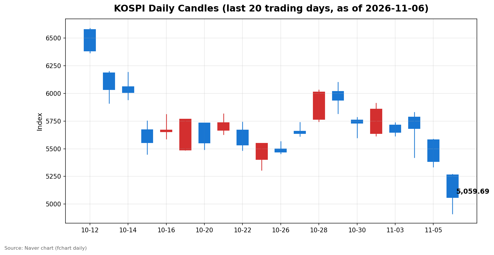
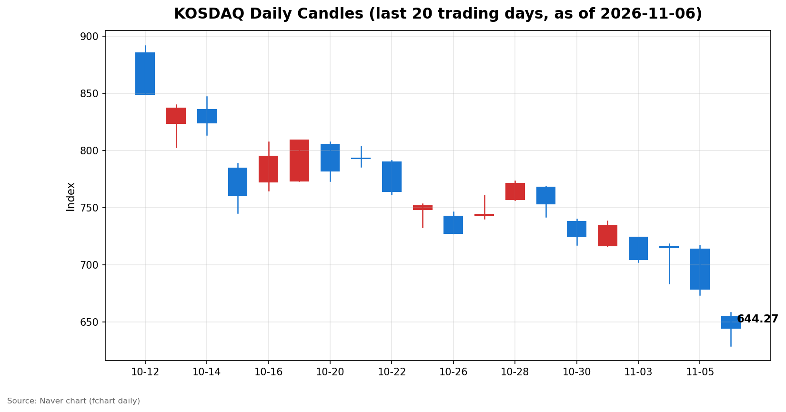

안녕하세요, [한국투자증권](https://securities.koreainvestment.com/main/Main.jsp)에서 [한투-한국투자증권](https://play.google.com/store/apps/details?id=com.truefriend.neosmartarenewal&hl=ko) 개발을 담당하고 있는 way입니다. 
오늘 국내 증시는 장 초반 서킷브레이커가 발동하는 폭락 장세 속에 코스피가 5,000선을 간신히 지키며 마감했습니다. 

## 마감 요약

코스피는 전일 대비 324.11포인트(6.02%) 하락한 5,059.69에 마감했습니다. 
코스닥은 전일 대비 34.14포인트(5.03%) 하락한 644.27에 마감했습니다. 
코스피는 장중 4,911.28까지 밀리며 5,000선이 무너졌으나 오후 들어 낙폭을 줄여 5,000선을 회복했습니다. 
전일 5%대 급락에 이어 이틀 연속 5% 넘는 하락이 이어졌고, 양 시장 모두 매도 사이드카와 코스피 1단계 서킷브레이커가 발동하는 등 시장 안정장치가 가동된 하루였습니다. 

## 오늘의 마감 스냅샷

| 지수 | 종가 | 전일 대비 | 등락률 | 시가 | 고가 | 저가 | 거래량 | 거래대금 |
| --- | --- | --- | --- | --- | --- | --- | --- | --- |
| 코스피 | 5,059.69 | -324.11 | -6.02% | 5,263.26 | 5,269.10 | 4,911.28 | 2억 9,704만 주 | 27조 4,919억 원 |
| 코스닥 | 644.27 | -34.14 | -5.03% | 654.43 | 657.95 | 629.17 | 4억 1,755만 주 | 4조 7,545억 원 |

스냅샷 기준은 2026년 11월 6일 장 마감 수치이며, 전일 종가는 네이버 실시간 데이터 역산값으로 교차 검증했습니다. 
코스피 전일 종가 5,383.80, 코스닥 전일 종가 678.41이 일봉 데이터와 일치했습니다. 
코스피200은 783.23으로 6.51% 하락했고, 원/달러 환율은 1,356.50원으로 전일 대비 0.07% 상승했습니다. 
출처: [코스피](https://finance.naver.com/sise/sise_index.naver?code=KOSPI), [코스닥](https://finance.naver.com/sise/sise_index.naver?code=KOSDAQ) 

## 차트

최근 20거래일 일봉 차트입니다. 
빨간 봉은 종가가 시가보다 높은 날, 파란 봉은 종가가 시가보다 낮은 날입니다. 

## 원인·촉매 분석

오늘 하락의 근본 촉매는 미국발 AI 투자 회의론이었습니다. 
미국 중간선거에서 민주당이 승리한 직후, 미국 일부 주에서 신규 데이터센터 개발 중단과 세제 혜택 축소를 추진하는 움직임이 나타났고, ING가 5억 달러 규모의 데이터센터 관련 대출을 매물로 내놓았다는 소식이 전해졌습니다. 
데이터센터 건설을 뒷받침하던 자금 조달 구조 자체에 균열이 생겼다는 신호로 받아들여졌고, 이는 AI 인프라 투자 사이클의 지속 가능성에 대한 의구심으로 번졌습니다. 
전일 미국 증시에서 나스닥이 5.52%, 필라델피아 반도체지수가 12.25% 급락한 것이 국내 장 초반 투매의 직접적인 방아쇠가 되었습니다. 
국내 증시는 반도체 비중이 높은 구조라, 미국 반도체주의 급락이 코스피200 선물 -6.49%까지 이어지며 지수 하락을 증폭시켰습니다. 
수급 구도는 외국인의 일방적인 매도와 개인·기관의 받침으로 요약됩니다. 
코스피에서 외국인은 2조 7,686억 원을 순매도했고, 개인이 6,045억 원, 기관이 1조 7,000억 원을 순매수하며 물량을 받았습니다. 
외국인의 매도 규모가 개인과 기관의 합을 웃돌았고, 특히 금융투자 중심의 기관 매수가 장중 저점 부근에서 유입되며 낙폭을 일부 만회하는 데 기여했습니다. 
다만 기관의 매수가 추세 전환을 의미한다고 보기는 어렵습니다. 
투신과 사모는 오히려 순매도를 기록했고, 연기금의 순매수 2,885억 원은 하락장에서의 기계적인 비중 조절 성격이 강합니다. 
개인 투자자의 순매수도 저가 매수라기보다, 한 달간 KODEX 레버리지 상품에 약 1조 2,199억 원이 순유입된 흐름의 연장선으로 해석됩니다. 
지수가 추가로 밀릴 경우 신용융자 반대매매가 연쇄적으로 나올 수 있는 구조라, 개인의 매수 여력은 제한적일 수 있습니다. 
환율은 1,356.50원으로 비교적 안정적이었으나, 이는 원화 강세가 아니라 달러 강세 속에서도 외국인 매도 자금의 이탈이 환율에 고스란히 반영되지 않았기 때문입니다. 
환율이 급등하지 않았다는 점은 이번 하락이 외환 위기형이 아니라 주식 시장 내부의 밸류에이션 재평가 성격이 강하다는 것을 보여줍니다. 

## 핵심 사건 3가지

### 1. 미국 중간선거 이후 AI 데이터센터 규제 우려 확산

미국 중간선거에서 민주당이 승리한 직후, 스타게이트 프로젝트가 추진되는 미시간과 뉴멕시코에서 신규 데이터센터 개발 중단과 세제 혜택 축소를 추진하는 움직임이 나타났습니다. 
ING가 5억 달러 규모의 데이터센터 관련 대출을 매물로 내놓았다는 소식도 같은 날 전해졌습니다. 
AI 데이터센터 건설 붐을 떠받치던 자금 조달과 정책 지원이라는 두 축이 동시에 흔들린다는 점이 시장의 심리를 가장 크게 건드렸습니다. 
그동안 AI 인프라 투자는 수요가 아니라 자금 조달 능력에 의해 지탱된다는 의문이 제기돼 왔는데, 대형 은행의 대출 매각은 그 의문에 현실성을 부여했습니다. 
국내 증시는 반도체를 중심으로 AI 밸류체인에 대한 노출이 크기 때문에, 미국발 규제 우려는 곧바로 국내 반도체주와 관련 밸류체인의 동반 하락으로 이어졌습니다. 

### 2. 서킷브레이커와 매도 사이드카 발동, 장중 4,911선 이탈

코스피는 4,923.47로 8.55% 하락 출발한 뒤 오전 9시 3분 34초에 1단계 서킷브레이커가 발동해 20분간 매매가 중단됐습니다. 
매매 재개 이후에도 낙폭이 이어져 오전 9시 34분경 코스피 매도 사이드카가 발동했고, 코스닥에서도 오전 9시 6분경 매도 사이드카가 발동했습니다. 
장중 코스피는 4,911.28까지 밀려 5,000선을 이탈했고, 코스닥도 629.17까지 하락했습니다. 
서킷브레이커는 10월 15일 이후 한 달이 채 되지 않아 다시 발동한 것으로, 최근 한 달 사이 시장 안정장치가 두 차례나 가동됐다는 점에서 변동성의 강도를 보여줍니다. 
오후 들어 낙폭이 줄며 코스피가 5,000선을 회복했지만, 이는 추세 반전이 아니라 장중 과매도에 따른 기술적 되돌림에 가깝습니다. 
매매 중단과 사이드카 발동은 투자 심리가 공포 구간에 진입했음을 보여주는 지표이며, 당분간 변동성이 쉽게 가라앉지 않을 것임을 시사합니다. 

### 3. 미국 10월 고용보고서 발표 임박

미국 노동부는 한국 시간 오늘 밤 22시 30분에 10월 고용보고서를 발표합니다. 
고용보고서는 미국 연방준비제도의 금리 경로를 가늠하는 핵심 지표이며, 이번 발표는 중간선거 이후 불거진 정책 불확실성과 맞물려 있습니다. 
고용이 예상보다 약하면 경기 둔화 우려가 커지고, 예상보다 강하면 금리 인하 기대가 약해지는 등 어느 방향으로든 시장을 자극할 수 있습니다. 
오늘 국내 장의 급락이 미국발 요인에서 시작된 만큼, 고용보고서 결과에 따라 다음 거래일 국내 증시의 방향이 갈릴 가능성이 큽니다. 
발표 전까지는 포지션을 새로 잡기보다 관망하는 자금이 늘어날 수 있어, 장 마감 이후 시간외 흐름까지 확인할 필요가 있습니다. 

## 섹터·테마 영향 체인

오늘 하락의 중심에는 반도체와 AI 밸류체인이 있었습니다. 
미국 필라델피아 반도체지수의 전일 12.25% 급락이 국내 반도체주의 투자 심리를 직접적으로 압박했고, 이는 코스피200이 코스피보다 더 크게 하락한 6.51%에서 확인됩니다. 
금리 경로에 대한 불확실성도 성장주 밸류에이션에 부담으로 작용했습니다. 
데이터센터 규제 우려는 단순히 반도체 수요 감소를 넘어, AI 인프라 투자 자체의 자금 조달 비용 상승으로 이어질 수 있습니다. 
자금 조달 비용이 오르면 데이터센터 건설 속도가 느려지고, 이는 다시 반도체와 전력 설비, 건설 자재 등 하위 밸류체인 전반의 수요 둔화로 연결되는 구조입니다. 
반대로 일부 방어적 성격의 테마는 상대적인 강세를 보였습니다. 
KIS MTS 테마 데이터에서 통신사가 2.79% 상승했고, 디지털방송이 3.03%, 중고차 및 렌터카가 1.19% 상승했습니다. 
대마 관련주가 14.12% 상승했으나, 이는 종목 수가 2개에 불과한 소규모 테마라 시장 전체의 흐름을 대표한다고 보기 어렵습니다. 
통신사처럼 현금 흐름이 안정적인 섹터가 하락장에서 상대적으로 선방한 것은, 자금이 성장주에서 방어주로 이동하는 전형적인 위험 회피 흐름으로 해석됩니다. 
전력·통신 인프라 관련 테마가 데이터센터 규제 우려와 직접 연결되는 만큼, 규제의 구체적인 범위가 확인되기 전까지는 관련 테마의 변동성도 이어질 수 있습니다. 

## 최근 5거래일 일봉

### 코스피

| 날짜 | 시가 | 고가 | 저가 | 종가 | 거래량(천 주) |
| --- | --- | --- | --- | --- | --- |
| 2026-11-02 | 5,637.77 | 5,910.83 | 5,616.50 | 5,859.08 | 198,130 |
| 2026-11-03 | 5,715.19 | 5,735.92 | 5,615.80 | 5,648.79 | 207,371 |
| 2026-11-04 | 5,786.13 | 5,828.13 | 5,421.72 | 5,683.80 | 276,889 |
| 2026-11-05 | 5,580.09 | 5,586.46 | 5,336.88 | 5,383.80 | 277,253 |
| 2026-11-06 | 5,263.26 | 5,269.10 | 4,911.28 | 5,059.69 | 297,036 |

### 코스닥

| 날짜 | 시가 | 고가 | 저가 | 종가 | 거래량(천 주) |
| --- | --- | --- | --- | --- | --- |
| 2026-11-02 | 716.44 | 738.01 | 716.21 | 734.36 | 355,750 |
| 2026-11-03 | 723.92 | 723.92 | 702.34 | 704.39 | 430,571 |
| 2026-11-04 | 715.74 | 718.34 | 683.66 | 714.95 | 539,758 |
| 2026-11-05 | 713.49 | 717.06 | 673.38 | 678.41 | 434,307 |
| 2026-11-06 | 654.43 | 657.95 | 629.17 | 644.27 | 417,550 |

5거래일 기준으로 코스피는 5,859.08에서 5,059.69로 13.65% 하락했고, 코스닥은 734.36에서 644.27로 12.27% 하락했습니다. 
특히 11월 4일 장중 저점 5,421.72에서 한 차례 반등한 뒤 다시 하락하는 흐름이 이어지고 있어, 단기 저점을 확인하는 과정이 반복되고 있습니다. 
오늘 장중 저점 4,911.28은 최근 5거래일 중 가장 낮은 수준입니다. 

## 당일 수급

코스피에서는 외국인이 2조 7,686억 원을 순매도했고, 개인이 6,045억 원, 기관이 1조 7,000억 원, 기타법인이 4,641억 원을 순매수했습니다. 
외국인의 매도는 전일 3조 3,733억 원 순매도에 이어 이틀 연속 대규모로 이어졌고, 이는 단순한 차익 실현이 아니라 AI 투자 회의론에 따른 포지션 축소로 보입니다. 
기관 순매수 1조 7,000억 원의 대부분은 금융투자 1조 6,146억 원과 연기금 2,885억 원에서 나왔습니다. 
금융투자의 매수는 증권사 자기매매 성격이 강해 추세적인 매수라기보다 장중 변동성에 대응한 물량 조절로 해석하는 것이 적절합니다. 
투신과 사모가 각각 1,886억 원, 849억 원을 순매도한 점도 기관 내부의 온도 차를 보여줍니다. 
코스닥에서는 외국인이 999억 원, 개인이 1,104억 원을 순매도했고, 기관이 2,055억 원을 순매수했습니다. 
코스피와 달리 코스닥에서는 개인도 순매도를 기록했는데, 이는 중소형주 중심의 코스닥에서 개인의 저가 매수 여력이 소진되고 있음을 보여줍니다. 
기관의 코스닥 순매수 역시 금융투자 3,423억 원에 집중됐고, 투신은 972억 원을 순매도했습니다. 
수급 수치 중 외국인·기관·개인의 합이 0에 가깝게 맞아떨어지는 것으로 보아 마감 직후 잠정치이지만 구조는 안정적으로 확인됩니다. 
최종 확정치는 추후 네이버 시장동향 최종값으로 달라질 수 있습니다. 

## 강했던 테마와 흐름

하락장 속에서도 일부 테마는 상승 흐름을 유지했습니다. 
KIS MTS 테마 기준 대마 관련주가 14.12% 상승했고, 디지털방송이 3.03%, 통신사가 2.79% 상승했습니다. 
통신사는 구성 종목 3개가 모두 상승하며 테마 내 확산이 확인됐고, 이는 방어주 선호 흐름과 맞닿아 있습니다. 
개별 종목 기준으로는 파이온엑스가 29.89% 상승하며 KIS MTS 실시간 랭킹 상위에 올랐습니다. 
다만 오늘의 테마 강세는 대부분 소규모 테마나 개별 종목의 움직임에 불과합니다. 
시장 전체가 5% 넘게 하락한 날의 테마 상승은 주도주의 전환이라기보다 하락장에서의 일시적인 자금 피난처 성격이 강합니다. 
데이터센터 규제 우려가 구체화되는 과정에서 전력·통신 인프라 관련 테마는 수혜와 타격이 엇갈릴 수 있어, 테마별 흐름을 단정적으로 해석하기보다 규제 내용 확인을 우선할 필요가 있습니다. 

## 단기·중기 전망과 내일 확인할 시나리오

단기적으로는 미국 10월 고용보고서 결과가 가장 중요한 변수입니다. 
오늘 밤 22시 30분 발표되는 고용보고서가 예상치를 크게 벗어나면, 다음 거래일 국내 증시는 오늘의 되돌림이 이어질지 아니면 재차 하락할지가 갈립니다. 
고용이 둔화되면 경기 침체 우려가 커지고, 고용이 강하면 금리 인하 기대가 후퇴하는 만큼, 어느 쪽 결과든 변동성은 이어질 수 있습니다. 
확인할 가격 레벨은 코스피 5,000선과 장중 저점 4,911.28입니다. 
다음 거래일 시초에 5,000선을 다시 내준다면 저점 확인 과정이 길어질 수 있고, 5,000선을 지키며 반등한다면 오늘의 되돌림이 단기 바닥 신호로 작용할 수 있습니다. 
코스닥은 629.17의 장중 저점과 650선 안착 여부가 관건입니다. 
중기적으로는 미국 데이터센터 규제 논의의 구체적인 범위가 관건입니다. 
미시간·뉴멕시코 등 개별 주 단위의 움직임이 연방 차원의 정책으로 확산되는지, ING의 대출 매각이 일회성인지 다른 금융기관으로 번지는지를 확인해야 합니다. 
외국인 매도의 진정 여부도 함께 봐야 합니다. 
외국인이 이틀 연속 3조 원 안팎을 순매도한 상황에서, 매도 규모가 줄어들지 않으면 지수 하방 압력은 쉽게 해소되지 않습니다. 
반대로 외국인 매도가 둔화되고 기관의 매수가 지속된다면, 5,000선 부근에서 저점을 다지는 흐름이 나올 수 있습니다. 
신용융자 반대매매 리스크도 단기 변수의 하나입니다. 
개인 투자자의 레버리지 상품 순매수가 한 달간 1조 원을 넘긴 상황에서 지수가 추가로 하락하면 반대매매가 매물을 키우는 악순환이 나타날 수 있습니다. 
반대로 지수가 5,000선을 회복하며 안정된다면 반대매매 압력은 빠르게 줄어듭니다. 
내일 확인할 이벤트는 미국 고용보고서 결과, 미국 증시의 마감 흐름, 외국인 선물 포지션 변화입니다. 
이 중 어느 하나라도 긍정적으로 확인되면 단기 반등의 근거가 되지만, 세 가지가 모두 부정적이면 4,911선 재확인 흐름으로 이어질 수 있습니다. 

## 마치며

오늘 국내 증시는 서킷브레이커가 발동하는 폭락 속에서도 5,000선을 간신히 지키며 마감했습니다. 
다만 이는 반등의 시작이라기보다 과매도 이후의 되돌림에 가깝고, 진정한 방향은 오늘 밤 발표되는 미국 고용보고서와 미국발 AI 규제 논의의 향방이 정할 것으로 보입니다. 
이 글은 교육·해설 목적으로 작성됐으며, 특정 종목의 매수나 매도를 권유하지 않습니다. 
