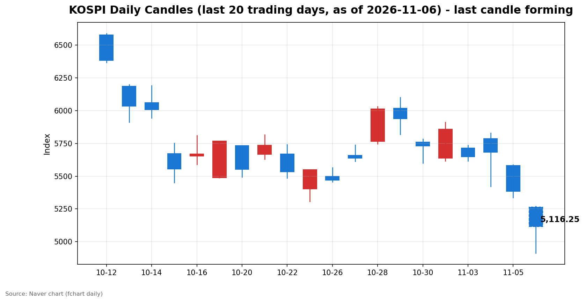
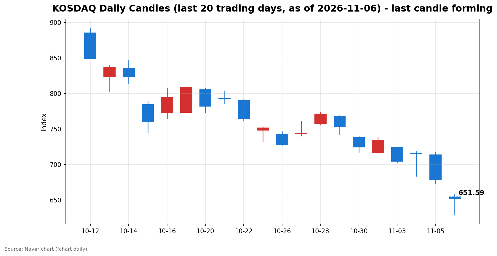

안녕하세요, [한국투자증권](https://securities.koreainvestment.com/main/Main.jsp)에서 [한투-한국투자증권](https://play.google.com/store/apps/details?id=com.truefriend.neosmartarenewal&hl=ko) 개발을 담당하고 있는 way입니다. 
2026년 11월 6일 국내 증시 오전장 흐름을 수치 중심으로 정리합니다. 

## 오전장 요약

코스피는 전일 대비 2.24% 내린 5,263.26에 출발했습니다. 
개장 직후 낙폭이 빠르게 확대되며 오전 9시 3분 기준 4,911.91까지 내려갔습니다. 
코스피가 장중 5,000선 아래로 내려간 것은 지난 2월 6일 이후 약 9개월 만입니다. 
지수가 전일 대비 8% 이상 하락한 상태가 1분간 지속되면서 한국거래소는 오전 9시 3분 34초부터 1단계 서킷브레이커를 발동해 유가증권시장 전체 매매거래를 20분간 중단했습니다. 
코스닥 시장에서는 오전 9시 6분 2초 매도 사이드카가 발동됐습니다. 
매매 재개 이후 지수는 저점 대비 회복 흐름을 보였습니다. 
스냅샷 시점 코스피는 5,124.31로 당일 저점 4,911.28 대비 4.34% 반등한 수준입니다. 
코스닥도 당일 저점 629.17에서 652.06까지 3.64% 되돌렸습니다. 
다만 두 지수 모두 여전히 4% 안팎의 하락률을 기록하고 있어 오전장 전체로는 급락 흐름이 이어지고 있습니다. 

## 오늘의 스냅샷

| 지수 | 현재가 | 전일 대비 | 등락률 | 시가 | 고가 | 저가 | 거래량 | 거래대금 | 스냅샷 기준 시각 |
| --- | --- | --- | --- | --- | --- | --- | --- | --- | --- |
| 코스피 | 5,124.31 | -259.49 | -4.82% | 5,263.26 | 5,269.10 | 4,911.28 | 177,873천주 | 15조 9,880억원 | 2026-11-06 12:29 KST |
| 코스닥 | 652.06 | -26.35 | -3.88% | 654.43 | 657.95 | 629.17 | 295,989천주 | 3조 786억원 | 2026-11-06 12:29 KST |

당일 봉은 형성 중인 봉으로, 마감 전에는 계속 변합니다. 
전일 종가는 네이버 실시간 수치와 일봉 종가를 교차 확인했습니다. 
코스피 전일 종가는 5,383.80, 코스닥 전일 종가는 678.41입니다. 
교차 검증은 현재가를 등락률로 나눈 역산값으로 수행했습니다. 
역산값은 코스피 약 5,383.8, 코스닥 약 678.4로 일봉 전일 종가와 일치했습니다. 
지수 차트는 [코스피](https://finance.naver.com/sise/sise_index.naver?code=KOSPI)와 [코스닥](https://finance.naver.com/sise/sise_index.naver?code=KOSDAQ)에서 확인할 수 있습니다. 

## 차트

최근 20거래일 일봉 차트입니다. 
빨간 봉은 종가가 시가보다 높은 날, 파란 봉은 종가가 시가보다 낮은 날입니다. 
당일 봉은 형성 중인 봉으로, 마감 전에는 계속 변합니다. 

## 원인·촉매 분석

오늘 급락의 근본 촉매는 미국 정치 지형 변화가 인공지능 인프라 투자 사이클에 던진 규제 불확실성입니다. 
미국 중간선거에서 민주당이 상원과 하원을 모두 장악했습니다. 
선거 직후에는 정치 불확실성 해소로 뉴욕 증시가 올랐지만, 하루 만에 해석이 정반대로 바뀌었습니다. 
민주당이 데이터센터 건설에 대한 규제를 강화할 수 있다는 전망이 부각되면서 인공지능 인프라 확장이 늦어질 수 있다는 우려가 확산됐습니다. 
유비에스 전략가들은 2028년 계획된 데이터센터 증설 용량의 약 30%가 지연되거나 차질을 빚을 수 있다고 경고했습니다. 
이 우려는 기존에 쌓여 있던 인공지능 투자 회수에 대한 의구심과 맞물렸습니다. 
빅테크 기업들은 데이터센터와 칩, 인프라에 수천억 달러를 쏟아붓고 있지만, 그 투자가 언제 이익으로 돌아올지에 대한 의문은 해소되지 않았습니다. 
지난달 알파벳과 메타의 실적도 인공지능 지출의 수익성에 대한 시장의 우려를 가라앉히지 못했습니다. 
애플이 약 70억 달러 규모의 회사채 발행을 추진하는 등 빅테크의 차입 확대도 부담으로 거론됐습니다. 
금리가 여전히 높은 수준에 머무는 가운데 차입에 의존한 설비투자 확대는 밸류에이션 부담을 키우는 요인입니다. 
간밤 미국 증시는 올해 들어 가장 큰 폭으로 하락했습니다. 
나스닥 종합은 24,315.00으로 전일 대비 5.52% 하락했고, 필라델피아 반도체지수는 12.25% 하락했습니다. 
스탠더드앤드푸어스 500 지수는 7,353.73으로 4.36% 하락했고, 다우존스 산업평균지수는 51,523.06으로 3.44% 하락했습니다. 
국내 시장에서는 이 충격이 반도체 중심의 지수 구조를 통해 그대로 전달됐습니다. 
코스피200은 792.67로 5.38% 하락했고, 코스피 선물은 792.65로 5.33% 하락했습니다. 
전일 수급 구도는 외국인의 일방적인 매도와 개인·기관의 받기가 맞선 형태였습니다. 
네이버 시장동향 API 최종값 기준 전일 코스피 수급은 외국인 3조 3,733억원 순매도, 개인 2조 2,087억원 순매수, 기관 8,819억원 순매수였습니다. 
기관 내부에서도 방향은 갈렸습니다. 
금융투자는 1조 1,443억원을 순매수하며 받기를 주도했지만, 투신은 3,078억원, 사모는 1,545억원을 순매도했습니다. 
외국인이 팔고 개인과 기관이 받았으나 매도 규모가 압도적이어서 지수 방어로 이어지지 못했습니다. 
오늘 장중에도 외국인의 순매도 흐름이 이어지는 것으로 집계됩니다. 
네이버 시장동향 API 기준 12시 29분 장중 누적 잠정치(코스피·코스닥 합계)는 외국인 1조 3,357억원 순매도, 기관 9,905억원 순매수, 개인 786억원 순매수입니다. 
장중 누적치는 확정치가 아니며, 최종 수급은 마감 이후 확인이 필요합니다. 
원·달러 환율은 1,360.90원으로 전일 대비 5.40원, 0.40% 상승했습니다. 
외국인 매도에도 환율 급등은 제한적이어서 환율 자체는 이날 급락의 직접적인 촉매가 되지 않았습니다. 
구조적인 부담 요인도 남아 있습니다. 
개인은 10월 6일부터 11월 5일까지 한 달간 KODEX 레버리지 약 1조 2,199억원을 순매수했습니다. 
급락이 이어지면 레버리지 상품의 반대매매가 변동성을 키울 수 있는 구조입니다. 

## 핵심 사건 3가지

첫째, 코스피 5,000선 붕괴와 1단계 서킷브레이커 발동입니다. 
코스피는 개장 직후 4,911.91까지 내려가며 5,000선을 밑돌았습니다. 
오전 9시 3분 34초 1단계 서킷브레이커가 발동돼 유가증권시장 전체 매매가 20분간 중단됐습니다. 
코스닥 시장에서는 오전 9시 6분 2초 매도 사이드카가 발동됐습니다. 
서킷브레이커는 지수 급락 시 매매를 일시 중단해 투자자에게 냉각 시간을 주는 장치입니다. 
발동 자체가 시장의 공포 심리가 극단적인 수준에 도달했음을 보여주는 신호로 받아들여졌습니다. 
매매 재개 이후 지수가 저점 대비 4% 이상 반등한 점은 중단이 단기적인 진정 효과를 냈음을 시사합니다. 

둘째, 간밤 미국 증시의 급락과 인공지능 데이터센터 규제 우려입니다. 
나스닥 종합은 5.52% 하락했고, 필라델피아 반도체지수는 12.25% 하락해 사상 두 번째로 큰 낙폭을 기록했습니다. 
나스닥은 10월 6일 사상 최고 종가 27,599.89 대비 10% 이상 하락해 조정 국면에 진입했습니다. 
중간선거 결과에 대한 해석이 하루 만에 뒤집힌 점이 충격의 크기 키웠습니다. 
정치 불확실성 해소로 올랐던 시장이 규제 강화 전망에 다시 급락하면서, 투자 심리는 방향성 자체를 잃은 상태입니다. 
이 사건은 국내 반도체 중심 지수에 직접적인 하방 압력으로 작용했습니다. 

셋째, 정부의 긴급 대응과 신용융자 담보비율 유지의무 면제입니다. 
정부는 부총리 주재 긴급 시장상황점검회의를 열고 주가 급락에 대응했습니다. 
증권사의 신용융자 담보비율 140% 유지의무를 오는 9일부터 3개월간 면제하기로 했습니다. 
급락에 따른 과도한 반대매매로 시장 변동성이 증폭되는 상황을 막는 것이 목적입니다. 
정부는 과도한 불안 심리와 수급 쏠림 현상을 예의주시하면서 변동성이 추가로 확대될 경우 시장 안정을 위한 추가 조치도 준비하기로 했습니다. 
이 조치는 급락의 원인을 해소하는 대책이 아니라 반대매매 연쇄를 차단하는 진정책이라는 점에서 성격이 다릅니다. 
대책 발표 이후 지수가 저점 대비 회복 흐름을 보였으나, 대책 효과와 자연스러운 기술적 반등을 구분하기는 어렵습니다. 

## 섹터·테마 영향 체인

가장 직접적인 타격은 반도체와 인공지능 인프라 밸류체인에 집중됐습니다. 
미국의 중국 장비 수출 규제와 인공지능 수요 불확실성이 하락 압력으로 작용했습니다. 
국내에서는 반도체 대형주 중심의 매도가 코스피200과 선물 동반 하락으로 이어졌습니다. 
코스피200이 5.38% 하락한 점은 지수 전체가 반도체 충격을 고스란히 반영했음을 보여줍니다. 
금리 경로는 성장주 밸류에이션을 통해 작용했습니다. 
금리가 높은 수준에 머무는 가운데 빅테크의 차입 확대가 부각되면서 인공지능 설비투자의 수익성 의문이 커졌습니다. 
데이터센터 증설 지연 우려는 칩과 장비, 소재로 이어지는 밸류체인 전체의 투자 심리를 압박했습니다. 
반도체 섹터 내부에서는 차별화도 나타났습니다. 
한국투자증권 MTS 12시 시장 브리핑 기준 D램과 HBM, 반도체 섹터 거래대금은 1조 1,000억원 규모로 섹터 1위였습니다. 
매도 압력이 유지되는 가운데서도 장비와 소재 일부 종목은 상승하며 온도 차를 보였습니다. 
태성은 3.28% 상승했고 멜콘은 0.44% 상승한 반면, 한미반도체는 5.14%, 샘씨엔에스는 3.73% 하락했습니다. 
하락장 속 자금 이동도 확인됐습니다. 
같은 브리핑 기준 로봇과 지배구조 이슈로 순환매가 나타났고, 바이오 일부 종목도 강세를 보였습니다. 
전면적인 투매가 아니라 테마 간 자금 이동이 병행되고 있다는 점은 오후 흐름을 가르는 단서가 됩니다. 

## 최근 5거래일 일봉 표

| 날짜 | 시가 | 고가 | 저가 | 종가 | 전일 대비 등락률 | 거래량 |
| --- | --- | --- | --- | --- | --- | --- |
| 2026-10-30 | 5,760.35 | 5,784.98 | 5,599.42 | 5,730.74 | -3.49% | 228,294천주 |
| 2026-11-02 | 5,637.77 | 5,910.83 | 5,616.50 | 5,859.08 | +2.24% | 198,130천주 |
| 2026-11-03 | 5,715.19 | 5,735.92 | 5,615.80 | 5,648.79 | -3.59% | 207,371천주 |
| 2026-11-04 | 5,786.13 | 5,828.13 | 5,421.72 | 5,683.80 | +0.62% | 276,889천주 |
| 2026-11-05 | 5,580.09 | 5,586.46 | 5,336.88 | 5,383.80 | -5.28% | 277,253천주 |

| 날짜 | 시가 | 고가 | 저가 | 종가 | 전일 대비 등락률 | 거래량 |
| --- | --- | --- | --- | --- | --- | --- |
| 2026-10-30 | 737.76 | 739.79 | 717.27 | 724.38 | -3.83% | 470,174천주 |
| 2026-11-02 | 716.44 | 738.01 | 716.21 | 734.36 | +1.38% | 355,750천주 |
| 2026-11-03 | 723.92 | 723.92 | 702.34 | 704.39 | -4.08% | 430,571천주 |
| 2026-11-04 | 715.74 | 718.34 | 683.66 | 714.95 | +1.50% | 539,758천주 |
| 2026-11-05 | 713.49 | 717.06 | 673.38 | 678.41 | -5.11% | 434,307천주 |

위 표는 코스피와 코스닥 순서입니다. 
11월 4일 종가 대비 스냅샷 시점 코스피는 9.84% 낮은 수준이며, 코스닥은 8.80% 낮은 수준입니다. 
이틀 연속 급락이 이어진 뒤 오전장에 기술적 반등이 나타난 구도입니다. 

## 오전 강했던 테마와 흐름 변화

한국투자증권 MTS 12시 시장 브리핑은 반도체 매도 압력 유지, 로봇과 지배구조 이슈로 순환매, 바이오 일부 종목 강세로 오전장을 요약했습니다. 
D램과 HBM, 반도체 섹터는 거래대금 1조 1,000억원 규모로 섹터 1위를 기록했습니다. 
시가 대비 방향 전환이 오전장의 가장 큰 특징입니다. 
코스피는 시가 5,263.26에서 출발해 장중 4,911.28까지 내려갔다가 5,124.31까지 회복했습니다. 
코스닥도 시가 654.43에서 출발해 장중 629.17까지 내려갔다가 652.06까지 되돌렸습니다. 
두 지수 모두 시가 대비로는 여전히 약세이지만, 장중 저점 대비로는 뚜렷한 회복 흐름을 보였습니다. 
테마별로는 반도체 매도 압력이 유지되는 가운데 로봇과 지배구조, 바이오 쪽으로 자금이 이동하는 순환매가 나타났습니다. 
반도체 섹터 내부에서도 장비와 소재 일부 종목이 상승하며 대형주 매도와 다른 움직임을 보였습니다. 
이 흐름이 오후에도 이어질지는 외국인 매도 진정 여부와 미국 고용보고서 대기 심리에 달려 있습니다. 

## 오후 전망과 확인할 시나리오

오전 흐름은 일시적 공포에 따른 급락과 저점 매수세 유입이 교차한 형태입니다. 
서킷브레이커 발동 이후 저점 대비 4% 이상 반등한 점은 단기 낙폭 과대에 대한 되돌림이 작동했음을 보여줍니다. 
다만 반등이 추세 전환인지 일시적 되돌림인지는 오후 수급으로 가려질 전망입니다. 
첫 번째로 확인할 수치는 오후 외국인 매도 규모입니다. 
전일 코스피 3조 3,733억원 순매도에 이어 장중에도 코스피·코스닥 합계 1조 3,000억원대 순매도가 이어지고 있어 매도 진정 여부가 오후 방향을 가릅니다. 
두 번째로 확인할 구간은 코스피 5,000선과 당일 저가 4,911.28의 지지 여부입니다. 
5,000선이 다시 위협받으면 오전의 공포가 재점화될 수 있습니다. 
반대로 회복 흐름이 이어지면 당일 고가 5,269.10이 1차 저항 구간이 됩니다. 
코스닥은 630선 안착 여부와 654.43인 시가 회복 여부가 관전 포인트입니다. 
세 번째로 확인할 이벤트는 오늘 밤 10시 30분 발표되는 미국 10월 고용보고서입니다. 
발표를 앞두고 오후에는 관망 심리가 강해질 수 있습니다. 
고용지표 결과에 따라 미국 금리 경로 기대가 달라지면 국내 시장에도 다음 거래일 방향성으로 이어질 수 있습니다. 
네 번째로 확인할 변수는 정부 대책의 체감 효과입니다. 
신용융자 담보비율 유지의무 면제는 9일 시행 예정으로, 당장 오후 장에 직접 작용하지는 않습니다. 
다만 반대매매 우려가 완화된다는 신호로 받아들여지면 오후 심리에 완충 작용을 할 수 있습니다. 
오후에는 지수 레벨보다 외국인 매도 진정 여부와 5,000선 지지 여부를 우선 확인할 필요가 있습니다. 

## 마치며

오늘 오전장은 서킷브레이커 발동이라는 극단적인 장면으로 시작했지만, 저점 대비 회복 흐름이 나타나며 오후를 가르는 분기점에 서 있습니다. 
이 글은 시장 해설 목적이며 특정 종목의 매수나 매도를 권유하지 않습니다. 
정정(2026년 11월 6일 오후): 초판의 전일·장중 수급 수치는 코스피·코스닥 합계 기준으로 쓴 것을 코스피 수치로 잘못 표기했습니다. 
전일 코스피 수급 최종값은 외국인 -3조 3,733억원, 개인 +2조 2,087억원, 기관 +8,819억원이며, 장중 누적 잠정치는 코스피·코스닥 합계 기준으로 바로잡았습니다. 
