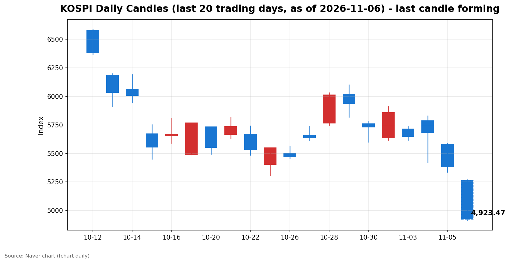
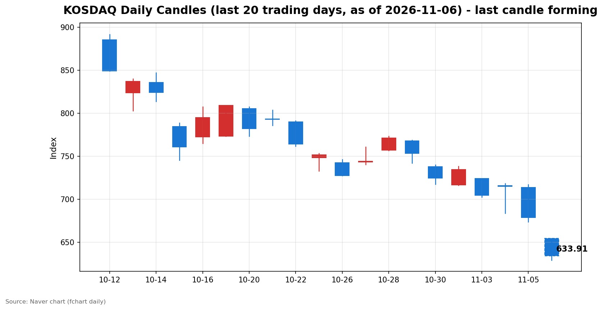

안녕하세요, [한국투자증권](https://securities.koreainvestment.com/main/Main.jsp)에서 [한투-한국투자증권](https://play.google.com/store/apps/details?id=com.truefriend.neosmartarenewal&hl=ko) 개발을 담당하고 있는 way입니다. 
2026년 11월 6일 국내 증시 장 오픈 흐름을 수치 중심으로 정리합니다. 

## 배경

간밤 미국 증시는 올해 들어 가장 큰 폭으로 하락했습니다. 
한국투자증권 MTS 기준 나스닥 종합은 24,315.00으로 전일 대비 1,421.51포인트, 5.52% 하락했습니다. 
스탠더드앤드푸어스 500 지수는 7,353.73으로 전일 대비 334.89포인트, 4.36% 하락했습니다. 
다우존스 산업평균지수는 51,523.06으로 3.44% 하락했습니다. 
나스닥은 10월 6일 사상 최고 종가 27,599.89 대비 10% 이상 하락해 조정 국면에 진입했습니다. 
필라델피아 반도체지수는 12.2% 하락해 사상 두 번째로 큰 낙폭을 기록했습니다. 
전일인 2026년 11월 5일 국내 증시도 이미 5% 넘게 하락했습니다. 
코스피는 5,383.80으로 전일 대비 5.28% 하락했고, 코스닥은 678.41로 전일 대비 5.11% 하락했습니다. 
이틀 연속 급락이 이어지면서 코스피는 11월 4일 종가 5,683.80 대비 스냅샷 시점 기준 13.4% 낮은 수준까지 내려왔습니다. 
코스닥도 같은 기간 714.95에서 632.91까지 11.5% 하락했습니다. 

## 오늘의 스냅샷

| 지수 | 현재가 | 전일 대비 | 등락률 | 시가 | 고가 | 저가 | 거래량 | 거래대금 | 스냅샷 기준 시각 |
| --- | --- | --- | --- | --- | --- | --- | --- | --- | --- |
| 코스피 | 4,923.47 | -460.33 | -8.55% | 5,263.26 | 5,269.10 | 4,911.28 | 16,390천주 | 1조 2,568억원 | 2026-11-06 09:30 KST |
| 코스닥 | 632.91 | -45.50 | -6.71% | 654.43 | 654.43 | 629.17 | 97,971천주 | 8,188억원 | 2026-11-06 09:30 KST |

코스피와 코스닥은 모두 폭락 출발했습니다. 
코스피는 전일 대비 2.24% 내린 5,263.26에 출발했지만 개장 직후 낙폭이 빠르게 확대됐습니다. 
코스피는 오전 9시 3분 기준 4,911.91까지 내려가며 전일 대비 8.76% 하락했습니다. 
코스피가 장중 5,000선 아래로 내려간 것은 지난 2월 6일 이후 약 9개월 만입니다. 
지수가 전일 대비 8% 이상 하락한 상태가 1분간 지속되면서 한국거래소는 오전 9시 3분 34초부터 1단계 서킷브레이커를 발동해 유가증권시장 전체 매매거래를 20분간 중단했습니다. 
코스닥 시장에서는 오전 9시 6분 2초 코스닥150 선물가격과 현물지수가 동반 급락하자 프로그램매매 매도호가의 효력을 5분간 정지하는 매도 사이드카가 발동됐습니다. 
스냅샷 시점 코스피는 4,923.47로 서킷브레이커 발동 당시 수준에서 크게 벗어나지 않았습니다. 
전일 종가는 네이버 실시간 수치와 일봉 종가를 교차 확인했습니다. 
코스피 전일 종가는 5,383.80, 코스닥 전일 종가는 678.41입니다. 
교차 검증은 현재가를 등락률로 나눈 역산값으로 수행했습니다. 
역산값은 코스피 약 5,383.8, 코스닥 약 678.4로 일봉 전일 종가와 일치했습니다. 
원·달러 환율은 1,356.30원으로 전일 대비 0.06% 상승에 그쳐 환율 자체는 이날 급락의 직접적인 촉매가 되지 않았습니다. 
지수 차트는 [코스피](https://finance.naver.com/sise/sise_index.naver?code=KOSPI)와 [코스닥](https://finance.naver.com/sise/sise_index.naver?code=KOSDAQ)에서 확인할 수 있습니다. 

## 차트

최근 20거래일 일봉 차트입니다. 
빨간 봉은 종가가 시가보다 높은 날, 파란 봉은 종가가 시가보다 낮은 날입니다. 
당일 봉은 형성 중인 봉으로, 마감 전에는 계속 변합니다. 

## 원인·촉매 분석

오늘 급락 출발의 근본 촉매는 미국 정치 지형 변화가 인공지능 인프라 투자 사이클에 던진 규제 불확실성입니다. 
미국 중간선거에서 민주당이 상원과 하원을 모두 장악했습니다. 
선거 직후에는 정치 불확실성 해소로 뉴욕 증시가 올랐지만, 하루 만에 해석이 정반대로 바뀌었습니다. 
민주당이 데이터센터 건설에 대한 규제를 강화할 수 있다는 전망이 부각되면서 인공지능 인프라 확장이 늦어질 수 있다는 우려가 확산됐습니다. 
유비에스 전략가들은 2028년 계획된 데이터센터 증설 용량의 약 30%가 지연되거나 차질을 빚을 수 있다고 경고했습니다. 
이 우려는 기존에 쌓여 있던 인공지능 투자 회수에 대한 의구심과 맞물렸습니다. 
빅테크 기업들은 데이터센터와 칩, 인프라에 수천억 달러를 쏟아붓고 있지만, 그 투자가 언제 이익으로 돌아올지에 대한 의문은 해소되지 않았습니다. 
지난달 알파벳과 메타의 실적도 인공지능 지출의 수익성에 대한 시장의 우려를 가라앉히지 못했습니다. 
애플이 약 70억 달러 규모의 회사채 발행을 추진하는 등 빅테크의 차입 확대도 부담으로 거론됐습니다. 
금리가 여전히 높은 수준에 머무는 가운데 차입에 의존한 설비투자 확대는 밸류에이션 부담을 키우는 요인입니다. 
국내 시장에서는 이 충격이 반도체 중심의 지수 구조를 통해 그대로 전달됐습니다. 
코스피200은 761.38로 9.12% 하락했고, 코스피 선물도 8.00% 하락했습니다. 
전일 수급 구도도 오늘 급락의 배경이 됩니다. 
전일 코스피에서 외국인은 3조 3,733억원을 순매도했고, 개인이 2조 2,087억원을 순매수하며 받았습니다. 
기관은 8,819억원을 순매수했지만 외국인 매도 규모를 메우기에는 부족했습니다. 
외국인의 대규모 매도가 이어지는 가운데 개인이 물량을 떠안는 구도는 하락이 깊어질수록 개인의 손실 부담이 커지는 구조입니다. 
올해 1월 2일부터 11월 5일까지 코스피 시장에서 외국인의 누적 순매수 규모는 215조 4,370억원에 달합니다. 
이 누적 매수 물량이 되돌림 국면에서 매도 압력으로 전환될 수 있다는 점이 시장의 불안 요인입니다. 

## 핵심 사건 3가지

첫 번째 사건은 미국 중간선거 민주당 양원 석권 이후 인공지능 규제 우려가 본격화된 점입니다. 
민주당 승리 직후 뉴욕 증시는 올랐지만, 다음 날 시장은 데이터센터 건설 규제 강화 가능성을 다시 평가했습니다. 
텍사스와 조지아 등 데이터센터 건설 반대 목소리가 큰 지역에서 규제 지지 후보들이 승리한 점도 우려를 키웠습니다. 
이 사건이 중요한 이유는 인공지능 투자 사이클의 전제가 흔들렸기 때문입니다. 
데이터센터 증설이 늦어지면 칩과 장비, 전력 인프라로 이어지는 수요 전망 자체가 낮아집니다. 
시장이 성장 전망을 가격에 반영해 온 만큼, 전망 하향은 밸류에이션 조정으로 직결됩니다. 

두 번째 사건은 간밤 미국 증시의 폭락 자체입니다. 
나스닥은 5.52% 하락해 올해 들어 가장 큰 낙폭을 기록했고, 10월 6일 사상 최고 종가 대비 10% 이상 하락하며 조정 국면에 진입했습니다. 
스탠더드앤드푸어스 500 지수는 4.36% 하락했고, 11개 업종이 모두 하락했습니다. 
기술 업종은 7.3% 하락했고, 필라델피아 반도체지수는 12.2% 급락했습니다. 
엔비디아는 9.26%, AMD는 17.26%, 샌디스크는 22% 하락했습니다. 
퀄컴은 4분기 스마트폰용 칩 매출 전망이 시장 기대에 못 미치면서 약세를 보였습니다. 
나스닥 시가총액은 하루 만에 약 2조 달러가 증발했습니다. 
10월 한 달 동안에만 나스닥 시가총액이 2조 5,000억 달러 이상 줄었던 흐름이 이어진 것입니다. 
이 사건은 국내 시장 개장 전부터 투자 심리를 얼어붙게 만들었고, 장 초반 서킷브레이커 발동으로 이어졌습니다. 

세 번째 사건은 영국 중앙은행의 금리 인상과 미국 금리 경로에 대한 전망 변화입니다. 
영국 중앙은행은 2023년 이후 처음으로 금리를 인상했고, 추가 인상 가능성이 크다고 경고했습니다. 
미국에서는 금리 선물 시장이 연방준비제도의 다음 인상 시기를 3월로 미루는 방향으로 움직였습니다. 
민주당 양원 장악 이후 부채한도 대치 위험도 거론됐습니다. 
이 사건이 중요한 이유는 인공지능 투자 사이클이 높은 차입 비용에 민감하기 때문입니다. 
금리가 높은 수준에 오래 머물수록 차입에 의존한 데이터센터 투자의 수익성은 낮아집니다. 
인플레이션 우려가 이어지는 가운데 중앙은행들의 긴축 기조가 확인되면서, 성장주 밸류에이션에 대한 할인율 부담도 커졌습니다. 

## 섹터·테마 영향 체인

이번 급락의 영향은 반도체와 인공지능 인프라 밸류체인을 중심으로 퍼지고 있습니다. 
데이터센터 건설 규제 우려는 칩 수요 전망을 직접 낮추는 요인입니다. 
칩 수요가 줄면 반도체 장비와 소재, 전력 인프라로 이어지는 수요도 함께 위축됩니다. 
간밤 미국 시장에서 반도체지수가 12.2% 급락한 것은 이 연결고리가 시장 전체로 확산됐음을 보여줍니다. 
국내 시장에서도 반도체 대형주의 하락이 지수 하락을 주도했습니다. 
보도에 따르면 삼성전자 주가는 20만원선 아래로, SK하이닉스 주가는 120만원선 아래로 각각 내려갔습니다. 
코스피에서 반도체 대형주가 차지하는 비중이 큰 만큼, 반도체 약세는 지수 전체의 하락으로 곧바로 연결됩니다. 
코스닥에서는 성장주와 중소형 기술주의 낙폭이 컸습니다. 
코스닥이 6.71% 하락한 것은 금리와 성장 전망에 민감한 중소형 성장주가 밸류에이션 조정을 더 크게 받았음을 보여줍니다. 
한국투자증권 MTS 기준 테마별로는 상승한 테마가 사실상 없었습니다. 
반면 인버스 2배 상장지수증권은 59% 안팎 급등해 하락에 베팅하거나 하락을 헤지하려는 수요가 몰렸음을 보여줍니다. 
금리 부담이 커지면서 성장주 전반의 밸류에이션 할인 압력이 높아졌고, 이는 반도체를 넘어 인공지능 관련 밸류체인 전체로 퍼졌습니다. 
반도체를 제외한 업종도 시장 전체의 위험 회피 심리에 휩쓸렸습니다. 
스탠더드앤드푸어스 500 지수 11개 업종이 모두 하락한 것처럼, 이날 하락은 특정 업종의 문제가 아니라 시장 전반의 위험 회피 흐름입니다. 
다만 환율이 안정적으로 유지된 점은 원화 자산 전반에 대한 신뢰가 무너지지는 않았음을 보여줍니다. 
원·달러 환율이 1,356.30원으로 0.06% 상승에 그친 것은 외국인 매도가 환율 급등과 맞물린 자금 이탈 국면으로 번지지 않았음을 시사합니다. 

## 최근 5거래일 일봉

코스피 일봉입니다. 
당일 봉은 형성 중인 봉으로, 마감 전에는 계속 변합니다. 

| 날짜 | 시가 | 고가 | 저가 | 종가 | 거래량 |
| --- | --- | --- | --- | --- | --- |
| 2026-11-02 | 5,637.77 | 5,910.83 | 5,616.50 | 5,859.08 | 198,130천주 |
| 2026-11-03 | 5,715.19 | 5,735.92 | 5,615.80 | 5,648.79 | 207,371천주 |
| 2026-11-04 | 5,786.13 | 5,828.13 | 5,421.72 | 5,683.80 | 276,889천주 |
| 2026-11-05 | 5,580.09 | 5,586.46 | 5,336.88 | 5,383.80 | 277,253천주 |
| 2026-11-06 (형성 중) | 5,263.26 | 5,269.10 | 4,911.28 | 4,923.47 | 16,390천주 |

코스닥 일봉입니다. 
당일 봉은 형성 중인 봉으로, 마감 전에는 계속 변합니다. 

| 날짜 | 시가 | 고가 | 저가 | 종가 | 거래량 |
| --- | --- | --- | --- | --- | --- |
| 2026-11-02 | 716.44 | 738.01 | 716.21 | 734.36 | 355,750천주 |
| 2026-11-03 | 723.92 | 723.92 | 702.34 | 704.39 | 430,571천주 |
| 2026-11-04 | 715.74 | 718.34 | 683.66 | 714.95 | 539,758천주 |
| 2026-11-05 | 713.49 | 717.06 | 673.38 | 678.41 | 434,307천주 |
| 2026-11-06 (형성 중) | 654.43 | 654.43 | 629.17 | 632.91 | 97,971천주 |

코스피는 11월 2일 5,859.08까지 올랐던 흐름이 사흘 만에 4,923.47까지 무너졌습니다. 
11월 4일 장중 고가 5,828.13에서 저가 5,421.72까지 400포인트 넘게 흔들렸던 변동성이 이틀 연속 급락으로 이어졌습니다. 
코스닥도 11월 2일 734.36에서 632.91까지 나흘 만에 100포인트 넘게 하락했습니다. 
거래량은 서킷브레이커로 매매가 중단된 영향으로 스냅샷 시점 기준 코스피 16,390천주에 그쳤습니다. 
거래 재개 이후 거래량이 얼마나 늘어나는지가 장중 매도 압력의 강도를 가늠하는 지표가 됩니다. 

## 전일 수급

전일인 2026년 11월 5일 코스피 수급은 외국인의 대규모 매도를 개인과 기관이 받아내는 구도였습니다. 
외국인은 3조 3,733억원을 순매도했습니다. 
개인은 2조 2,087억원을 순매수했고, 기관은 8,819억원을 순매수했습니다. 
기관 순매수 안에서는 금융투자가 1조 1,443억원을 순매수한 반면 투신은 3,078억원, 사모펀드는 1,545억원을 순매도했습니다. 
연기금은 1,602억원을 순매수했습니다. 
기타법인은 2,827억원을 순매수했습니다. 
외국인 매도 규모가 개인과 기관의 매수를 합친 규모를 웃돌았고, 지수는 5.28% 하락했습니다. 
외국인이 파는 물량을 개인이 떠안는 구도가 이어지는 가운데, 개인의 매수 여력은 하락이 깊어질수록 부담이 커집니다. 
코스닥 전일 수급은 코스피와 다른 양상을 보였습니다. 
외국인은 584억원을 순매도했고, 개인은 1,568억원을 순매수했습니다. 
기관은 1,026억원을 순매도했습니다. 
기관 안에서는 금융투자가 1,442억원을 순매수한 반면 투신은 1,140억원, 연기금은 784억원, 사모펀드는 385억원을 순매도했습니다. 
코스닥에서는 외국인과 기관이 함께 순매도했고 개인만 순매수한 구도였습니다. 
두 시장 모두 개인이 순매수 주체로 나섰지만, 지수는 각각 5% 넘게 하락했습니다. 
이는 개인 매수가 하락을 막아내는 힘이 아니라 하락 과정에서 물량을 떠안는 흐름에 가깝다는 해석을 가능하게 합니다. 
장 초반인 11월 6일 한국투자증권 MTS 기준 코스피 수급은 외국인 1,337억원 순매도, 기관 865억원 순매수, 개인 426억원 순매수였습니다. 
코스닥은 외국인 492억원 순매수, 기관 3억원 순매도, 개인 496억원 순매도였습니다. 
다만 장 초반 수급은 서킷브레이커와 사이드카 발동으로 매매가 중단된 영향이 있어, 마감 기준으로 다시 확인이 필요합니다. 

## 단기·중기 전망과 확인할 시나리오

단기적으로는 변동성 확대 국면이 이어질 가능성이 큽니다. 
나스닥이 조정 국면에 진입했고, 코스피는 이틀 만에 13% 넘게 하락했습니다. 
기술적으로 과매도 구간에 들어섰다고 볼 수 있지만, 시장이 바닥을 확인하기 전에는 반등을 단정하기 어렵습니다. 
확인할 첫 번째 가격 레벨은 코스피 5,000선입니다. 
장 초반 무너진 5,000선을 종가 기준으로 회복하는지가 단기 심리의 분기점이 됩니다. 
코스피 장중 저점 4,911.28과 전일 저점 5,336.88 사이의 구간도 지지 여부를 확인할 구간입니다. 
코스닥에서는 630선 부근의 지지 여부와 700선 회복 여부가 확인할 수치입니다. 
스냅샷 시점 코스닥 저점은 629.17입니다. 
중기적으로는 인공지능 규제 논의의 전개가 핵심 변수입니다. 
미국 의회에서 데이터센터 규제 논의가 실제로 입법으로 이어지는지, 유비에스 전망처럼 2028년 증설 용량의 30%가 지연되는지가 확인돼야 합니다. 
규제 우려가 구체화되지 않고 의구심 수준에 머무른다면 시장은 과도한 낙폭을 되돌릴 여지가 있습니다. 
반대로 규제가 구체화되면 인공지능 밸류체인 전반의 이익 전망이 하향 조정될 수 있습니다. 
금리 경로도 중기 변수입니다. 
영국 중앙은행의 금리 인상과 연방준비제도 인상 시기 전망이 성장주 밸류에이션에 어떤 영향을 주는지 확인할 필요가 있습니다. 
외국인 수급도 확인할 지표입니다. 
올해 누적 순매수가 큰 만큼, 외국인의 매도가 일시적인 차익 실현인지 추세 전환인지가 단기 방향을 가를 수 있습니다. 
리스크 관리 관점에서는 서킷브레이커 발동 이후 거래 재개 직후의 변동성에 주의가 필요합니다. 
매매 중단 이후에는 쌓인 주문이 한꺼번에 체결되면서 변동성이 커질 수 있습니다. 
이 글은 교육과 시장 해설을 목적으로 작성됐으며, 특정 종목의 매수나 매도를 권유하지 않습니다. 

## 장 초반 확인할 점

서킷브레이커 발동 이후 거래 재개 직후 코스피가 5,000선을 회복하는지 확인이 필요합니다. 
코스닥 매도 사이드카 이후 프로그램매매 매도 물량이 얼마나 나오는지도 확인할 점입니다. 
외국인의 장중 매도 규모가 전일 수준을 이어가는지, 개인의 매수세가 유지되는지도 확인할 수치입니다. 
원·달러 환율이 1,350원대 후반에서 안정되는지도 확인할 지표입니다. 
환율이 급등하면 외국인 자금 이탈 우려가 커질 수 있습니다. 
미국 선물 시장과 아시아 증시의 장중 흐름도 오후 장 방향을 가늠하는 단서가 됩니다. 

## 마치며

2026년 11월 6일 국내 증시는 미국 인공지능 규제 우려와 간밤 뉴욕 증시 폭락의 여파로 서킷브레이커가 발동되는 폭락 출발을 보였습니다. 
5,000선 회복 여부와 외국인 수급, 미국 규제 논의 전개를 확인하면서 장중 흐름을 지켜볼 필요가 있습니다. 
