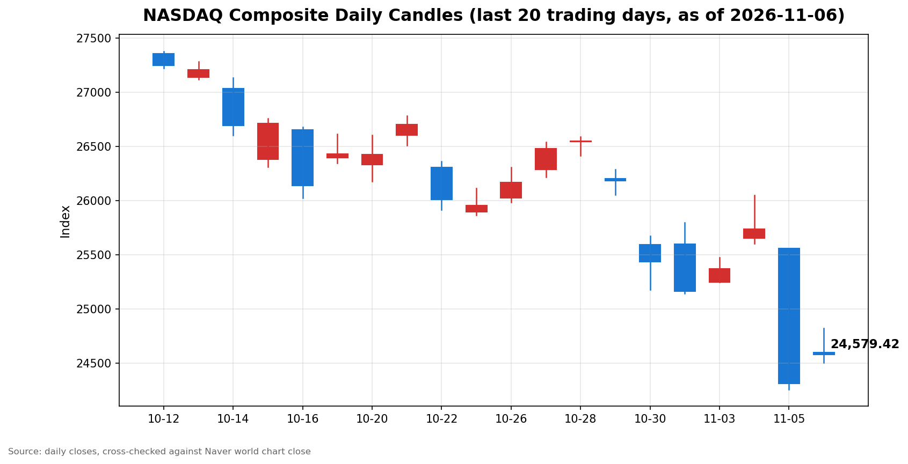

안녕하세요, [한국투자증권](https://securities.koreainvestment.com/main/Main.jsp)에서 [한투-한국투자증권](https://play.google.com/store/apps/details?id=com.truefriend.neosmartarenewal&hl=ko) 개발을 담당하고 있는 way입니다. 
2026년 11월 6일 나스닥 장 마감 흐름을 수치 중심으로 정리합니다. 

## 마감 요약

나스닥 종합은 전일 대비 1.09% 상승해 24,579.43으로 마감했습니다. 
상승 폭은 264.43이었습니다. 
전 거래일 하락 폭 1,421.51의 18.6%를 되돌린 수준으로, 급락 하루 만의 기술적 반등에 가깝습니다. 
나스닥은 지난 10월 6일 기록한 사상 최고 종가 27,599.89 대비 10.94% 낮아져 조정 구간에 머물렀습니다. 
S&P500은 0.31% 상승해 7,376.86으로 마감했고, 다우지수는 0.46% 하락해 51,285.73으로 마감했습니다. 
세 지수가 같은 방향으로 움직이지 않은 혼조 장세였습니다. 
장중 고가 24,825.55까지 올랐던 나스닥은 마감 무렵 상승 폭을 상당 부분 반납했습니다. 
이 글은 교육과 해설 목적으로 작성되었으며 특정 종목의 매수나 매도를 권유하지 않습니다. 

## 오늘의 마감 스냅샷

| 지수 | 종가 | 전일 대비 | 등락률 | 전일 종가 | 당일 고가 | 당일 저가 |
| --- | --- | --- | --- | --- | --- | --- |
| 나스닥 종합 | 24,579.43 | +264.43 | +1.09% | 24,315.00 | 24,825.55 | 24,507.63 |
| S&P500 | 7,376.86 | +23.13 | +0.31% | 7,353.73 | 7,444.20 | 7,369.55 |
| 다우지수 | 51,285.73 | -237.33 | -0.46% | 51,523.06 | 51,662.26 | 50,992.61 |

스냅샷 기준 시각은 미국 동부시간 2026년 11월 6일 16시 20분, 한국시간 2026년 11월 7일 06시 20분입니다. 
나스닥 종합 수치는 네이버 월드 차트 페이지에서 직접 확인한 마감 수치입니다. 
네이버 월드 차트 페이지는 curl 직접 조회로는 시세 데이터가 확인되지 않아 브라우저로 직접 확인했습니다. 
네이버 월드 차트 페이지에는 미국 11월 6일 16시 20분 장마감 기준으로 종가 24,579.43, 전일 대비 264.43, 등락률 1.09%가 표시되어 있습니다. 
나스닥 당일 시가는 24,602.48, 52주 범위는 20,690.25에서 27,722.75입니다. 
한투 MTS 해외 대시보드의 나스닥 종합 값도 종가 24,579.43, 전일 대비 264.43, 등락률 1.09%로 네이버 값과 일치합니다. 
S&P500 수치는 한투 MTS 해외 대시보드에서 확인한 마감 수치입니다. 
전일 종가는 종가에서 전일 대비 변동폭을 빼는 방식으로 역산했습니다. 
역산한 전일 종가는 나스닥 24,315.00, S&P500 7,353.73, 다우지수 51,523.06이며, 세 값 모두 전 거래일 마감 글의 종가와 일치합니다. 
S&P500과 다우지수의 당일 고가와 저가는 Yahoo Finance 일봉 기준입니다. 
같은 일봉의 나스닥 수치가 네이버 마감 수치와 시가와 고가와 저가와 종가까지 일치해 일봉 기준의 정합성을 확인했습니다. 
다우지수는 한투 MTS 해외 대시보드 지수 목록에 포함되지 않았습니다. 
원/달러 환율은 한투 MTS 해외 대시보드 기준 1,361.00원으로 전일 대비 5.50원, 0.41% 상승했습니다. 
네이버 월드 차트 출처는 [네이버 금융 월드 시세](https://finance.naver.com/world/sise.naver?symbol=NAS@IXIC)와 [네이버 월드 차트](https://stock.naver.com/worldstock/index/.IXIC/price)에서 확인할 수 있습니다. 
확인되지 않은 마감 원인은 본문에 쓰지 않았습니다. 

## 차트

최근 20거래일 일봉 차트입니다. 
빨간 봉은 종가가 시가보다 높은 날, 파란 봉은 종가가 시가보다 낮은 날입니다. 

## 원인·촉매 분석

이날 반등의 표면적 이유는 전일 폭락에 대한 저가 매수세입니다. 
전 거래일 나스닥은 5.52% 하락해 2025년 4월 이후 가장 큰 낙폭을 기록했고, 필라델피아 반도체지수는 12.25% 하락했습니다. 
낙폭이 컸던 만큼 단기 되돌림 매수가 들어오는 것은 자연스러운 흐름입니다. 
근본 촉매는 10월 고용보고서였습니다. 
10월 비농업 부문 신규 고용은 16만 5천 명 증가해 시장 예상치 5만 9천 명을 3배 가까이 웃돌았습니다. 
고용 호조는 경기 둔화 우려를 덜어주는 재료였지만, 동시에 12월 기준금리 인상 확률을 66%에서 76%로 끌어올렸습니다. 
미국 2년물 국채금리는 5bp 올랐고, 10년물 국채금리는 4.868%로 전 거래일 종가 4.84%보다 올랐습니다. 
금리 인상 기대가 커지자 성장주 밸류에이션 부담이 다시 부각됐고, 나스닥은 장중 고가에서 밀려 마감했습니다. 
연준 인사들의 발언도 같은 방향이었습니다. 
메리 데일리 샌프란시스코 연은 총재는 추가 금리 인상이 필요하다고 밝혔고, 토머스 바킨 리치먼드 연은 총재도 11월 5일 추가 인상 필요성을 언급했습니다. 
두 총재 모두 점진적인 방식을 선호한다고 밝혔지만, 인상 자체를 시사한 점이 시장에 매파 신호로 작용했습니다. 
인공지능 데이터센터 규제 우려라는 전 거래일의 하락 원인은 해소되지 않았습니다. 
네덜란드 대형 은행 ING가 약 5억 달러 규모의 데이터센터 관련 대출채권 매각을 추진한다는 보도가 나왔습니다. 
규제 우려가 실물 신용시장으로 번지고 있다는 신호로, 인공지능 투자 논쟁이 단순한 주가 조정을 넘어 신용위험 논의로 확산되고 있음을 보여줍니다. 
원/달러 환율이 0.41% 오르며 달러 강세가 이어진 점도 위험자산 회피 심리가 완전히 가시지 않았음을 보여줍니다. 
지수 간 방향 차이는 반등의 성격을 보여줍니다. 
전 거래일 낙폭이 가장 컸던 나스닥이 1.09% 오르며 반등을 주도했고, 우량주와 가치주 비중이 높은 다우지수는 0.46% 하락했습니다. 
이는 자금이 전 거래일 급락주를 되사는 쪽으로 움직였고, 시장 전반의 위험 선호가 회복된 것은 아니라는 뜻입니다. 

## 핵심 사건 3가지

첫째, 10월 고용보고서가 예상을 크게 웃돌았습니다. 
미 노동부에 따르면 10월 비농업 부문 신규 고용은 16만 5천 명 증가했고, 시장 예상치 5만 9천 명을 크게 상회했습니다. 
전문 서비스 부문에서 일자리가 7만 개 늘어 최근 12개월 평균 1만 5천 개를 대폭 웃돌았고, 건설 부문에서는 고용이 3천 명 감소했습니다. 
고용 호조에 12월 금리 인상 확률은 66%에서 76%로 올랐고, 2년물 국채금리는 5bp 급등했습니다. 
고용이 강하다는 소식은 경기에는 긍정적이지만 금리 경로에는 부담이 되는 양면성을 지녔습니다. 
이날 나스닥이 장중 고가에서 밀려 마감한 배경에는 이 양면성이 자리하고 있습니다. 

둘째, 인공지능주와 반도체주에 저가 매수세가 유입됐습니다. 
필라델피아 반도체지수는 6% 넘게 올라 9,586.08로 마감했습니다. 
전 거래일 종가 9,011.14 대비 6.38% 오른 수준으로, 전 거래일 하락 폭의 절반 가까이를 되돌렸습니다. 
다만 반도체지수는 11월 4일 종가 10,268.65 대비로는 여전히 6.65% 낮은 수준입니다. 
나스닥도 전 거래일 하락 폭의 18.6%만 되돌렸습니다. 
반등이 시작됐지만 하락 이전 수준 회복까지는 거리가 멀고, 되돌림의 성격이 강하다는 뜻입니다. 

셋째, 급락의 여파가 글로벌 시장과 신용시장으로 확산됐습니다. 
한국 코스피는 11월 6일 개장 직후 8% 넘게 급락해 서킷브레이커가 발동했고, 장중 5,000선 아래로 떨어졌다가 5,059.69에 마감했습니다. 
외국인은 이날 약 2조 8천억 원을 순매도했습니다. 
미국 인공지능 데이터센터 규제 우려가 메모리 반도체 수요 둔화 우려로 이어지며 한국 반도체주까지 밀렸습니다. 
삼성전자는 이틀 만에 12.69%, SK하이닉스는 17.18% 하락했다는 보도가 있습니다. 
ING의 데이터센터 대출 매각 추진 보도와 맞물려, 인공지능 투자 논쟁이 주가뿐 아니라 신용과 글로벌 수급으로 번지고 있음을 보여줍니다. 

## 지수·섹터 영향 체인

나스닥의 상승률이 가장 컸던 것은 전 거래일 낙폭이 가장 컸던 기술주와 반도체주의 되돌림이 집중됐기 때문입니다. 
필라델피아 반도체지수가 6.38% 오르며 반등을 주도했고, 이는 인공지능 인프라 투자에 대한 재평가가 일단 진정되는 쪽으로 움직였음을 보여줍니다. 
다만 반도체지수가 11월 4일 수준을 회복하지 못한 점은 재평가가 끝났다고 보기 어렵다는 뜻입니다. 
S&P500은 기술주 비중이 나스닥보다 낮고, 금리 인상 기대에 민감한 성장주와 방어주가 섞여 있어 상승률이 0.31%에 그쳤습니다. 
다우지수는 산업재와 가치주와 우량주 비중이 높아 전 거래일 낙폭이 가장 작았지만, 이날은 0.46% 하락하며 반등에서 소외됐습니다. 
이는 반등 자금이 전 거래일 급락주에 집중됐고, 우량주 쪽으로는 순환되지 않았다는 뜻입니다. 
에너지 섹터는 유가 흐름과 별개로 움직였습니다. 
서부텍사스산 원유는 장중 배럴당 91달러대 중반까지 올랐고, 브렌트유는 장중 배럴당 100달러를 다시 넘었습니다. 
중동 유조선 공격 소식에 따른 공급 차질 우려가 유가를 끌어올렸습니다. 
다만 두 유종 모두 주간 기준으로는 12% 안팎의 하락이 예상돼, 유가 반등은 주간 급락 속 되돌림에 가깝습니다. 
연결고리는 고용에서 시작해 금리로 이어집니다. 
고용 호조는 금리 인상 기대를 높이고, 금리 상승은 성장주 밸류에이션 부담으로 이어지며, 이는 나스닥의 장중 되밀림으로 나타났습니다. 
정리하면 이날은 인공지능 규제 우려가 가신 날이 아니라, 급락 이후 되돌림과 금리 부담이 맞부딪힌 날이었습니다. 

## 다우·S&P500 마감 흐름

S&P500은 7,376.86으로 마감했습니다. 
전일 대비 변동폭은 23.13, 등락률은 0.31%였습니다. 
역산한 S&P500 전일 종가는 7,353.73입니다. 
Yahoo Finance 일봉 기준 S&P500 당일 시가는 7,377.65, 고가는 7,444.20, 저가는 7,369.55였습니다. 
다우지수는 51,285.73으로 마감했습니다. 
전일 대비 변동폭은 -237.33, 등락률은 -0.46%였습니다. 
Yahoo Finance 일봉 기준 다우지수 당일 시가는 51,078.85, 고가는 51,662.26, 저가는 50,992.61이었습니다. 
전 거래일과 비교하면 힘의 배치가 바뀌었습니다. 
전 거래일에는 다우지수가 3.44% 하락으로 낙폭이 가장 작았지만, 이날은 세 지수 중 유일하게 하락했습니다. 
S&P500은 전 거래일 334.89 하락했던 것의 6.9%만 되돌렸고, 나스닥은 전 거래일 1,421.51 하락했던 것의 18.6%를 되돌렸습니다. 
반등이 나스닥에 집중됐고, 그 폭도 전 거래일 하락의 일부에 그쳤다는 뜻입니다. 

## 단기·중기 전망과 다음 거래일 확인할 시나리오

흐름 지속과 일시적 반등을 구분하는 기준은 세 가지입니다. 
첫째, 나스닥이 당일 저가 24,507.63 부근을 지키는지 확인합니다. 
이 구간이 무너지면 반등이 꺾이고 조정 구간에서의 하락이 이어질 가능성이 커집니다. 
둘째, 나스닥이 당일 고가 24,825.55와 25,000 구간을 회복하는지 확인합니다. 
이 구간을 회복하지 못하고 되밀리면 반등 동력이 약하다는 뜻입니다. 
셋째, 반도체주의 반등이 이어지는지 확인합니다. 
필라델피아 반도체지수가 9,500 구간을 지키고 10,000 구간을 향해 오르는지, 아니면 되밀리는지가 지수 전반의 방향을 가를 것입니다. 
다음 거래일 이후 확인할 이벤트로는 연준 관계자 발언과 데이터센터 규제 논의의 구체화 여부가 있습니다. 
규제 방향이 구체화되기 전에는 하루의 반등만으로 추세 전환을 단정하지 않고, 저가 지지 여부와 섹터 확산 여부를 함께 확인해야 합니다. 
12월 금리 인상 확률이 76%까지 오른 만큼, 연준 인사들의 발언 하나하나가 금리 경로에 대한 가정을 바꿀 수 있습니다. 
나스닥 선물은 한투 MTS 해외 대시보드 기준 27,116.75로 전일 대비 1.36% 상승한 상태이며, 선물 시장의 흐름이 이어지는지도 확인할 지점입니다. 
중기적으로는 인공지능 데이터센터 규제 논의와 반도체 수요 전망, 그리고 12월 연방공개시장위원회를 앞둔 금리 경로가 관건입니다. 

## 마치며

이날은 전 거래일 폭락 이후 저가 매수세가 들어왔지만, 고용 호조에 따른 금리 인상 기대가 반등의 상단을 누른 날이었습니다. 
반등이 이어지는지, 다시 밀리는지는 당일 고저 구간과 반도체주의 흐름에서 확인하는 것이 순서입니다. 
이 글은 교육과 해설 목적으로 작성되었으며 특정 종목의 매수나 매도를 권유하지 않습니다. 
