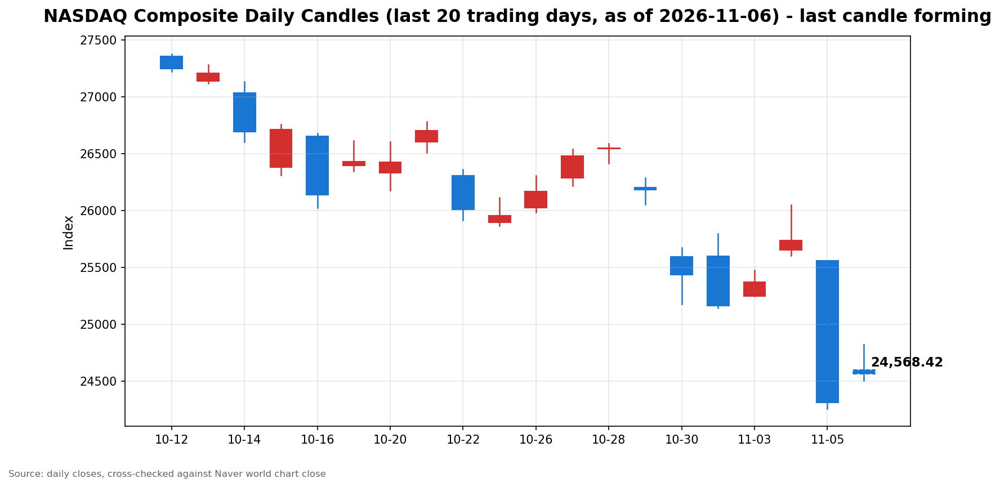

안녕하세요, [한국투자증권](https://securities.koreainvestment.com/main/Main.jsp)에서 [한투-한국투자증권](https://play.google.com/store/apps/details?id=com.truefriend.neosmartarenewal&hl=ko) 개발을 담당하고 있는 way입니다. 
2026년 11월 6일 미국 동부시간 장중 나스닥 흐름을 정리합니다. 

## 장중 요약

나스닥 종합지수는 장중 1.15% 상승하고 있습니다. 
미국 동부시간 12시 59분 기준 24,594.03으로, 전일 종가 대비 279.03포인트 올랐습니다. 
전일 5.52% 급락한 뒤 반등 흐름을 이어가고 있습니다. 
다만 장 초반 2.10%까지 올랐던 상승폭은 장중 들어 절반 가까이 줄었습니다. 
10월 고용보고서와 11월 미시간대 소비심리가 예상을 웃돌며 반등의 재료가 됐습니다. 
반면 반도체주의 되돌림과 금리 인상 전망이 상승폭을 제한하고 있습니다. 

## 오늘의 스냅샷

| 지수 | 현재가 | 전일 대비 | 등락률 | 전일 종가 | 장중 고가 | 장중 저가 |
| --- | --- | --- | --- | --- | --- | --- |
| 나스닥 종합 | 24,594.03 | +279.03 | +1.15% | 24,315.00 | 24,825.55 | 24,507.63 |
| S&P500 | 7,396.50 | +42.77 | +0.58% | 7,353.73 | 7,444.20 | 7,369.55 |
| 다우존스 산업평균지수 | 51,454.38 | -68.68 | -0.13% | 51,523.06 | 51,662.26 | 50,992.61 |

스냅샷 기준 시각은 미국 동부시간 2026년 11월 6일 12시 59분, 한국시간 2026년 11월 7일 2시 59분입니다. 
나스닥 수치와 다우존스 수치는 [네이버 월드 차트 나스닥 종합](https://finance.naver.com/world/sise.naver?symbol=NAS@IXIC)과 [네이버 월드 차트 나스닥 종합 가격](https://stock.naver.com/worldstock/index/.IXIC/price), [네이버 월드 차트 다우존스 가격](https://stock.naver.com/worldstock/index/.DJI/price)에서 확인했습니다. 
한국투자증권 해외 대시보드 값과도 교차 검증했습니다. 
한국투자증권 해외 대시보드 기준 나스닥 종합은 24,545.93으로 전일 대비 230.93포인트, 0.95% 상승했고, 스탠더드앤드푸어스 500 지수는 7,384.18로 0.41% 상승했습니다. 
네이버 값과 한국투자증권 값의 차이는 조회 시점 차이 범위 안에 있습니다. 
전일 종가는 네이버 월드 차트와 한국투자증권 해외 대시보드 값으로 교차 검증했습니다. 
당일 수치는 장중 형성 중인 값으로, 마감 전까지 계속 변합니다. 
나스닥 장중 거래량은 722,386천주로 집계됐습니다. 
다우존스 장중 거래량은 262,207천주로 집계됐습니다. 

## 차트

최근 20거래일 일봉 차트입니다. 
빨간 봉은 종가가 시가보다 높은 날, 파란 봉은 종가가 시가보다 낮은 날입니다. 
당일 봉은 형성 중인 봉으로, 마감 전에는 계속 변합니다. 

## 원인·촉매 분석

이번 장중 반등의 첫 번째 촉매는 고용입니다. 
10월 비농업 취업자 수가 16만 5천 명 늘며 예상치 6만 5천 명을 2배 이상 웃돌았습니다. 
실업률은 4.1%로 예상치 4.2%보다 낮았습니다. 
고용이 강하다는 신호는 경기가 아직 견조하다는 확인으로 읽혔습니다. 
중간선거 이후 불확실성이 커진 상황에서, 실물 경기의 회복력이 반등의 근거가 됐습니다. 
두 번째 촉매는 소비심리입니다. 
11월 미시간대 소비자심리지수 예비치가 51.0으로, 10월 최종치 48.0과 예상치 48.0을 모두 웃돌았습니다. 
고용에 이어 소비심리까지 예상을 웃돌면서, 경기 둔화 우려가 장중에는 되돌려지는 모습입니다. 
다만 두 지표가 모두 금리에는 부담입니다. 
강한 고용은 연방준비제도의 금리 인상 여지를 키우는 재료입니다. 
보도에 따르면 CME 페드워치 기준 12월 연방공개시장위원회에서의 25bp 금리 인상 확률은 72.8%로 집계됐습니다. 
미국 10년물 국채수익률은 4.84% 수준으로, 전일 종가 4.837%와 거의 같은 수준입니다. 
장중 고가 4.903%까지 올랐던 금리가 되돌려졌다는 점은, 금리 부담이 장중에는 다소 완화된 신호입니다. 
그럼에도 나스닥 상승폭이 장중 절반 가까이 줄었다는 점은, 금리 부담이 완전히 사라지지 않았음을 보여줍니다. 
달러지수는 102.234로 전일 대비 0.68% 올랐습니다. 
원·달러 환율은 한국투자증권 해외 대시보드 기준 1,361.60원으로 전일 대비 0.45% 상승했습니다. 
달러 강세가 이어지는 가운데서도 기술주가 올랐다는 점은, 이날 매수세가 환율보다는 고용과 반도체 재료에 반응했음을 보여줍니다. 
국제유가는 서부텍사스산원유가 89.93달러로 전일 대비 0.65% 내렸습니다. 
유가 하락은 인플레이션 압력을 낮추는 요인인 동시에, 위험자산 심리가 완전히 회복되지 않았음을 보여주는 신호이기도 합니다. 
공포지수는 25.34로 전일 종가 28.18보다 10.08% 내렸습니다. 
장중 저가 23.47까지 내려갔다가 되돌려졌고, 투자 심리는 전일보다 완화됐지만 여전히 높은 수준입니다. 
인공지능 데이터센터 규제 우려라는 전일의 하락 원인은 아직 해소되지 않았습니다. 
규제 우려가 실제 법안으로 이어지는지 여부는 확인되지 않았습니다. 
우려가 심리에 그치면 반등이 이어질 여지가 있고, 정책으로 굳어지면 인공지능 인프라 투자 논쟁은 중기 재료가 됩니다. 
전일 3대 지수가 나란히 2025년 4월 이후 최악의 하루를 기록한 뒤의 반등이라는 점도 중요합니다. 
나스닥이 5.52%, 스탠더드앤드푸어스 500 지수가 4.36%, 다우존스 산업평균지수가 3.44% 내렸던 만큼, 이날 상승은 낙폭 되돌림의 성격이 강합니다. 
보도에 따르면 전일 하루 동안 기술주 시가총액 2조 3천억 달러가 증발했습니다. 
지수 간 방향 차이도 의미가 있습니다. 
나스닥이 1.15% 오른 반면 다우존스 산업평균지수는 0.13% 내렸습니다. 
반등이 시장 전반이 아니라 전일 가장 많이 빠진 기술주와 반도체에 집중되고 있음을 보여줍니다. 
전일 다우가 세 지수 가운데 낙폭이 가장 작았던 것과 대비되는, 기술주 중심의 되돌림입니다. 

## 핵심 사건 3가지

### 1. 10월 고용보고서 서프라이즈입니다

미국 10월 비농업 취업자 수는 16만 5천 명 증가했습니다. 
로이터 집계 예상치 6만 5천 명을 2배 이상 웃돌았고, 지난 12개월 월평균 증가 폭 4만 8천 명의 3배를 넘겼습니다. 
증가는 전문·사업 서비스 7만 명, 의료 4만 2천 명, 운송·창고 2만 5천 명, 제조업 1만 9천 명으로 업종 전반에 퍼졌습니다. 
실업률은 4.1%로 낮아졌고, 경제활동참가율은 61.9%로 3월 이후 가장 높았습니다. 
9월 취업자 수 증가 폭은 2만 9천 명에서 6만 명으로, 8월은 13만 3천 명에서 18만 6천 명으로 각각 상향 수정됐습니다. 
시간당 평균 임금은 전월 대비 0.4% 올라 38.00달러를 기록했고, 전년 대비로는 3.1% 상승했습니다. 
이 사건이 중요한 이유는 고용이 경기 둔화 우려를 되돌리는 가장 직접적인 증거이기 때문입니다. 
중간선거 이후 불확실성이 커진 상황에서, 고용 지표는 실물 경기가 아직 견조하다는 신호를 줬습니다. 
반면 강한 고용은 연방준비제도의 금리 인상 가능성을 높입니다. 
발표 직후 10년물 국채수익률이 올랐고, 12월 금리 인상 확률이 70%를 넘겼습니다. 
고용 호재가 금리 부담을 이기는지, 아니면 장 후반에 금리 부담이 되돌림을 부르는지가 오늘 장의 관전 지점입니다. 

### 2. 미시간대 소비심리 예비치 예상 상회입니다

미시간대 소비자심리지수 11월 예비치는 51.0으로 발표됐습니다. 
10월 최종치 48.0보다 3.0포인트 올랐고, 예상치 48.0도 웃돌았습니다. 
3개월 만에 가장 높은 수준이지만, 여전히 역사적 저점 부근에 머물고 있습니다. 
역대 최저치는 지난 5월 기록한 44.8입니다. 
현재 여건 지수는 51.0으로 10월 46.7에서 올랐고, 기대 지수는 50.9로 10월 48.8에서 올랐습니다. 
향후 1년 기대 인플레이션은 4.3%로 10월 4.7%에서 내려왔고, 5년 기대 인플레이션은 3.4%로 10월 3.5%에서 내려왔습니다. 
이 사건이 중요한 이유는 소비심리가 고용과 같은 방향의 확인 신호를 줬기 때문입니다. 
가계의 체감 경기가 바닥권에서 소폭 개선됐다는 점은, 경기 둔화 우려를 추가로 되돌리는 재료입니다. 
기대 인플레이션이 함께 내려왔다는 점도 금리 부담을 덜어주는 방향입니다. 
다만 조사 기간이 10월 20일부터 11월 2일까지로, 중간선거 결과가 나오기 전에 끝났다는 점에 유의할 필요가 있습니다. 
선거 이후의 심리는 이달 말 발표되는 최종치에서 확인할 사안입니다. 
예비치라는 점에서도, 수치가 확정치가 아니라 추후 수정될 수 있다는 점을 함께 봐야 합니다. 

### 3. 반도체 반등 후 되돌림입니다

램 리서치는 전일 장 마감 후 250억 달러 규모의 자사주 매입 승인과 분기 배당금 0.33달러를 발표했습니다. 
개장 전 주가는 10% 넘게 올랐고, 장 초반에는 전일 종가 대비 10.86%까지 상승했습니다. 
장중 현재 램 리서치는 198.69달러로 전일 대비 7.29% 상승하고 있습니다. 
장중 고가 209.18달러와 비교하면 상승폭이 절반 가까이 줄었습니다. 
AMD는 435.75달러로 전일 대비 7.75% 올랐고, 장중 고가는 459.78달러였습니다. 
마이크론은 681.70달러로 3.86% 올랐고, 장중 고가는 724.80달러였습니다. 
엔비디아는 185.995달러로 2.42% 올랐고, 장중 고가는 194.895달러였습니다. 
브로드컴은 291.36달러로 전일 대비 0.06% 내리며 장 초반 상승분을 모두 되돌렸습니다. 
필라델피아 반도체지수는 9,307.61로 전일 대비 3.29% 올랐습니다. 
장중 고가 9,627.26과 비교하면 6.84%까지 올랐던 상승폭이 절반 수준으로 줄었습니다. 
이 사건이 중요한 이유는 전일 반도체 폭락의 성격과 맞닿아 있기 때문입니다. 
전일 필라델피아 반도체지수는 12.25% 폭락했고, 나스닥 100 지수는 2020년 3월 이후 최악의 하루를 기록했습니다. 
폭락의 원인이 실적이 아니라 규제 우려라는 심리 재료였던 만큼, 자사주 매입 같은 구체적인 재료가 저가 매수를 부르는 계기가 됐습니다. 
다만 장중 되돌림은 저가 매수가 차익 실현과 맞부딪히고 있음을 보여줍니다. 
자사주 매입 승인은 매입 의무가 아니라 상한선이라는 점에도 유의할 필요가 있습니다. 
실제 매입 규모는 향후 공시로 확인할 사안입니다. 
반도체의 되돌림이 나스닥 전체의 상승폭 축소로 직결됐다는 점에서, 이 섹터의 장 후반 움직임이 마감 방향을 가릅니다. 

## 지수·섹터 영향 체인

나스닥이 1.15% 오른 반면 스탠더드앤드푸어스 500 지수는 0.58%, 다우존스 산업평균지수는 0.13% 내렸습니다. 
기술주 비중이 높은 나스닥의 상승폭이 가장 크다는 점이 이번 반등의 성격을 보여줍니다. 
반등이 전일 가장 많이 빠진 기술주와 반도체에 집중되고 있기 때문입니다. 
기술·반도체 섹터는 반등의 중심이자 되돌림의 진원지입니다. 
데이터센터 규제 우려는 반도체 수요 전망을 낮추는 재료였고, 이날은 램 리서치의 자사주 매입 재료와 저가 매수가 같은 연결고리를 반대 방향으로 되돌렸습니다. 
장중 반도체 상승폭이 절반으로 줄면서 나스닥 상승폭도 함께 줄었습니다. 
고용에서 금리로 이어지는 연결고리도 함께 작동합니다. 
강한 고용은 경기 회복력을 확인시켜주지만, 동시에 금리 인상 가능성을 높입니다. 
10년물 국채수익률이 4.84% 수준에서 횡보하고 있다는 점은, 두 힘이 장중 팽팽하게 맞서고 있음을 보여줍니다. 
금리가 다시 4.90% 위로 오르면 성장주 밸류에이션 부담이 커질 수 있습니다. 
달러에서 자금 흐름으로 이어지는 연결고리도 확인됩니다. 
달러지수는 102.234로 전일 대비 0.68% 올랐습니다. 
달러 강세가 이어지는 가운데 기술주가 반등했다는 점은, 이날 매수세가 환율보다는 개별 재료에 반응했음을 보여줍니다. 
안전자산에서는 반대 흐름이 나타났습니다. 
금 선물은 4,065.20달러로 전일 대비 1.17% 내렸습니다. 
위험 선호가 되돌아오면서 안전자산 선호가 완화된 모습입니다. 
에너지는 유가 하락의 영향을 받았습니다. 
서부텍사스산원유는 89.93달러로 전일 대비 0.65% 내렸습니다. 
유가 하락은 인플레이션 압력을 낮추는 요인인 동시에, 경기 둔화 우려와 전쟁 프리미엄 소멸이 겹친 신호로도 읽힙니다. 
금융 섹터 등 다른 섹터의 당일 흐름은 확인된 수치가 없어 단정하지 않습니다. 
수혜와 타격을 단순히 나누기보다, 같은 고용 지표가 경기 확인과 금리 부담이라는 두 방향으로 작용한다는 점이 이번 장의 특징입니다. 
장중에는 경기 확인 쪽 해석이 우위를 점하고 있지만, 상승폭 축소는 금리 부담 쪽이 다시 고개를 들고 있음을 보여줍니다. 

## 다우·스탠더드앤드푸어스 500 흐름

스탠더드앤드푸어스 500 지수는 11월 5일 7,353.73으로 4.36% 하락 마감했습니다. 
11월 6일 장 오픈 무렵에는 7,420.82로 0.91% 상승했습니다. 
장중 현재는 7,396.50으로 0.58% 상승하고 있습니다. 
나스닥 상승률 1.15%의 절반 수준으로, 상승 폭이 상대적으로 작습니다. 
이는 반등이 기술주에 집중되고, 시장 전반으로 고르게 확산되지는 않았음을 보여줍니다. 
다우존스 산업평균지수는 11월 5일 51,523.06으로 3.44% 하락했습니다. 
세 지수 가운데 낙폭이 가장 작았고, 전일에는 가치주와 산업주가 상대적으로 선방했습니다. 
11월 6일 장 오픈 무렵 다우는 51,436.37로 0.17% 하락했습니다. 
장중 저가 50,992.61까지 밀렸다가 현재는 51,454.38로 0.13% 하락하고 있습니다. 
나스닥 선물은 상승했지만 다우 선물은 개장 전 478포인트 내렸던 흐름이 장 초반에도 이어졌습니다. 
다만 장중 들어 다우는 저가에서 되돌려지며 낙폭을 줄이고 있습니다. 
전일 가장 적게 빠졌던 다우가 당일에는 유일하게 내리고 있다는 점이 눈에 띕니다. 
기술주에서 빠져나온 자금이 가치주로 옮겨갔던 전일의 순환매가 되돌려지는 흐름으로 읽힙니다. 
다우가 장 후반에 나스닥의 반등에 동참하는지가 확인할 지점입니다. 

## 오전과 오후 흐름 변화

나스닥은 장 오픈 무렵 24,732.82로 1.72% 상승했습니다. 
장중 고가 24,825.55까지 오르며 상승률이 2.10%까지 확대됐습니다. 
장중 현재는 24,594.03으로 상승률이 1.15%까지 줄었습니다. 
현재가는 시가 24,602.48보다도 8.45포인트 아래입니다. 
오전의 상승 확대 흐름이 오후 들어 상승폭 축소로 바뀐 것입니다. 
다만 전일 종가 24,315.00보다는 여전히 279.03포인트 위에 있습니다. 
스탠더드앤드푸어스 500 지수도 같은 흐름입니다. 
장 오픈 무렵 7,420.82로 0.91% 올랐고, 장중 고가 7,444.20까지 올랐습니다. 
장중 현재는 7,396.50으로 상승률이 0.58%까지 줄었습니다. 
다만 시가 7,377.65보다는 위에 머물고 있습니다. 
다우존스 산업평균지수는 반대 방향으로 움직였습니다. 
장 오픈 무렵 51,436.37로 0.17% 내렸고, 장중 저가 50,992.61까지 밀렸습니다. 
장중 현재는 51,454.38로 낙폭이 0.13%까지 줄었습니다. 
시가 51,078.85보다 위에 있고, 저가에서 461.77포인트 되돌려진 상태입니다. 
나스닥이 고점에서 밀리는 동안 다우는 저점에서 되돌려지고 있습니다. 
필라델피아 반도체지수도 장중 고가 9,627.26에서 9,307.61까지 밀렸습니다. 
공포지수는 전일 종가 28.18에서 장중 25.34까지 내려왔고, 장중 저가는 23.47이었습니다. 
오전의 강한 반등이 오후 들어 차익 실현과 맞부딪히며 상승폭이 줄고 있는 모습입니다. 

## 마감까지 전망과 확인할 시나리오

흐름 지속과 일시적 노이즈를 구분하는 것이 관건입니다. 
반등이 이어지려면 반도체의 되돌림이 장 후반에 멈춰야 합니다. 
반대로 금리 부담이 우위를 점하면, 장 초반 상승 폭이 더 되돌려질 여지도 있습니다. 
장 후반에 확인할 첫 번째 수치는 장중 저가입니다. 
나스닥 장중 저가는 24,507.63입니다. 
이 수준을 지켜내는지, 아니면 전일 종가 24,315.00까지 밀리는지가 단기 방향을 가릅니다. 
저항선으로는 장중 고가 24,825.55와 25,000선, 전전일 종가 25,736.51이 있습니다. 
되돌림이 이어진다면 25,000선 회복 여부가 첫 번째 확인 지점입니다. 
섹터 단위에서는 반도체지수의 움직임이 관건입니다. 
전일 12.25% 폭락한 반도체가 당일 상승 폭을 유지하는지, 아니면 되돌림에 그치는지가 중요합니다. 
금리 흐름도 함께 확인할 필요가 있습니다. 
10년물 국채수익률이 장중 고가 4.903%를 다시 넘는지, 아니면 4.84% 수준에서 머무는지가 성장주 방향을 가릅니다. 
달러지수가 102.234에서 더 오르는지도 확인할 지점입니다. 
달러 강세가 이어지면 외국인 자금 이탈 압력이 이어질 수 있습니다. 
이날 장 마감까지 예정된 주요 미국 경제지표는 확인되지 않았습니다. 
다음 확인할 일정은 화요일에 발표되는 10월 소비자물가지수입니다. 
12월 9일 연방공개시장위원회를 앞두고 12월 4일 발표되는 11월 고용보고서도 확인할 일정입니다. 
중기적으로는 민주당의 데이터센터 규제 관련 입법 움직임과 빅테크의 자본지출 계획을 확인할 필요가 있습니다. 
실제 법안이나 가이던스 변경이 확인되기 전에는, 규제 우려를 확정적인 정책 변화로 단정하지 않습니다. 
두 가지 시나리오를 정리하면 다음과 같습니다. 
첫 번째는 반등 유지 시나리오입니다. 
나스닥이 장중 저가 24,507.63을 지키고 반도체가 상승 폭을 유지하면, 반등 흐름이 마감까지 이어질 수 있습니다. 
두 번째는 되돌림 확대 시나리오입니다. 
반도체 되돌림이 이어지고 금리가 다시 오르면, 나스닥이 전일 종가 24,315.00을 다시 시험할 수 있습니다. 
어느 쪽이든 특정 종목의 매수나 매도를 권유하지 않으며, 지수와 섹터 단위의 흐름을 확인하는 관점으로 봐야 합니다. 

## 마치며

11월 6일 나스닥은 고용과 소비심리 호조에 힘입어 반등을 이어가고 있습니다. 
다만 반도체 되돌림으로 상승폭이 줄고 있어, 마감까지 장중 저가와 금리 흐름을 확인하는 것이 중요합니다. 
이 글은 교육과 해설 목적으로 작성되었으며, 특정 종목의 매수나 매도를 권유하지 않습니다. 
