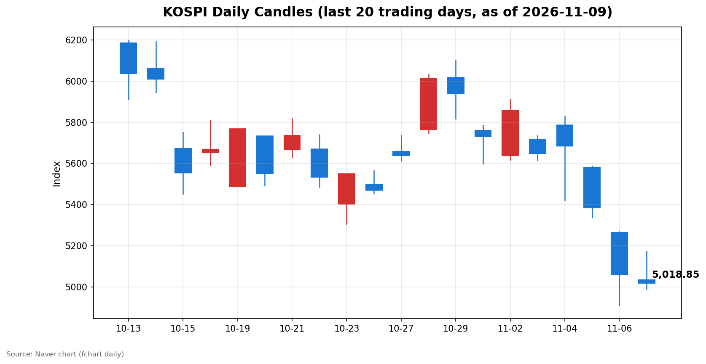
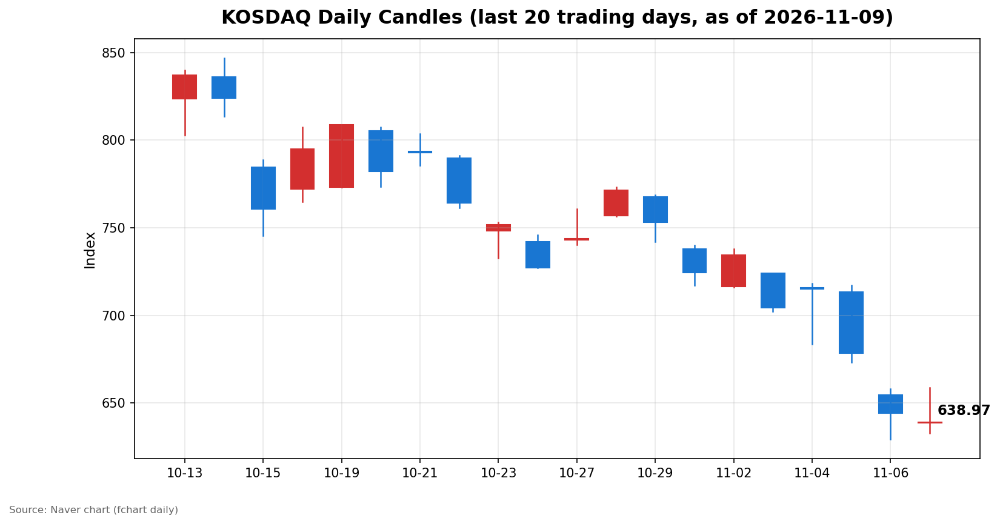

안녕하세요, [한국투자증권](https://securities.koreainvestment.com/main/Main.jsp)에서 [한투-한국투자증권](https://play.google.com/store/apps/details?id=com.truefriend.neosmartarenewal&hl=ko) 개발을 담당하고 있는 way입니다. 
오늘 국내 증시는 장중 5,100선을 회복하는 듯했으나 오후 들어 되돌리며 코스피가 5,000선을 간신히 지키는 선에서 마감했습니다. 

## 마감 요약

코스피는 전일 대비 40.84포인트(0.81%) 하락한 5,018.85에 마감했습니다. 
코스닥은 전일 대비 5.30포인트(0.82%) 하락한 638.97에 마감했습니다. 
코스피는 5,034.20으로 출발한 뒤 장중 5,172.94까지 올랐으나, 오후 들어 상승 폭을 모두 반납하고 5,018.85로 장을 마쳤습니다. 
장중 저점은 4,990.66으로, 5,000선이 장중에 한 차례 무너졌다가 종가 기준으로는 회복된 하루였습니다. 
지난 금요일 6.02% 급락에 이은 월요일 장세였으나, 반등 시도는 외국인의 매도 지속과 미국발 금리 인상 우려에 막혀 되돌림으로 끝났습니다. 

## 오늘의 마감 스냅샷

| 지수 | 종가 | 전일 대비 | 등락률 | 시가 | 고가 | 저가 | 거래량 | 거래대금 |
| --- | --- | --- | --- | --- | --- | --- | --- | --- |
| 코스피 | 5,018.85 | -40.84 | -0.81% | 5,034.20 | 5,172.94 | 4,990.66 | 2억 3,180만 주 | 17조 2,599억 원 |
| 코스닥 | 638.97 | -5.30 | -0.82% | 638.82 | 658.66 | 632.70 | 3억 3,306만 주 | 4조 2,608억 원 |

스냅샷 기준은 2026년 11월 9일 장 마감 수치이며, 전일 종가는 네이버 실시간 데이터 역산값으로 교차 검증했습니다. 
코스피 전일 종가 5,059.69, 코스닥 전일 종가 644.27이 일봉 데이터와 일치했습니다. 
코스피200은 778.35로 0.62% 하락했습니다. 
출처: [코스피](https://finance.naver.com/sise/sise_index.naver?code=KOSPI), [코스닥](https://finance.naver.com/sise/sise_index.naver?code=KOSDAQ) 

## 차트

최근 20거래일 일봉 차트입니다. 
빨간 봉은 종가가 시가보다 높은 날, 파란 봉은 종가가 시가보다 낮은 날입니다. 

## 원인·촉매 분석

오늘 장의 흐름은 반등 시도와 되돌림이라는 두 힘의 충돌로 요약됩니다. 
지난 금요일 미국 10월 고용보고서가 예상을 크게 웃돌며 나스닥이 1.09% 반등했고, 그 여파로 국내 증시도 장 초반 반등을 시도했습니다. 
코스피가 장중 5,172.94까지 오른 것은 금요일 낙폭의 일부를 되돌리려는 움직임이었습니다. 
그러나 고용 서프라이즈의 이면에는 연준의 12월 금리 인상 가능성이 커졌다는 부담이 있었습니다. 
시장에 반영된 12월 금리 인상 확률은 고용 발표 전 66.9%에서 발표 후 74.8%로 올랐고, 미국 10년물 국채 금리는 4.86% 수준까지 상승했습니다. 
금리 상승은 성장주 밸류에이션에 부담이 되는 요인이며, 국내 증시의 반도체 중심 구조와 맞물려 오후 들어 차익 실현 매물을 자극했습니다. 
수급 구도도 반등을 제한했습니다. 
코스피에서 외국인은 6,894억 원을 순매도하며 5거래일 연속 순매도를 이어갔고, 개인도 4,890억 원을 순매도했습니다. 
기관이 7,171억 원을 순매수하며 물량을 받았으나, 매수 주체가 금융투자에 집중되고 연기금과 사모는 순매도를 기록해 받침의 성격이 제한적이었습니다. 
외국인 5거래일 누적 순매도는 약 10조 7,000억 원에 달합니다. 
금요일 급락 이후 개인의 저가 매수가 반등의 동력이 될 것이라는 기대와 달리, 개인이 매도로 돌아선 점은 단기 심리가 아직 회복되지 않았음을 보여줍니다. 
엔비디아 최고경영자 관련 논란으로 시간외 주가가 4.2% 하락한 것도 AI 밸류체인에 대한 심리를 위축시키는 요인이었습니다. 
반등의 재료였던 미국발 호재와 금리 부담, 외국인 매도라는 악재가 같은 날 맞물리며 지수는 장중 고점 대비 150포인트 넘게 되돌렸습니다. 

## 핵심 사건 3가지

### 1. 미국 10월 고용 서프라이즈와 연준 12월 금리 인상 가능성 재부상

미국 노동부는 지난 6일 10월 비농업 고용이 전월 대비 16만 5,000명 증가했다고 발표했습니다. 
시장 예상치 5만 9,000명의 약 2.8배에 달하는 수치였고, 실업률은 4.2%에서 4.1%로 낮아졌습니다. 
고용이 예상보다 강하게 나오자 시장은 연준이 12월에 기준금리를 인상할 가능성을 다시 가격에 반영하기 시작했습니다. 
12월 금리 인상 확률은 고용 발표 전 66.9%에서 발표 후 74.8%로 올랐고, 미국 10년물 국채 금리는 4.86% 수준으로 상승했습니다. 
그럼에도 나스닥은 1.09% 상승한 24,579.42에 마감했습니다. 
AI 관련 기술주를 중심으로 저가 매수세가 유입되며 금리 부담을 상쇄했기 때문입니다. 
고용 호조가 경기 둔화 우려를 덜어준다는 해석과 금리 인상 부담이 커졌다는 해석이 동시에 작용하고 있어, 시장은 방향을 잡지 못한 채 변동성을 키우고 있습니다. 
국내 증시 입장에서는 나스닥 반등이 반등의 계기가 됐지만, 금리 인상 경로가 다시 열렸다는 점은 밸류에이션 부담으로 남았습니다. 

### 2. 젠슨 황 사생활 논란에 엔비디아 시간외 4.2% 하락

엔비디아의 젠슨 황 최고경영자가 주말 사이 사내 메모를 통해 사생활 관련 의혹을 인정하고 직원들에게 사과했습니다. 
엔비디아 이사회는 자체 조사에 착수했습니다. 
이 소식이 전해진 뒤 엔비디아 주가는 8일(현지시간) 밤 미국 온라인 증권거래 플랫폼 로빈후드에서 약 4.2% 하락했습니다. 
애널리스트들은 이번 의혹이 단기적으로 엔비디아 주가에 불안 요인이 되고 있다고 평가했습니다. 
엔비디아는 AI 반도체 시장의 상징적인 기업이며, 국내 반도체 밸류체인의 투자 심리에도 직접적인 영향을 미칩니다. 
금요일 미국장에서 반도체주가 급반등하며 필라델피아 반도체지수가 4.2% 올랐던 흐름과 달리, 월요일 국내 장에서는 대장주 논란이 반도체 관련 심리에 찬물을 끼얹는 요인이 됐습니다. 
다만 이번 사안은 기업의 실적이나 AI 수요와 직접 연결된 사안이 아니므로, 주가에 미치는 영향이 구조적인 문제로 번지는지 여부는 이사회 조사 결과와 정규장 반응을 지켜봐야 합니다. 

### 3. 공정위, 배달앱 2곳에 6,319억 원 과징금 부과

공정거래위원회는 배달의민족과 쿠팡이츠에 총 6,319억 원의 과징금을 부과했습니다. 
두 업체의 지난해 주문금액 기준 합산 시장점유율은 92.9%에 달합니다. 
공정위는 두 업체가 시장지배적 지위를 남용해 입점업체의 가격 결정권을 침해하고 경쟁 배달앱의 사업 활동을 방해했다고 판단했습니다. 
쿠팡은 2023년 7월부터 올해 1월까지 경쟁 앱과 같거나 더 유리한 거래조건을 맞추지 않은 입점업체를 와우매장에서 제외한 것으로 알려졌습니다. 
양사는 제재에 반발하고 있습니다. 
이번 제재는 플랫폼 기업의 시장지배력 남용에 대한 규제 기조가 강화되고 있음을 보여주는 사례입니다. 
쿠팡이 미국 증시에 상장돼 있어 국내 지수에 미치는 직접적인 영향은 제한적입니다. 
그러나 플랫폼·유통 섹터 전반에 규제 리스크가 부각될 수 있고, 향후 유사한 제재가 다른 플랫폼 기업으로 확산될지 여부는 지켜볼 사안입니다. 

## 섹터·테마 영향 체인

지수 하락 속에서도 반도체 장비와 통신장비 테마는 강세를 유지했습니다. 
한투 MTS 기준 반도체 기판·장비는 정규장 주도권을 유지했고, SSD 테마는 2.84%, CXL 테마는 2.94% 상승했습니다. 
통신장비 테마는 41개 종목 중 31개 종목이 오르며 2.83% 상승했고, 항공 테마도 3.63% 올랐습니다. 
이러한 흐름은 지수 하락과 테마 강세 사이의 괴리를 보여줍니다. 
지수 하락의 주된 원인은 외국인 매도와 금리 부담이라는 거시 요인이었고, 대형주 중심의 지수 하락이었습니다. 
반면 반도체 장비·기판 테마는 3분기 실적 호조와 설비 투자 확대, AI 수요 지속이라는 개별 재료가 지탱했습니다. 
통신장비와 5G 테마의 강세는 보안 이슈와 실적 기대가 맞물린 결과로 보입니다. 
연결고리를 정리하면, 미국 고용 서프라이즈는 금리 상승 경로를 열어 성장주 밸류에이션에 부담을 줬고, 이는 지수 하락으로 이어졌습니다. 
그러나 AI 수요 자체가 꺾인 것은 아니라는 인식이 반도체 장비·기판·SSD·CXL 같은 하드웨어 밸류체인에는 여전히 지지 요인으로 작용했습니다. 
엔비디아 논란은 AI 대장주의 신뢰에 금이 가는 사건이지만, 실적과 수요의 펀더멘털과 직접 연결되지 않아 하드웨어 밸류체인 전반으로 확산되지는 않았습니다. 
플랫폼 규제 강화는 유통·플랫폼 섹터의 밸류에이션 할인 요인으로 작용할 수 있습니다. 
결국 오늘 시장은 거시 요인에 따른 지수 하락과 개별 재료에 따른 테마 강세가 공존하는, 종목 선별이 중요해지는 국면이었습니다. 

## 최근 5거래일 일봉

| 날짜 | 지수 | 시가 | 고가 | 저가 | 종가 | 거래량 |
| --- | --- | --- | --- | --- | --- | --- |
| 2026-11-03 | 코스피 | 5,715.19 | 5,735.92 | 5,615.80 | 5,648.79 | 2억 737만 주 |
| 2026-11-04 | 코스피 | 5,786.13 | 5,828.13 | 5,421.72 | 5,683.80 | 2억 7,689만 주 |
| 2026-11-05 | 코스피 | 5,580.09 | 5,586.46 | 5,336.88 | 5,383.80 | 2억 7,725만 주 |
| 2026-11-06 | 코스피 | 5,263.26 | 5,269.10 | 4,911.28 | 5,059.69 | 3억 2,327만 주 |
| 2026-11-09 | 코스피 | 5,034.20 | 5,172.94 | 4,990.66 | 5,018.85 | 2억 3,180만 주 |
| 2026-11-03 | 코스닥 | 723.92 | 723.92 | 702.34 | 704.39 | 4억 3,057만 주 |
| 2026-11-04 | 코스닥 | 715.74 | 718.34 | 683.66 | 714.95 | 5억 3,976만 주 |
| 2026-11-05 | 코스닥 | 713.49 | 717.06 | 673.38 | 678.41 | 4억 3,431만 주 |
| 2026-11-06 | 코스닥 | 654.43 | 657.95 | 629.17 | 644.27 | 4억 4,371만 주 |
| 2026-11-09 | 코스닥 | 638.82 | 658.66 | 632.70 | 638.97 | 3억 3,306만 주 |

## 당일 수급

코스피 수급은 외국인과 개인의 매도, 기관의 매수로 요약됩니다. 
외국인은 6,894억 원을 순매도했고, 개인은 4,890억 원을 순매도했습니다. 
기관은 7,171억 원을 순매수했고, 기타법인은 4,614억 원을 순매수했습니다. 
외국인의 순매도는 11월 3일 이후 5거래일 연속 이어지고 있습니다. 
다만 오늘 매도 규모는 지난주 3조 원대를 기록했던 날들에 비해 축소됐습니다. 
매도 강도가 약해진 것인지, 일시적인 숨 고르기인지는 다음 거래일 수급을 확인해야 합니다. 
개인은 지난 금요일 5,207억 원을 순매수하며 저가 매수에 나섰다가 오늘 매도로 돌아섰습니다. 
금요일의 저가 매수가 단기 반등을 노린 움직임이었다면, 오늘의 매도는 반등 실패에 대한 실망 매물로 해석할 수 있습니다. 
기관의 순매수는 금융투자가 1조 1,080억 원을 순매수하며 주도했습니다. 
반면 연기금은 1,523억 원, 사모는 2,367억 원을 순매도해 기관 내부에서도 방향이 엇갈렸습니다. 
기관 전체의 순매수가 추세적인 매수 전환이라기보다 금융투자 중심의 장중 저점 매수 성격이 강하다는 점은 유의해야 합니다. 
코스닥에서는 외국인 748억 원 순매도, 개인 397억 원 순매도, 기관 1,075억 원 순매수, 기타법인 71억 원 순매수를 기록했습니다. 
코스닥 수급도 코스피와 같은 구도이며, 기관이 양 시장에서 물량을 받는 역할을 했습니다. 
수치는 마감 직후 집계된 잠정치이며 최종 확정값과 다를 수 있습니다. 

## 강했던 테마와 흐름

오늘 가장 강한 흐름은 반도체 장비·기판과 통신장비였습니다. 
SSD 테마는 2.84%, CXL 테마는 2.94% 상승했고, 통신장비 테마는 2.83% 올랐습니다. 
항공 테마도 3.63% 상승하며 강세를 보였습니다. 
반도체 장비·기판 테마는 3분기 실적 호조와 설비 투자 확대, AI 수요 지속이라는 재료가 지탱했습니다. 
외국국적상장기업 테마도 6.85% 상승했습니다. 
지수 하락 속에서도 테마 강세가 유지됐다는 점은 시장이 모든 종목을 일괄 매도하는 국면이 아니라, 재료가 있는 쪽으로 자금이 선별적으로 이동하는 국면임을 보여줍니다. 
다만 테마 강세의 폭이 지수 하락을 상쇄할 정도는 아니었고, 대형주 중심의 지수 하락이 시장 전체의 분위기를 결정했습니다. 

## 단기·중기 전망과 내일 확인할 시나리오

단기적으로 시장은 반등 시도와 되돌림을 반복하는 변동성 국면이 이어질 가능성이 큽니다. 
금요일 6.02% 급락 이후 월요일 반등이 되돌림으로 끝났다는 점은 단기 바닥 확인이 아직 끝나지 않았음을 보여줍니다. 
내일 확인할 첫 번째 수치는 코스피 5,000선 방어 여부입니다. 
오늘 장중 저점 4,990.66과 종가 5,018.85를 기준으로, 5,000선을 종가 기준으로 지켜내는지가 단기 심리의 분기점이 됩니다. 
저항 구간은 금요일 종가 5,059.69와 오늘 고점 5,172.94입니다. 
코스닥은 오늘 저점 632.70이 지지 구간이며, 저항은 금요일 종가 644.27과 오늘 고점 658.66입니다. 
두 번째로 확인할 것은 외국인의 매도 진정 여부입니다. 
오늘 외국인 순매도 규모가 지난주 대비 축소됐으나 5거래일 연속 매도가 이어지고 있어, 매도 규모가 추가로 줄어드는지 확인해야 합니다. 
세 번째는 미국 10월 소비자물가지수입니다. 
한국 시간 내일 밤 22시 30분에 발표되며, 고용 서프라이즈 이후 불거진 12월 금리 인상 논의의 방향을 가를 핵심 지표입니다. 
물가가 예상보다 높게 나오면 금리 인상 우려가 커지고, 낮게 나오면 고용 서프라이즈의 부담이 완화될 수 있습니다. 
네 번째는 엔비디아의 정규장 반응입니다. 
시간외 4.2% 하락이 정규장에서도 이어지는지, 반도체주 전반으로 확산되는지 확인해야 합니다. 
중기적으로는 AI 수요의 지속성과 금리 경로라는 두 변수가 시장의 방향을 결정할 것으로 보입니다. 
AI 수요가 유지되는 한 반도체 하드웨어 밸류체인의 실적 기대는 지탱되겠으나, 금리 인상 경로가 현실화되면 성장주 전반의 밸류에이션 부담이 커질 수 있습니다. 
변동성이 큰 국면에서는 지수 레벨보다 외국인 매도 진정 여부와 미국 물가 지표를 먼저 확인하는 것이 바람직합니다. 

## 마치며

오늘 국내 증시는 반등을 시도했으나 외국인 매도와 금리 부담에 막혀 되돌림으로 마감했습니다. 
내일은 미국 소비자물가지수 발표와 외국인 수급이 시장의 방향을 가를 것으로 보이며, 5,000선 방어 여부를 지켜봐야 합니다. 
이 글은 교육·해설 목적의 시장 정리이며, 특정 종목의 매수·매도 권유가 아닙니다. 
