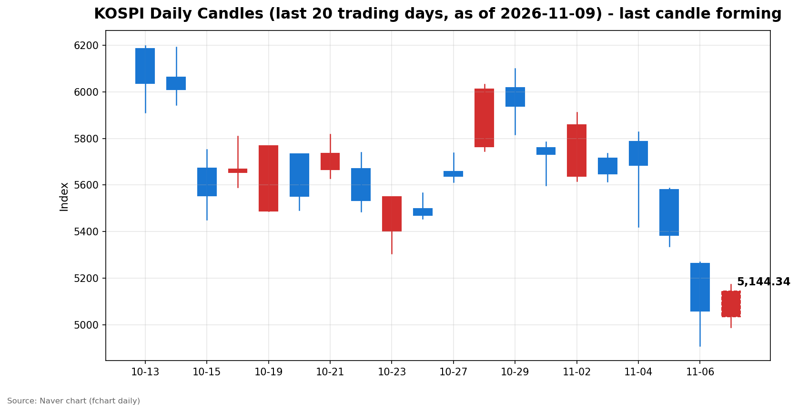
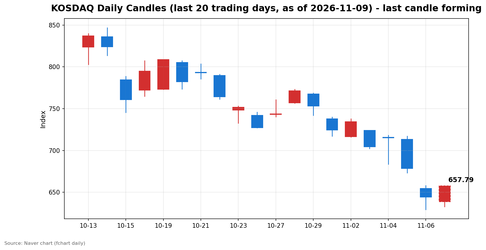

안녕하세요, [한국투자증권](https://securities.koreainvestment.com/main/Main.jsp)에서 [한투-한국투자증권](https://play.google.com/store/apps/details?id=com.truefriend.neosmartarenewal&hl=ko) 개발을 담당하고 있는 way입니다. 
오늘 국내 증시는 미국 고용보고서 서프라이즈에 따른 나스닥 반등을 받아들여 반도체를 중심으로 반등하는 오전장을 보냈습니다. 

## 오전장 요약

코스피는 전일 대비 83.46포인트(1.65%) 오른 5,143.15를 기록하고 있습니다. 
코스닥은 전일 대비 13.50포인트(2.10%) 오른 657.77을 기록하고 있습니다. 
양 시장 모두 시가에서 전일 종가보다 낮게 출발한 뒤 상승으로 방향을 틀었고, 코스피는 장중 5,100선을 회복했습니다. 
금요일 서킷브레이커가 발동했던 폭락장에서 이틀 만에 방향이 바뀐 오전장입니다. 
다만 고점 대비로는 되돌림이 나타나고 있어 오후 흐름을 지켜볼 필요가 있습니다. 

## 오늘의 스냅샷

| 지수 | 현재가 | 전일 대비 | 등락률 | 시가 | 고가 | 저가 | 거래량 | 거래대금 |
| --- | --- | --- | --- | --- | --- | --- | --- | --- |
| 코스피 | 5,143.15 | +83.46 | +1.65% | 5,034.20 | 5,172.94 | 4,990.66 | 1억 4,556만 주 | 10조 6,584억 원 |
| 코스닥 | 657.77 | +13.50 | +2.10% | 638.82 | 657.85 | 632.70 | 2억 1,739만 주 | 2조 8,300억 원 |

스냅샷 기준은 2026년 11월 9일 12시 33분경이며, 당일 봉은 형성 중인 봉으로 마감 전에는 계속 변합니다. 
전일 종가는 네이버 실시간 데이터 역산값으로 교차 검증했습니다. 
코스피 전일 종가 5,059.69, 코스닥 전일 종가 644.27이 일봉 데이터와 일치했습니다. 
코스피200은 798.50으로 1.95% 올랐고, 원/달러 환율은 1,356.10원으로 전일 대비 0.51% 하락했습니다. 
출처: [코스피](https://finance.naver.com/sise/sise_index.naver?code=KOSPI), [코스닥](https://finance.naver.com/sise/sise_index.naver?code=KOSDAQ) 

## 차트

최근 20거래일 일봉 차트입니다. 
빨간 봉은 종가가 시가보다 높은 날, 파란 봉은 종가가 시가보다 낮은 날입니다. 
당일 봉은 형성 중인 봉으로, 마감 전에는 계속 변합니다. 

## 원인·촉매 분석

오늘 오전 반등의 근본 촉매는 미국 10월 고용보고서 서프라이즈였습니다. 
비농업 고용이 16만 5천 명 늘어 예상치의 3배 가까이 나왔고, 실업률은 4.1%로 낮아졌습니다. 
경기 둔화 우려가 잦아들면서 간밤 나스닥이 1.09% 반등했고, 미국 반도체주의 반등이 국내 반도체 밸류체인으로 이어졌습니다. 
다만 이번 반등은 금리 인하 기대에서 비롯된 것이 아닙니다. 
고용이 강하게 나오면서 미국 10년물 국채 금리는 4.8%대 후반으로 올랐고, 12월 금리 인상 확률은 76%를 넘었습니다. 
반등의 동력은 금리 완화가 아니라 경기 회복 기대와 과매도 되돌림에 가깝습니다. 
과매도 되돌림이라는 판단의 근거는 낙폭의 크기입니다. 
코스피는 11월 2일 종가 5,859.08에서 11월 6일 종가 5,059.69까지 5거래일 동안 13.64% 하락했습니다. 
코스닥도 같은 기간 734.36에서 644.27로 12.27% 하락했습니다. 
이틀 연속 5%대 급락 뒤에는 기술적 반등이 나오기 쉬운 구간이었고, 고용보고서가 그 방아쇠가 됐습니다. 
전일 수급 구도는 외국인의 매도와 개인·기관의 받침으로 요약됩니다. 
네이버 시장동향 API 최종값 기준, 11월 6일 코스피에서 외국인은 2조 7,788억 원을 순매도했습니다. 
개인이 3,985억 원, 기관이 1조 9,160억 원을 순매수하며 물량을 받았습니다. 
외국인의 매도는 전일 3조 4,318억 원 순매도에 이어 이틀 연속 대규모로 이어졌습니다. 
이는 단순한 차익 실현이 아니라 AI 투자 회의론에 따른 포지션 축소로 보입니다. 
기관 매수의 중심은 금융투자 1조 9,685억 원이었습니다. 
증권사 자기매매 성격이 강해 추세적인 매수라기보다 장중 변동성에 대응한 물량 조절로 해석하는 것이 적절합니다. 
투신과 사모가 각각 2,857억 원, 951억 원을 순매도한 점도 기관 내부의 온도 차를 보여줍니다. 
연기금은 2,656억 원을 순매수했습니다. 
코스닥에서는 11월 6일 마감 직후 잠정치 기준으로 외국인이 999억 원, 개인이 1,104억 원을 순매도했고, 기관이 2,055억 원을 순매수했습니다. 
코스닥 수급의 최종값은 확인이 필요하며, 코스피와 달리 코스닥에서는 개인도 순매도를 기록했습니다. 
환율은 1,356.10원으로 전일 대비 0.51% 하락했습니다. 
원화가 강세를 보인 것은 외국인 매도 자금의 이탈 압력이 금요일보다 잦아들었음을 시사합니다. 
다만 장중 수급은 아직 확인되지 않아 외국인 매도가 실제로 둔화했는지는 오후 수급을 봐야 합니다. 

## 핵심 사건 3가지

### 1. 미국 10월 고용보고서 서프라이즈와 나스닥 반등

미국 노동부는 한국 시간 11월 6일 밤 22시 30분에 10월 고용보고서를 발표했습니다. 
비농업 고용은 16만 5천 명 증가해 시장 예상치 5만 9천 명을 3배 가까이 웃돌았습니다. 
실업률은 4.2%에서 4.1%로 낮아졌고, 직전 두 달 수치는 합계 8만 4천 명이 상향 수정됐습니다. 
시간당 임금은 전월 대비 0.4%, 전년 대비 3.1% 올랐습니다. 
고용 서프라이즈는 경기 둔화 우려를 잦아들게 했고, 나스닥은 1.09% 오른 24,579.43으로 마감했습니다. 
S&P500은 0.31% 올랐고, 다우는 0.46% 밀렸습니다. 
반도체주가 일제히 반등한 점이 국내 증시에는 직접적인 호재로 작용했습니다. 
다만 고용 강세는 금리에도 부담을 줬습니다. 
미국 10년물 국채 금리는 4.8%대 후반으로 올랐고, 12월 금리 인상 확률은 76%를 넘었습니다. 
고용보고서는 반등의 방아쇠였지만, 금리 경로의 불확실성은 해소되지 않았습니다. 

### 2. 코스피 5,100선 회복과 반도체 주도 반등

코스피는 시가 5,034.20으로 전일 종가보다 0.50% 낮게 출발했습니다. 
장 초반 4,990.66까지 밀리며 5,000선을 잠시 내줬으나, 곧바로 상승으로 방향을 틀었습니다. 
장중 고가는 5,172.94까지 올랐고, 현재 5,143.15에서 거래되고 있습니다. 
코스닥도 시가 638.82에서 출발해 고가 657.85까지 올랐고, 650선을 회복했습니다. 
반등을 이끈 것은 반도체 밸류체인입니다. 
KIS MTS 테마 기준 HBM이 5.88% 올랐고, 구성 종목 15개가 모두 상승했습니다. 
반도체재료도 5.79% 올랐고, 3D낸드와 유리기판도 각각 5.72%, 5.11% 올랐습니다. 
금요일 폭락의 중심이 반도체였던 만큼, 오늘 반등의 중심도 반도체라는 점은 일관된 흐름입니다. 
다만 고점 대비로는 30포인트가량 밀린 상태라, 반등의 지속 여부는 오후 흐름에서 갈립니다. 

### 3. 12월 금리 인상 확률 급등과 내일 CPI 대기

고용보고서 발표 이후 시장의 관심은 금리 경로로 옮겨갔습니다. 
CME 페드워치 기준 12월 금리 인상 확률은 76%를 넘었습니다. 
다음 고비는 내일 밤 22시 30분에 발표되는 미국 10월 소비자물가지수입니다. 
고용이 강한 상황에서 물가지수까지 강하게 나오면 금리 부담이 다시 부각될 수 있습니다. 
반대로 물가지수가 둔화되면 금리 인상 우려가 잦아들며 반등에 힘이 실릴 수 있습니다. 
오늘 오전 반등이 고점 대비 밀린 배경에도 이 경계감이 자리하고 있습니다. 
CPI 발표 전까지는 방향을 단정하기보다 결과를 확인하는 흐름이 이어질 수 있습니다. 

## 섹터·테마 영향 체인

오늘 반등의 축은 반도체 밸류체인입니다. 
미국 반도체주 반등이 HBM과 3D낸드, SSD, CXL, 반도체재료, 온디바이스AI, 유리기판으로 번졌습니다. 
HBM은 구성 종목 15개가 모두 올랐고, 3D낸드도 19개 종목이 모두 올랐습니다. 
테마 내부의 확산이 넓다는 점은 단순한 개별 종목 움직임이 아니라 밸류체인 전반의 되돌림임을 보여줍니다. 
금리 경로의 불확실성은 성장주 밸류에이션에 부담으로 작용합니다. 
미국 10년물 금리가 4.8%대 후반으로 오른 상황에서, 반등이 반도체에 집중된 것은 금리 부담이 덜한 쪽이 아니라 미국발 반등의 진원지가 반도체였기 때문입니다. 
다른 성장 섹터로의 확산 여부는 금리 경로가 확인된 뒤에 갈릴 수 있습니다. 
원화 강세는 외국인 수급에 우호적인 환경입니다. 
환율이 1,356.10원으로 안정된 것은 외국인 매도 압력이 잦아들 가능성을 보여줍니다. 
다만 장중 수급이 확인되지 않아 외국인 매도의 둔화를 단정할 수는 없습니다. 
금요일 방어주 성격의 테마가 상대적으로 선방했던 것과 달리, 오늘은 반도체가 주도권을 가져왔습니다. 
이는 위험 회피에서 위험 선호로의 심리적 전환을 보여주지만, 지속 여부는 오후 수급과 미국 물가 지표가 정할 것으로 보입니다. 
마리화나 관련주가 14.49% 올랐으나, 구성 종목이 2개에 불과한 소규모 테마라 시장 전체의 흐름을 대표한다고 보기 어렵습니다. 

## 최근 5거래일 일봉

### 코스피

| 날짜 | 시가 | 고가 | 저가 | 종가 | 거래량(천 주) |
| --- | --- | --- | --- | --- | --- |
| 2026-11-03 | 5,715.19 | 5,735.92 | 5,615.80 | 5,648.79 | 207,371 |
| 2026-11-04 | 5,786.13 | 5,828.13 | 5,421.72 | 5,683.80 | 276,889 |
| 2026-11-05 | 5,580.09 | 5,586.46 | 5,336.88 | 5,383.80 | 277,253 |
| 2026-11-06 | 5,263.26 | 5,269.10 | 4,911.28 | 5,059.69 | 323,267 |
| 2026-11-09 | 5,034.20 | 5,172.94 | 4,990.66 | 5,143.15 | 145,555 |

### 코스닥

| 날짜 | 시가 | 고가 | 저가 | 종가 | 거래량(천 주) |
| --- | --- | --- | --- | --- | --- |
| 2026-11-03 | 723.92 | 723.92 | 702.34 | 704.39 | 430,571 |
| 2026-11-04 | 715.74 | 718.34 | 683.66 | 714.95 | 539,758 |
| 2026-11-05 | 713.49 | 717.06 | 673.38 | 678.41 | 434,307 |
| 2026-11-06 | 654.43 | 657.95 | 629.17 | 644.27 | 443,709 |
| 2026-11-09 | 638.82 | 657.85 | 632.70 | 657.77 | 217,387 |

11월 9일 행은 스냅샷 시점의 형성 중인 봉입니다. 
5거래일 기준으로 코스피는 11월 3일 종가 5,648.79에서 5,143.15로 8.95% 하락했고, 코스닥은 704.39에서 657.77로 6.62% 하락했습니다. 
오늘 반등에도 불구하고 5거래일 기준으로는 여전히 큰 낙폭이 남아 있습니다. 

## 오전 강했던 테마와 흐름 변화

오전 강했던 테마는 반도체 관련 테마가 중심이었습니다. 
KIS MTS 기준 CXL이 6.43% 올랐고, HBM이 5.88%, 반도체재료가 5.79% 올랐습니다. 
SSD와 3D낸드, 온디바이스AI, 유리기판도 5% 넘게 올랐습니다. 
시가 대비 방향 전환이 뚜렷했습니다. 
코스피는 시가 5,034.20에서 출발해 장중 고가 5,172.94까지 올랐고, 코스닥도 시가 638.82에서 고가 657.85까지 올랐습니다. 
양 시장 모두 시가에서 전일 종가보다 낮게 출발한 뒤 상승으로 방향을 틀었습니다. 
KIS MTS 분봉 기준으로 코스피는 오전 초반 5,000선 부근에서 저점을 다진 뒤 꾸준히 올라 5,160선 부근까지 상승했고, 이후 5,140선 부근에서 등락하고 있습니다. 
방향 전환의 배경은 간밤 나스닥 반등과 고용보고서 서프라이즈입니다. 
다만 고점 대비 되돌림이 나타나고 있어, 방향 전환이 오후까지 이어질지는 지켜볼 필요가 있습니다. 

## 오후 전망과 확인할 시나리오

오후에 확인할 첫 번째 레벨은 코스피 5,100선입니다. 
5,100선을 지키며 마감하면 단기 바닥을 다지는 흐름으로 해석할 수 있습니다. 
반대로 5,100선을 다시 내주면 오늘 반등은 금요일 폭락 이후의 되돌림에 그칠 수 있습니다. 
당일 고점 5,172.94의 돌파 여부도 함께 봐야 합니다. 
고점을 넘어서면 반등의 강도가 확인되지만, 고점 부근에서 밀리면 경계감이 커질 수 있습니다. 
하방에서는 장중 저점 4,990.66과 5,000선이 지지 구간입니다. 
코스닥은 650선 안착 여부와 당일 고점 657.85의 돌파 여부가 관건입니다. 
확인할 이벤트는 오후 외국인·기관의 수급 방향과 미국 물가 지표를 앞둔 경계감입니다. 
외국인 매도가 둔화되고 기관 매수가 이어지면 반등의 지속 가능성이 커집니다. 
반대로 외국인 매도가 이어지면 반등 폭이 축소될 수 있습니다. 
내일 밤 미국 10월 소비자물가지수 발표를 앞두고 있어, 오후에는 방향을 단정하기보다 결과를 확인하는 관망 흐름이 나타날 수 있습니다. 
단기적으로는 반등의 지속과 되돌림 가능성을 함께 열어두고, 지수 레벨과 수급 방향을 확인하는 것이 필요합니다. 

## 마치며

오늘 국내 증시는 고용보고서 서프라이즈와 나스닥 반등을 받아들여 반도체를 중심으로 5,100선을 회복하는 오전장을 보냈습니다. 
다만 금리 경로의 불확실성과 내일 CPI 발표를 앞두고 있어, 반등의 지속 여부는 오후 수급과 미국 물가 지표를 확인한 뒤에 판단할 필요가 있습니다. 
이 글은 교육·해설 목적으로 작성됐으며, 특정 종목의 매수나 매도를 권유하지 않습니다. 
