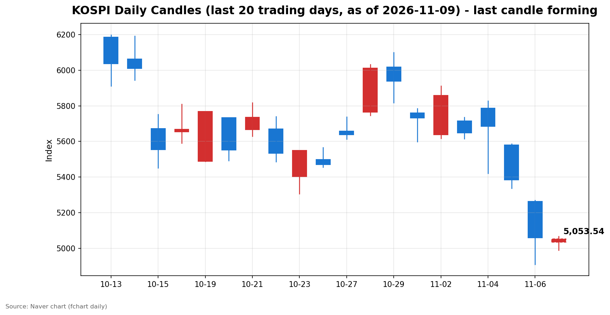
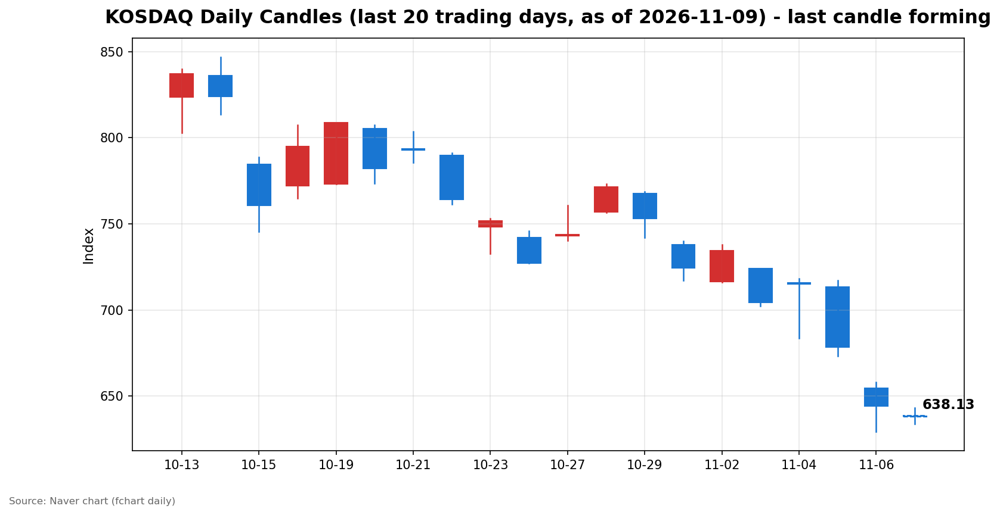

안녕하세요, [한국투자증권](https://securities.koreainvestment.com/main/Main.jsp)에서 [한투-한국투자증권](https://play.google.com/store/apps/details?id=com.truefriend.neosmartarenewal&hl=ko) 개발을 담당하고 있는 way입니다. 
지난 금요일 서킷브레이커가 발동한 검은 금요일 이후, 월요일 국내 증시가 5,000선 공방 속에 장을 열었습니다. 

## 배경

간밤 미국 증시는 엇갈린 흐름을 보였습니다. 
미국 10월 고용보고서는 취업자 수 16만 5천 명 증가, 실업률 4.1%로 발표되며 시장 예상보다 강한 모습을 보였습니다. 
고용 지표가 견조하다는 해석이 확산되며 나스닥 종합지수는 24,579.43으로 264.43포인트, 1.09% 상승 마감했습니다. 
다만 S&P 500 지수는 0.31% 상승에 그쳤고 다우존스 지수는 0.46% 하락했습니다. 
반등이 기술주 중심으로 나타났고, 시장 전체로 확산되지는 않았습니다. 
원·달러 환율은 1,358.30원으로 전일 대비 4.70원, 0.34% 하락했습니다. 
원화 강세 방향은 외국인 수급에 우호적인 신호입니다. 

## 오늘의 스냅샷

| 지수 | 현재가 | 전일 대비 | 등락률 | 시가 | 고가 | 저가 | 거래량 | 거래대금 |
| --- | --- | --- | --- | --- | --- | --- | --- | --- |
| 코스피 | 5,036.17 | -23.52 | -0.46% | 5,034.20 | 5,067.00 | 4,990.66 | 47,458천주 | 3조 6,325억원 |
| 코스닥 | 635.84 | -8.43 | -1.31% | 638.82 | 643.07 | 633.69 | 74,089천주 | 8,943억원 |

스냅샷 기준 시각은 2026년 11월 9일 09시 32분 KST입니다. 
코스피는 장 초반 4,990.66까지 밀렸다가 5,000선을 회복했습니다. 
코스닥은 1%대 하락으로 출발해 코스피보다 약한 흐름을 보이고 있습니다. 
차트 출처는 [코스피](https://finance.naver.com/sise/sise_index.naver?code=KOSPI)와 [코스닥](https://finance.naver.com/sise/sise_index.naver?code=KOSDAQ)입니다. 

## 차트

최근 20거래일 일봉 차트입니다. 
빨간 봉은 종가가 시가보다 높은 날, 파란 봉은 종가가 시가보다 낮은 날입니다. 
당일 봉은 형성 중인 봉으로, 마감 전에는 계속 변합니다. 

## 원인·촉매 분석

오늘 장 초반 흐름의 핵심은 반등이 아니라 진정 여부입니다. 
간밤 나스닥 반등은 개장 전 심리를 안정시키는 방향으로 작용했습니다. 
그러나 국내 지수는 하락 출발했고, 이는 금요일 충격의 여진이 아직 가시지 않았음을 보여줍니다. 
금요일 코스피는 5,059.69로 6.02% 하락 마감했습니다. 
오전 9시 3분 34초에 1단계 서킷브레이커가 발동해 20분간 매매가 중단됐습니다. 
코스닥도 5.03% 하락했습니다. 
저점은 코스피 4,911.28, 코스닥 629.17까지 밀렸습니다. 
외국인 매도가 촉매의 중심에 있습니다. 
코스피 기준 외국인은 11월 4일 약 2조 4,528억원, 11월 5일 약 3조 3,733억원, 11월 6일 약 2조 6,892억원을 순매도했습니다. 
3거래일 합계는 약 8조 5,153억원에 이릅니다. 
개인이 3거래일 연속 매수 우위를 보였고 기관도 금융투자를 중심으로 매수에 나섰습니다. 
그러나 매수 주체가 받아낸 물량보다 외국인 매도 규모가 컸고, 지수는 이를 흡수하지 못했습니다. 
원·달러 환율이 하락한 점은 외국인 매도 압력을 완화할 수 있는 요인입니다. 
다만 환율 안정만으로 외국인 매도세가 진정됐다고 판단하기는 이릅니다. 
미국 고용보고서 서프라이즈는 경기 연착륙 기대를 키웠습니다. 
동시에 강한 고용은 금리 인하 경로에 대한 불확실성을 남깁니다. 
이 때문에 나스닥 반등이 국내 반도체·성장주 밸류에이션 우려를 해소하지는 못했습니다. 

## 핵심 사건 3가지

첫째, 미국 10월 고용보고서 서프라이즈입니다. 
취업자 수 16만 5천 명 증가, 실업률 4.1%라는 수치는 경기 둔화 우려를 완화했습니다. 
나스닥이 1.09% 반등한 배경입니다. 
다만 반등이 기술주에 집중됐고 다우존스 지수는 하락했습니다. 
고용 강세가 연준의 금리 인하 속도를 늦출 수 있다는 해석도 함께 존재합니다. 
이중적 해석이 가능한 지표라는 점이 시장의 심리를 복잡하게 만듭니다. 

둘째, 금요일 국내 시장의 서킷브레이커 발동과 반도체 대투매입니다. 
미국 중간선거 이후 AI 데이터센터 규제 우려가 확산되며 필라델피아 반도체지수는 12.25% 급락했습니다. 
국내 반도체 밸류체인으로 충격이 전이되며 코스피는 장중 4,911.28까지 밀렸습니다. 
코스피 1단계 서킷브레이커 발동은 10월 15일 이후 처음 있는 일입니다. 
서킷브레이커 자체보다 중요한 것은 외국인의 3거래일 연속 대규모 매도입니다. 
단기 수급 충격이 아니라 AI 밸류에이션에 대한 재평가 국면이라는 해석이 힘을 얻고 있습니다. 

셋째, 증권가의 AI 쏠림 경계와 횡보 전망입니다. 
딥서치 트렌딩 토픽에서 가장 높은 순위를 차지한 이슈는 코스피 급락 이후 V자 반등보다 횡보를 예상하는 증권가 시각입니다. 
반도체 업종의 고점 대비 최대 낙폭은 54.6%, 하드웨어 업종은 61.1%로 집계됐습니다. 
AI 관련 종목에 쏠린 비중을 줄여야 한다는 지적이 잇따르고 있습니다. 
젠슨 황 엔비디아 최고경영자의 장녀 방한 일정이 돌연 취소됐다는 소식도 전해졌습니다. 
스파이 의혹 여파가 거론되고 있으나, 구체적인 경위는 확인이 필요합니다. 
이 소식은 AI를 둘러싼 심리 위축과 맞물려 투자 심리에 부담을 더하고 있습니다. 

## 섹터·테마 영향 체인

반도체·D램·HBM 테마는 직격탄을 맞았습니다. 
HBM과 AI 서버용 기판 수요는 구조적으로 견조하다는 평가가 이어지고 있습니다. 
그러나 단기적으로는 AI 밸류에이션 조정 국면에서 가장 먼저 매도 대상이 됐습니다. 
고점 대비 낙폭이 코스피 전체보다 컸다는 점이 이를 보여줍니다. 
5G·6G·광통신 테마는 상대적으로 선방하는 흐름입니다. 
북미향 공급 계약 체결과 주요 기업의 3분기 실적 호조가 긍정적인 요인으로 작용했습니다. 
AI 서버 투자 자체가 사라진 것이 아니라, 수혜의 무게중심이 부품·소재에서 인프라·통신으로 이동하는 모습입니다. 
보안주·사이버보안 테마는 지수 약세 속에서도 관심이 이어졌습니다. 
잇따른 해킹 사고와 보안 인력 부족 이슈로 사이버 보안 수요가 부각되고 있습니다. 
2차전지·ESS 테마는 3분기 흑자 전환 소식에도 수익성 지속 우려가 겹치며 하락세를 보였습니다. 
로봇 테마는 휴머노이드 개발 진척과 개별 기업의 경영권 이슈가 맞물리며 종목별 순환매가 나타났습니다. 
지수 약세 속에서도 테마 간 온도 차가 뚜렷하다는 점이 오늘 시장의 특징입니다. 

## 최근 5거래일 일봉

| 날짜 | 시가 | 고가 | 저가 | 종가 | 거래량 |
| --- | --- | --- | --- | --- | --- |
| 11-03 | 5,715.19 | 5,735.92 | 5,615.80 | 5,648.79 | 207,371천주 |
| 11-04 | 5,786.13 | 5,828.13 | 5,421.72 | 5,683.80 | 276,889천주 |
| 11-05 | 5,580.09 | 5,586.46 | 5,336.88 | 5,383.80 | 277,253천주 |
| 11-06 | 5,263.26 | 5,269.10 | 4,911.28 | 5,059.69 | 323,267천주 |
| 11-09 | 5,034.20 | 5,067.00 | 4,990.66 | 5,037.65 | 43,270천주 |

위 표는 코스피 기준입니다. 
11월 9일 행은 형성 중인 봉으로, 종가와 거래량은 장 마감 전에 계속 변합니다. 
코스닥 최근 5거래일 종가는 11월 3일 704.39, 11월 4일 714.95, 11월 5일 678.41, 11월 6일 644.27입니다. 
코스닥 11월 9일 봉도 형성 중이며, 스냅샷 시점 종가는 635.00 수준입니다. 
11월 4일 장중 고가 5,828.13에서 11월 6일 장중 저가 4,911.28까지, 사흘 만에 900포인트 넘게 흔들렸습니다. 
11월 6일 거래량은 323,267천주로 최근 5거래일 중 가장 많았습니다. 
급락장에서 거래량이 급증했다는 점은 손바뀜이 활발했음을 의미합니다. 

## 전일 수급

11월 6일 금요일 수급은 외국인이 팔고 개인과 기관이 받은 구도였습니다. 
코스피 기준 외국인은 약 2조 6,892억원을 순매도했습니다. 
개인은 약 5,207억원을 순매수했고, 기관은 약 1조 7,091억원을 순매수했습니다. 
기관 매수는 금융투자 약 1조 6,248억원이 대부분을 차지했습니다. 
연기금도 약 2,874억원을 순매수했습니다. 
투신과 사모는 각각 약 1,886억원, 약 849억원을 순매도하며 기관 내에서도 엇갈렸습니다. 
기타법인은 약 4,593억원을 순매수했습니다. 
코스닥에서는 구도가 달랐습니다. 
외국인은 약 896억원을 순매도했고, 개인도 약 1,222억원을 순매도했습니다. 
기관은 금융투자 약 3,436억원을 중심으로 약 2,067억원을 순매수했습니다. 
코스피에서는 개인이 매수에 나섰지만 코스닥에서는 개인도 매도에 동참했습니다. 
코스닥 개인 매도는 중소형주에 대한 심리 위축이 더 깊었음을 보여줍니다. 
장 초반 수급도 외국인 매도가 이어지는 흐름입니다. 
한국투자증권 MTS 기준 오전 장 초반 코스피 외국인은 약 4,642억원 순매도, 개인은 약 3,529억원 순매수, 기관은 약 757억원 순매수입니다. 
외국인 매도세가 진정되는지가 오늘 장의 관건입니다. 

## 단기·중기 전망과 확인할 시나리오

단기적으로는 반등보다 진정 국면이 이어질 가능성이 큽니다. 
증권가에서는 V자 반등보다 횡보를 예상하는 시각이 우세합니다. 
코스피 5,000선은 심리적 지지선으로 작용하고 있습니다. 
오늘 장 초반 저점 4,990.66에서 5,000선을 회복한 점은 의미가 있습니다. 
다만 금요일 저점 4,911.28이 다시 위협받는다면 심리가 빠르게 악화될 수 있습니다. 
저항 구간으로는 금요일 종가 5,059.69와 장중 고점 5,269.10이 확인됩니다. 
코스닥은 금요일 저점 629.17과 전일 종가 644.27이 각각 지지와 저항의 기준이 됩니다. 
중기적으로는 AI 밸류에이션 재평가가 어디까지 이어지는지가 핵심 변수입니다. 
반도체 업종의 고점 대비 낙폭이 50%를 넘긴 상황에서, 실적이 이를 뒷받침하는지가 관건입니다. 
확인할 이벤트로는 미국의 추가 경제지표와 연준 인사의 발언, AI 데이터센터 관련 규제 논의의 전개가 있습니다. 
외국인 매도세가 3거래일 연속 이어진 만큼, 매도 진정 여부가 단기 흐름을 가를 트리거입니다. 
원·달러 환율이 1,350원대에서 안정되는지도 함께 확인할 필요가 있습니다. 
본 글은 지수·섹터 단위의 시나리오 정리이며, 특정 종목에 대한 매수·매도 권유가 아닙니다. 

## 장 초반 확인할 점

코스피가 5,000선을 종가 기준으로 지킬 수 있는지 확인이 필요합니다. 
외국인 순매도 규모가 금요일보다 줄어드는지 살펴야 합니다. 
코스닥 개인 매도세가 이어지는지, 기관 매수세가 유지되는지도 관전 포인트입니다. 
나스닥 선물과 아시아 증시의 흐름도 함께 확인이 필요합니다. 
반도체·성장주의 낙폭이 축소되는지, 보안주·통신 등 순환매 테마가 강세를 이어가는지도 살펴야 합니다. 

## 마치며

검은 금요일 이후 첫 거래일은 반등보다 진정을 확인하는 장입니다. 
외국인 매도 진정과 5,000선 방어 여부가 오늘 장의 핵심입니다. 
본 글은 시장 해설을 목적으로 작성됐으며, 특정 종목의 매수·매도를 권유하지 않습니다. 
