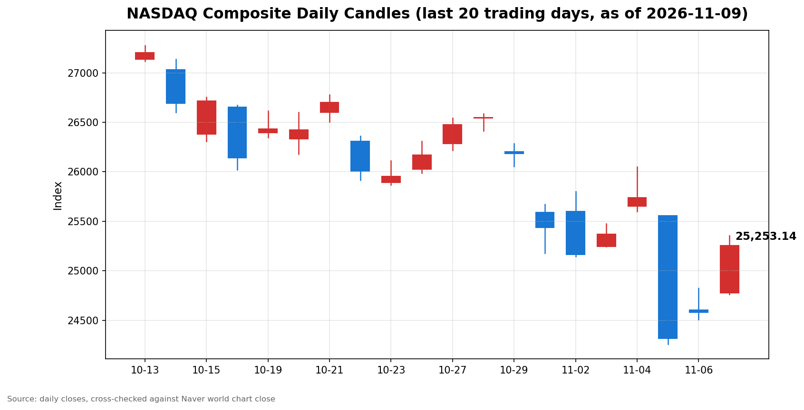

안녕하세요, [한국투자증권](https://securities.koreainvestment.com/main/Main.jsp)에서 [한투-한국투자증권](https://play.google.com/store/apps/details?id=com.truefriend.neosmartarenewal&hl=ko) 개발을 담당하고 있는 way입니다. 
2026년 11월 9일 나스닥 장 마감 흐름을 수치 중심으로 정리합니다. 

## 마감 요약

나스닥 종합은 전일 대비 2.74% 상승해 25,253.14로 마감했습니다. 
상승 폭은 673.71이었습니다. 
지난주 목요일 하락 폭 1,421.51의 47.4%를 하루 만에 되돌렸고, 금요일 반등분까지 합하면 목요일 낙폭의 66.0%를 회복했습니다. 
나스닥은 지난 10월 6일 기록한 사상 최고 종가 27,599.89 대비 8.50% 낮은 수준으로, 여전히 조정 구간에 머물렀습니다. 
S&P500은 2.35% 상승해 7,549.94로 마감했고, 다우지수는 2.15% 상승해 52,389.75로 마감했습니다. 
세 지수가 모두 2% 넘게 오른 동반 강세 장세였습니다. 
로이터 통신에 따르면 S&P500은 4월 8일 이후 가장 큰 하루 상승률을, 나스닥은 7월 30일 이후 가장 큰 하루 상승률을 기록했습니다. 
이 글은 교육과 해설 목적으로 작성되었으며 특정 종목의 매수나 매도를 권유하지 않습니다. 

## 오늘의 마감 스냅샷

| 지수 | 종가 | 전일 대비 | 등락률 | 전일 종가 | 당일 고가 | 당일 저가 |
| --- | --- | --- | --- | --- | --- | --- |
| 나스닥 종합 | 25,253.14 | +673.71 | +2.74% | 24,579.43 | 25,354.30 | 24,762.57 |
| S&P500 | 7,549.94 | +173.08 | +2.35% | 7,376.86 | 7,577.39 | 7,422.24 |
| 다우지수 | 52,389.75 | +1,104.02 | +2.15% | 51,285.73 | 52,574.34 | 51,643.01 |

스냅샷 기준 시각은 미국 동부시간 2026년 11월 9일 16시 20분, 한국시간 2026년 11월 10일 06시 20분입니다. 
나스닥 종합 수치는 네이버 월드 차트 페이지에서 직접 확인한 마감 수치입니다. 
네이버 월드 차트 페이지는 curl 직접 조회로는 시세 데이터가 확인되지 않아 브라우저로 직접 확인했습니다. 
네이버 월드 차트 페이지에는 미국 11월 9일 16시 21분 장마감 기준으로 종가 25,253.14, 전일 대비 673.71, 등락률 2.74%가 표시되어 있습니다. 
나스닥 당일 시가는 24,777.44입니다. 
한투 MTS 해외 대시보드의 나스닥 종합 값도 종가 25,253.14, 전일 대비 673.71, 등락률 2.74%로 네이버 값과 일치합니다. 
S&P500 수치는 한투 MTS 해외 대시보드에서 확인한 마감 수치이며, 연합뉴스 보도와도 일치합니다. 
전일 종가는 종가에서 전일 대비 변동폭을 빼는 방식으로 역산했습니다. 
역산한 전일 종가는 나스닥 24,579.43, S&P500 7,376.86, 다우지수 51,285.73이며, 세 값 모두 전 거래일 마감 글의 종가와 일치합니다. 
S&P500과 다우지수의 당일 고가와 저가는 Yahoo Finance 일봉 기준입니다. 
같은 일봉의 나스닥 수치가 네이버 마감 수치와 시가와 고가와 저가와 종가까지 일치해 일봉 기준의 정합성을 확인했습니다. 
다우지수는 한투 MTS 해외 대시보드 지수 목록에 포함되지 않았습니다. 
원/달러 환율은 한투 MTS 해외 대시보드 기준 1,340.00원으로 전일 대비 23.00원, 1.69% 하락했습니다. 
네이버 월드 차트 출처는 [네이버 금융 월드 시세](https://finance.naver.com/world/sise.naver?symbol=NAS@IXIC)와 [네이버 월드 차트](https://stock.naver.com/worldstock/index/.IXIC/price)에서 확인할 수 있습니다. 
확인되지 않은 마감 원인은 본문에 쓰지 않았습니다. 

## 차트

최근 20거래일 일봉 차트입니다. 
빨간 봉은 종가가 시가보다 높은 날, 파란 봉은 종가가 시가보다 낮은 날입니다. 

## 원인·촉매 분석

이날 반등의 가장 직접적인 촉매는 국제유가 급락이었습니다. 
트럼프 대통령이 이란에 대한 추가 공격 가능성을 낮게 언급하면서 지정학적 공급 차질 우려가 완화됐고, 브렌트유는 5.58% 하락해 배럴당 92.83달러, 서부텍사스산 원유는 4.24% 하락해 배럴당 86.98달러에 마감했습니다. 
유가 하락은 인플레이션 압력을 낮추는 방향으로 작용했고, 금리 인상 기대가 추가로 커지지 않는 환경이 성장주 반등의 여지를 넓혔습니다. 
다만 미국 10년물 국채금리는 4.864%로 전 거래일 종가 4.859%와 사실상 같은 수준이었습니다. 
금리가 떨어진 것이 아니라 유가발 인플레이션 우려가 가라앉은 것이 반등의 배경이라는 뜻입니다. 
두 번째 촉매는 지난주 급락 이후의 저가 매수세입니다. 
나스닥은 지난주 목요일 5.52% 폭락했고, 금요일 1.09% 반등에 이어 이날 2.74% 더 올랐습니다. 
낙폭이 컸던 만큼 되돌림 매수가 들어오는 것은 자연스러운 흐름입니다. 
공포지수는 전 거래일 25.64에서 19.96으로 22.15% 하락해, 시장 심리가 급격히 안정됐음을 보여줍니다. 
달러 약세도 같은 방향이었습니다. 
원/달러 환율이 1.69% 하락한 것은 위험자산 회피 심리가 한풀 꺾였음을 보여줍니다. 
지수 간 방향 차이는 전 거래일과 정반대였습니다. 
전 거래일에는 나스닥이 1.09% 오르고 다우지수가 0.46% 내리는 혼조였지만, 이날은 세 지수가 모두 2% 넘게 올랐습니다. 
반등이 나스닥에만 머물지 않고 시장 전반으로 확산됐다는 뜻입니다. 

## 핵심 사건 3가지

첫째, 국제유가가 급락하면서 인플레이션 우려가 완화됐습니다. 
브렌트유는 전 거래일 98.32달러에서 92.83달러로 5.58% 하락했고, 서부텍사스산 원유는 90.83달러에서 86.98달러로 4.24% 하락했습니다. 
트럼프 대통령이 평화 협상이 진전되는 동안 이란에 대한 추가 공격이 없을 가능성을 시사했다는 보도가 유가 하락의 직접적인 계기였습니다. 
유가 하락은 에너지 비용 부담을 낮추고 인플레이션 기대를 누그러뜨려, 연준의 금리 경로에 대한 부담을 덜어주는 재료로 작용했습니다. 
지난주까지 유가 급등이 인플레이션 우려를 키웠던 흐름이 이날은 정반대로 뒤집힌 것입니다. 

둘째, 엔비디아는 급락했지만 반도체주 전반은 급등했습니다. 
젠슨 황 최고경영자(CEO)가 중국 정보기관과 연계된 것으로 의심받는 인물과의 관계를 두고 이사회 조사를 받고 있다는 보도가 나왔습니다. 
엔비디아 주가는 5%대 하락했습니다. 
반면 반도체주 전반은 강했습니다. 
AMD는 오펜하이머의 투자 의견 상향에 힘입어 12% 안팎으로 올랐고, 브로드컴은 9.2% 상승했습니다. 
필라델피아 반도체지수는 6.86% 올라 10,033.93으로 마감했습니다. 
시장의 대표 종목이 빠지는데도 지수가 오른 것은, 악재가 엔비디아 개별 사안에 머물렀고 업종 전반의 투자 심리는 오히려 회복됐음을 보여줍니다. 
다만 이사회 조사 결과에 따라 사안이 커질 수 있는 만큼, 엔비디아의 개별 리스크가 업종으로 번지는지는 지켜봐야 합니다. 

셋째, 반등이 시장 전반으로 확산됐습니다. 
S&P500의 11개 업종이 모두 상승했고, 산업재와 경기소비재는 3% 넘게 올랐습니다. 
장중 기준으로는 나스닥과 뉴욕증권거래소 모두 상승 종목이 하락 종목을 3대 1 넘게 앞질렀습니다. 
이는 금요일의 기술주 중심 반등이 이날은 가치주와 경기순환주로 번졌다는 뜻입니다. 
나스닥 신규 고점 73개, 신규 저점 135개로 저점이 여전히 많았다는 점은, 반등이 시작됐지만 하락 추세의 흔적이 완전히 사라지지 않았음을 보여줍니다. 
다음 거래일 오전 8시 30분에는 10월 소비자물가지수가 발표됩니다. 
지난주 금요일 고용보고서가 예상을 크게 웃돈 뒤라, 물가 지표가 금리 경로에 대한 시장의 가정을 바꿀 수 있는 변수로 남아 있습니다. 

## 지수·섹터 영향 체인

나스닥의 상승률이 가장 컸던 것은 반도체주의 되돌림이 집중됐기 때문입니다. 
필라델피아 반도체지수가 6.86% 오르며 반등을 주도했고, 이는 인공지능 인프라 투자에 대한 재평가가 일단 진정되는 쪽으로 움직였음을 보여줍니다. 
다만 반도체지수는 11월 4일 종가 10,268.65 대비로는 여전히 2.29% 낮은 수준입니다. 
나스닥도 11월 4일 종가 25,736.51 대비 1.88% 낮습니다. 
반등이 시작됐지만 하락 이전 수준 회복까지는 거리가 멀고, 되돌림의 성격이 강하다는 뜻입니다. 
S&P500은 기술주 비중이 나스닥보다 낮지만 11개 업종이 모두 오른 덕분에 2.35% 올랐습니다. 
다우지수는 산업재와 우량주 비중이 높아 전 거래일 반등에서 소외됐지만, 이날은 2.15% 오르며 반등에 합류했습니다. 
에너지 섹터는 유가 하락의 직접적인 영향을 받았습니다. 
유가 하락은 에너지 기업의 수익 전망에는 부담이 되지만, 시장 전체로는 인플레이션 부담을 낮추는 쪽으로 작용했습니다. 
이날은 유가 하락의 부정적 측면보다 인플레이션 완화라는 긍정적 측면이 시장 심리를 지배했습니다. 
연결고리는 유가에서 시작해 물가로 이어집니다. 
유가 하락은 물가 상승 압력을 낮추고, 물가 압력 완화는 금리 인상 기대를 누그러뜨리며, 이는 성장주 밸류에이션 부담 완화로 이어져 나스닥 반등으로 나타났습니다. 
정리하면 이날은 유가발 인플레이션 우려가 가라앉고, 급락 이후 되돌림 매수와 업종 확산이 맞물린 날이었습니다. 

## 다우·S&P500 마감 흐름

S&P500은 7,549.94로 마감했습니다. 
전일 대비 변동폭은 173.08, 등락률은 2.35%였습니다. 
역산한 S&P500 전일 종가는 7,376.86입니다. 
Yahoo Finance 일봉 기준 S&P500 당일 시가는 7,422.24, 고가는 7,577.39, 저가는 7,422.24였습니다. 
다우지수는 52,389.75로 마감했습니다. 
전일 대비 변동폭은 1,104.02, 등락률은 2.15%였습니다. 
Yahoo Finance 일봉 기준 다우지수 당일 시가는 51,643.01, 고가는 52,574.34, 저가는 51,643.01이었습니다. 
전 거래일과 비교하면 힘의 배치가 바뀌었습니다. 
전 거래일에는 다우지수가 세 지수 중 유일하게 하락했지만, 이날은 세 지수 모두 2% 넘게 올랐습니다. 
나스닥은 전 거래일 1,421.51 하락했던 것의 66.0%를 되돌렸습니다. 
S&P500은 전 거래일 334.89 하락했던 것의 58.6%를 되돌렸습니다. 
반등이 세 지수로 확산됐고, 그 폭도 목요일 하락의 절반을 넘겼다는 뜻입니다. 
다만 세 지수 모두 11월 4일 종가에는 여전히 1.8% 안팎 못 미치고 있어, 하락 이전 수준 회복까지는 거리가 남아 있습니다. 

## 단기·중기 전망과 다음 거래일 확인할 시나리오

흐름 지속과 일시적 반등을 구분하는 기준은 세 가지입니다. 
첫째, 나스닥이 당일 저가 24,762.57 부근을 지키는지 확인합니다. 
이 구간이 무너지면 반등이 꺾이고 조정 구간에서의 하락이 이어질 가능성이 커집니다. 
둘째, 나스닥이 11월 4일 종가 25,736.51과 26,000 구간을 회복하는지 확인합니다. 
이 구간을 회복하지 못하고 되밀리면 반등 동력이 약하다는 뜻입니다. 
셋째, 반도체주의 반등이 이어지는지 확인합니다. 
필라델피아 반도체지수가 10,000 구간을 지키고 11월 4일 수준 10,268.65를 향해 오르는지, 아니면 되밀리는지가 지수 전반의 방향을 가를 것입니다. 
다음 거래일 확인할 이벤트로는 10월 소비자물가지수 발표가 있습니다. 
발표 시각은 미국 동부시간 화요일 오전 8시 30분입니다. 
물가 지표가 예상을 웃돌면 금리 인상 기대가 다시 커질 수 있고, 예상을 밑돌면 반등 흐름에 힘이 실릴 수 있습니다. 
나스닥 선물은 한투 MTS 해외 대시보드 기준 28,009.50으로 전일 대비 3.41% 상승한 상태이며, 선물 시장의 흐름이 이어지는지도 확인할 지점입니다. 
엔비디아 이사회 조사와 관련된 추가 보도도 확인해야 합니다. 
개별 종목의 사안이 업종 전반으로 번지지 않는지가 단기 심리의 변수입니다. 
중기적으로는 인공지능 데이터센터 규제 논의와 반도체 수요 전망, 그리고 12월 연방공개시장위원회를 앞둔 금리 경로가 관건입니다. 
유가 흐름도 함께 봐야 합니다. 
브렌트유 92.83달러 수준이 유지되는지, 다시 98달러 구간으로 되돌아가는지에 따라 인플레이션 우려의 방향이 달라질 수 있습니다. 

## 마치며

이날은 유가 급락으로 인플레이션 우려가 가라앉고, 지난주 폭락 이후의 되돌림 매수가 시장 전반으로 확산된 날이었습니다. 
반등이 이어지는지, 다시 밀리는지는 소비자물가지수와 당일 고저 구간, 반도체주의 흐름에서 확인하는 것이 순서입니다. 
이 글은 교육과 해설 목적으로 작성되었으며 특정 종목의 매수나 매도를 권유하지 않습니다. 
