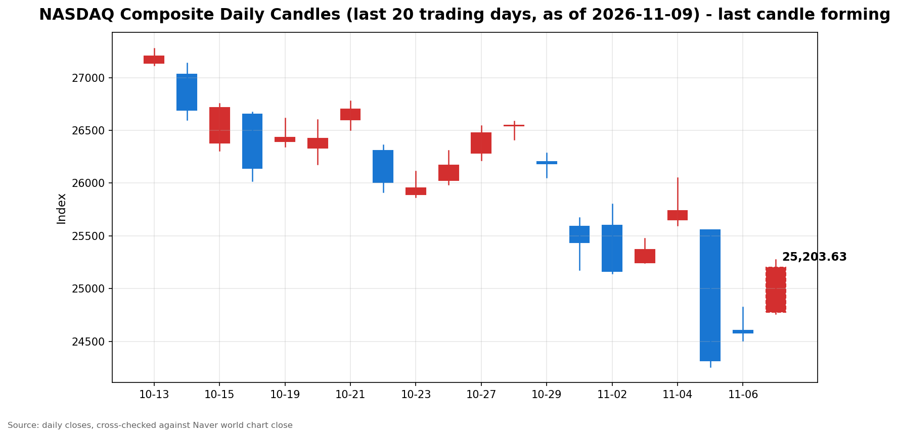

안녕하세요, [한국투자증권](https://securities.koreainvestment.com/main/Main.jsp)에서 [한투-한국투자증권](https://play.google.com/store/apps/details?id=com.truefriend.neosmartarenewal&hl=ko) 개발을 담당하고 있는 way입니다. 
지난주 급락 뒤 월요일 장중, 나스닥을 비롯한 미국 3대 지수가 유가 급락을 동력 삼아 일제히 반등하는 흐름을 정리합니다. 

## 장중 요약

나스닥 종합은 장중 25,205.36으로 전일 대비 625.94포인트, 2.55% 상승하고 있습니다. 
지난주 나스닥이 주간 3.37% 하락하며 조정 국면에 진입한 뒤 나온 되돌림 성격의 반등입니다. 
브렌트유 급락이 3대 지수 동반 상승의 직접적인 동력이 되었고, 엔비디아의 개별 악재에도 반도체 중심의 반등 흐름이 이어졌습니다. 
장중 고점 25,272.45에서는 상승폭이 소폭 축소되었습니다. 

## 오늘의 스냅샷

| 지수 | 현재가 | 전일 대비 | 등락률 | 전일 종가 | 장중 고가 | 장중 저가 |
| --- | --- | --- | --- | --- | --- | --- |
| 나스닥 종합 | 25,205.36 | +625.94 | +2.55% | 24,579.43 | 25,272.45 | 24,762.57 |
| S&P500 | 7,544.43 | +167.57 | +2.27% | 7,376.86 | 7,550.61 | 7,457.53 |
| 다우존스 | 52,383.37 | +1,097.64 | +2.14% | 51,285.73 | 52,392.46 | 51,643.01 |

스냅샷 기준 시각은 미국 동부시간 2026년 11월 9일 12시 56분(나스닥 기준, 한국시간 11월 10일 02시 56분)이며, 다우존스 값은 같은 날 13시 4분 전후에 확인한 수치입니다. 
아래 수치는 장중 형성 중인 값으로, 마감 전에는 계속 변합니다. 
나스닥 종합과 다우존스 값은 [네이버 월드 차트](https://finance.naver.com/world/sise.naver?symbol=NAS@IXIC)와 [나스닥 종합 가격 페이지](https://stock.naver.com/worldstock/index/.IXIC/price)에서 직접 확인하였고, S&P500 값은 한투 MTS 해외 대시보드에서 확인하였습니다. 
한투 MTS 해외 대시보드 교차 확인값은 나스닥 종합 25,195.26(+2.51%)으로, 네이버 값과 같은 방향과 수준을 보였습니다. 
나스닥 종합의 장중 거래량은 615,171천주로 집계되었습니다. 

## 차트

최근 20거래일 일봉 차트입니다. 
빨간 봉은 종가가 시가보다 높은 날, 파란 봉은 종가가 시가보다 낮은 날입니다. 
당일 봉은 형성 중인 봉으로, 마감 전에는 계속 변합니다. 

## 원인·촉매 분석

반등의 첫 번째 촉매는 유가 급락입니다. 
브렌트유는 배럴당 93.50달러 안팎까지 밀리며 당일 약 5% 하락하였고, 전주에만 약 17% 하락하였습니다. 
에너지 가격 하락은 인플레이션 압력 완화 기대와 기업의 에너지 비용 부담 경감을 동시에 자극합니다. 
유가 약세가 주식 전반의 위험 선호를 되살리는 방향으로 작용하였습니다. 

두 번째 요인은 지난주 낙폭에 대한 기술적 되돌림입니다. 
지난주 나스닥은 3.37% 하락하였고, S&P500은 2.68% 하락하며 2025년 4월 이후 최대 주간 하락을 기록하였습니다. 
나스닥은 한 달 전 고점 대비 10% 이상 밀리며 조정 국면에 진입한 상태였습니다. 
월요일 반등은 낙폭 과대에 대한 되돌림 성격이 강합니다. 

세 번째 요인은 고용 지표의 양면성입니다. 
11월 6일 발표된 미국 10월 고용보고서는 취업자 16만 5천 명 증가, 실업률 4.1%로 예상을 웃돌았습니다. 
경기 회복력을 확인시켜 주는 수치인 동시에, 12월 연준 인상 기대를 높이는 재료로도 읽힙니다. 
고용 서프라이즈가 긴축 기대를 자극했음에도 유가 하락이 인플레이션 기대를 낮추며 성장주에 우호적으로 작용하였습니다. 

전일 지수 간 방향 차이도 눈여겨볼 대목입니다. 
금요일 나스닥은 1.09%, S&P500은 0.31% 상승한 반면 다우는 0.46% 하락하였습니다. 
금요일 반등은 기술주 중심의 선별적 반등이었습니다. 
월요일에는 유가 하락이라는 공통 동력이 더해지며 3대 지수 모두 상승으로 확산되었습니다. 

## 핵심 사건 3가지

### 1. 국제유가 급락

브렌트유가 당일 약 5% 하락하며 배럴당 93.50달러 안팎까지 밀렸습니다. 
전주 17% 하락의 연장선에 있는 움직임입니다. 
유가 하락은 인플레이션 둔화 기대와 기업 비용 부담 완화라는 두 가지 경로로 증시에 우호적으로 작용합니다. 
장중 3대 지수가 일제히 상승한 직접적인 배경이 되었습니다. 

### 2. 엔비디아 CEO에 대한 이사회 조사

엔비디아 이사회가 젠슨 황 최고경영자(CEO)와 중국 정보기관 스파이 의혹을 받는 여성 사업가와의 관계에 대해 조사에 착수했다는 소식이 전해졌습니다. 
엔비디아 주가는 장중 4~5% 하락하며 지수 반등 흐름과 따로 움직였습니다. 
웨드부시 애널리스트는 이사회 초기 성명을 근거로 CEO 해임 가능성은 낮은 것으로 분석하였습니다. 
AI 대장주의 개별 리스크가 지수 전체의 반등을 막지는 못하였으나, AI 밸류에이션 재평가 국면이 이어지고 있음을 보여줍니다. 

### 3. 지난주 AI 매도 뒤 되돌림과 CPI 대기

지난주 S&P500은 2025년 4월 이후 가장 큰 주간 하락을 기록하였고, 나스닥은 4주 연속 주간 하락을 이어갔습니다. 
월요일 반등은 낙폭 되돌림 성격이 강해, 추세 전환으로 단정하기는 이릅니다. 
진짜 시험대는 11월 10일 오전 8시 30분(미국 동부시간)에 발표되는 10월 소비자물가지수(CPI)입니다. 
G7 회의와 미국 국채 발행 일정도 이번 주 주시 대상입니다. 

## 지수·섹터 영향 체인

반등은 기술·반도체가 주도하였습니다. 
금요일 반도체 지수는 4.2% 반등하였고, 월요일 장 초반 나스닥100은 3.26% 상승하였습니다. 
나스닥 상승률 2.55%가 다우 2.14%와 S&P500 2.27%를 웃도는 점도 성장주 중심 반등의 성격을 보여줍니다. 
성장주 밸류에이션은 금리 경로에 민감합니다. 
고용 서프라이즈 이후 긴축 기대가 커졌음에도, 유가 하락이 인플레이션 기대를 낮추며 성장주에 우호적으로 작용하였습니다. 

에너지 섹터는 정반대 방향의 압력을 받습니다. 
유가 하락은 에너지 기업 실적에 직접적인 부담이 됩니다. 
반면 항공사와 운송, 소비재는 연료와 물류 비용 완화의 수혜 쪽에 가깝습니다. 
금융 섹터는 금리 경로가 변수입니다. 
12월 인상 기대와 CPI 결과를 확인하기 전까지 방향성 판단은 유보되는 구간입니다. 

## 다우·S&P500 흐름

다우존스는 52,383.37로 전일 대비 1,097.64포인트, 2.14% 상승하고 있습니다. 
전일 종가는 51,285.73, 장중 시가는 51,643.01, 장중 고가는 52,392.46입니다. 
2주 연속 하락 뒤 나온 반등으로, 장중 1,000포인트 이상 상승하였습니다. 

S&P500은 7,544.43으로 전일 대비 167.57포인트, 2.27% 상승하고 있습니다. 
전일 종가는 7,376.86, 장중 시가는 7,457.53, 장중 고가는 7,550.61입니다. 
S&P500은 지난주 2.68% 하락하며 2025년 4월 이후 최대 주간 하락을 기록한 뒤 되돌리는 중입니다. 
다우의 상승폭이 나스닥보다 작아, 반등이 기술주 중심으로 기울었음을 보여줍니다. 

## 오전과 오후 흐름 변화

나스닥은 시가 24,777.44(+0.82%)로 출발하였습니다. 
오전 9시 57분에는 25,118.58(+2.19%)까지 상승폭을 넓혔고, 오전 10시 56분에는 25,255.07(+2.75%)까지 올랐습니다. 
12시 56분 기준 25,205.36(+2.55%)으로, 장중 고점 25,272.45 대비 소폭 되돌린 상태입니다. 
오전 상승 이후 정오에 상승폭이 축소된 흐름으로, 방향 전환이 아니라 상승폭 조정 수준입니다. 
다우도 시가 51,643.01에서 52,383.37로 상승폭을 넓혔고, 장중 고가 52,392.46에 근접한 수준을 유지하고 있습니다. 

## 마감까지 전망과 확인할 시나리오

반등 지속 시나리오에서는 유가 약세가 유지되고 CPI 발표를 앞둔 관망 매수가 유입되며 장중 고점 25,272.45 재도전을 시도할 수 있습니다. 
25,000선 위 유지 여부가 단기 흐름의 관건입니다. 
되돌림 시나리오에서는 오전 상승폭이 기술적 반등에 그칠 경우, 엔비디아 조사 관련 추가 소식이나 유가 반등 시 상승폭이 축소될 수 있습니다. 
장중 저가 24,762.57이 1차 지지 구간으로 작용합니다. 

마감까지 확인할 사항은 다음과 같습니다. 
11월 10일 오전 8시 30분(미국 동부시간) 발표되는 10월 CPI가 가장 큰 변수입니다. 
유가 흐름과 엔비디아 조사 관련 추가 보도, 10년물 국채수익률 방향도 함께 확인할 필요가 있습니다. 
10년물 국채수익률의 당일 수치는 확인되지 않아 확인 필요로 표기합니다. 
이 전망은 지수·섹터 단위 시나리오이며, 특정 종목의 매수·매도를 권유하지 않습니다. 

## 마치며

오늘 장중 흐름은 유가 급락과 지난주 낙폭 되돌림이 맞물린 반등입니다. 
마감까지는 CPI 발표를 앞둔 관망 심리와 유가 흐름을 함께 확인할 필요가 있습니다. 
이 글은 교육·해설 목적으로 작성되었으며, 특정 종목의 매수·매도를 권유하지 않습니다. 
