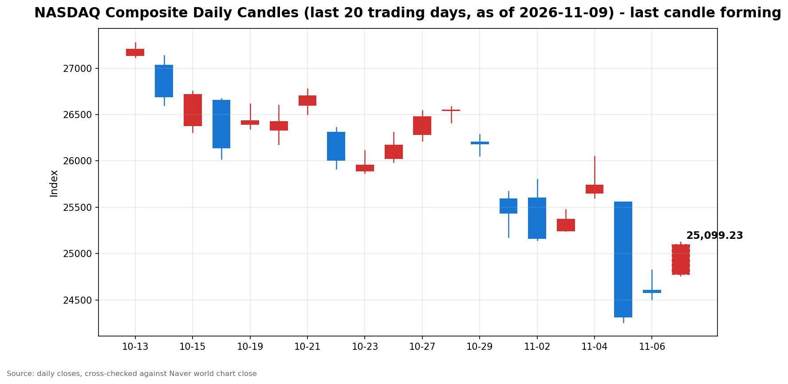

안녕하세요, [한국투자증권](https://securities.koreainvestment.com/main/Main.jsp)에서 [한투-한국투자증권](https://play.google.com/store/apps/details?id=com.truefriend.neosmartarenewal&hl=ko) 개발을 담당하고 있는 way입니다. 
2026년 11월 9일 나스닥 장 오픈 흐름을 수치 중심으로 정리합니다. 

## 개장 배경

지난주 미국 증시는 2025년 4월 이후 최악의 한 주를 기록했습니다. 
나스닥 종합은 한 주 동안 3.37% 내렸고, 스탠더드앤드푸어스 500 지수는 2.68%, 다우존스 산업평균지수는 0.94% 내렸습니다. 
나스닥은 한 달 전 고점 대비 10% 넘게 내려 조정 국면에 들어갔습니다. 
직전 거래일인 11월 6일에는 반등이 나타났습니다. 
나스닥은 24,579.43으로 1.09% 올랐고, 스탠더드앤드푸어스 500 지수는 7,376.86으로 0.31% 올랐습니다. 
반면 다우는 51,285.73으로 0.46% 내리며 엇갈렸습니다. 
금요일 반등은 반도체가 이끌었습니다. 
필라델피아 반도체지수는 4.2% 올랐고, AMD는 11.0%, 엔비디아는 2.8% 올랐습니다. 
에어비앤비는 연간 매출 전망 상향에 11.7% 올랐고, 아틀라시안은 실적 발표 뒤 16% 내렸습니다. 
월요일 장전에는 미국 주가지수 선물이 일제히 올랐습니다. 
다우 선물은 545포인트, 1.06% 올랐고, 스탠더드앤드푸어스 500 선물은 0.66%, 나스닥 100 선물은 0.42% 올랐습니다. 
아시아 증시도 월요일에 반등했습니다. 
일본 닛케이 225 지수는 2.33% 올랐고, 대만 가권지수는 5% 올랐습니다. 
지난주 폭락 이후 저가 매수세가 유입되는 흐름이 장 초반에도 이어지고 있습니다. 

## 오늘의 스냅샷

| 지수 | 현재가 | 전일 대비 | 등락률 | 전일 종가 | 장중 고가 | 장중 저가 | 스냅샷 기준 시각 |
| --- | --- | --- | --- | --- | --- | --- | --- |
| 나스닥 종합 | 25,099.83 | +520.40 | +2.12% | 24,579.43 | 25,116.29 | 24,900.30 | 미국 동부시간 2026-11-09 10:07, 한국시간 2026-11-10 00:07 |
| 스탠더드앤드푸어스 500 | 7,506.50 | +129.64 | +1.76% | 7,376.86 | 7,508.11 | 7,457.53 | 미국 동부시간 2026-11-09 10:07, 한국시간 2026-11-10 00:07 |
| 다우존스 산업평균지수 | 52,100.49 | +814.76 | +1.59% | 51,285.73 | 52,116.39 | 51,643.01 | 미국 동부시간 2026-11-09 10:04, 한국시간 2026-11-10 00:04 |

당일 수치는 형성 중인 수치로, 마감 전에는 계속 변합니다. 
나스닥 종합의 시가는 24,777.44였습니다. 
전일 종가와 비교하면 시가 기준으로는 0.81% 상승 출발했고, 이후 상승 폭이 2.12%까지 확대됐습니다. 
스탠더드앤드푸어스 500 지수의 시가는 7,422.24로 전일 대비 0.62% 상승 출발했습니다. 
다우존스 산업평균지수의 시가는 51,643.01로 전일 대비 0.70% 상승 출발했습니다. 
네이버 월드 차트 페이지는 직접 조회가 막혀 현재가를 확인할 수 없었습니다. 
curl로 조회한 페이지는 자바스크립트 렌더링 이후의 수치를 담고 있지 않아 현재가가 0으로 표시됐습니다. 
이 글의 수치는 한국투자증권 MTS 해외 대시보드 값을 기준으로 하고, Yahoo Finance 값으로 교차 검증했습니다. 
다우존스 산업평균지수 값은 한국투자증권 MTS 해외 대시보드에 포함되지 않아 Yahoo Finance 값으로 확인했습니다. 
교차 확인 결과 Yahoo Finance 기준 같은 시각 나스닥 종합은 25,098.96으로 한국투자증권 MTS 값과 0.05% 이내에서 일치했습니다. 
Yahoo Finance 기준 장중 저가는 24,762.57로, 한국투자증권 MTS 시계열의 저가 24,900.30보다 낮게 나타났습니다. 
시계열 샘플링 차이로 보입니다. 
참고로 [네이버 월드 차트 나스닥 종합](https://finance.naver.com/world/sise.naver?symbol=NAS@IXIC)과 [네이버 월드 차트 나스닥 종합 가격](https://stock.naver.com/worldstock/index/.IXIC/price) 링크를 함께 둡니다. 

## 차트

최근 20거래일 일봉 차트입니다. 
빨간 봉은 종가가 시가보다 높은 날, 파란 봉은 종가가 시가보다 낮은 날입니다. 
당일 봉은 형성 중인 봉으로, 마감 전에는 계속 변합니다. 

## 원인·촉매 분석

표면적으로는 나스닥이 전일 대비 2.12% 상승 출발했습니다. 
첫 번째 촉매는 지난주 폭락 이후의 저가 매수세입니다. 
나스닥이 한 달 전 고점 대비 10% 넘게 내린 조정 국면에서, 금요일 반도체 반등이 월요일에도 이어지고 있습니다. 
장전 미국 주가지수 선물이 일제히 오른 점도 같은 방향을 가리킵니다. 
다우 선물이 1.06% 오른 것은 반등이 기술주에만 머물지 않고 시장 전반으로 확산될 가능성을 보여줍니다. 
두 번째 촉매는 10월 고용보고서 서프라이즈의 여파입니다. 
미국 10월 비농업 취업자 수는 16만 5천 명 증가해 예상치 6만 5천 명을 크게 웃돌았습니다. 
실업률은 4.1%로 전월 4.2%에서 내려왔습니다. 
8월과 9월 취업자 수 증가 폭도 합쳐 8만 4천 명 상향 수정됐습니다. 
강한 고용은 경기가 아직 견조하다는 확인으로 읽힙니다. 
동시에 연방준비제도의 금리 인상 가능성을 높이는 재료이기도 합니다. 
발표 이후 12월 연방공개시장위원회에서의 금리 인상 베팅이 강화됐습니다. 
이날 미국 10년물 국채수익률은 4.855% 수준으로, 금요일 종가 4.859%와 거의 같은 수준을 유지하고 있습니다. 
금리 부담이 이날은 반등을 막지 않고 있다는 점이 눈에 띕니다. 
세 번째 촉매는 유가 하락입니다. 
서부텍사스산 원유 선물은 87.60달러로 전일 대비 3.56% 내렸습니다. 
브렌트유도 배럴당 100달러 아래에서 움직이고 있습니다. 
유가 하락은 인플레이션 압력을 덜어주는 방향으로 작용합니다. 
기술주에 대한 압박이 완화되는 재료로 읽힙니다. 
달러 흐름도 위험 선호 회복 쪽을 가리킵니다. 
달러는 금요일 강한 고용 지표에 6개월 만에 가장 큰 폭으로 올랐으나, 월요일에는 약세로 돌아섰습니다. 
원·달러 환율은 한국투자증권 MTS 기준 1,346.00원으로 전일 대비 1.25% 내렸습니다. 
지수 간 방향 차이도 의미가 있습니다. 
나스닥이 2.12% 오른 가운데 스탠더드앤드푸어스 500 지수는 1.76%, 다우는 1.59% 올랐습니다. 
세 지수가 동반 상승하고 있다는 점은 금요일과 다릅니다. 
금요일에는 다우만 0.46% 내렸습니다. 
다만 상승 폭이 나스닥에 가장 크다는 점은, 반등의 중심이 여전히 기술주와 반도체에 있음을 보여줍니다. 
엔비디아 관련 악재에도 나스닥이 오르고 있다는 점도 주목할 지점입니다. 
개별 기업의 악재가 지수 전체의 반등을 막지 못하고 있습니다. 
이는 악재가 엔비디아라는 개별 기업에 국한된 재료로 인식되고 있음을 시사합니다. 
다만 악재의 파장이 섹터 전체로 번지는지는 장 후반에 확인할 사안입니다. 

## 핵심 사건 3가지

### 첫째, 엔비디아 젠슨 황 CEO 의혹과 이사회 독립 조사입니다

엔비디아 이사회가 젠슨 황 CEO와 관련한 의혹에 대한 독립 조사를 착수했습니다. 
보도에 따르면 황 CEO가 미국 정보기관이 중국 스파이로 지목한 것으로 알려진 한 기업 임원과 친밀한 관계를 인정했습니다. 
미 의회의 출석 요청 보도도 함께 나왔습니다. 
장전 거래에서 엔비디아 주가는 4.8% 내렸습니다. 
이 사건이 중요한 이유는 엔비디아가 인공지능 인프라 논쟁의 중심에 있는 기업이기 때문입니다. 
지난주 폭락의 원인도 인공지능 데이터센터 규제 우려였습니다. 
기업 지배구조와 경영진 리스크가 불거지면, 밸류에이션 논쟁과 별개로 투자 심리가 흔들릴 수 있습니다. 
다만 이날 나스닥이 2% 넘게 오르고 있다는 점은, 시장이 이 사안을 엔비디아 개별 기업의 재료로 분리해 인식하고 있음을 보여줍니다. 
조사의 진행 상황과 추가 보도가 나오는지가 단기 변동성을 가를 변수입니다. 
아직 확인되지 않은 세부 내용은 단정하지 않습니다. 

### 둘째, 고용 서프라이즈 이후 금리 재가격과 화요일 소비자물가지수 발표 대기입니다

금요일 발표된 10월 고용보고서는 예상을 크게 웃돌았습니다. 
비농업 취업자 수는 16만 5천 명 증가했고, 실업률은 4.1%로 내려왔습니다. 
시간당 평균 임금은 전월 대비 0.4% 올랐습니다. 
고용 지표 발표 이후 12월 금리 인상 베팅이 강화됐습니다. 
미국 10년물 국채수익률은 금요일 종가 4.859%에서 월요일 오전 4.855% 수준으로 거의 움직이지 않았습니다. 
이 사건이 중요한 이유는 이번 주의 향방을 가를 다음 지표가 바로 앞에 있기 때문입니다. 
미국 동부시간 화요일 오전 8시 30분에 10월 소비자물가지수가 발표됩니다. 
강한 고용 뒤에 물가지표까지 강하게 나오면 금리 인상 기대가 한층 더 강화될 수 있습니다. 
반대로 물가가 진정되면 금리 부담이 완화되는 방향으로 해석될 수 있습니다. 
화요일 발표를 앞두고 월요일 장 초반에는 관망세가 섞일 가능성도 있습니다. 
다만 이날 장 초반 흐름은 저가 매수세가 관망세보다 우위를 점하고 있습니다. 

### 셋째, 지난주 폭락 이후 저가 매수세와 아시아 증시 반등입니다

지난주 나스닥은 3.37% 내렸고, 스탠더드앤드푸어스 500 지수는 2.68% 내렸습니다. 
스탠더드앤드푸어스 500 지수의 주간 낙폭은 2025년 4월 이후 가장 컸습니다. 
폭락의 원인은 미국 중간선거에서 민주당이 압승한 이후 불거진 인공지능 데이터센터 규제 우려였습니다. 
11월 5일 하루에는 기술주 시가총액 2조 3천억 달러가 증발했다는 보도가 나왔습니다. 
금요일에는 반도체가 4.2% 반등하며 되돌림이 시작됐습니다. 
월요일 아시아 증시도 반등했습니다. 
일본 닛케이 225 지수는 2.33% 올랐고, 대만 가권지수는 5% 올랐습니다. 
이 사건이 중요한 이유는 오늘의 반등이 기술적 되돌림인지, 추세 전환인지 가르는 기준이 되기 때문입니다. 
규제 우려가 실제 법안으로 이어지는지 여부는 아직 확인되지 않았습니다. 
우려가 심리에 그치면 반등이 이어질 여지가 있고, 정책으로 굳어지면 인공지능 인프라 투자 논쟁은 중기 재료가 됩니다. 
이날 장 초반에는 되돌림 쪽 해석이 우위를 점하고 있습니다. 

## 지수·섹터 영향 체인

금리에서 성장주 밸류에이션으로 이어지는 연결고리가 먼저 작동합니다. 
강한 고용은 금리 인상 가능성을 높이지만, 이날 10년물 국채수익률은 4.855% 수준에서 안정돼 있습니다. 
금리 부담이 커지지 않는 구간에서는 성장주와 기술주의 되돌림이 이어질 여지가 있습니다. 
장 후반에 국채수익률이 오르는지는 확인할 사안입니다. 
유가에서 에너지와 기술주로 이어지는 연결고리는 반대 방향으로 작용합니다. 
서부텍사스산 원유 선물이 3.56% 내린 것은 에너지 섹터에는 부담이 되는 재료입니다. 
반면 인플레이션 압력을 덜어준다는 점에서 기술주에는 우호적으로 작용합니다. 
규제 우려에서 반도체로 이어지는 연결고리는 되돌림 국면에 들어갔습니다. 
데이터센터 규제 우려는 인공지능 인프라 확장의 속도를 늦출 수 있다는 점에서 반도체와 메모리 수요 전망에 부담을 줍니다. 
11월 5일 필라델피아 반도체지수가 12.25% 폭락한 것이 그 반영입니다. 
금요일 4.2% 반등에 이어 월요일에도 반등이 이어지고 있습니다. 
엔비디아 의혹에서 인공지능 밸류체인으로 이어지는 연결고리는 확인할 지점입니다. 
개별 기업의 지배구조 리스크가 인공지능 인프라 전반의 투자 심리로 번지는지는 아직 확인되지 않았습니다. 
이날 나스닥이 오르고 있다는 점은, 적어도 장 초반에는 번지지 않고 있음을 보여줍니다. 
달러에서 자금 흐름으로 이어지는 연결고리도 확인됩니다. 
달러가 금요일 급등 뒤 월요일 약세로 돌아선 것은 위험 선호 회복과 같은 방향입니다. 
원·달러 환율이 1,346.00원으로 전일 대비 1.25% 내린 것도 같은 흐름입니다. 
금융 섹터의 움직임은 이날 확인이 필요합니다. 
금리 인상 기대는 은행의 순이자마진에 우호적인 재료이나, 섹터별 당일 움직임은 아직 확인되지 않았습니다. 
실적도 하방을 받치는 요인입니다. 
스탠더드앤드푸어스 500 지수 구성 기업 가운데 실적을 발표한 335개 기업 중 82.4%가 예상을 웃돌았습니다. 
실적 자체는 견조하지만, 인공지능 인프라 투자 논쟁이 실적을 앞지르고 있는 구간입니다. 

## 다우·스탠더드앤드푸어스 500 흐름

스탠더드앤드푸어스 500 지수는 11월 6일 7,376.86으로 0.31% 상승 마감했습니다. 
11월 9일 장 오픈 무렵에는 7,506.50으로 1.76% 상승했습니다. 
나스닥 상승률 2.12%보다 상승 폭이 작습니다. 
이는 반등이 기술주에 집중되고, 시장 전반으로 고르게 확산되지는 않았음을 보여줍니다. 
다우존스 산업평균지수는 11월 6일 51,285.73으로 0.46% 하락했습니다. 
세 지수 가운데 유일하게 내렸고, 전일에는 가치주와 산업주가 상대적으로 선방했습니다. 
11월 9일 장 오픈 무렵 다우는 52,100.49로 1.59% 상승했습니다. 
전일 유일하게 내렸던 다우가 당일에는 세 지수 가운데 나스닥 다음으로 크게 오르고 있습니다. 
장전 다우 선물이 545포인트 올랐던 흐름이 장 초반에도 이어지고 있습니다. 
기술주에서 빠져나온 자금이 가치주로 옮겨갔던 지난주의 순환매가 되돌려지는 흐름으로 읽힙니다. 
다우가 장 후반까지 상승 폭을 유지하는지가 확인할 지점입니다. 

## 단기·중기 전망과 장 초반 확인할 시나리오

흐름 지속과 일시적 노이즈를 구분하는 것이 관건입니다. 
반등이 이어지려면 반도체의 되돌림이 장 후반까지 유지돼야 합니다. 
반대로 엔비디아 의혹이 확산되거나 금리 부담이 우위를 점하면, 장 초반 상승 폭이 되돌려질 여지도 있습니다. 
장 초반에 확인할 수치는 전일 종가와 장중 저가입니다. 
나스닥은 전일 종가 24,579.43을 이미 웃돌고 있습니다. 
장중 저가 24,762.57을 지켜내는지, 아니면 시가 24,777.44 아래로 밀리는지가 단기 방향을 가릅니다. 
저항선으로는 25,000선과 11월 5일 장중 고가 25,559.03이 있습니다. 
되돌림이 이어진다면 25,000선 회복 여부가 첫 번째 확인 지점입니다. 
섹터 단위에서는 반도체지수의 움직임이 관건입니다. 
11월 5일 12.25% 폭락한 반도체가 당일 상승 폭을 유지하는지, 아니면 되돌림에 그치는지가 중요합니다. 
엔비디아 주가의 향방도 함께 확인할 필요가 있습니다. 
조사 관련 추가 보도가 나오는지, 장전 낙폭이 장중에도 이어지는지가 관건입니다. 
미국 동부시간 화요일 오전 8시 30분에 발표되는 10월 소비자물가지수도 확인할 지표입니다. 
이 글 작성 시점에는 해당 수치가 확인되지 않았습니다. 
목요일에는 시스코와 어플라이드 머티어리얼즈의 실적이 발표되고, 금요일에는 10월 생산자물가지수가 발표됩니다. 
11월 17일 장 마감 후에는 엔비디아 실적이 발표됩니다. 
중기적으로는 민주당의 데이터센터 규제 관련 입법 움직임과 빅테크의 자본지출 계획을 확인할 필요가 있습니다. 
12월 9일 연방공개시장위원회를 앞두고 12월 4일 발표되는 11월 고용보고서도 확인할 일정입니다. 
실제 법안이나 가이던스 변경이 확인되기 전에는, 규제 우려를 확정적인 정책 변화로 단정하지 않습니다. 

## 마치며

11월 9일 나스닥은 지난주 폭락 이후 저가 매수세에 힘입어 2.12% 상승 출발했습니다. 
장 초반에는 반도체의 상승 지속 여부와 엔비디아 의혹의 파장, 화요일 소비자물가지수 발표를 앞둔 경계감을 함께 확인하는 것이 중요합니다. 
이 글은 교육과 해설 목적으로 작성되었으며, 특정 종목의 매수나 매도를 권유하지 않습니다. 
