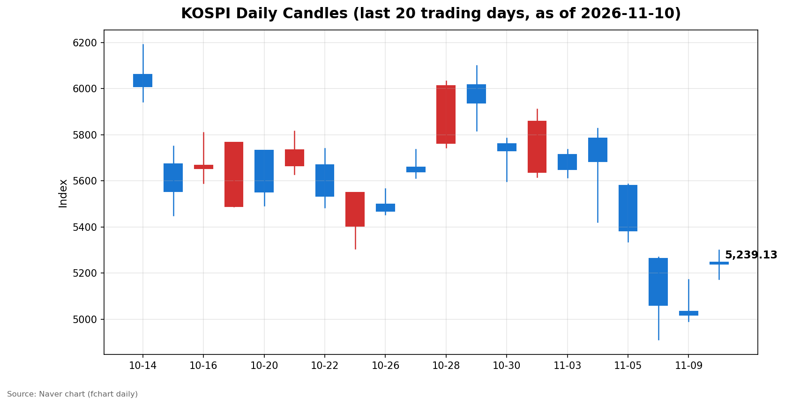
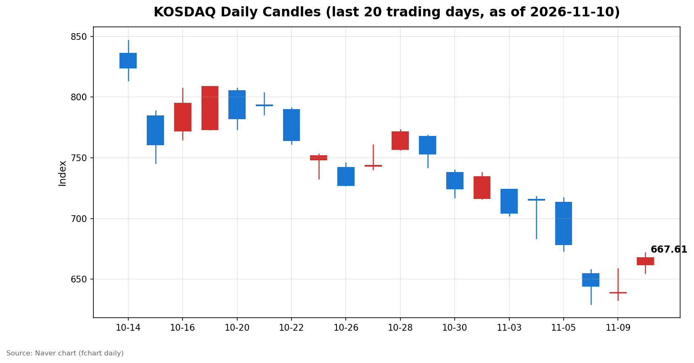

안녕하세요, [한국투자증권](https://securities.koreainvestment.com/main/Main.jsp)에서 [한투-한국투자증권](https://play.google.com/store/apps/details?id=com.truefriend.neosmartarenewal&hl=ko) 개발을 담당하고 있는 way입니다. 
오늘 국내 증시는 3거래일 연속 하락을 멈추고 양 시장이 4% 넘게 오르는 강한 반등으로 마감했습니다. 

## 마감 요약

코스피는 전일 대비 220.28포인트(4.39%) 상승한 5,239.13에 마감했습니다. 
코스닥은 전일 대비 28.64포인트(4.48%) 상승한 667.61에 마감했습니다. 
코스피는 장 초반 5,300.92까지 오르며 5,300선을 터치했고, 오전 9시 6분에는 매수 사이드카가 발동됐습니다. 
종가는 고점 대비 약 62포인트 낮아진 5,239.13으로, 오늘 밤 발표되는 미국 10월 소비자물가지수(CPI)를 앞둔 경계감이 상승 폭의 일부를 되돌렸습니다. 
지난주 목요일과 금요일 5%대 급락과 서킷브레이커, 월요일의 5,000선 턱걸이 마감에 이은 반등으로, 낙폭의 일부를 하루 만에 되돌린 하루였습니다. 

## 오늘의 마감 스냅샷

| 지수 | 종가 | 전일 대비 | 등락률 | 시가 | 고가 | 저가 | 거래량 | 거래대금 |
| --- | --- | --- | --- | --- | --- | --- | --- | --- |
| 코스피 | 5,239.13 | +220.28 | +4.39% | 5,247.22 | 5,300.92 | 5,174.55 | 2억 4,099만 주 | 16조 1,788억 원 |
| 코스닥 | 667.61 | +28.64 | +4.48% | 661.73 | 671.91 | 655.09 | 3억 7,900만 주 | 4조 4,161억 원 |

스냅샷 기준은 2026년 11월 10일 장 마감 수치이며, 전일 종가는 네이버 실시간 데이터 역산값으로 교차 검증했습니다. 
코스피 전일 종가 5,018.85, 코스닥 전일 종가 638.97이 일봉 데이터와 일치했습니다. 
코스피200은 814.31로 4.62% 상승했습니다. 
출처: [코스피](https://finance.naver.com/sise/sise_index.naver?code=KOSPI), [코스닥](https://finance.naver.com/sise/sise_index.naver?code=KOSDAQ) 

## 차트

최근 20거래일 일봉 차트입니다. 
빨간 봉은 종가가 시가보다 높은 날, 파란 봉은 종가가 시가보다 낮은 날입니다. 

## 원인·촉매 분석

오늘 반등의 출발점은 해외 증시의 되돌림이었습니다. 
나스닥은 11월 9일(현지시간) 2.74% 상승한 25,253.14에 마감하며 지난주 급락의 일부를 되돌렸고, 그 흐름이 국내 장 초반 반도체 중심의 매수세로 이어졌습니다. 
그러나 반등의 성격을 결정한 것은 수급의 전환이었습니다. 
코스피에서 외국인이 3,913억 원을 순매수하며 8거래일 만에 순매수로 돌아섰고, 기관도 4,734억 원을 순매수했습니다. 
지난주 외국인이 하루에 3조 원 넘게 팔아치우던 흐름과 정반대의 구도이며, 하락을 주도했던 주체가 매수로 돌아선 점이 지수를 장 초반부터 5,300선까지 밀어 올렸습니다. 
개인이 1조 3,530억 원을 순매도한 점은 반등 국면에서 차익 실현과 비중 축소에 나선 흐름으로 해석됩니다. 
급락장에서 저가 매수에 나섰던 개인이 반등일에 매도로 돌아선 것은 단기 심리가 아직 완전히 회복되지 않았음을 보여줍니다. 
상승 폭이 장중 고점 대비 축소된 배경에는 오늘 밤 발표되는 미국 10월 소비자물가지수(CPI)를 앞둔 경계감이 있습니다. 
시장이 반영하는 연준의 12월 금리 인상 확률이 85% 수준까지 올랐다는 보도가 나오는 가운데, 물가 지표가 예상을 웃돌 경우 금리 인상 경로가 더 선명해질 수 있다는 부담이 오후 들어 차익 실현을 자극했습니다. 
금리 상승은 성장주 밸류에이션에 부담이 되는 요인이며, 반도체 중심의 국내 지수 구조와 맞물려 상승 탄력을 제한하는 요인으로 작용했습니다. 
결국 오늘 장은 낙폭 과대에 따른 기술적 반등과 외국인 수급 전환이라는 우호적 요인이, CPI 경계감과 금리 인상 우려라는 부담과 맞물린 하루였습니다. 

## 핵심 사건 3가지

### 1. 코스피 5,300선 터치와 매수 사이드카 발동

코스피는 장 초반 5,300선을 돌파했고, 오전 9시 6분에는 코스피 시장에 매수 사이드카가 발동됐습니다. 
매수 사이드카는 프로그램 매수호가의 효력을 일시 정지하는 장치로, 급등 국면에서 시장의 과열을 식히는 역할을 합니다. 
지난주 금요일 서킷브레이커가 발동하며 매매가 중단됐던 시장이 사흘 만에 반대 방향의 변동성 완화 장치까지 작동시킨 것은 변동성의 방향이 급락에서 급등으로 전환됐음을 보여줍니다. 
외국인이 8거래일 만에 현물 순매수로 돌아선 점도 이날의 전환을 상징합니다. 
다만 사이드카 발동 이후에도 지수는 고점을 유지하지 못하고 5,239선에서 마감했습니다. 
사이드카 자체가 상승을 막은 것은 아니며, CPI를 앞둔 경계감이 더 크게 작용한 것으로 보입니다. 

### 2. 오늘 밤 미국 10월 소비자물가지수 발표를 앞둔 경계감

오늘 밤 발표되는 미국 10월 소비자물가지수는 이번 주 시장의 방향을 가르는 분수령으로 꼽혀 왔습니다. 
지난주 10월 고용보고서가 예상을 크게 웃돈 뒤 연준의 12월 금리 인상 가능성이 다시 부각됐고, 시장이 반영하는 12월 인상 확률은 85% 수준까지 올랐다는 보도가 나왔습니다. 
물가 지표가 예상을 웃돌면 금리 인상 경로가 더 선명해지고, 반대로 예상을 밑돌면 인상 우려가 한풀 꺾일 수 있습니다. 
오늘 국내 증시가 장중 고점 대비 상승 폭을 반납한 것은 결과를 확인하기 전에 먼저 경계 심리가 작용한 결과입니다. 
국내 증시 입장에서는 CPI 결과에 따라 나스닥의 방향이 갈리고, 그 여파가 내일 장 초반 외국인 수급으로 이어지는 연결고리가 있습니다. 
CPI 발표 이후의 미국 증시 반응과 환율 움직임이 내일 확인할 첫 번째 수치입니다. 

### 3. 반도체 수출 초호황과 상위 10대 기업으로의 집중 심화

올해 3분기 수출액이 반도체 초호황에 힘입어 전년 동기 대비 72.3% 증가하며 역대 최대를 기록했습니다. 
상위 10대 기업이 전체 수출에서 차지하는 비중은 60.9%로 역대 최고 수준에 올랐습니다. 
대기업 수출액은 2,486억 달러로 전년 동기 대비 103.5% 증가한 반면, 중견·중소기업의 수출 증가율은 10%대에 머물렀습니다. 
반도체 호황이 지수 상승의 동력이 되는 동시에, 그 수혜가 소수 대기업에 집중되고 있다는 구조적 양극화가 수치로 확인된 것입니다. 
국내 증시에서 반도체 대형주가 지수에서 차지하는 비중이 큰 만큼, 수출 집중은 지수 상승과 체감 경기 사이의 괴리로 이어질 수 있습니다. 
반도체 실적과 수출이 호조를 이어가는 한 지수의 하방은 지지되겠지만, 수출 증가분이 대기업에 쏠리는 구조가 이어지면 중소형주와 내수 업종의 회복은 상대적으로 더딜 수 있습니다. 

## 섹터·테마 영향 체인

오늘 강세의 축은 한투 MTS 요약이 지목한 대로 HBM과 전력 인프라였습니다. 
AI 데이터센터발 전력 수요 폭증이 전력기기, 전선, 복합화력발전으로 이어지는 연결고리가 테마 등락률에 그대로 드러났습니다. 
전력기기는 8.91%, 전선업체는 8.13%, 복합화력발전은 11.82% 올랐고, 해당 테마의 구성 종목은 대부분 상승했습니다. 
HBM 장비와 AI 기판 기업들의 3분기 실적 호조와 시설 투자 결정이 3D낸드 6.31%, PCB 6.18%, 유리기판 7.47%, 시스템반도체 6.16%의 동반 상승으로 이어졌습니다. 
반도체 밸류체인에서는 소재와 장비, 기판까지 상승이 확산되며 특정 종목이 아니라 밸류체인 전반이 함께 움직이는 흐름이었습니다. 
배터리도 강세였습니다. 
BMW 차세대 전기차용 46파이 배터리 공급사 선정 소식이 전해지며 관련 종목이 올랐고, 엘앤에프는 LG에너지솔루션과 약 1조 원 규모의 LFP 공급계약을 맺었다는 재료가 부각됐습니다. 
항공 테마는 12.20%로 오늘 가장 크게 올랐습니다. 
항공사들의 3분기 흑자 전환과 저비용항공사 3사 통합 기대가 맞물린 결과입니다. 
공정위가 네이버파이낸셜과 두나무 간 기업결합과 관련해 시정 방안을 제출받고 심사보고서를 위원회에 제출했다는 소식도 이날 전해졌습니다. 
지배구조와 주주환원 이슈가 부각된 한진칼이 14.94% 오르는 등 지주사 관련 흐름도 강했습니다. 
반면 오늘은 약세 테마가 눈에 띄지 않을 정도로 시장 전반이 올랐으며, 상승이 일부 테마에 국한되지 않고 지수 전반으로 확산된 하루였습니다. 

## 최근 5거래일 일봉

| 날짜 | 코스피 시가 | 코스피 고가 | 코스피 저가 | 코스피 종가 | 코스닥 시가 | 코스닥 고가 | 코스닥 저가 | 코스닥 종가 |
| --- | --- | --- | --- | --- | --- | --- | --- | --- |
| 2026-11-04 | 5,786.13 | 5,828.13 | 5,421.72 | 5,683.80 | 715.74 | 718.34 | 683.66 | 714.95 |
| 2026-11-05 | 5,580.09 | 5,586.46 | 5,336.88 | 5,383.80 | 713.49 | 717.06 | 673.38 | 678.41 |
| 2026-11-06 | 5,263.26 | 5,269.10 | 4,911.28 | 5,059.69 | 654.43 | 657.95 | 629.17 | 644.27 |
| 2026-11-09 | 5,034.20 | 5,172.94 | 4,990.66 | 5,018.85 | 638.82 | 658.66 | 632.70 | 638.97 |
| 2026-11-10 | 5,247.22 | 5,300.92 | 5,174.55 | 5,239.13 | 661.73 | 671.91 | 655.09 | 667.61 |

지난 5거래일 동안 코스피는 5,683.80에서 5,018.85까지 밀렸다가 오늘 5,239.13으로 되돌렸습니다. 
코스닥도 714.95에서 638.97까지 하락한 뒤 오늘 667.61로 반등했습니다. 
오늘 종가는 5거래일 전 종가에는 여전히 못 미치지만, 하락 추세의 되돌림이 시작됐다는 점에서 의미가 있습니다. 

## 당일 수급

코스피에서는 외국인이 3,913억 원을 순매수했고, 기관이 4,734억 원을 순매수했으며, 개인이 1조 3,530억 원을 순매도했습니다. 
기타법인은 4,884억 원을 순매수했습니다. 
외국인의 순매수는 8거래일 만의 전환이며, 지난주 하루 3조 원대 순매도와 비교하면 규모는 크지 않지만 방향이 바뀌었다는 점이 중요합니다. 
기관 순매수의 내역은 투신 3,287억 원, 사모 1,171억 원, 금융투자 826억 원, 보험 433억 원 순이었고, 연기금은 1,101억 원을 순매도했습니다. 
연기금이 순매도에 나선 점은 기관 내부에서도 시각이 갈린다는 점을 보여주며, 받침의 성격이 전면적이지 않았음을 시사합니다. 
코스닥에서는 외국인이 1,472억 원을 순매도했고, 기관이 2,148억 원을 순매수했으며, 개인이 564억 원을 순매도했습니다. 
코스닥 외국인이 여전히 순매도를 이어간 점은 오늘 반등이 코스피 대형주 중심으로 이뤄졌고, 코스닥으로의 자금 확산은 제한적이었음을 보여줍니다. 
양 시장을 합산하면 외국인은 약 2,441억 원 순매수, 기관은 약 6,882억 원 순매수, 개인은 약 1조 4,094억 원 순매도였습니다. 
개인 매도 물량을 외국인과 기관이 받아낸 구도이며, 반등일의 전형적인 수급 그림입니다. 
수급 수치는 네이버 시장동향 API 기준이며, 코스피와 코스닥을 각각 조회해 구분했습니다. 

## 강했던 테마와 흐름

오늘 가장 강했던 테마는 항공 12.20%, 복합화력발전 11.82%, 전력기기 8.91%, 전선업체 8.13%, 유리기판 7.47% 순이었습니다. 
3D낸드 6.31%, PCB 6.18%, 시스템반도체 6.16%도 강했습니다. 
상승의 중심에는 AI 데이터센터라는 하나의 수요가 있었습니다. 
데이터센터가 전력을 끌어다 쓰고, 전력을 실어 나를 전선과 변압기가 필요해지며, 그 전력을 만들 발전 설비까지 수요가 이어지는 구조입니다. 
반도체 쪽에서는 HBM 실적과 시설 투자가 소재와 장비, 기판으로 확산됐습니다. 
배터리는 완성차 수주 재료가, 항공은 통합과 실적 개선 재료가 각각 작용하며 상승의 폭을 넓혔습니다. 
상승 종목이 특정 테마에 국한되지 않고 시장 전반으로 확산된 점이 오늘 흐름의 특징입니다. 

## 단기·중기 전망과 내일 확인할 시나리오

단기적으로는 오늘 밤 미국 10월 CPI 결과가 첫 번째 분기점입니다. 
물가가 예상을 밑돌면 금리 인상 우려가 완화되며 나스닥과 국내 증시의 반등 흐름이 이어질 수 있습니다. 
반대로 예상을 웃돌면 12월 금리 인상 경로가 선명해지며 오늘 반등의 상당 부분이 되돌려질 수 있습니다. 
내일 확인할 수치로는 나스닥의 마감 등락률과 미국 10년물 국채 금리, 달러·원 환율이 있습니다. 
가격 레벨로는 코스피 5,300선이 첫 번째 저항선입니다. 
오늘 장중 고점 5,300.92를 종가 기준으로 넘는지 여부가 반등의 지속 여부를 가르는 기준이 됩니다. 
아래로는 5,000선에서 5,019선 구간이 지지선입니다. 
어제 종가 5,018.85와 장중 저점 4,990.66이 형성한 구간이며, 이 구간이 유지되는 한 단기 하락 추세의 되돌림 국면으로 볼 수 있습니다. 
코스닥은 오늘 고점 671.91이 저항선, 어제 종가 638.97 부근이 지지선입니다. 
외국인의 코스피 순매수가 내일도 이어지는지, 코스닥에서도 순매수로 전환되는지가 수급 측면의 확인 포인트입니다. 
중기적으로는 반도체 수출 호조와 3분기 실적이 지수의 하방을 지지하는 요인으로 작용합니다. 
다만 수출 증가가 상위 10대 기업에 집중되는 구조가 이어지면 지수와 중소형주 사이의 괴리는 좁혀지기 어렵습니다. 
신용융자 담보비율 140% 유지 의무가 내년 1월 31일까지 한시 면제돼 반대매매가 유예되는 구간이라는 점도 단기 수급에는 완화 요인입니다. 
오늘 반등이 낙폭 과대에 따른 기술적 되돌림에 그칠지, 수급 전환을 동반한 추세 반전의 시작인지 여부는 CPI 결과와 외국인 매수 지속 여부로 가려질 전망입니다. 

## 마치며

오늘 국내 증시는 3거래일 하락을 멈추고 양 시장이 4% 넘게 오르며 강한 반등으로 마감했습니다. 
다만 오늘 밤 미국 CPI 발표를 앞두고 있어 반등의 지속 여부는 아직 확인되지 않았으며, 내일 장 초반의 반응을 지켜볼 필요가 있습니다. 
본 글은 시장 해설과 교육 목적으로 작성됐으며, 특정 종목의 매수나 매도를 권유하는 내용이 아닙니다. 
