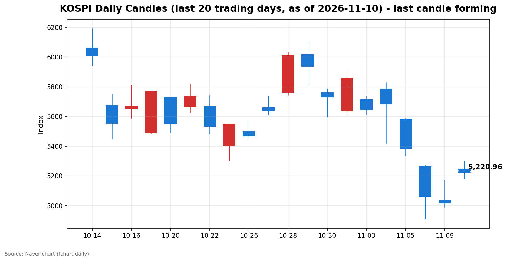
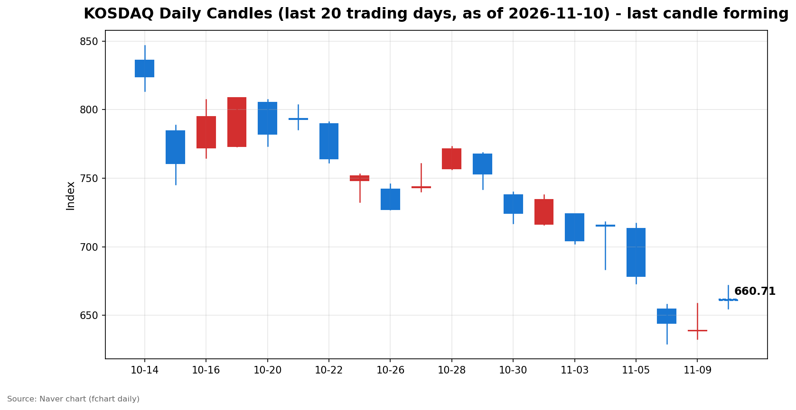

안녕하세요, [한국투자증권](https://securities.koreainvestment.com/main/Main.jsp)에서 [한투-한국투자증권](https://play.google.com/store/apps/details?id=com.truefriend.neosmartarenewal&hl=ko) 개발을 담당하고 있는 way입니다. 
간밤 뉴욕 증시의 반등에 힘입어 국내 증시가 장 초반 양 시장 매수 사이드카가 발동되는 급등세로 출발한 뒤, 고점에서 되돌리는 흐름을 보이고 있습니다. 

## 오전장 요약

코스피는 전일 종가보다 228.37포인트 높은 5,247.22에 출발했습니다. 
장 초반 고가 5,300.92까지 오르며 전일 대비 5.62% 상승하기도 했습니다. 
이 과정에서 코스피와 코스닥 양 시장에서 매수 사이드카가 잇따라 발동됐습니다. 
이후 상승폭은 다소 줄었습니다. 
정오 무렵 코스피는 5,222.85로 전일 대비 4.06% 상승을 기록하고 있습니다. 
코스닥도 시가 661.73으로 출발해 고가 671.91까지 오른 뒤, 정오 무렵 660.92로 전일 대비 3.44% 상승을 기록하고 있습니다. 
두 지수 모두 시가 아래로 내려온 상태입니다. 
11월 5일 5.28% 하락, 11월 6일 6.02% 하락과 서킷브레이커 발동, 11월 9일 0.81% 하락으로 이어진 3거래일 연속 하락을 딛고 반등하는 흐름입니다. 

## 오늘의 스냅샷

| 지수 | 현재가 | 전일 대비 | 등락률 | 시가 | 고가 | 저가 | 거래량 | 거래대금 | 스냅샷 기준 시각 |
| --- | --- | --- | --- | --- | --- | --- | --- | --- | --- |
| 코스피 | 5,222.85 | +204.00 | +4.06% | 5,247.22 | 5,300.92 | 5,184.58 | 148,063천 주 | 9조 4,842억 원 | 2026-11-10 12:27 KST |
| 코스닥 | 660.92 | +21.95 | +3.44% | 661.73 | 671.91 | 655.09 | 251,711천 주 | 3조 66억 원 | 2026-11-10 12:27 KST |

전일 종가는 코스피 5,018.85, 코스닥 638.97입니다. 
전일 종가는 네이버 실시간 지수의 현재가와 전일 대비로 역산한 값과 일치합니다. 
당일 봉은 형성 중인 봉으로, 마감 전에는 계속 변합니다. 
네이버 차트: [코스피](https://finance.naver.com/sise/sise_index.naver?code=KOSPI), [코스닥](https://finance.naver.com/sise/sise_index.naver?code=KOSDAQ)

## 차트

최근 20거래일 일봉 차트입니다. 
빨간 봉은 종가가 시가보다 높은 날, 파란 봉은 종가가 시가보다 낮은 날입니다. 
당일 봉은 형성 중인 봉으로, 마감 전에는 계속 변합니다. 

## 원인·촉매 분석

오늘 오전 급등의 가장 직접적인 촉매는 간밤 뉴욕 증시의 반등입니다. 
다우존스30 산업평균지수는 2.15% 오른 52,389.75, 스탠더드앤드푸어스500지수는 2.35% 오른 7,549.94, 나스닥종합지수는 2.74% 오른 25,253.14에 마감했습니다. 
필라델피아 반도체지수는 6.9% 급등했습니다. 
반도체 비중이 큰 국내 증시에는 직접적인 상방 압력으로 작용했습니다. 
지난주 후반 3거래일 연속 하락으로 낙폭이 컸던 점도 되돌림의 여건을 만들었습니다. 
11월 5일과 6일 이틀 동안 코스피는 11% 가까이 빠졌습니다. 
급락 뒤에는 저가 매수세가 유입되기 쉬운 구간이 형성됩니다. 
국제유가 하락도 배경으로 작용했습니다. 
유가 하락은 물가 부담을 누그러뜨리고, 에너지 비용에 민감한 업종의 수익성 기대를 높입니다. 
전일 수급을 보면 외국인과 개인이 함께 팔고 기관이 받은 구도였습니다. 
11월 9일 최종값 기준 코스피는 외국인 5,256억 원 순매도, 개인 6,887억 원 순매도, 기관 7,535억 원 순매수였습니다. 
코스닥은 외국인 581억 원 순매도, 개인 606억 원 순매도, 기관 1,118억 원 순매수였습니다. 
외국인은 어제까지 7거래일 연속 순매도를 이어왔습니다. 
오늘 장중에는 외국인이 매수 우위를 보이고 있다는 보도가 나왔습니다. 
다만 장중 수급은 마감 전 확정치가 아니므로, 외국인의 매매 방향 전환 여부는 마감 수급으로 확인이 필요합니다. 
원/달러 환율은 1,345.90원으로 전 거래일보다 5.90원(0.44%) 올랐습니다. 
원화 약세가 이어지는 점은 외국인 자금 유입에는 우호적이지 않은 신호입니다. 
12월 금리 인상 기대가 사라진 것은 아닙니다. 
금리선물 시장은 12월 0.25%포인트 인상 확률을 약 80%로 반영하고 있습니다. 
오늘 밤 발표되는 미국 10월 소비자물가지수가 이 기대를 바꿀 수 있는 변수로 남아 있습니다. 
정리하면, 오늘 오전 반등은 해외발 훈풍과 낙폭 과대에 따른 기술적 되돌림이 결합된 성격이 강합니다. 
수급 구조가 바뀌는 전환점인지 여부는 아직 확인되지 않았습니다. 

## 핵심 사건 3가지

첫째, 코스피와 코스닥 양 시장의 매수 사이드카 동반 발동입니다. 
장 초반 코스피200 선물 급등으로 프로그램 매수호가 일시효력정지 장치가 발동됐습니다. 
11월 5일과 6일에는 매도 사이드카와 서킷브레이커가 발동했던 것과 정반대의 장면입니다. 
이틀 만에 매도 압력에서 매수 압력으로 변동성의 방향이 뒤집혔습니다. 
다만 사이드카는 5분간 프로그램 매매를 일시 정지하는 장치입니다. 
발동 자체가 추세 전환을 확증하는 것은 아닙니다. 
발동 이후 지수가 고점에서 되돌린 점도 함께 봐야 합니다. 

둘째, 엔비디아 최고경영자 젠슨 황을 둘러싼 의혹과 주주 집단소송입니다. 
엔비디아 이사회가 젠슨 황 최고경영자와 중국 정보기관 연루 의혹이 제기된 인물 사이의 관계에 대해 독립 조사에 착수했다는 소식이 전해졌습니다. 
엔비디아 주가는 4.3% 하락했습니다. 
주주들이 젠슨 황과 회사를 상대로 국가안보 위험 미공개를 주장하는 집단소송을 제기했다는 소식도 나왔습니다. 
반면 AMD는 13.3%, 브로드컴은 8.8%, 마이크론은 6.3% 올랐습니다. 
악재가 엔비디아 한 종목에 국한되고 다른 반도체주로 확산되지 않았다는 점이 시장의 안도 요인으로 작용했습니다. 
다만 인공지능 대장주에 대한 신뢰 문제는 단기간에 해소되기 어렵습니다. 
의혹의 사실관계와 조사 경과에 따라 반도체주 전반의 변동성이 다시 커질 수 있습니다. 

셋째, 오늘 밤 발표되는 미국 10월 소비자물가지수입니다. 
미국 노동통계국은 한국시간으로 오늘 밤 10시 30분에 10월 소비자물가지수를 발표합니다. 
시장 예상치는 전월 대비 0.2~0.3%, 식품과 에너지를 제외한 근원 지수는 0.2% 안팎입니다. 
2025년 10월 연방정부 셧다운으로 그달 가격 조사가 이뤄지지 못해 전년 동월 대비 상승률은 나오지 않을 가능성이 있습니다. 
이 결과에 따라 연준의 12월 금리 인상 여부에 대한 판단이 한층 뚜렷해집니다. 
예상보다 높은 수치가 나오면 금리 인상 우려가 다시 부각될 수 있습니다. 
예상보다 낮은 수치가 나오면 간밤 반등에 힘이 실릴 수 있습니다. 
발표 결과는 내일 국내 시장에 반영됩니다. 

## 섹터·테마 영향 체인

반도체 밸류체인이 반등의 중심입니다. 
필라델피아 반도체지수 6.9% 급등이 국내 반도체 관련 테마로 전이됐습니다. 
삼성전자는 5%대 상승으로 20만 원 회복을 시도하고 있고, SK하이닉스는 6%대 상승으로 120만 원을 터치했습니다. 
장 초반에는 유리기판 6.04%, 3D낸드 6.03%, CXL 6.90%, 온디바이스AI 5.97%가 오르며 반도체 밸류체인 전반이 강세를 보였습니다. 
인공지능 데이터센터의 전력 인프라 수요 기대는 전력기기와 전선 테마로 이어졌습니다. 
장 초반 전력기기는 8.40%, 복합화력발전은 8.35%, 전선업체는 8.20% 올랐습니다. 
반도체 수요 회복 기대가 전력 설비 투자 기대로 연결되는 고리입니다. 
항공 테마는 장 초반부터 장중까지 강세를 유지하고 있습니다. 
정오 무렵 진에어는 24.72%, 에어부산은 19.43%, 한진칼은 14.22%, 아시아나항공은 11.55%, 대한항공은 11.51% 오르고 있습니다. 
국제유가 하락에 따른 유류비 부담 완화 기대와 대한항공과 아시아나항공의 합병 시너지 기대가 함께 작용했습니다. 
유가 하락의 영향은 업종마다 다르게 나타납니다. 
운송과 항공처럼 에너지 비용에 민감한 업종에는 우호적입니다. 
반면 정유주는 유가 하락에 약세를 보이고 있습니다. 
같은 유가 하락이 업종별로 정반대의 영향을 주는 구조입니다. 
식품 업종에서는 개별 실적 소식도 전해졌습니다. 
CJ제일제당은 3분기 영업이익 2,030억 원으로 전년 동기보다 6.9% 증가했습니다. 
만두와 햇반 등 글로벌 전략제품의 해외 판매 확대와 바이오 핵심소재 사업의 성장이 이끌었습니다. 
지수 흐름과 별개로 개별 기업의 실적 모멘텀이 확인되는 사례입니다. 

## 최근 5거래일 일봉

| 날짜 | 코스피 시가 | 코스피 고가 | 코스피 저가 | 코스피 종가 | 코스피 거래량 | 코스닥 시가 | 코스닥 고가 | 코스닥 저가 | 코스닥 종가 | 코스닥 거래량 |
| --- | --- | --- | --- | --- | --- | --- | --- | --- | --- | --- |
| 2026-11-03 | 5,715.19 | 5,735.92 | 5,615.80 | 5,648.79 | 207,371천 주 | 723.92 | 723.92 | 702.34 | 704.39 | 430,571천 주 |
| 2026-11-04 | 5,786.13 | 5,828.13 | 5,421.72 | 5,683.80 | 276,889천 주 | 715.74 | 718.34 | 683.66 | 714.95 | 539,758천 주 |
| 2026-11-05 | 5,580.09 | 5,586.46 | 5,336.88 | 5,383.80 | 277,253천 주 | 713.49 | 717.06 | 673.38 | 678.41 | 434,307천 주 |
| 2026-11-06 | 5,263.26 | 5,269.10 | 4,911.28 | 5,059.69 | 323,267천 주 | 654.43 | 657.95 | 629.17 | 644.27 | 443,709천 주 |
| 2026-11-09 | 5,034.20 | 5,172.94 | 4,990.66 | 5,018.85 | 248,140천 주 | 638.82 | 658.66 | 632.70 | 638.97 | 358,495천 주 |

11월 3일부터 9일까지 5거래일 동안 코스피는 5,648.79에서 5,018.85로 11% 넘게 하락했습니다. 
코스닥도 같은 기간 704.39에서 638.97로 하락했습니다. 
11월 6일에는 코스피가 장중 4,911.28까지 밀리며 5,000선을 밑돌기도 했습니다. 
오늘 반등은 이 낙폭의 일부를 되돌리는 수준입니다. 

## 오전 강했던 테마와 흐름 변화

정오 무렵 한투 MTS 기준 상승률 상위 테마는 항공 관련 종목들입니다. 
진에어, 에어부산, 한진칼, 아시아나항공, 대한항공이 일제히 두 자릿수 상승률을 기록하고 있습니다. 
장 초반에는 전력기기와 전선, 반도체 밸류체인 테마가 강세를 보였습니다. 
전력기기 8.40%, 복합화력발전 8.35%, 마이크로LED 8.25%, 전선업체 8.20%가 장 초반 상승률 상위권이었습니다. 
오전 흐름의 변화는 지수에서 확인됩니다. 
코스피는 시가 5,247.22에서 고가 5,300.92까지 오른 뒤 정오 무렵 5,222.85로 시가 아래로 내려왔습니다. 
코스닥도 시가 661.73에서 고가 671.91까지 오른 뒤 정오 무렵 660.92로 시가 아래로 내려왔습니다. 
장 초반 급등 뒤 차익 실현성 매물이 나오며 상승폭이 줄어든 형태입니다. 
다만 두 지수 모두 전일 대비 3~4%대 상승을 유지하고 있습니다. 
테마별로는 항공이 장 초반 강세를 장중까지 이어가는 반면, 지수 전체의 상승폭은 고점 대비 축소됐습니다. 

## 오후 전망과 확인할 시나리오

오후에는 오전 반등의 지속 여부를 가늠할 수 있는 지표를 확인해야 합니다. 
첫째, 5,200선 유지 여부입니다. 
코스피가 정오 무렵 5,222.85에 머물고 있는 만큼, 5,200선을 지키는지 여부가 오후 흐름의 기준이 됩니다. 
당일 저가 5,184.58을 밑돌면 오전 반등의 힘이 약해졌다고 볼 수 있습니다. 
반대로 시가 5,247.22를 회복하면 오전의 되돌림이 일시적 조정이었다고 볼 수 있습니다. 
고가 5,300.92는 단기 저항 구간으로 볼 수 있습니다. 
코스닥은 660선 유지 여부와 시가 661.73 회복 여부, 고가 671.91이 확인할 구간입니다. 
둘째, 외국인의 매매 방향입니다. 
외국인은 7거래일 연속 순매도 뒤 오늘 장중 매수 우위 보도가 나왔습니다. 
이 매수세가 오후에도 이어지는지, 마감 수급으로 확인이 필요합니다. 
셋째, 오늘 밤 미국 10월 소비자물가지수 발표를 앞둔 관망 심리입니다. 
발표를 앞두고 오후에는 거래가 다소 위축될 가능성도 있습니다. 
거래대금이 오전 수준을 유지하는지, 변동성이 축소되는지를 함께 봐야 합니다. 
리스크 요인으로는 엔비디아 조사 경과와 금리 인상 기대 재부각 가능성이 남아 있습니다. 
어느 한쪽으로 단정하기보다는 지수 레벨과 수급 방향을 함께 확인하는 흐름입니다. 
이 글은 시장 해설 목적이며, 특정 종목의 매수나 매도를 권유하는 내용이 아닙니다. 

## 마치며

오늘 오전 국내 증시는 간밤 뉴욕 증시 반등과 낙폭 과대에 따른 되돌림으로 양 시장 매수 사이드카가 발동되는 급등세로 출발했습니다. 
다만 고점 뒤 되돌림이 나타나고 있어, 오후에는 5,200선 유지 여부와 외국인 매매 방향, 오늘 밤 미국 소비자물가지수 발표를 확인하는 흐름이 이어질 것으로 보입니다. 
