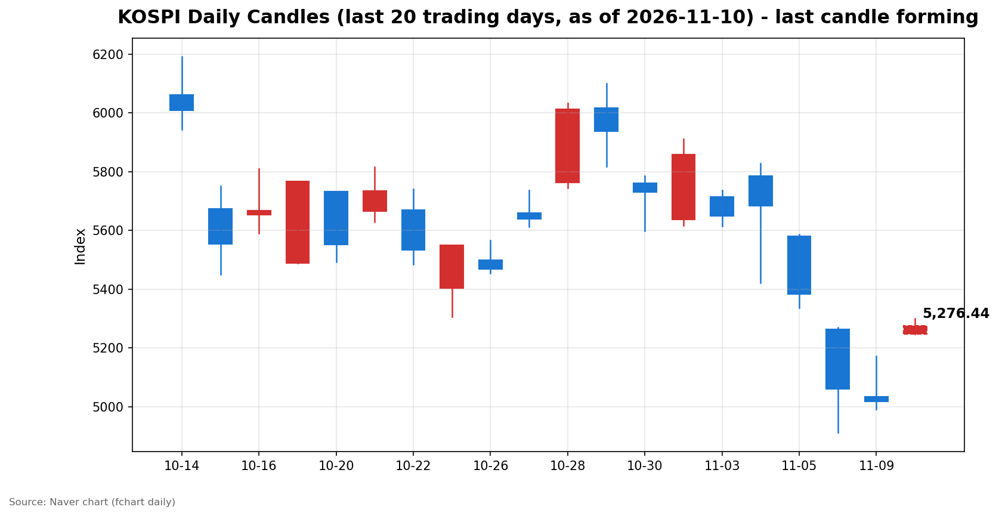
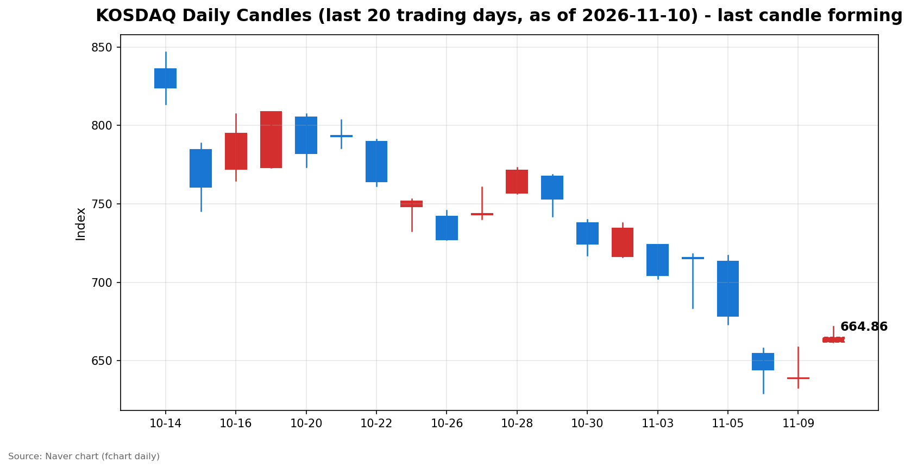

안녕하세요, [한국투자증권](https://securities.koreainvestment.com/main/Main.jsp)에서 [한투-한국투자증권](https://play.google.com/store/apps/details?id=com.truefriend.neosmartarenewal&hl=ko) 개발을 담당하고 있는 way입니다. 
간밤 뉴욕 증시의 2%대 반등에 힘입어 국내 증시가 큰 폭의 상승세로 장을 열었습니다. 

## 배경: 간밤 미국 증시와 개장 전 이슈

간밤 뉴욕 증시는 3대 지수가 일제히 2% 넘게 올랐습니다. 
다우존스30 산업평균지수는 전 거래일보다 1,104.02포인트(2.15%) 오른 52,389.75에 마감했습니다. 
스탠더드앤드푸어스500지수는 173.08포인트(2.35%) 오른 7,549.94, 나스닥종합지수는 673.71포인트(2.74%) 오른 25,253.14에 마감했습니다. 
필라델피아 반도체지수는 6.9% 급등했습니다. 
국제유가가 하루 새 4% 안팎 떨어지면서 물가 부담이 누그러진 점이 반등의 배경으로 지목됐습니다. 
다만 엔비디아는 4.3% 하락하며 시장 흐름과 대조를 보였습니다. 
원/달러 환율은 1,345.50원으로 전 거래일보다 5.50원(0.41%) 올랐습니다. 
코스피200은 821.40으로 5.53% 올랐고, 코스피200 선물은 821.25로 5.85% 올랐습니다. 

## 오늘의 스냅샷

| 지수 | 현재가 | 전일 대비 | 등락률 | 시가 | 고가 | 저가 | 거래량 | 거래대금 | 스냅샷 기준 시각 |
| --- | --- | --- | --- | --- | --- | --- | --- | --- | --- |
| 코스피 | 5,271.86 | +253.01 | +5.04% | 5,247.22 | 5,300.92 | 5,247.22 | 52,271천 주 | 3조 6,013억 원 | 2026-11-10 09:30 KST |
| 코스닥 | 665.00 | +26.03 | +4.07% | 661.73 | 671.91 | 661.73 | 85,182천 주 | 1조 1,921억 원 | 2026-11-10 09:30 KST |

전일 종가는 코스피 5,018.85, 코스닥 638.97입니다. 
전일 종가는 네이버 실시간 지수의 현재가와 등락률로 역산한 값과 일치합니다. 
코스피는 시가부터 전일 종가보다 228.37포인트 높은 5,247.22에 출발했고, 장 초반 고가 5,300.92까지 올랐습니다. 
코스닥도 시가 661.73으로 출발해 장 초반 고가 671.91을 기록했습니다. 
네이버 차트: [코스피](https://finance.naver.com/sise/sise_index.naver?code=KOSPI), [코스닥](https://finance.naver.com/sise/sise_index.naver?code=KOSDAQ)

## 차트

최근 20거래일 일봉 차트입니다. 
빨간 봉은 종가가 시가보다 높은 날, 파란 봉은 종가가 시가보다 낮은 날입니다. 
당일 봉은 형성 중인 봉으로, 마감 전에는 계속 변합니다. 

## 원인·촉매 분석

오늘 장 초반 급등의 가장 직접적인 촉매는 간밤 뉴욕 증시의 반등입니다. 
지난주 후반 국내 증시는 이틀 연속 5% 넘게 빠졌습니다. 
11월 5일 코스피는 5.28% 하락했고, 11월 6일에는 6.02% 하락하며 서킷브레이커가 발동했습니다. 
11월 9일에도 장중 2%대 상승세를 보이다가 오후 들어 하락으로 돌아서 0.81% 내린 5,018.85에 마감했습니다. 
급락이 이어진 뒤라 저가 매수세가 유입될 여건이 마련돼 있었습니다. 
간밤 필라델피아 반도체지수가 6.9% 급등한 점은 반도체 비중이 큰 국내 증시에 직접적인 상방 압력으로 작용했습니다. 
국제유가 하락은 물가 우려를 누그러뜨렸습니다. 
다만 12월 금리 인상 기대가 사라진 것은 아닙니다. 
금리선물 시장은 12월 0.25%포인트 인상 확률을 약 80%로 반영하고 있습니다. 
오늘 밤 발표되는 미국 10월 소비자물가지수가 이 기대를 바꿀 수 있는 변수로 남아 있습니다. 
원/달러 환율이 1,345.50원으로 소폭 오른 점은 외국인 자금 유입에 우호적이지 않은 신호입니다. 
전일 수급을 보면 외국인과 개인이 함께 팔고 기관이 받은 구도였습니다. 
외국인의 매도세가 이어지는 가운데 기관의 매수가 하락을 떠받치는 형태가 이어지고 있습니다. 
오늘 반등이 해외발 훈풍에 기댄 기술적 되돌림인지, 수급 구조가 바뀌는 전환점인지는 장중 외국인의 매매 방향을 봐야 판단할 수 있습니다. 

## 핵심 사건 3가지

첫째, 뉴욕 증시의 2%대 반등과 반도체주의 급등입니다. 
다우 2.15%, 스탠더드앤드푸어스500 2.35%, 나스닥 2.74% 상승은 지난주 급락에 대한 되돌림 성격이 강합니다. 
필라델피아 반도체지수가 6.9% 오른 점이 국내 증시에는 가장 직접적인 영향을 줍니다. 
반도체 업종의 반등이 국내 반도체 밸류체인 전반의 투자심리를 끌어올리는 연결고리가 되기 때문입니다. 
다만 반등 하루만으로 추세 전환을 단정할 수는 없습니다. 

둘째, 엔비디아 최고경영자 젠슨 황을 둘러싼 의혹과 엔비디아 주가의 4.3% 하락입니다. 
엔비디아 이사회가 젠슨 황 최고경영자와 중국 정보기관 연루 의혹이 제기된 인물 사이의 관계에 대해 독립 조사에 착수했다는 소식이 전해졌습니다. 
엔비디아 주가는 장전 거래에서 4~5% 떨어진 뒤 종가 기준 4.3% 하락했습니다. 
반면 AMD는 13.3%, 브로드컴은 8.8%, 마이크론은 6.3% 올랐습니다. 
악재가 엔비디아 한 종목에 국한되고 다른 반도체주로 확산되지 않았다는 점이 시장의 안도 요인으로 작용했습니다. 
다만 인공지능 대장주에 대한 신뢰 문제는 단기간에 해소되기 어렵습니다. 
의혹의 사실관계와 조사 경과에 따라 반도체주 전반의 변동성이 다시 커질 수 있습니다. 

셋째, 오늘 밤 발표되는 미국 10월 소비자물가지수입니다. 
미국 노동통계국은 한국시간으로 오늘 밤 10시 30분에 10월 소비자물가지수를 발표합니다. 
시장 예상치는 전월 대비 0.2~0.3%, 식품과 에너지를 제외한 근원 지수는 0.2% 안팎입니다. 
2025년 10월 연방정부 셧다운으로 그달 가격 조사가 이뤄지지 못해 전년 동월 대비 상승률은 나오지 않을 가능성이 있습니다. 
이 결과에 따라 연준의 12월 금리 인상 여부에 대한 판단이 한층 뚜렷해집니다. 
예상보다 높은 수치가 나오면 금리 인상 우려가 다시 부각될 수 있습니다. 
예상보다 낮은 수치가 나오면 간밤 반등에 힘이 실릴 수 있습니다. 
발표 결과는 내일 국내 시장에 반영됩니다. 

## 섹터·테마 영향 체인

장 초반 테마별 흐름은 전 종목이 오르는 전면 상승에 가깝습니다. 
전력기기가 8.40% 올랐고, 복합화력발전이 8.35%, 마이크로LED가 8.25%, 전선업체가 8.20% 올랐습니다. 
인공지능 데이터센터의 전력 인프라 수요 기대가 전력기기와 전선 테마로 이어지는 흐름입니다. 
유리기판이 6.04%, 3D낸드가 6.03%, CXL이 6.90% 오르며 반도체 밸류체인 전반이 강세를 보였습니다. 
온디바이스AI도 5.97% 올랐습니다. 
필라델피아 반도체지수의 급등이 국내 반도체 관련 테마로 전이되는 연결고리가 확인됩니다. 
항공 테마는 6.21% 올랐습니다. 
국제유가 하락이 연료비 부담 완화 기대로 이어진 것입니다. 
유가 하락의 영향은 업종마다 다르게 작용합니다. 
운송과 항공, 화학처럼 에너지 비용에 민감한 업종에는 우호적입니다. 
반면 에너지 업종 자체의 수익성에는 부담이 될 수 있습니다. 
상위 테마 10개 가운데 하락한 테마가 하나도 없다는 점은 매수세가 특정 테마에 국한되지 않고 시장 전반으로 확산되고 있음을 보여줍니다. 

## 최근 5거래일 일봉

| 날짜 | 시가 | 고가 | 저가 | 종가 | 거래량 |
| --- | --- | --- | --- | --- | --- |
| 2026-11-03 | 5,715.19 | 5,735.92 | 5,615.80 | 5,648.79 | 207,371천 주 |
| 2026-11-04 | 5,786.13 | 5,828.13 | 5,421.72 | 5,683.80 | 276,889천 주 |
| 2026-11-05 | 5,580.09 | 5,586.46 | 5,336.88 | 5,383.80 | 277,253천 주 |
| 2026-11-06 | 5,263.26 | 5,269.10 | 4,911.28 | 5,059.69 | 323,267천 주 |
| 2026-11-09 | 5,034.20 | 5,172.94 | 4,990.66 | 5,018.85 | 248,140천 주 |
| 2026-11-10 | 5,247.22 | 5,300.92 | 5,247.22 | 5,271.86 (형성 중) | 52,271천 주 |

위 표는 코스피 기준입니다. 
코스닥의 최근 5거래일 종가는 11월 3일 704.39, 11월 4일 714.95, 11월 5일 678.41, 11월 6일 644.27, 11월 9일 638.97입니다. 
11월 10일 코스닥 봉은 형성 중이며, 스냅샷 기준 종가는 665.00입니다. 
11월 9일 코스피는 장중 4,990.66까지 밀렸다가 5,000선을 턱걸이로 지켜냈습니다. 
11월 4일 장중 고가 5,828.13에서 11월 6일 장중 저가 4,911.28까지 이틀 만에 900포인트 넘게 흔들렸습니다. 

## 전일 수급

11월 9일 전일 수급은 외국인과 개인이 팔고 기관이 받은 구도였습니다. 
코스피에서 외국인은 5,256억 원 순매도했고, 개인은 6,886억 원 순매도했습니다. 
기관은 7,535억 원 순매수했습니다. 
기관 매수의 중심은 금융투자로, 1조 1,456억 원을 순매수했습니다. 
반면 사모펀드는 2,367억 원, 연기금은 1,523억 원 순매도했습니다. 
기관 전체가 산 것이 아니라 금융투자 중심의 매수가 다른 기관의 매도를 상쇄한 형태입니다. 
코스닥에서도 같은 구도가 나타났습니다. 
외국인은 580억 원, 개인은 606억 원 순매도했고, 기관은 1,119억 원 순매수했습니다. 
외국인의 매도세가 사흘 연속 이어지고 있다는 점은 주의할 대목입니다. 
11월 5일 외국인은 코스피에서 3조 3,733억 원을 순매도했고, 11월 6일에도 2조 6,892억 원을 순매도했습니다. 
매도 규모는 줄고 있지만 방향이 바뀌지는 않았습니다. 
오늘 반등이 지속되려면 외국인의 매도 진정이 확인돼야 합니다. 
개인 투자자는 11월 9일에도 순매도를 이어갔습니다. 
급락 국면에서 개인의 매도가 이어지는 점은 단기 수급 부담으로 작용할 수 있습니다. 
다만 11월 9일부터 내년 1월 31일까지 신용융자 담보비율 140% 유지 의무가 한시 면제돼 반대매매가 유예되는 구간입니다. 
이 점은 단기 매도 압력을 완화하는 요인으로 작용할 수 있습니다. 

## 단기·중기 전망과 확인할 시나리오

단기 흐름은 오늘 밤 미국 10월 소비자물가지수에 달려 있습니다. 
예상치에 부합하거나 밑돌면 간밤 반등의 연장선에서 상승 흐름이 이어질 수 있습니다. 
예상치를 웃돌면 12월 금리 인상 우려가 다시 부각되며 변동성이 커질 수 있습니다. 
코스피는 장 초반 고가 5,300.92를 넘어 안착하는지가 첫 관문입니다. 
5,300선을 지키면 전일 고가 5,172.94를 회복한 데 이어 11월 5일 종가 5,383.80 부근까지 되돌림을 시도할 수 있습니다. 
반대로 5,300선을 넘지 못하고 되돌리면 5,000선 지지 여부를 다시 확인하는 흐름이 될 수 있습니다. 
코스닥은 장 초반 고가 671.91을 넘어 700선 회복을 시도할지가 관전 포인트입니다. 
중기적으로는 외국인의 매도 진정 여부가 가장 중요합니다. 
외국인이 사흘 연속 순매도한 흐름이 멈추는지, 매수 전환으로 이어지는지를 봐야 합니다. 
필라델피아 반도체지수가 2일 연속 상승하는지, 변동성 지수가 20 아래에 안착하는지도 확인할 조건입니다. 
이번 주에는 11월 13일 미국 10월 생산자물가지수 발표가 예정돼 있습니다. 
엔비디아 의혹의 조사 경과도 반도체주 변동성의 변수로 남아 있습니다. 
오늘 오후 4시에는 한국은행이 10월 22일 금융통화위원회 의사록을 공개합니다. 
국내 금리 방향을 가늠할 자료로 참고할 수 있습니다. 

## 장 초반 확인할 점

코스피 5,300선 안착 여부를 확인합니다. 
외국인과 기관의 장중 수급 방향이 바뀌는지 확인합니다. 
원/달러 환율이 1,345원대에서 추가로 오르는지 확인합니다. 
오후 들어 상승폭이 되돌려지는 패턴이 반복되는지 확인합니다. 
최근 장에서는 오전 상승 뒤 오후 되돌림이 잦았습니다. 
오늘 밤 미국 소비자물가지수 발표를 앞두고 오후 변동성이 커질 수 있습니다. 

## 마치며

간밤 뉴욕 증시의 반등과 반도체주 급등이 국내 증시의 큰 폭 상승 출발을 이끌었습니다. 
다만 오늘 밤 미국 소비자물가지수 발표를 앞두고 있어 반등의 지속 여부는 아직 확인이 필요합니다. 
이 글은 교육과 해설을 위한 시황 정리이며, 특정 종목의 매수나 매도를 권유하는 내용이 아닙니다. 
