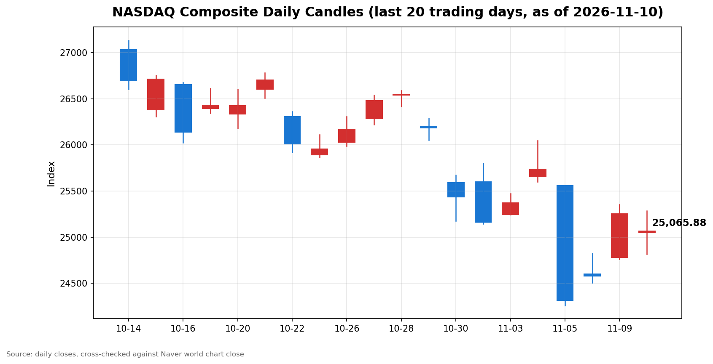

안녕하세요, [한국투자증권](https://securities.koreainvestment.com/main/Main.jsp)에서 [한투-한국투자증권](https://play.google.com/store/apps/details?id=com.truefriend.neosmartarenewal&hl=ko) 개발을 담당하고 있는 way입니다. 
2026년 11월 10일 나스닥 장 마감 흐름을 수치 중심으로 정리합니다. 

## 마감 요약

나스닥 종합은 전일 대비 0.74% 하락해 25,065.87로 마감했습니다. 
하락 폭은 187.27이었습니다. 
전일 상승분 673.71의 27.8%를 하루 만에 되돌렸습니다. 
다만 종가는 지난주 금요일 종가 24,579.43보다 1.98% 높은 수준으로, 반등 흐름이 꺾였다고 단정할 단계는 아닙니다. 
나스닥은 지난 10월 6일 기록한 사상 최고 종가 27,599.89 대비 9.18% 낮은 수준으로, 여전히 조정 구간에 머물렀습니다. 
S&P500은 0.38% 하락해 7,520.93으로 마감했고, 다우지수는 0.30% 하락해 52,231.89로 마감했습니다. 
세 지수가 모두 내렸지만 하락 폭은 나스닥이 가장 컸습니다. 
이 글은 교육과 해설 목적으로 작성되었으며 특정 종목의 매수나 매도를 권유하지 않습니다. 

## 오늘의 마감 스냅샷

| 지수 | 종가 | 전일 대비 | 등락률 | 전일 종가 | 당일 고가 | 당일 저가 |
| --- | --- | --- | --- | --- | --- | --- |
| 나스닥 종합 | 25,065.87 | -187.27 | -0.74% | 25,253.14 | 25,286.83 | 24,816.10 |
| S&P500 | 7,520.93 | -29.01 | -0.38% | 7,549.94 | 7,543.92 | 7,470.43 |
| 다우지수 | 52,231.89 | -157.86 | -0.30% | 52,389.75 | 52,316.89 | 51,977.08 |

스냅샷 기준 시각은 미국 동부시간 2026년 11월 10일 16시 20분, 한국시간 2026년 11월 11일 06시 20분입니다. 
네이버 월드 차트 페이지는 curl 직접 조회로는 시세 데이터가 확인되지 않았습니다. 
새 페이지 주소에서는 자바스크립트 앱 껍질만 내려받고 가격 필드가 비어 있었고, 구 페이지 주소는 리디렉션 응답과 함께 빈 본문을 돌려보냈습니다. 
이 글의 스냅샷 수치는 한투 MTS 해외 대시보드에서 확인한 마감 수치입니다. 
Yahoo Finance 일봉 종가는 나스닥 25,065.88, S&P500 7,520.93으로 한투 MTS 값과 소수점 둘째 자리 반올림 수준에서 일치합니다. 
나스닥 당일 시가는 25,047.45입니다. 
전일 종가는 종가와 전일 대비 변동폭으로 역산했습니다. 
역산한 전일 종가는 나스닥 25,253.14, S&P500 7,549.94, 다우지수 52,389.75이며, 세 값 모두 전 거래일 마감 글의 종가와 일치합니다. 
당일 고가와 저가는 Yahoo Finance 일봉 기준입니다. 
다우지수는 한투 MTS 해외 대시보드 지수 목록에 포함되지 않았습니다. 
원/달러 환율은 한투 MTS 해외 대시보드 기준 1,344.50원으로 전일 대비 4.50원, 0.34% 상승했습니다. 
네이버 월드 차트 출처는 [네이버 금융 월드 시세](https://finance.naver.com/world/sise.naver?symbol=NAS@IXIC)와 [네이버 월드 차트](https://stock.naver.com/worldstock/index/.IXIC/price)에서 확인할 수 있습니다. 
확인되지 않은 마감 원인은 본문에 쓰지 않았습니다. 

## 차트

최근 20거래일 일봉 차트입니다. 
빨간 봉은 종가가 시가보다 높은 날, 파란 봉은 종가가 시가보다 낮은 날입니다. 

## 원인·촉매 분석

이날 하락의 가장 직접적인 촉매는 개장 전 발표된 10월 소비자물가지수였습니다. 
10월 소비자물가지수는 전월 대비 0.4% 상승해 예상치 0.3%를 웃돌았습니다. 
근원 소비자물가지수도 전월 대비 0.3% 올라 3개월 연속 같은 폭의 상승을 이어갔고, 두 지표 모두 시장 예상을 0.1%포인트씩 웃돌았습니다. 
물가 상승률이 예상을 웃돌자 연준의 추가 금리 인상 기대가 다시 커졌고, 미국 10년물 국채금리는 전 거래일 종가 4.86%에서 4.98%로 0.12%포인트 올랐습니다. 
장중에는 5.02%까지 올라 5%선을 터치했습니다. 
금리가 오르면 미래 현금흐름을 현재 가치로 환산하는 할인율이 높아져 성장주 밸류에이션 부담이 커집니다. 
성장주 비중이 높은 나스닥이 S&P500과 다우지수보다 더 크게 내린 것은 이 연결고리와 맞아떨어집니다. 
두 번째 촉매는 연준 고위 인사들의 매파 발언이 같은 날 겹친 점입니다. 
크리스토퍼 월러 연준 이사는 런던에서 열린 콘퍼런스에서 지표 발표에 앞서 근원 소비자물가지수가 전월 대비 0.3% 안팎이거나 그 이상이면 12월 연방공개시장위원회에서 0.5%포인트 인상을 검토해야 한다고 말했습니다. 
로건 댈러스 연방준비은행 총재는 금리 인상을 멈추고 상황을 재평가하기 전에 기준금리를 최소 0.5%포인트 더 올려야 한다고 말했습니다. 
미셸 보먼 연준 감독 부의장은 같은 날 연설에서 물가 안정을 최우선으로 꼽으며 10월 근원 개인소비지출 물가지수 상승률을 3.3%로 추정했습니다. 
발언이 겹치면서 12월 금리 인상 확률은 페드워치 기준 100%까지 올라갔다는 보도가 나왔고, 0.5%포인트 인상 확률도 15%에 육박했습니다. 
미국 2년물 국채금리는 19개월 만에 가장 큰 폭으로 급등했다는 보도도 나왔습니다. 
세 번째 촉매는 엔비디아의 급락이 나스닥에 더해진 점입니다. 
엔비디아는 이날 5.47% 하락해 168.89달러로 마감했고, 지난주 금요일 종가 186.64달러 대비로는 이틀 새 9.51% 내렸습니다. 
젠슨 황 최고경영자를 둘러싼 이사회 조사 보도가 이어지는 가운데 나온 하락이라, 지수 하락의 일부는 개별 종목 사안에서 비롯됐습니다. 
다만 하락을 되돌림의 범주에서 벗어났다고 보기는 이릅니다. 
나스닥은 지난주 목요일 5.52% 폭락한 뒤 금요일 1.09%, 월요일 2.74% 오르며 반등했고, 이날 하락은 월요일 상승분의 27.8%를 되돌린 수준입니다. 
종가는 지난주 금요일 종가보다 1.98% 높은 수준을 유지했습니다. 
유가 흐름은 이날 하락의 촉매가 아니었습니다. 
서부텍사스산 원유는 전 거래일 86.85달러에서 86.38달러로 0.54% 하락했습니다. 
유가가 내렸는데도 물가가 예상보다 높게 나온 것은, 이날의 물가 압력이 유가가 아니라 식품과 서비스 쪽에서 비롯됐음을 보여줍니다. 
식품 가격은 전월 대비 0.5% 올랐고, 9월 소매판매도 전월 대비 0.8% 늘어 소비가 여전히 탄탄했습니다. 
달러도 같은 방향이었습니다. 
원/달러 환율은 1,344.50원으로 전일 대비 0.34% 올랐습니다. 

## 핵심 사건 3가지

첫째, 10월 소비자물가지수가 예상을 웃돌았습니다. 
10월 소비자물가지수는 전월 대비 0.4% 상승해 예상치 0.3%를 웃돌았고, 근원 지수도 전월 대비 0.3% 올라 3개월 연속 같은 폭을 기록했습니다. 
두 지표 모두 시장 예상을 0.1%포인트씩 웃돈 것입니다. 
식품 가격은 전월 대비 0.5% 올랐고, 9월 소매판매도 전월 대비 0.8% 늘어 소비 둔화의 신호는 보이지 않았습니다. 
물가와 소비가 동시에 예상보다 강하게 나오면서 연준이 금리를 올릴 여지가 커졌고, 시장은 개장 전부터 금리 인상 기대를 가격에 반영하기 시작했습니다. 
이날 하락의 출발점이 된 사건입니다. 

둘째, 연준 고위 인사들의 매파 발언이 하루에 겹쳤습니다. 
월러 이사는 근원 소비자물가지수가 0.3% 안팎이거나 그 이상이면 12월 0.5%포인트 인상을 검토해야 한다고 말했고, 로건 총재는 최소 0.5%포인트 추가 인상이 필요하다고 말했습니다. 
보먼 부의장은 물가 안정을 최우선으로 꼽으며 10월 근원 개인소비지출 물가지수 상승률을 3.3%로 추정했습니다. 
세 사람의 발언은 방향이 같았습니다. 
물가 목표 달성이 아직 멀었고, 금리 인상 중단이나 인하를 논하기에는 이르다는 것입니다. 
발언이 겹치면서 12월 금리 인상 확률은 페드워치 기준 100%까지 올라갔다는 보도가 나왔고, 미국 2년물 국채금리는 19개월 만에 가장 큰 폭으로 급등했습니다. 
시장 심리를 짓누른 두 번째 사건입니다. 

셋째, 엔비디아가 이틀 새 9.51% 급락했습니다. 
엔비디아는 이날 5.47% 하락해 168.89달러로 마감했습니다. 
지난주 금요일 종가 186.64달러에서 이틀 만에 17.75달러가 빠진 것입니다. 
젠슨 황 최고경영자를 둘러싼 이사회 조사 보도가 이어지는 가운데 나온 하락입니다. 
다만 반도체지수 전체로 번지지는 않았습니다. 
필라델피아 반도체지수는 이날 0.35% 하락하는 데 그쳤습니다. 
악재가 엔비디아 개별 종목에 머물렀고 업종 전반의 투자 심리는 무너지지 않았음을 보여줍니다. 
다만 조사 결과에 따라 사안이 커질 수 있는 만큼, 개별 종목의 리스크가 업종으로 번지는지는 지켜봐야 합니다. 

## 지수·섹터 영향 체인

나스닥 하락률이 가장 컸던 것은 금리 민감도가 가장 높기 때문입니다. 
10년물 금리가 0.12%포인트 오르며 5%선에 다가서자 성장주 밸류에이션 부담이 커졌고, 기술주 비중이 가장 높은 나스닥이 가장 크게 내렸습니다. 
S&P500은 기술주 비중이 나스닥보다 낮아 하락 폭이 0.38%에 그쳤고, 가치주와 산업재 비중이 높은 다우지수는 0.30% 내리는 데 그쳤습니다. 
금리에서 시작해 성장주 밸류에이션으로 이어지는 연결고리가 지수 간 하락 폭 차이를 설명합니다. 
섹터 상장지수펀드 흐름도 같은 이야기를 합니다. 
Yahoo Finance 기준 기술주 상장지수펀드는 전일 대비 1.15% 하락해 나스닥보다 더 크게 내렸습니다. 
반면 금융주 상장지수펀드는 0.52% 올랐고, 에너지주 상장지수펀드도 0.44% 올랐습니다. 
금리가 오르는 국면에서는 성장주가 눌리고 은행의 순이자마진 기대가 커지는 쪽으로 자금이 이동한다는 뜻입니다. 
에너지 섹터는 유가 하락에도 올랐습니다. 
서부텍사스산 원유는 0.54% 내려 86.38달러로 마감했지만, 에너지주 상장지수펀드는 0.44% 상승했습니다. 
당일 유가 하락 폭이 크지 않았고 유가 수준 자체가 여전히 86달러대로 높게 유지된 점이 에너지주 하락을 막아준 것으로 보입니다. 
반도체 섹터는 지수보다 단단했습니다. 
필라델피아 반도체지수는 0.35% 하락해 9,998.33으로 마감했고, 10,000 구간을 아슬아슬하게 밑돌았습니다. 
엔비디아 혼자 5.47% 내린 것과 달리 반도체지수 하락 폭이 작았다는 것은, 이날의 반도체 약세가 업종 전반의 문제가 아니라 개별 종목 사안에 머물렀음을 보여줍니다. 
다만 반도체지수는 11월 4일 종가 10,268.65 대비로는 여전히 2.63% 낮은 수준입니다. 
나스닥도 11월 4일 종가 25,736.51 대비 2.61% 낮습니다. 
지난주 폭락 이전 수준 회복까지는 거리가 남아 있고, 되돌림의 성격이 강하다는 뜻입니다. 
달러 강세도 같은 방향이었습니다. 
원/달러 환율이 0.34% 오른 것은 금리 인상 기대가 달러 강세로 이어졌음을 보여줍니다. 
정리하면 이날은 물가 지표와 연준 발언이 금리를 끌어올리고, 금리가 성장주 밸류에이션을 누르며, 개별 종목 악재가 나스닥에 더해진 날이었습니다. 

## 다우·S&P500 마감 흐름

S&P500은 7,520.93으로 마감했습니다. 
전일 대비 변동폭은 29.01, 등락률은 0.38% 하락이었습니다. 
역산한 S&P500 전일 종가는 7,549.94입니다. 
Yahoo Finance 일봉 기준 S&P500 당일 시가는 7,513.09, 고가는 7,543.92, 저가는 7,470.43이었습니다. 
다우지수는 52,231.89로 마감했습니다. 
전일 대비 변동폭은 157.86, 등락률은 0.30% 하락이었습니다. 
Yahoo Finance 일봉 기준 다우지수 당일 시가는 52,163.21, 고가는 52,316.89, 저가는 51,977.08이었습니다. 
전 거래일과 비교하면 힘의 배치가 정반대로 바뀌었습니다. 
전 거래일에는 세 지수가 모두 2% 넘게 올랐지만, 이날은 세 지수가 모두 내렸습니다. 
나스닥은 전 거래일 상승분의 27.8%를 되돌렸고, S&P500은 전 거래일 상승분 173.08의 16.8%를 되돌렸으며, 다우지수는 전 거래일 상승분 1,104.02의 14.3%를 되돌렸습니다. 
되돌림 폭이 나스닥에서 가장 컸다는 것은, 하락 압력이 성장주 쪽에 집중됐다는 뜻입니다. 
다만 세 지수 모두 지난주 금요일 종가보다는 높은 수준을 유지했습니다. 
나스닥은 금요일 종가 대비 1.98%, S&P500은 1.95%, 다우지수는 1.85% 높은 수준입니다. 

## 단기·중기 전망과 다음 거래일 확인할 시나리오

흐름 지속과 일시적 되돌림을 구분하는 기준은 세 가지입니다. 
첫째, 미국 10년물 국채금리가 5%선에 안착하는지 확인합니다. 
이날 장중 5.02%까지 올랐던 금리가 5% 위에서 머무르면 성장주 밸류에이션 부담이 이어질 가능성이 커집니다. 
둘째, 나스닥이 당일 저가 24,816.10 부근을 지키는지 확인합니다. 
이 구간이 무너지면 반등이 꺾이고 조정 구간에서의 하락이 이어질 가능성이 커집니다. 
셋째, 반도체주의 흐름이 이어지는지 확인합니다. 
필라델피아 반도체지수가 10,000 구간을 회복하는지, 아니면 10,000 아래에 머무르는지가 지수 전반의 방향을 가를 것입니다. 
다음에 확인할 물가 지표로는 10월 개인소비지출 물가지수가 있습니다. 
보먼 부의장이 10월 근원 개인소비지출 물가지수 상승률을 3.3%로 추정한 만큼, 실제 발표치가 이 수준을 웃도는지가 금리 경로의 다음 변수입니다. 
나스닥 선물은 한투 MTS 해외 대시보드 기준 27,859.75로 전일 대비 0.55% 하락한 상태이며, 선물 시장의 흐름이 이어지는지도 확인할 지점입니다. 
엔비디아와 관련된 추가 보도도 확인해야 합니다. 
개별 종목의 사안이 업종 전반으로 번지지 않는지가 단기 심리의 변수입니다. 
중기적으로는 12월 연방공개시장위원회를 앞둔 금리 경로가 관건입니다. 
물가 지표가 예상을 계속 웃돌면 금리 인상 기대가 더 커질 수 있고, 예상을 밑돌면 반등 흐름에 힘이 실릴 수 있습니다. 
유가 흐름도 함께 봐야 합니다. 
서부텍사스산 원유 86.38달러 수준이 유지되는지, 다시 90달러 구간으로 되돌아가는지에 따라 인플레이션 우려의 방향이 달라질 수 있습니다. 

## 마치며

이날은 예상보다 높은 물가 지표와 연준 인사들의 매파 발언이 금리를 끌어올리며 나스닥을 가장 크게 누른 날이었습니다. 
되돌림이 이어지는지, 반등으로 돌아서는지는 10년물 금리 5%선과 당일 저가 구간, 반도체주의 흐름에서 확인하는 것이 순서입니다. 
이 글은 교육과 해설 목적으로 작성되었으며 특정 종목의 매수나 매도를 권유하지 않습니다. 
