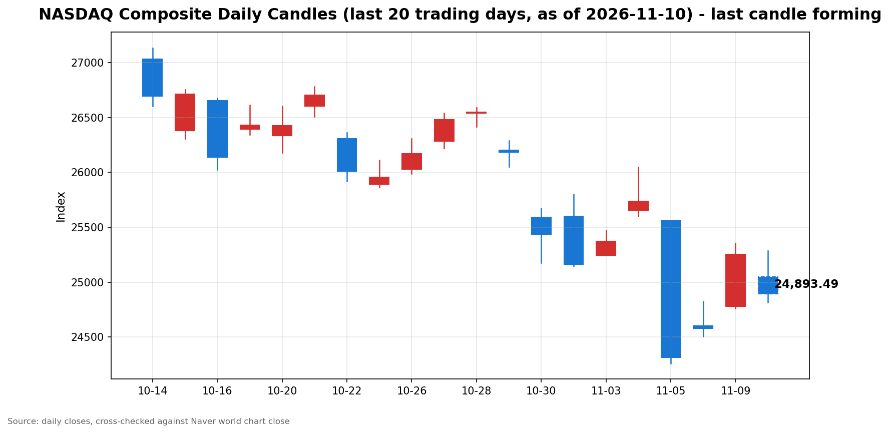

안녕하세요, [한국투자증권](https://securities.koreainvestment.com/main/Main.jsp)에서 [한투-한국투자증권](https://play.google.com/store/apps/details?id=com.truefriend.neosmartarenewal&hl=ko) 개발을 담당하고 있는 way입니다. 
미국 동부시간 11월 10일 장중, 나스닥 종합지수가 10월 소비자물가 발표 이후 하락세를 이어가고 있습니다. 

## 장중 요약

전일인 11월 9일 나스닥 종합은 25,253.14로 2.74% 오르며 지난주 폭락분의 일부를 되돌렸습니다. 
화요일 장은 오전 8시 30분에 발표된 10월 소비자물가지수가 시장 예상을 웃돌면서 하락 출발했습니다. 
나스닥은 시가 기준 0.81% 내린 뒤 장 초반 저가 매수세에 낙폭을 되돌렸습니다. 
장 초반에는 전일 종가를 웃도는 수준까지 회복하기도 했습니다. 
그러나 정오를 지나면서 하락세로 다시 돌아섰습니다. 
미국 동부시간 13시 8분 기준 나스닥은 전일 대비 1.47% 내린 24,881.52를 기록하고 있습니다. 
스탠더드앤드푸어스 500 지수는 0.90%, 다우존스 산업평균지수는 0.63% 내리며 동반 하락하고 있습니다. 
오전 장의 되돌림이 오후 장에서 이어지지 못한 흐름입니다. 

## 오늘의 스냅샷

| 지수 | 현재가 | 전일 대비 | 등락률 | 전일 종가 | 장중 고가 | 장중 저가 |
| --- | --- | --- | --- | --- | --- | --- |
| 나스닥 종합 | 24,881.52 | -371.62 | -1.47% | 25,253.14 | 25,286.83 | 24,816.10 |
| 스탠더드앤드푸어스 500 | 7,481.76 | -68.18 | -0.90% | 7,549.94 | 7,543.92 | 7,470.43 |
| 다우존스 산업평균지수 | 52,062.29 | -327.46 | -0.63% | 52,389.75 | 52,291.77 | 51,977.08 |

스냅샷 기준 시각은 미국 동부시간 2026년 11월 10일 13시 8분, 한국시간 2026년 11월 11일 3시 8분입니다. 
당일 수치는 형성 중인 값으로, 마감 전에는 계속 변합니다. 
나스닥 종합의 시가는 25,047.45였습니다. 
스탠더드앤드푸어스 500 지수의 시가는 7,513.09, 다우존스 산업평균지수의 시가는 52,163.21이었습니다. 
장중 고가와 저가는 Yahoo Finance 일봉 기준입니다. 
나스닥 종합과 다우존스 산업평균지수 값은 [네이버 월드 차트](https://finance.naver.com/world/sise.naver?symbol=NAS@IXIC)와 [네이버 월드스탁 가격 페이지](https://stock.naver.com/worldstock/index/.IXIC/price)에서 직접 확인했습니다. 
네이버 월드 차트 페이지는 curl 직접 조회가 되지 않아 브라우저로 확인했으며, 수치는 한국투자증권 MTS 해외 대시보드와 교차 검증했습니다. 
한국투자증권 MTS 기준 같은 날 12시 56분 나스닥 종합은 24,916.72로 네이버 값과 같은 방향을 보였습니다. 
스탠더드앤드푸어스 500 지수 값은 한국투자증권 MTS 해외 대시보드에서 확인했습니다. 
원·달러 환율은 한국투자증권 MTS 기준 1,344.50원으로 전일 대비 4.50원, 0.34% 올랐습니다. 

## 차트

최근 20거래일 일봉 차트입니다. 
빨간 봉은 종가가 시가보다 높은 날, 파란 봉은 종가가 시가보다 낮은 날입니다. 
당일 봉은 형성 중인 봉으로, 마감 전에는 계속 변합니다. 

## 원인·촉매 분석

표면적으로는 나스닥이 전일 대비 1.47% 내리고 있습니다. 
근본 촉매는 오전 8시 30분에 발표된 10월 소비자물가지수입니다. 
10월 소비자물가지수는 전월 대비 0.4% 올랐습니다. 
변동성이 큰 식품과 에너지를 제외한 근원 소비자물가지수도 전월 대비 0.3% 올랐습니다. 
시장 예상은 근원 기준 0.2% 수준이었습니다. 
근원 소비자물가지수의 0.3% 상승은 3개월 연속입니다. 
식품 가격은 전월 대비 0.5% 올랐고, 주거비 상승도 물가 압박 요인으로 지목됐습니다. 
물가 상승률이 예상을 웃돌면서 연방준비제도의 12월 금리 인상 가능성이 커졌다는 해석이 나왔습니다. 
전달 경로는 물가 상회에서 금리 인상 기대로, 다시 국채금리 상승으로 이어집니다. 
미국 2년물 국채수익률은 장중 20bp 넘게 올랐습니다. 
할인율 상승은 미래 이익의 현재가치를 낮추는 방향으로 작용합니다. 
성장주 비중이 높은 나스닥이 다우보다 크게 내린 것은 이 경로와 맞닿아 있습니다. 
배경에는 11월 6일 고용지표 서프라이즈도 있습니다. 
10월 비농업 부문 취업자는 16만 5천 명 늘었고, 실업률은 4.1%를 기록했습니다. 
고용 호조에 물가 상회가 더해지면서 긴축 압력이 가중되는 구도입니다. 
전일 2.74% 급반등 이후 되돌림 성격도 함께 있습니다. 
지난주 폭락 이후 변동성이 큰 국면이 이어지고 있습니다. 
유가 하락은 물가 압력을 낮추는 요인이지만, 당일은 금리발 매도가 우세한 흐름입니다. 
브렌트유는 8월 이후 처음으로 배럴당 90달러를 밑돌았습니다. 
미국 휘발유 전국 평균 가격은 갤런당 3.9788달러로 넉 달 만에 4달러를 밑돌았습니다. 
에너지 가격 둔화에도 물가 지표의 다른 항목이 끈적하게 이어지고 있다는 점이 시장의 주목을 받고 있습니다. 

## 핵심 사건 3가지

### 첫째, 10월 소비자물가지수 예상 상회입니다

10월 소비자물가지수는 전월 대비 0.4% 올랐습니다. 
근원 소비자물가지수는 전월 대비 0.3% 올라 시장 예상 0.2%를 웃돌았습니다. 
근원 소비자물가지수의 0.3% 상승은 3개월 연속입니다. 
식품 가격은 전월 대비 0.5% 올랐습니다. 
9월 소매판매도 전월 대비 0.8% 증가해 소비가 이어지고 있음을 보여줬습니다. 
이 사건이 중요한 이유는 연방준비제도의 12월 결정이 다시 물가 지표에 묶였기 때문입니다. 
물가 재가속이라기보다는 끈적한 물가 흐름이 이어지고 있다는 해석이 나옵니다. 
발표 직후 나스닥은 0.81% 하락 출발했습니다. 
로이터통신은 기술주 중심의 반등세에 제동이 걸릴 수 있으며, 지난주 시장을 흔들었던 매도세가 다시 살아날 수 있다고 전했습니다. 
다만 에너지 가격 상승세가 급격히 둔화됐다는 점은 향후 물가 경로를 가를 변수로 남아 있습니다. 

### 둘째, 월러 연준 이사의 빅스텝 시사입니다

크리스토퍼 월러 연방준비제도 이사는 10일 런던 콘퍼런스에서 발언했습니다. 
월러 이사는 10월 월간 물가 상승률이 개선되더라도 12월 연방공개시장위원회에서 정책금리를 0.25%포인트 인상하는 쪽으로 기울고 있다고 밝혔습니다. 
근원 소비자물가지수가 0.3% 이상을 또 기록하면 0.5%포인트 금리 인상도 검토해야 한다는 입장도 밝혔습니다. 
실제 발표된 10월 근원 소비자물가지수 상승률은 0.3%였습니다. 
월러 이사가 제시한 기준이 그대로 충족된 셈입니다. 
이 사건이 중요한 이유는 연준 내부에서 더 강력한 대응을 주장하는 목소리가 공개됐기 때문입니다. 
물가가 여전히 높다는 인식이 연준 위원 사이에서 확인된 것입니다. 
금리선물시장에서는 12월 금리 인상 확률이 100%로 반영됐다는 보도가 나왔습니다. 
고용 호조에 이어 물가 상회까지 확인되면서 긴축 기대가 한층 강화되는 흐름입니다. 
월러 이사는 인플레이션의 원인으로 에너지 가격 상승과 인공지능 투자 확대에 따른 비용 압력을 지목했습니다. 
노동시장의 채용과 해고가 모두 줄어 역동성을 잃고 있다는 점도 함께 지적했습니다. 

### 셋째, 국채금리 급등과 유가 하락의 엇갈린 신호입니다

10월 소비자물가지수 발표 이후 미국 국채금리가 급등했습니다. 
미국 2년물 국채수익률은 장중 20bp 넘게 올랐습니다. 
국채금리 급등은 12월 금리 인상 기대가 채권시장에 빠르게 반영되고 있음을 보여줍니다. 
같은 날 브렌트유는 8월 이후 처음으로 배럴당 90달러를 밑돌았습니다. 
이란 전쟁 완화 기대가 유가 하락의 배경으로 거론됐습니다. 
미국 휘발유 전국 평균 가격은 갤런당 3.9788달러로 넉 달 만에 4달러를 밑돌았습니다. 
이 사건이 중요한 이유는 물가와 금리, 유가가 서로 다른 방향의 신호를 동시에 보내고 있기 때문입니다. 
유가 하락은 에너지발 물가 압력을 낮추는 방향입니다. 
반면 국채금리 급등은 긴축 기대가 커지고 있음을 보여줍니다. 
시장은 유가 하락보다 금리 상승 쪽에 더 크게 반응하고 있습니다. 
원·달러 환율이 1,344.50원으로 오른 점도 달러 강세 방향을 가리킵니다. 
이어 발표되는 10월 도매물가에서도 예상보다 높은 상승률이 확인되면 금리 인상 폭 논의가 확대될 수 있습니다. 

## 지수·섹터 영향 체인

나스닥이 1.47% 내린 반면 스탠더드앤드푸어스 500 지수는 0.90%, 다우는 0.63% 내렸습니다. 
금리 민감도가 높은 성장주 중심 지수일수록 낙폭이 컸습니다. 
할인율 상승은 미래 이익 비중이 큰 성장주의 밸류에이션에 직접 작용합니다. 
나스닥의 낙폭이 가장 큰 것은 이 경로가 가장 강하게 작용했음을 보여줍니다. 
반도체와 인공지능 인프라 체인에는 별도의 심리 변수도 더해졌습니다. 
중국 기업들이 해외 데이터센터를 임대해 엔비디아 GPU를 사용하는 것이 규제의 사각지대로 지적됐습니다. 
중국 인공지능 기업 문샷AI가 유럽 데이터센터를 통해 블랙웰 반도체에 접근한 사례도 보도됐습니다. 
인공지능 기업 앤트로픽의 기업공개 조건도 눈높이 하향을 보여줍니다. 
공모가는 70달러에서 78달러 사이로 제시됐고, 기업가치 목표는 1조200억 달러에서 1조4,000억 달러 수준으로 거론됩니다. 
당초 시장에서 거론되던 최대 2조 달러에는 못 미치는 수준입니다. 
막대한 인공지능 인프라 투자 부담과 최근 기술주 변동성 확대가 기업가치 평가에 반영되는 흐름입니다. 
에너지 섹터는 유가 하락의 직접 영향을 받습니다. 
브렌트유 90달러 하회는 에너지 가격 하락 압력을 보여줍니다. 
다만 휘발유 가격 하락은 가계 소비 여력 측면에서는 물가 부담을 낮추는 방향입니다. 
금융 섹터는 금리 상승이 순이자마진에 우호적일 수 있으나, 긴축 장기화에 대한 경기 둔화 우려와 맞물려 방향이 엇갈릴 수 있습니다. 
결국 이날의 차별화는 섹터별 실적이 아니라 금리 경로에 대한 재가격이 만든 것입니다. 

## 다우·S&P500 흐름

다우존스 산업평균지수는 52,062.29로 전일 대비 327.46포인트, 0.63% 내렸습니다. 
장중 고가는 52,291.77, 저가는 51,977.08이었습니다. 
다우의 장중 저가는 52,000선을 밑돌았습니다. 
스탠더드앤드푸어스 500 지수는 7,481.76으로 전일 대비 68.18포인트, 0.90% 내렸습니다. 
장중 고가는 7,543.92, 저가는 7,470.43이었습니다. 
스탠더드앤드푸어스 500 지수의 장중 저가는 7,500선을 밑돌았습니다. 
두 지수 모두 시가 대비 낙폭이 확대되는 흐름입니다. 
다우의 시가는 52,163.21로 전일 대비 0.43% 하락 출발이었습니다. 
스탠더드앤드푸어스 500 지수의 시가는 7,513.09로 전일 대비 0.49% 하락 출발이었습니다. 
세 지수가 동반 하락하고 있다는 점은 이날 약세가 기술주에만 머물지 않음을 보여줍니다. 
다만 낙폭의 크기는 나스닥이 가장 크고, 다우가 가장 작습니다. 
금리 민감도에 따른 차별화가 지수 간에 그대로 나타나고 있습니다. 

## 오전과 오후 흐름 변화

오전 장은 하락 출발 뒤 되돌림이 나타났습니다. 
나스닥은 시가 25,047.45에서 출발해 장중 저가 24,958.31까지 밀렸다가 되돌렸습니다. 
09시 59분 기준 나스닥은 전일 대비 0.14% 하락에 그쳤습니다. 
장 초반 고가는 25,286.83으로 전일 종가를 웃돌았습니다. 
저가 매수세가 장 초반 낙폭을 흡수하는 흐름이었습니다. 
정오 이후 흐름은 방향이 바뀌었습니다. 
한국투자증권 MTS 장중 시계열에서도 장 초반 고점 이후 점진적인 하락이 이어졌습니다. 
13시 8분 기준 나스닥은 전일 대비 1.47% 하락으로 낙폭이 다시 확대됐습니다. 
장중 저가도 24,816.10까지 낮아졌습니다. 
오전의 되돌림이 오후 장에서 이어지지 못한 것입니다. 
소비자물가지수 충격이 장 초반 저가 매수세로 흡수되는 듯했으나, 금리 인상 경계가 오후 들어 다시 우위를 점한 흐름으로 읽힙니다. 
나스닥 선물도 한국투자증권 MTS 기준 27,568.75로 전일 대비 1.59% 내렸습니다. 

## 마감까지 전망과 확인할 시나리오

단기적으로는 소비자물가지수 충격이 일회성 되돌림인지, 금리 재가격의 시작인지가 갈림길입니다. 
장중 흐름만으로는 일시적 노이즈로 단정하기 어렵습니다. 
물가 수치가 실제로 예상을 웃돌았고, 연준 위원의 빅스텝 발언까지 더해졌기 때문입니다. 
마감까지 확인할 첫 번째 수치는 25,000선 지지 여부입니다. 
13시 8분 기준 나스닥은 24,881.52로 25,000선을 밑돌고 있습니다. 
장중 저가 24,816.10을 다시 테스트하면 낙폭 확대 시나리오가 힘을 얻을 수 있습니다. 
반대로 25,000선을 회복하면 오전 장의 되돌림 흐름이 다시 살아나는 시나리오를 염두에 둘 수 있습니다. 
전일 종가 25,253.14 회복 여부는 더 강한 반전 신호가 됩니다. 
스탠더드앤드푸어스 500 지수는 7,500선, 다우는 52,000선 안착 여부를 확인할 필요가 있습니다. 
두 지수 모두 장중 저가가 해당 구간을 밑돌았습니다. 
두 번째로 확인할 변수는 국채금리 상승폭의 유지 여부입니다. 
2년물 국채수익률 상승폭이 축소되면 낙폭이 좁혀지는 방향으로 해석될 수 있습니다. 
상승폭이 유지되거나 확대되면 금리 부담이 마감까지 이어질 수 있습니다. 
이어 발표되는 10월 도매물가도 확인할 사안입니다. 
도매물가에서 예상보다 높은 상승률이 확인되면 12월 금리 인상 폭 논의가 확대될 수 있습니다. 
중기적으로는 12월 연방공개시장위원회까지 물가 지표와 연준 위원들의 발언이 방향을 정합니다. 
물가 상승률이 꺾이는 신호가 나오면 금리 부담이 완화되는 방향으로 해석될 수 있습니다. 
물가가 끈적하게 이어지면 금리 인상 기대가 유지되면서 변동성이 이어질 수 있습니다. 
이 글은 지수와 섹터 단위의 흐름을 정리한 것으로, 특정 종목의 매수나 매도를 권유하지 않습니다. 

## 마치며

10월 소비자물가지수 예상 상회와 월러 연준 이사의 빅스텝 시사로 나스닥은 장중 하락세를 이어가고 있습니다. 
마감까지는 25,000선 지지 여부와 국채금리 상승폭, 이어 발표되는 도매물가를 함께 확인할 필요가 있습니다. 
이 글은 매수나 매도를 권유하지 않습니다. 
