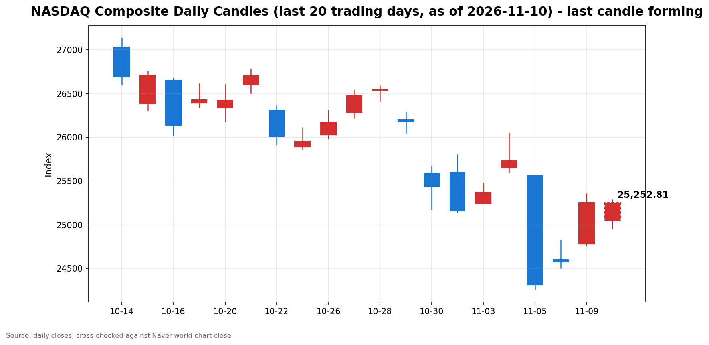

안녕하세요, [한국투자증권](https://securities.koreainvestment.com/main/Main.jsp)에서 [한투-한국투자증권](https://play.google.com/store/apps/details?id=com.truefriend.neosmartarenewal&hl=ko) 개발을 담당하고 있는 way입니다. 
2026년 11월 10일 나스닥 장 오픈 흐름을 수치 중심으로 정리합니다. 

## 개장 배경

전일인 11월 9일 미국 증시는 큰 폭으로 반등했습니다. 
나스닥 종합은 25,253.14로 전 거래일 대비 2.74% 올랐습니다. 
스탠더드앤드푸어스 500 지수는 7,549.94로 2.35% 올랐고, 다우존스 산업평균지수는 52,389.75로 2.15% 올랐습니다. 
지난주 폭락 이후 저가 매수세가 이어진 결과로 보입니다. 
화요일 장의 최대 변수는 오전 8시 30분에 발표된 10월 소비자물가지수였습니다. 
발표 직후 시장 분위기는 반전됐습니다. 
나스닥 100 선물은 1.2% 내렸고, 미국 2년물 국채수익률은 14bp 급등했습니다. 
아시아 증시는 소비자물가지수 발표 전에 거래를 마쳤습니다. 
일본 닛케이 225 지수는 2.87% 올랐고, 한국 코스피는 4.39% 올랐습니다. 
코스피에서는 외국인이 8거래일 만에 순매수로 돌아섰고, 코스피와 코스닥 시장에 매수 사이드카가 잇따라 발동됐습니다. 

## 오늘의 스냅샷

| 지수 | 현재가 | 전일 대비 | 등락률 | 전일 종가 | 장중 고가 | 장중 저가 | 스냅샷 기준 시각 |
| --- | --- | --- | --- | --- | --- | --- | --- |
| 나스닥 종합 | 25,218.28 | -34.86 | -0.14% | 25,253.14 | 25,223.72 | 24,958.31 | 미국 동부시간 2026-11-10 09:59, 한국시간 2026-11-10 23:59 |
| 스탠더드앤드푸어스 500 | 7,525.08 | -24.86 | -0.33% | 7,549.94 | 7,525.08 | 7,505.70 | 미국 동부시간 2026-11-10 09:59, 한국시간 2026-11-10 23:59 |
| 다우존스 산업평균지수 | 52,176.75 | -213.00 | -0.41% | 52,389.75 | 52,291.77 | 52,010.35 | 미국 동부시간 2026-11-10 10:00, 한국시간 2026-11-11 00:00 |

당일 수치는 형성 중인 수치로, 마감 전에는 계속 변합니다. 
나스닥 종합의 시가는 25,047.45였습니다. 
전일 종가와 비교하면 시가 기준으로는 0.81% 하락 출발했습니다. 
장중 저가는 24,958.31로 전일 대비 1.17%까지 밀렸다가, 09:59 기준 낙폭을 0.14%까지 되돌렸습니다. 
스탠더드앤드푸어스 500 지수의 시가는 7,513.09로 전일 대비 0.49% 하락 출발했습니다. 
다우존스 산업평균지수의 시가는 52,163.21로 전일 대비 0.43% 하락 출발했습니다. 
나스닥 종합과 다우존스 산업평균지수 값은 네이버 월드 차트 페이지에서 직접 확인했습니다. 
스탠더드앤드푸어스 500 지수 값은 한국투자증권 MTS 해외 대시보드에서 확인했습니다. 
한국투자증권 MTS 기준 같은 시각 나스닥 종합은 25,205.55로 네이버 값과 0.05% 이내에서 일치했습니다. 
스탠더드앤드푸어스 500 지수의 장중 고가와 저가는 한국투자증권 MTS 시계열의 최대값과 최소값으로 산출했습니다. 
한국투자증권 MTS 시계열은 표본 수가 적어, Yahoo Finance 기준 장중 고가는 7,543.57, 저가는 7,490.65로 더 넓게 나타났습니다. 
참고로 [네이버 월드 차트 나스닥 종합](https://finance.naver.com/world/sise.naver?symbol=NAS@IXIC)과 [네이버 월드 차트 나스닥 종합 가격](https://stock.naver.com/worldstock/index/.IXIC/price) 링크를 함께 둡니다. 

## 차트

최근 20거래일 일봉 차트입니다. 
빨간 봉은 종가가 시가보다 높은 날, 파란 봉은 종가가 시가보다 낮은 날입니다. 
당일 봉은 형성 중인 봉으로, 마감 전에는 계속 변합니다. 

## 원인·촉매 분석

표면적으로는 나스닥이 전일 대비 0.14% 하락 출발했습니다. 
근본 촉매는 오전 8시 30분에 발표된 10월 소비자물가지수입니다. 
10월 소비자물가지수는 전월 대비 0.4% 올랐습니다. 
변동성이 큰 식품과 에너지를 제외한 근원 소비자물가지수도 전월 대비 0.3% 올랐습니다. 
근원 소비자물가지수는 3개월 연속 0.3% 상승을 기록했습니다. 
시장 예상은 근원 기준 0.2% 수준이었습니다. 
9월 소비자물가지수의 전년 동월 대비 상승률은 3.7%였습니다. 
10월 전년 동월 대비 상승률은 작년 정부 셧다운의 여파로 발표되지 않았습니다. 
물가 상승률이 예상을 웃돌면서 연방준비제도의 12월 금리 인상 가능성이 커졌다는 해석이 나왔습니다. 
크리스토퍼 월러 연방준비제도 이사는 근원 소비자물가지수가 0.3% 이상을 또 기록하면 0.5%포인트 금리 인상도 검토해야 한다는 입장을 밝힌 바 있습니다. 
이번 발표는 그 기준에 부합하는 결과입니다. 
발표 직후 나스닥 100 선물은 1.2% 내렸고, 미국 2년물 국채수익률은 14bp 급등했습니다. 
금리 인상 경계가 커지면 성장주의 밸류에이션 부담이 커지는 것이 일반적인 경로입니다. 
그런데도 이날 나스닥의 낙폭은 스탠더드앤드푸어스 500 지수와 다우보다 작습니다. 
나스닥은 0.14% 내리는 데 그쳤고, 스탠더드앤드푸어스 500 지수는 0.33%, 다우는 0.41% 내렸습니다. 
시가 기준 0.81% 하락 출발에서 낙폭을 되돌렸다는 점도 눈에 띕니다. 
장중 저가에서 09:59 현재가까지 약 260포인트를 되돌렸습니다. 
소비자물가지수 충격을 장 초반 저가 매수세가 흡수하고 있는 흐름으로 읽힙니다. 
달러 흐름도 금리 경계 쪽을 가리킵니다. 
원·달러 환율은 한국투자증권 MTS 기준 1,344.00원으로 전일 대비 0.30% 올랐습니다. 
미국 10년물 국채수익률 수준은 이번 스냅샷에서 별도로 확인되지 않아 수치를 단정하지 않습니다. 
나스닥 선물은 한국투자증권 MTS 기준 27,771.00으로 전일 대비 0.87% 내렸습니다. 

## 핵심 사건 3가지

### 첫째, 10월 소비자물가지수 예상 상회와 12월 금리 인상 경계입니다

10월 소비자물가지수는 전월 대비 0.4% 올랐습니다. 
근원 소비자물가지수는 전월 대비 0.3% 올라 시장 예상 0.2%를 웃돌았습니다. 
근원 소비자물가지수의 0.3% 상승은 3개월 연속입니다. 
이 사건이 중요한 이유는 연방준비제도의 12월 결정이 다시 물가 지표에 묶였기 때문입니다. 
월러 이사가 언급한 0.5%포인트 인상 검토 기준이 이번 수치로 충족됐습니다. 
물가 재가속이라기보다는 끈적한 물가 흐름이 이어지고 있다는 해석이 나옵니다. 
다만 긴축 장기화 우려가 커지면 성장주 중심의 나스닥에 부담이 이어질 수 있습니다. 
12월 연방공개시장위원회까지 남은 물가 지표와 연준 위원들의 발언이 방향을 가를 변수입니다. 

### 둘째, 앤트로픽 기업공개와 인공지능 밸류에이션 눈높이 하향입니다

인공지능 기업 앤트로픽이 기업공개에 나섰습니다. 
공모와 사모 발행을 합쳐 최대 904억 달러를 조달한다는 계획입니다. 
공모가는 70달러에서 78달러 사이로 제시됐습니다. 
기업가치 목표는 보도마다 1조200억 달러에서 1조4,000억 달러 수준으로 엇갈립니다. 
당초 시장에서 거론되던 최대 2조 달러에는 못 미치는 수준입니다. 
기업가치 기대치가 낮아진 배경으로는 막대한 인공지능 인프라 투자 부담과 최근 기술주 변동성 확대가 꼽힙니다. 
이 사건이 중요한 이유는 인공지능 산업의 열기와 밸류에이션 피로가 동시에 드러나기 때문입니다. 
프런티어 인공지능 기업의 첫 상장이라는 상징성에도 불구하고, 시장은 가격에 까다로운 잣대를 들이대고 있습니다. 
인공지능 인프라 투자 부담이 기업가치 평가에 직접 반영되는 흐름은 반도체와 데이터센터 관련 섹터의 심리에도 영향을 줄 수 있습니다. 
다만 이는 개별 기업의 기업공개 조건에 대한 평가이지, 인공지능 수요 자체가 꺾였다는 증거는 아닙니다. 

### 셋째, 전일 급반등 이후 되돌림과 소비자물가지수 발표 전 아시아 강세의 시간차입니다

전일 나스닥은 2.74% 오르며 지난주 폭락분의 일부를 되돌렸습니다. 
스탠더드앤드푸어스 500 지수도 2.35%, 다우도 2.15% 올랐습니다. 
화요일 장은 그 반등분을 일부 되돌리며 출발했습니다. 
아시아 증시는 소비자물가지수 발표 전에 거래를 마쳐 강세를 유지했습니다. 
일본 닛케이 225 지수는 2.87% 올랐고, 한국 코스피는 4.39% 올랐습니다. 
코스피에서는 외국인이 8거래일 만에 순매수로 돌아섰고, 코스피와 코스닥 시장에 매수 사이드카가 잇따라 발동됐습니다. 
이 사건이 중요한 이유는 같은 날의 강세와 약세가 시간차 때문이지 방향이 엇갈린 것이 아니기 때문입니다. 
아시아 증시의 강세는 소비자물가지수 발표 이전의 위험 선호를 반영합니다. 
미국 장이 소비자물가지수를 소화한 뒤 아시아 강세와 같은 방향으로 이어질지, 아니면 금리 경계가 우위를 점할지는 장 후반 흐름에서 확인될 사안입니다. 

## 지수·섹터 영향 체인

금리 인상 경계는 성장주 밸류에이션을 통해 기술주에 가장 먼저 작용하는 것이 일반적입니다. 
그런데 이날은 나스닥의 낙폭이 가장 작습니다. 
이는 소비자물가지수 충격이 기술주만의 재료가 아니라 시장 전반의 금리 재료로 인식되고 있음을 보여줍니다. 
다우가 0.41%로 가장 많이 내린 점도 같은 맥락입니다. 
다우는 경기민감주와 금융·산업재 비중이 높아, 금리 인상 경계와 경기 둔화 우려에 직접 노출되는 구조입니다. 
스탠더드앤드푸어스 500 지수가 0.33% 내린 것은 하락이 특정 섹터에 국한되지 않고 시장 전반으로 번졌음을 보여줍니다. 
반도체와 인공지능 인프라 체인에는 앤트로픽 기업공개가 별도의 심리 변수로 작용합니다. 
기업가치 눈높이 하향은 인공지능 투자 회수 기간에 대한 시장의 의문을 반영합니다. 
다만 이날 지수 낙폭만으로는 특정 섹터의 자금 이탈을 단정할 수 없습니다. 
에너지 섹터의 방향은 유가 수치가 이번 스냅샷에서 확인되지 않아 단정하지 않습니다. 
금융 섹터는 금리 인상 기대가 순이자마진에는 우호적일 수 있으나, 경기 둔화 우려와 맞물려 방향이 엇갈릴 수 있습니다. 
결국 이날의 차별화는 섹터별 실적이 아니라 금리 경로에 대한 재가격이 만든 것입니다. 

## 다우·S&P500 흐름

다우존스 산업평균지수는 52,176.75로 전일 대비 213.00포인트, 0.41% 내렸습니다. 
장중 고가는 52,291.77, 저가는 52,010.35였습니다. 
스탠더드앤드푸어스 500 지수는 7,525.08로 전일 대비 24.86포인트, 0.33% 내렸습니다. 
두 지수 모두 나스닥보다 낙폭이 큽니다. 
세 지수가 동반 하락하고 있다는 점은 이날 약세가 기술주에만 머물지 않음을 보여줍니다. 
다만 나스닥이 시가 대비 낙폭을 크게 되돌렸다는 점은, 장 초반 저가 매수세가 기술주 쪽에서 먼저 들어오고 있음을 시사합니다. 
다우와 스탠더드앤드푸어스 500 지수의 낙폭이 장 후반에 좁혀지는지가 확인할 지점입니다. 

## 단기·중기 전망과 장 초반 확인할 시나리오

단기적으로는 소비자물가지수 충격이 일회성 되돌림인지, 금리 재가격의 시작인지가 갈림길입니다. 
장 초반에 확인할 첫 번째 수치는 나스닥의 전일 종가 25,253.14 회복 여부입니다. 
09:59 기준 나스닥은 전일 종가보다 34.86포인트 아래에 있습니다. 
두 번째로 확인할 구간은 장중 저가 24,958.31과 25,000선입니다. 
저가가 다시 테스트되면 25,000선 지지 여부가 단기 방향을 가를 수 있습니다. 
스탠더드앤드푸어스 500 지수는 7,500선, 다우는 52,000선 안착 여부를 확인할 필요가 있습니다. 
다우의 장중 저가 52,010.35는 52,000선에 바짝 다가선 수준입니다. 
낙폭이 되돌려지는 흐름이 이어지면 전일 종가 회복을 시도하는 시나리오가 힘을 얻습니다. 
반대로 금리 인상 경계가 확산되면 25,000선 테스트로 이어지는 시나리오를 염두에 둘 필요가 있습니다. 
중기적으로는 12월 연방공개시장위원회까지 물가 지표와 연준 위원들의 발언이 방향을 정합니다. 
물가 상승률이 꺾이는 신호가 나오면 금리 부담이 완화되는 방향으로 해석될 수 있습니다. 
물가가 끈적하게 이어지면 금리 인상 기대가 유지되면서 변동성이 이어질 수 있습니다. 
이번 주 남은 거시지표와 연준 위원들의 발언도 함께 확인할 사안입니다. 
이 글은 지수와 섹터 단위의 흐름을 정리한 것으로, 특정 종목의 매수나 매도를 권유하지 않습니다. 

## 마치며

10월 소비자물가지수 예상 상회에 나스닥은 하락 출발했으나, 장 초반 저가 매수세가 낙폭을 되돌리고 있습니다. 
금리 경로를 둘러싼 불확실성이 커진 만큼, 전일 종가 회복 여부와 25,000선 지지 여부를 장 초반에 확인할 필요가 있습니다. 
이 글은 매수나 매도를 권유하지 않습니다. 
