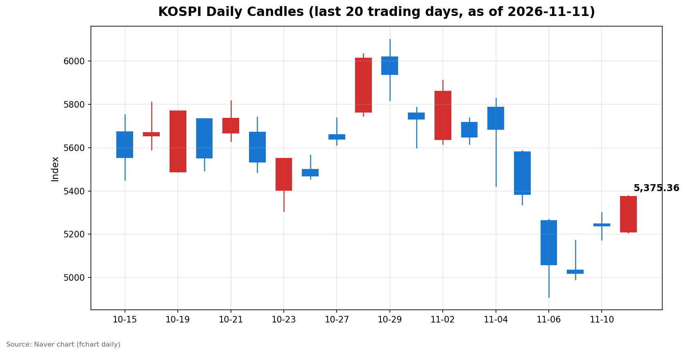
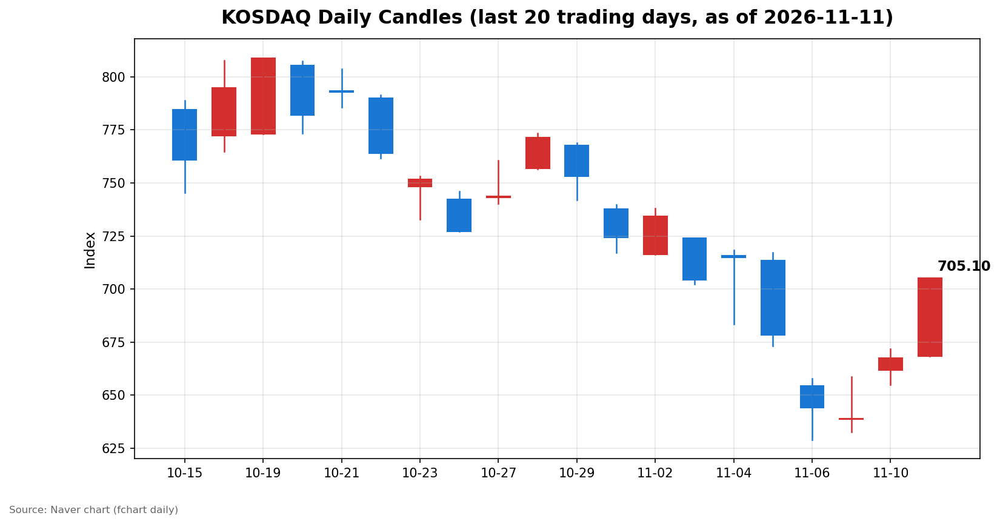

안녕하세요, [한국투자증권](https://securities.koreainvestment.com/main/Main.jsp)에서 [한투-한국투자증권](https://play.google.com/store/apps/details?id=com.truefriend.neosmartarenewal&hl=ko) 개발을 담당하고 있는 way입니다. 
오늘 국내 증시는 미국 물가 충격에도 양 시장이 함께 오르며 이틀 연속 강한 반등으로 마감했습니다. 

## 마감 요약

코스피는 전일 대비 136.23포인트(2.60%) 상승한 5,375.36에 마감했습니다. 
코스닥은 전일 대비 37.49포인트(5.62%) 상승한 705.10에 마감했습니다. 
코스피는 장중 5,377.99까지 올랐고, 종가는 고점과 불과 2.63포인트 차이로 장 막판까지 상승 탄력을 유지했습니다. 
코스닥은 장중 고점인 705.10에서 그대로 마감했고, 오전 11시 28분에는 매수 사이드카가 발동됐습니다. 
지난주 금요일 서킷브레이커 이후 저점에서 코스피는 이틀 만에 6.24%, 코스닥은 9.44% 되돌린 셈입니다. 
간밤 미국 증시가 하락했음에도 국내 증시가 오른 점이 오늘 장의 가장 큰 특징입니다. 

## 오늘의 마감 스냅샷

| 지수 | 종가 | 전일 대비 | 등락률 | 시가 | 고가 | 저가 | 거래량 | 거래대금 |
| --- | --- | --- | --- | --- | --- | --- | --- | --- |
| 코스피 | 5,375.36 | +136.23 | +2.60% | 5,209.71 | 5,377.99 | 5,207.44 | 2억 1,883만 주 | 16조 2,981억 원 |
| 코스닥 | 705.10 | +37.49 | +5.62% | 668.48 | 705.10 | 668.48 | 3억 8,499만 주 | 5조 2,947억 원 |

스냅샷 기준은 2026년 11월 11일 장 마감 수치이며, 전일 종가는 네이버 실시간 데이터 역산값으로 교차 검증했습니다. 
코스피 전일 종가 5,239.13, 코스닥 전일 종가 667.61이 일봉 데이터와 일치했습니다. 
원/달러 환율은 1,333.6원으로 전일 대비 3.9원 하락하며 원화 강세를 보였습니다. 
출처: [코스피](https://finance.naver.com/sise/sise_index.naver?code=KOSPI), [코스닥](https://finance.naver.com/sise/sise_index.naver?code=KOSDAQ) 

## 차트

최근 20거래일 일봉 차트입니다. 
빨간 봉은 종가가 시가보다 높은 날, 파란 봉은 종가가 시가보다 낮은 날입니다. 

## 원인·촉매 분석

오늘 상승의 첫 번째 촉매는 낙폭 과대에 따른 반발 매수였습니다. 
코스피는 지난주 목요일과 금요일 이틀 동안 5%대 급락을 겪었고, 금요일에는 서킷브레이커까지 발동했습니다. 
월요일 5,000선 턱걸이 마감 이후 화요일 4.39% 반등에 이어 오늘 2.60% 추가 상승이 나왔고, 저점 대비 되돌림이 이틀 연속 이어진 흐름입니다. 
단기 낙폭이 컸던 만큼 저가 매수 심리가 살아나기 쉬운 구간이었고, 지수가 장중 고점 부근에서 마감한 점은 매수 심리가 오후까지 꺾이지 않았음을 보여줍니다. 
두 번째 촉매는 외국인 수급의 전환입니다. 
코스피에서 외국인은 6,553억 원을 순매수하며 전일에 이어 매수 우위를 이어갔습니다. 
지난주 하루 3조 원 넘게 팔아치우던 주체가 이틀 연속 매수로 돌아선 점은 하락 국면의 수급 구도가 바뀌고 있다는 신호입니다. 
개인이 코스피에서 7,156억 원을 순매도한 것은 반등 국면의 차익 실현 성격으로 해석됩니다. 
기관도 코스피에서 4,823억 원을 순매도했는데, 금융투자가 5,214억 원을 팔며 기관 매도를 주도했습니다. 
코스닥에서는 정반대의 구도가 나타났습니다. 
기관이 3,136억 원을 순매수하며 지수 상승을 견인했고, 외국인과 개인은 각각 1,334억 원과 1,857억 원을 순매도했습니다. 
코스피는 외국인이, 코스닥은 기관이 상승을 이끈 시장별 수급 분화가 오늘 장의 특징입니다. 
세 번째 요인은 환율 안정입니다. 
원/달러 환율이 1,333.6원으로 전일 대비 3.9원 하락하며 원화 강세를 보였고, 환율 부담이 완화된 점은 외국인의 국내 증시 매수에 우호적인 환경으로 작용했습니다. 
미국 10년물 금리가 5%를 돌파했다는 소식에도 국내 증시가 오른 점은 주목할 만합니다. 
금리 상승이 성장주 밸류에이션에 부담이 되는 요인임에도 지수가 오른 것은, 금리 부담보다 낙폭 과대 반발과 수급 전환의 힘이 더 크게 작용했기 때문입니다. 
다만 금리 상승 국면이 길어지면 반도체 중심의 국내 지수 구조상 상승 탄력이 제한될 수 있다는 점은 염두에 둘 필요가 있습니다. 

## 핵심 사건 3가지

### 1. 미국 10월 소비자물가지수 예상 상회와 연준 빅스텝 우려 부각

미국 10월 소비자물가지수가 시장 예상을 웃돌면서 연준의 12월 금리 인상 가능성이 다시 부각됐습니다. 
월러 연준 이사는 인플레이션이 높게 유지된다면 12월에 0.5%포인트 금리 인상도 정당화할 수 있다고 밝혔습니다. 
미국 10년물 국채 금리는 5%를 돌파했고, 간밤 나스닥은 0.74% 하락한 25,065.87에 마감했습니다. 
미국 증시가 하락했음에도 국내 증시가 상승한 것은 미국발 악재를 국내 시장이 이미 지난주 급락 과정에서 상당 부분 반영했다는 해석이 가능합니다. 
국내 증시 입장에서는 CPI 결과보다 미국 증시의 추가 반응과 환율 움직임이 내일 장 초반 외국인 수급으로 이어지는 연결고리가 됩니다. 
CPI 발표 이후의 미국 증시 반응과 환율 움직임이 내일 확인할 첫 번째 수치입니다. 

### 2. 코스닥 매수 사이드카 발동과 700선 회복

코스닥은 오전 11시 28분 매수 사이드카가 발동될 만큼 강한 상승세를 보였습니다. 
매수 사이드카는 프로그램 매수호가의 효력을 일시 정지하는 장치로, 급등 국면에서 시장의 과열을 식히는 역할을 합니다. 
코스닥이 700선을 회복한 것은 지난주 644.27까지 밀렸던 지수가 이틀 만에 60포인트 넘게 되돌린 결과입니다. 
기관이 코스닥에서 3,136억 원을 순매수하며 상승을 주도한 점도 눈에 띕니다. 
다만 장중에는 금융감독원이 오후에 코스닥 부양책 관련 간담회를 연다는 소문이 확산됐고, 금감원은 사실이 아니라고 선을 그었습니다. 
부양책 기대감이 장중 상승의 일부를 자극했을 가능성은 있으나, 소문 자체는 사실이 아닌 것으로 확인됐으므로 원인으로 단정하지 않습니다. 
소문에 흔들리는 변동성이 큰 구간에서는 확인되지 않은 정보를 근거로 삼지 않는 것이 중요합니다. 

### 3. 엔비디아 급락에도 국내 반도체 밸류체인 강세

엔비디아는 젠슨 황 최고경영자(CEO)의 스캔들 여파로 이틀 연속 급락했고, 미국 의회에서는 AI칩의 대중 수출 전면 봉쇄를 요구하는 압박이 커지고 있습니다. 
SK하이닉스가 엔비디아에 HBM을 절반 이상 공급하는 구조인 만큼, 대중 수출 규제 강화 시 중국 다롄 공장 확대 전략에 차질이 빚어질 수 있다는 지적도 나왔습니다. 
그럼에도 국내 반도체 밸류체인은 오늘 강하게 올랐습니다. 
HBM 테마가 10.61%, 3D낸드가 10.68%, CXL이 11.51% 올랐고, 반도체/반도체장비 테마도 8.97% 상승했습니다. 
미국발 악재와 국내 반도체 강세가 동시에 나타난 것은 국내 시장이 엔비디아 개별 이슈보다 AI 메모리 수요라는 구조적 흐름에 더 무게를 두고 있다는 신호로 읽힙니다. 
다만 미 의회의 수출통제 압박이 실제 법안으로 이어질 경우 국내 반도체 밸류체인에도 파장이 미칠 수 있으므로, 관련 논의의 진행 상황은 계속 확인할 필요가 있습니다. 

## 섹터·테마 영향 체인

오늘 장의 중심축은 반도체와 그 주변 밸류체인이었습니다. 
HBM, 3D낸드, CXL, 반도체재료, 시스템반도체, 유리기판, MLCC, 온디바이스AI까지 반도체와 직접 연결된 테마가 8%에서 11% 넘게 올랐습니다. 
반도체 테마의 상승이 PCB와 유리기판, MLCC 같은 부품·소재 테마로 번진 것은 밸류체인 전반으로 매수세가 확산됐다는 뜻입니다. 
기판 관련 종목의 강세도 이어졌습니다. 
코리아써키트는 27.03% 급등하며 87,400원에 마감했고, PCB 테마 전체가 10.61% 올랐습니다. 
지난주 급락 국면에서 기판 종목이 시장보다 더 크게 빠졌던 만큼, 반등 국면에서는 낙폭이 컸던 쪽으로 매수세가 먼저 들어오는 패턴이 반복되고 있습니다. 
금리 상승은 성장주 밸류에이션에 부담이 되는 요인이나, 오늘은 반도체의 구조적 수요 기대가 금리 부담을 앞질렀습니다. 
반대로 금리 민감도가 높은 쪽과 내수·방어주는 상대적으로 상승 탄력이 제한되는 구조가 이어질 수 있습니다. 
코스닥의 5.62% 급등은 대형주보다 중소형 성장주 쪽으로 매수세가 넓게 퍼졌다는 뜻이며, 기관 매수가 이를 뒷받침했습니다. 
오늘의 테마 흐름은 반도체 중심의 상승이 지수 전반으로 확산되는 단계로, 특정 테마에만 머무르지 않고 밸류체인 전체로 번졌다는 점이 특징입니다. 

## 최근 5거래일 일봉

| 날짜 | 지수 | 시가 | 고가 | 저가 | 종가 | 거래량(천 주) |
| --- | --- | --- | --- | --- | --- | --- |
| 2026-11-05 | 코스피 | 5,580.09 | 5,586.46 | 5,336.88 | 5,383.80 | 277,253 |
| 2026-11-06 | 코스피 | 5,263.26 | 5,269.10 | 4,911.28 | 5,059.69 | 323,267 |
| 2026-11-09 | 코스피 | 5,034.20 | 5,172.94 | 4,990.66 | 5,018.85 | 248,140 |
| 2026-11-10 | 코스피 | 5,247.22 | 5,300.92 | 5,174.55 | 5,239.13 | 253,917 |
| 2026-11-11 | 코스피 | 5,209.71 | 5,377.99 | 5,207.44 | 5,375.36 | 218,829 |
| 2026-11-05 | 코스닥 | 713.49 | 717.06 | 673.38 | 678.41 | 434,307 |
| 2026-11-06 | 코스닥 | 654.43 | 657.95 | 629.17 | 644.27 | 443,709 |
| 2026-11-09 | 코스닥 | 638.82 | 658.66 | 632.70 | 638.97 | 358,495 |
| 2026-11-10 | 코스닥 | 661.73 | 671.91 | 655.09 | 667.61 | 402,110 |
| 2026-11-11 | 코스닥 | 668.48 | 705.10 | 668.48 | 705.10 | 384,991 |

## 당일 수급

코스피에서는 외국인이 6,553억 원을 순매수했고, 개인이 7,156억 원을 순매도했으며, 기관이 4,823억 원을 순매도했습니다. 
기타법인은 5,426억 원을 순매수했습니다. 
외국인 매수는 지난주 대규모 매도와 정반대의 방향이며, 하락을 주도했던 주체가 매수로 돌아섰다는 점에서 의미가 있습니다. 
기관 매도의 내역을 보면 금융투자가 5,214억 원을 순매도했고 연기금이 990억 원을 순매도한 반면, 투신은 753억 원, 사모는 386억 원, 보험은 190억 원을 순매수했습니다. 
기관 내부에서도 금융투자와 연기금이 파는 쪽에, 투신과 사모가 사는 쪽에 서는 분화가 나타났습니다. 
개인의 순매도는 반등 국면의 차익 실현 성격으로 보이며, 급락장에서 저가 매수에 나섰던 개인이 반등일에 매도로 돌아선 것은 단기 심리가 아직 완전히 회복되지 않았음을 보여줍니다. 
코스닥에서는 기관이 3,136억 원을 순매수했고, 외국인이 1,334억 원, 개인이 1,857억 원을 순매도했습니다. 
코스닥 기관 매수의 내역은 투신 1,431억 원, 사모 607억 원, 연기금 506억 원, 금융투자 430억 원 순으로, 기관 세부 주체가 고르게 매수에 나선 점이 특징입니다. 
코스피는 외국인이, 코스닥은 기관이 상승을 이끈 만큼, 내일도 시장별 주도 수급 주체가 유지되는지 확인하는 것이 중요합니다. 
수급 수치는 네이버 시장동향 API 기준 당일 수치이며, 최종 확정값과 다를 수 있습니다. 

## 강했던 테마와 흐름

오늘 가장 강했던 테마는 CXL로 11.51% 올랐고, 3D낸드 10.68%, HBM 10.61%, PCB 10.61%가 뒤를 이었습니다. 
반도체/반도체장비 테마는 8.97%, 반도체재료는 8.76%, 시스템반도체는 8.33%, 유리기판은 8.24%, MLCC는 8.11%, 온디바이스AI는 8.02% 올랐습니다. 
상위 테마 10개가 모두 8% 넘게 오른 것은 특정 테마의 강세가 아니라 반도체 밸류체인 전반의 강세였다는 뜻입니다. 
각 테마 안에서 상승 종목 수가 하락 종목 수를 압도했고, CXL과 3D낸드, HBM 테마는 구성 종목 전부가 올랐습니다. 
코스닥이 코스피보다 더 크게 오른 점도 중소형 반도체·부품주까지 매수세가 확산됐음을 보여줍니다. 
테마 등락률은 한투 MTS 기준 당일 수치입니다. 

## 단기·중기 전망과 내일 확인할 시나리오

단기적으로는 반등의 지속 여부를 가르는 구간에 들어섰습니다. 
코스피는 5,377.99까지 올랐고 5,400선이 다음 저항 구간으로 보입니다. 
5,400선을 넘기 위해서는 외국인의 코스피 순매수가 이어지고 미국 증시의 추가 하락이 멈춰야 합니다. 
아래쪽에서는 전일 종가인 5,239선과 5,200선이 첫 번째 지지 구간으로 보입니다. 
이 구간을 지키면 반등 흐름이 유지되는 것으로 볼 수 있고, 이탈하면 반등이 일시적 되돌림에 그쳤을 가능성이 커집니다. 
코스닥은 700선 안착 여부가 관건입니다. 
오늘 종가가 장중 고점과 같은 705.10인 만큼, 내일 700선을 지키는지, 기관의 순매수가 이어지는지가 확인할 수치입니다. 
700선을 지키지 못하면 오늘의 급등이 과열에 따른 되돌림이었을 가능성이 커집니다. 
중기적으로는 두 가지 흐름을 함께 봐야 합니다. 
첫째, 연준의 금리 경로입니다. 
미국 10년물 금리가 5%를 돌파한 상황에서 12월 금리 인상 확률이 어떻게 움직이는지가 반도체를 비롯한 성장주 밸류에이션에 영향을 줍니다. 
둘째, 미 의회의 AI칩 수출통제 논의입니다. 
법안으로 이어질 경우 국내 반도체 밸류체인의 대중 사업에 파장이 미칠 수 있으므로, 관련 논의의 진행 상황을 지켜봐야 합니다. 
확인할 시나리오는 세 가지입니다. 
미국 증시가 CPI 충격에서 벗어나 반등하는지, 외국인의 코스피 순매수가 3거래일 연속 이어지는지, 원/달러 환율이 1,330원대에서 안정되는지입니다. 
세 가지 중 두 가지 이상이 확인되면 반등 지속 쪽에 무게를 둘 수 있고, 반대라면 반등이 일시적 노이즈였을 가능성을 열어둬야 합니다. 
이 글은 교육·해설 목적의 시장 정리이며, 특정 종목의 매수나 매도를 권유하지 않습니다. 

## 마치며

오늘 국내 증시는 미국 물가 충격에도 낙폭 과대 반발과 수급 전환에 힘입어 이틀 연속 강한 반등으로 마감했습니다. 
내일은 5,400선과 700선 안착 여부, 그리고 미국 증시와 환율의 움직임이 반등의 지속 여부를 가를 것입니다. 
