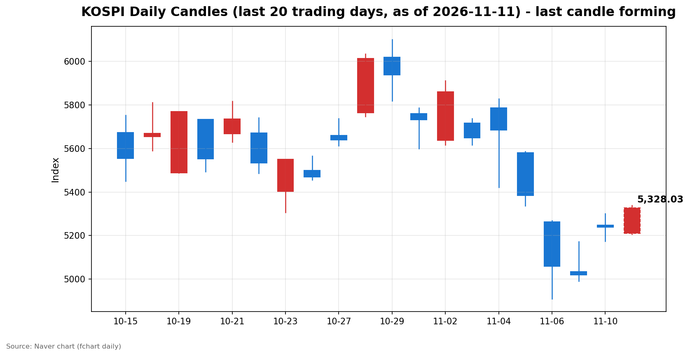
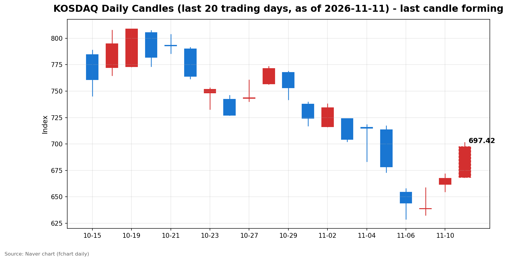

안녕하세요, [한국투자증권](https://securities.koreainvestment.com/main/Main.jsp)에서 [한투-한국투자증권](https://play.google.com/store/apps/details?id=com.truefriend.neosmartarenewal&hl=ko) 개발을 담당하고 있는 way입니다. 
오늘 오전 국내 증시는 간밤 미국 물가 경계감에 약세로 출발한 뒤 강한 반등으로 돌아섰습니다. 

## 오전장 요약

코스피는 전일 대비 0.56% 내린 5,209.71에 출발한 뒤 장중 저가 5,207.44를 찍고 방향을 바꿨습니다. 
이후 상승폭을 키우며 장중 고가 5,338.76까지 올랐고, 정오 무렵에는 5,329.32로 전일 대비 1.72% 상승한 수준에서 거래되고 있습니다. 
코스닥은 668.48로 소폭 상승 출발한 뒤 장중 내내 오름폭을 확대했습니다. 
장중 고가는 701.54로 700선을 넘어섰고, 정오 무렵에는 697.69로 전일 대비 4.51% 상승한 수준에서 거래되고 있습니다. 
코스닥 시장에서는 전날에 이어 오늘도 매수 사이드카가 발동됐습니다. 

## 오늘의 스냅샷

| 지수 | 현재가 | 전일 대비 | 등락률 | 시가 | 고가 | 저가 | 거래량 | 거래대금 |
| --- | --- | --- | --- | --- | --- | --- | --- | --- |
| 코스피 | 5,329.32 | +90.19 | +1.72% | 5,209.71 | 5,338.76 | 5,207.44 | 132,547천주 | 8조 9,258억 원 |
| 코스닥 | 697.69 | +30.08 | +4.51% | 668.48 | 701.54 | 668.48 | 263,031천주 | 3조 4,478억 원 |

스냅샷 기준 시각은 2026년 11월 11일 12시 27분(KST)입니다. 
당일 봉은 형성 중인 봉으로, 종가는 마감 전에는 계속 변합니다. 
전일 종가는 네이버 실시간 데이터에서 역산한 값으로 교차 검증했습니다. 
코스피 전일 종가는 5,239.13, 코스닥 전일 종가는 667.61입니다. 
지수별 차트는 [코스피](https://finance.naver.com/sise/sise_index.naver?code=KOSPI)와 [코스닥](https://finance.naver.com/sise/sise_index.naver?code=KOSDAQ)에서 확인할 수 있습니다. 

## 차트

최근 20거래일 일봉 차트입니다. 
빨간 봉은 종가가 시가보다 높은 날, 파란 봉은 종가가 시가보다 낮은 날입니다. 
당일 봉은 형성 중인 봉으로, 마감 전에는 계속 변합니다. 

## 원인·촉매 분석

오늘 오전 장의 출발점은 간밤 미국 물가 지표였습니다. 
미국 10월 소비자물가지수는 전월 대비 0.4% 상승해 예상치 0.3%를 웃돌았고, 근원 지수도 0.3% 상승해 예상치 0.2%를 상회했습니다. 
연준 인사가 12월 50bp 인상 검토 가능성까지 언급하면서 금리 인상 경계감이 커졌고, 뉴욕증시는 3대 지수가 일제히 하락했습니다. 
이 여파로 코스피는 약세 출발했으나, 하락은 장 초반 저가 부근에서 멈췄습니다. 
반등의 바탕에는 전일 수급 구도가 있습니다. 
전일 코스피에서는 개인이 1조 3,947억 원을 순매도한 반면 외국인이 4,439억 원, 기관이 4,642억 원, 기타법인이 4,867억 원을 순매수했습니다. 
개인의 매도 물량을 외국인과 기관이 나눠 받아낸 구도로, 낙폭이 깊어지기 어려운 수급 구조였습니다. 
코스닥에서도 전일 기관이 2,147억 원을 순매수하며 받침이 됐습니다. 
여기에 반도체 수출 급증이라는 국내 펀더멘털 재료가 더해지면서 반등의 촉매가 됐습니다. 
결국 오늘 오전 흐름은 외부 금리 경계감에 눌렸다가 국내 수급과 수출 재료가 이를 되돌린 형태로 볼 수 있습니다. 

## 핵심 사건 3가지

### 1. 미국 10월 CPI 예상 상회, 연준 빅스텝 경계 확산

미국 노동부가 발표한 10월 소비자물가지수는 전월 대비 0.4% 상승해 예상치 0.3%를 웃돌았습니다. 
근원 지수도 전월 대비 0.3% 상승해 예상치 0.2%를 상회했습니다. 
크리스토퍼 월러 연준 이사는 근원 물가가 높은 수준을 유지하면 12월 회의에서 50bp 인상을 검토해야 한다는 입장을 밝혔습니다. 
이에 뉴욕증시는 10일 현지 시간 기준 다우 0.30%, S&P500 0.38%, 나스닥 0.74% 하락 마감했습니다. 
나스닥 종가는 25,065.87이었습니다. 
시장이 반영한 12월 금리 인상 확률은 100%에 달했습니다. 
이 사건이 중요한 이유는 금리 경로에 대한 불확실성이 다시 커졌기 때문입니다. 
인상 폭이 커지면 성장주 밸류에이션 부담이 커지고, 달러 강세 압력도 커질 수 있습니다. 
국내 증시가 약세로 출발한 직접적인 배경이 됐습니다. 

### 2. 코스닥 매수 사이드카 이틀 연속 발동, 700선 회복 시도

코스닥 시장에서는 전날에 이어 오늘도 매수 사이드카가 발동됐습니다. 
코스닥 지수는 668.48로 출발해 상승폭을 키우다 장중 701.54까지 올라 700선을 넘어섰습니다. 
정오 무렵에는 697.69로 700선 바로 아래에서 거래되고 있습니다. 
사이드카는 프로그램 매매 호가의 효력을 일시 정지하는 장치로, 급등 국면에서 변동성을 완화하는 역할을 합니다. 
이틀 연속 발동은 코스닥으로의 자금 유입 속도가 그만큼 빠르다는 신호로 읽힙니다. 
다만 사이드카 발동 자체가 추가 상승을 보장하는 것은 아닙니다. 
종가 기준으로 700선에 안착하는지가 오후의 관전 포인트입니다. 

### 3. 반도체 수출 급증, 연간 수출 1조 달러 돌파 임박

올해 누적 수출액은 11월 11일 기준으로 9,637억 달러에 달했습니다. 
현재 추세가 이어지면 11월 20일 전후로 연간 수출액이 사상 처음 1조 달러를 돌파할 것으로 예상됩니다. 
이 흐름의 중심에는 반도체 수출 급증이 있습니다. 
인공지능과 데이터센터 확충에 따른 반도체 수요가 수출 증가를 이끌고 있습니다. 
이 사건은 오늘 오전 반등의 국내 측 촉매로 작용했습니다. 
미국 금리 경계감이라는 외부 악재에도 반도체를 중심으로 한 수출 펀더멘털이 시장의 하단을 받쳤기 때문입니다. 
다만 수출 증가가 반도체에 쏠려 있어, 인공지능 수요가 꺾일 경우 수출 증가세가 이어지기 어렵다는 구조적 약점도 함께 지적되고 있습니다. 

## 섹터·테마 영향 체인

오늘 오전의 흐름은 반도체 밸류체인을 중심으로 퍼졌습니다. 
한국투자증권 MTS의 12시 시장 브리핑은 AI 서버 기판 강세와 HBM 소부장 수급 확산을 오늘 시장의 특징으로 꼽았습니다. 
D램과 HBM, 반도체 부품과 소재, 장비로 이어지는 테마가 강세를 보였습니다. 
기판 관련 종목이 두드러진 강세를 보였고, HBM 소부장 종목들도 큰 폭으로 올랐습니다. 
연결고리는 반도체 수출과 실적 기대감입니다. 
인공지능 수요가 반도체 수출로 확인되고, 수출 증가가 실적 기대로 이어지며, 실적 기대가 기판과 소부장 같은 후방 밸류체인으로 확산되는 구조입니다. 
반면 금리 인상 경계감은 성장주 전반의 밸류에이션에 부담 요인으로 작용했습니다. 
코스피 대형주가 엇갈린 움직임을 보인 점이 이를 보여줍니다. 
금리 경로에 민감한 성장주는 경계감이 커질 때 조정을 받기 쉽고, 실적이 확인된 반도체 밸류체인은 상대적으로 버티는 구도가 됐습니다. 
한편 10월 청년 취업자가 19만 6,000명 감소해 48개월 연속 감소세를 이어갔다는 고용 지표도 나왔습니다. 
제조업 취업자도 7,000명 줄며 한 달 만에 감소세로 돌아섰습니다. 
고용 둔화는 내수 관련 섹터에는 부담 요인으로 작용할 수 있습니다. 
오늘 오전 장에서는 반도체 중심의 수출 테마가 강세를 주도했고, 내수 둔화 재료는 상대적으로 뒤로 밀렸습니다. 

## 최근 5거래일 일봉

| 날짜 | 코스피 종가 | 코스피 시가 | 코스피 고가 | 코스피 저가 | 코스닥 종가 |
| --- | --- | --- | --- | --- | --- |
| 2026-11-04 | 5,683.80 | 5,786.13 | 5,828.13 | 5,421.72 | 714.95 |
| 2026-11-05 | 5,383.80 | 5,580.09 | 5,586.46 | 5,336.88 | 678.41 |
| 2026-11-06 | 5,059.69 | 5,263.26 | 5,269.10 | 4,911.28 | 644.27 |
| 2026-11-09 | 5,018.85 | 5,034.20 | 5,172.94 | 4,990.66 | 638.97 |
| 2026-11-10 | 5,239.13 | 5,247.22 | 5,300.92 | 5,174.55 | 667.61 |

11월 6일 급락 이후 11월 9일 5,018.85까지 밀렸던 코스피는 11월 10일 4.39% 반등했고, 오늘 오전에도 상승세를 이어가고 있습니다. 
코스닥도 11월 9일 638.97에서 저점을 확인한 뒤 이틀 연속 큰 폭으로 오르고 있습니다. 
당일 봉은 형성 중이며, 위 표에는 확정된 종가만 실었습니다. 

## 오전 강했던 테마와 흐름 변화

시가 대비 방향 전환이 오늘 오전의 가장 큰 특징입니다. 
코스피는 시가 5,209.71로 전일 대비 0.56% 내린 채 출발했으나, 장중 저가 5,207.44를 바닥으로 삼아 상승으로 전환했습니다. 
코스닥은 시가 668.48로 소폭 상승 출발한 뒤 장중 내내 오름폭을 확대했습니다. 
한국투자증권 MTS의 12시 시장 브리핑이 꼽은 오전 강세 테마는 AI 서버 기판과 D램, HBM, 반도체 부품, 소재, 장비입니다. 
3분기 실적 호조와 대규모 시설 투자 결정이 이어지면서 테마 전반의 성장 기대감이 높아졌다는 설명입니다. 
이들 테마의 강세는 반도체 수출 급증이라는 재료와 맞물려 있습니다. 
반면 미국 물가 경계감이 커진 만큼, 금리 경로에 민감한 성장주는 오후에도 변동성이 클 수 있습니다. 

## 오후 전망과 확인할 시나리오

오전의 반등은 전일 수급과 반도체 수출이라는 확인된 재료에 기반하고 있습니다. 
다만 간밤 CPI발 금리 경계감이 완전히 해소된 것은 아니므로, 오후 흐름을 일시적 노이즈로 단정할 수는 없습니다. 
오후에 확인할 첫 번째 수치는 지수 레벨입니다. 
코스피는 5,300선 안착 여부와 장중 고가 5,338.76 돌파 여부가 관건입니다. 
코스닥은 종가 기준 700선 안착 여부가 관건입니다. 
두 번째로 확인할 것은 수급 방향입니다. 
장중 수급 확정치는 아직 나오지 않았으며, 외국인 매수세가 오후에도 이어지는지는 마감 후 수급에서 확인해야 합니다. 
세 번째로 확인할 것은 외부 변수입니다. 
달러/원 환율 움직임과 미국 국채금리, 연준 인사의 추가 발언이 오후 심리에 영향을 줄 수 있습니다. 
리스크 관리 관점에서는 단기 급등 이후 변동성 확대 가능성에 유의할 필요가 있습니다. 
코스닥이 이틀 연속 매수 사이드카를 발동할 만큼 빠르게 오른 만큼, 오후에는 차익 매물이 나올 수 있는 구간입니다. 

## 마치며

오늘 오전 국내 증시는 약세 출발 뒤 강한 반등으로 전환됐습니다. 
오후에는 5,300선과 700선 안착 여부, 그리고 수급 방향을 확인하며 변동성에 유의할 필요가 있습니다. 
본 글은 교육과 해설 목적의 시장 정리이며, 특정 종목의 매수나 매도 권유가 아닙니다. 
