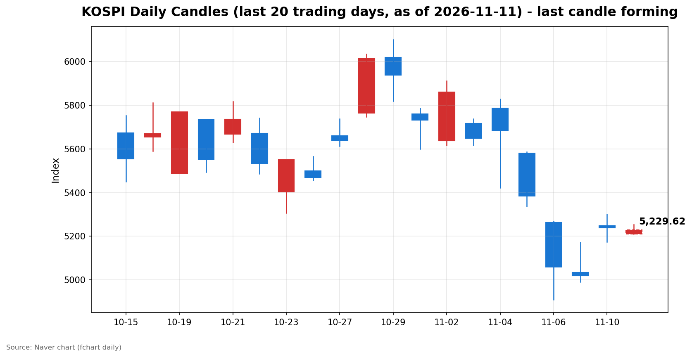
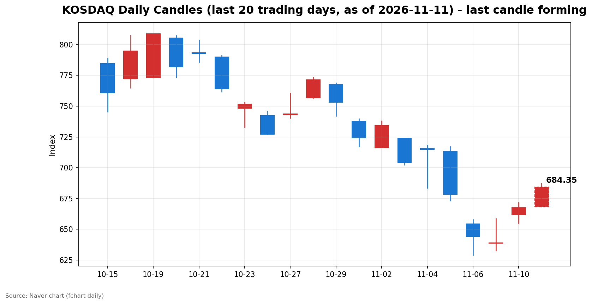

안녕하세요, [한국투자증권](https://securities.koreainvestment.com/main/Main.jsp)에서 [한투-한국투자증권](https://play.google.com/store/apps/details?id=com.truefriend.neosmartarenewal&hl=ko) 개발을 담당하고 있는 way입니다. 
미국 10월 소비자물가지수(CPI)가 예상을 웃돌면서 간밤 뉴욕 증시가 하락했고, 국내 증시는 코스피 약세와 코스닥 강세가 엇갈린 채 출발했습니다. 

## 배경: 간밤 미국 증시와 개장 전 이슈

간밤 뉴욕 증시는 3대 지수가 일제히 하락했습니다. 
나스닥 종합지수는 25,065.87로 187.27포인트, 0.74% 하락했습니다. 
S&amp;P500지수는 7,520.93으로 29.01포인트, 0.38% 하락했습니다. 
다우존스30산업평균지수는 52,231.18로 158.57포인트, 0.30% 하락했습니다. 

하락의 직접적인 계기는 미국 10월 CPI였습니다. 
미국 노동통계국(BLS)이 발표한 10월 CPI는 전월 대비 0.4% 상승해 시장 예상치 0.3%를 웃돌았습니다. 
근원 CPI도 전월 대비 0.3% 올라 예상치 0.2%를 상회했습니다. 
전월 수치는 헤드라인 0.6%, 근원 0.3%였습니다. 
연율 수치는 지난해 10월 미국 정부 셧다운으로 BLS가 온전한 기초 자료를 확보하지 못해 발표되지 않았습니다. 

물가 압력이 예상보다 덜 완화됐다는 소식에 12월 연방공개시장위원회(FOMC)에서 금리 인상에 나설 것이라는 전망이 다시 강해졌습니다. 
트레이더들은 12월 25bp 인상 가능성을 거의 100%로 반영했고, 50bp 인상 가능성도 약 12%로 거론됐습니다. 
미국 10년물 국채 금리는 CPI 발표 직후 약 12bp 올라 4.98% 수준까지 상승했습니다. 

원/달러 환율은 1,339.90원으로 전일 대비 4.60원, 0.34% 하락했습니다. 
달러 강세 흐름 속에서도 원화가 소폭 강세를 보인 점은 외국인 수급 측면에서 우호적인 신호입니다. 

전일 국내 증시는 강한 반등으로 마감했습니다. 
코스피는 5,239.13으로 4.39% 올랐고, 코스닥은 667.61로 4.48% 올랐습니다. 
외국인이 코스피에서 8거래일 만에 순매수로 돌아선 날이었습니다. 

## 오늘의 스냅샷

| 지수 | 현재가 | 전일 대비 | 등락률 | 시가 | 고가 | 저가 | 거래량 | 거래대금 |
| --- | --- | --- | --- | --- | --- | --- | --- | --- |
| [코스피](https://finance.naver.com/sise/sise_index.naver?code=KOSPI) | 5,228.59 | -10.54 | -0.20% | 5,209.71 | 5,253.39 | 5,209.63 | 39,768천 주 | 2조 1,617억 원 |
| [코스닥](https://finance.naver.com/sise/sise_index.naver?code=KOSDAQ) | 683.24 | +15.63 | +2.34% | 668.48 | 687.49 | 668.48 | 85,474천 주 | 1조 823억 원 |

스냅샷 기준 시각은 2026년 11월 11일 09시 28분 KST입니다. 
전일 종가는 네이버 실시간 API 등락률로 역산한 값이며, 코스피 5,239.13, 코스닥 667.61로 네이버 일봉 전일 종가와 일치합니다. 

## 차트

최근 20거래일 일봉 차트입니다. 
빨간 봉은 종가가 시가보다 높은 날, 파란 봉은 종가가 시가보다 낮은 날입니다. 
당일 봉은 형성 중인 봉으로, 마감 전에는 계속 변합니다. 

## 원인·촉매 분석

오늘 장 초반의 가장 큰 촉매는 미국 물가 지표입니다. 
CPI가 예상을 웃돌면서 연준의 긴축 우려가 다시 부각됐고, 이는 금리 민감도가 높은 대형 성장주에 직접적인 부담으로 작용했습니다. 
나스닥이 0.74% 하락한 흐름이 코스피의 약세 출발로 이어졌습니다. 

다만 하락 폭은 제한적입니다. 
전일 외국인과 기관이 코스피에서 각각 4,439억 원, 4,642억 원을 순매수하며 강한 매수세를 보인 점이 하방 지지 요인으로 작용하고 있습니다. 
개인이 전일 1조 3,947억 원을 순매도한 물량을 외국인과 기관이 받아낸 구도였습니다. 
외국인의 매수 전환이 하루 만에 매도로 돌아설지는 장중 수급을 지켜봐야 합니다. 

코스닥의 강세는 다른 결에서 읽힙니다. 
간밤 미국 시장에서도 러셀2000지수가 3.15% 급등하며 대형 기술주와 중소형주의 움직임이 엇갈렸습니다. 
국내에서도 대형주 중심의 코스피가 쉬는 사이 중소형주 중심의 코스닥으로 자금이 이동하는 선별 장세가 나타나고 있습니다. 
원/달러 환율이 1,340원 아래에서 안정된 점도 외국인 매도 압력을 완화하는 요인입니다. 

## 핵심 사건 3가지

### 1. 미국 10월 CPI, 예상 상회

10월 CPI는 전월 대비 0.4% 상승해 예상치 0.3%를 0.1%포인트 웃돌았습니다. 
근원 CPI도 0.3% 상승해 예상치 0.2%를 상회했고, 전월과 같은 상승률을 기록했습니다. 
물가 둔화 속도가 시장의 기대에 미치지 못하면서 연준의 추가 긴축 가능성이 다시 시장의 중심 변수로 올라왔습니다. 
단기적으로는 금리 인하 기대가 후퇴하고 인상 우려가 부각되는 구도가 형성됐습니다. 

### 2. 월러 연준 이사 발언, 50bp 인상 가능성 언급

크리스토퍼 월러 연준 이사는 CPI 발표를 앞두고 12월 FOMC에서 25bp 인상을 지지한다는 입장을 밝히면서, 10월 근원 CPI가 0.3% 이상이면 50bp 인상도 고려할 수 있다고 언급했습니다. 
실제 근원 CPI가 0.3%로 발표되면서 발언의 무게가 커졌습니다. 
연준 내부에서 매파적 목소리가 나온 점은 시장 심리에 구조적인 부담을 줍니다. 
12월 FOMC까지 남은 물가·고용 지표 하나하나에 시장의 민감도가 높아지는 구간입니다. 

### 3. 기술주 조정과 중소형주 강세의 분화

간밤 나스닥이 0.74% 하락하는 동안 러셀2000지수는 3.15% 급등했습니다. 
엔비디아는 3%대 하락했고, 메모리 관련 종목도 약세를 보였습니다. 
나스닥100지수가 조정 국면에 들어섰다는 지적도 나왔습니다. 
비트코인도 긴축 우려 속에 7만 3천 달러대로 밀렸습니다. 
기술주 중심의 조정이 진행되는 가운데 자금이 중소형주와 가치주로 이동하는 순환 장세가 나타나고 있습니다. 
국내 시장의 코스피 약세와 코스닥 강세도 같은 분화의 연장선에 있습니다. 

## 섹터·테마 영향 체인

금리 인상 우려는 성장주 밸류에이션에 직접적인 부담을 줍니다. 
할인율 상승은 미래 이익의 현재가치를 낮추기 때문에 반도체와 인공지능 인프라 관련 종목의 조정 압력이 커졌습니다. 
한투 MTS 오전 브리핑은 메모리 대형주 약세 속에서도 기판과 전력 인프라 관련 종목의 선별 강세를 전했습니다. 
HBM 밸류체인에서는 테크윙, ISC, 이수페타시스, 코리아써키트, 티엘비 등 관련 종목이 장 초반 강세를 보였습니다. 
인공지능 투자 확대라는 중기 수요 전망은 유지되는 가운데, 단기적으로는 밸류에이션 부담과 공급 과잉 우려가 맞서는 구간입니다. 

코스닥 강세는 중소형 성장주와 바이오·소부장 쪽으로의 자금 이동을 반영합니다. 
대형주 조정 국면에서는 상대적으로 금리 민감도가 낮거나 개별 재료가 있는 중소형주가 대안으로 부각되는 경향이 있습니다. 
다만 코스닥의 강세가 추세적인 자금 이동인지, 단기적인 순환 매수인지는 거래대금의 지속성을 보고 판단해야 합니다. 
유가와 원자재 쪽은 확인된 큰 변동이 없어 운송·화학 섹터에 미치는 영향은 제한적입니다. 

## 최근 5거래일 일봉

| 날짜 | 시가 | 고가 | 저가 | 종가 | 거래량 |
| --- | --- | --- | --- | --- | --- |
| 2026-11-04 | 5,786.13 | 5,828.13 | 5,421.72 | 5,683.80 | 276,889천 주 |
| 2026-11-05 | 5,580.09 | 5,586.46 | 5,336.88 | 5,383.80 | 277,253천 주 |
| 2026-11-06 | 5,263.26 | 5,269.10 | 4,911.28 | 5,059.69 | 323,267천 주 |
| 2026-11-09 | 5,034.20 | 5,172.94 | 4,990.66 | 5,018.85 | 248,140천 주 |
| 2026-11-10 | 5,247.22 | 5,300.92 | 5,174.55 | 5,239.13 | 253,917천 주 |
| 2026-11-11 | 5,209.71 | 5,253.39 | 5,209.63 | 5,228.59 | 39,768천 주 |

위 표는 코스피 기준입니다. 
2026년 11월 11일 봉은 형성 중인 봉으로, 종가와 거래량은 스냅샷 시점 값이며 마감 전에는 계속 변합니다. 

| 날짜 | 시가 | 고가 | 저가 | 종가 | 거래량 |
| --- | --- | --- | --- | --- | --- |
| 2026-11-04 | 715.74 | 718.34 | 683.66 | 714.95 | 539,758천 주 |
| 2026-11-05 | 713.49 | 717.06 | 673.38 | 678.41 | 434,307천 주 |
| 2026-11-06 | 654.43 | 657.95 | 629.17 | 644.27 | 443,709천 주 |
| 2026-11-09 | 638.82 | 658.66 | 632.70 | 638.97 | 358,495천 주 |
| 2026-11-10 | 661.73 | 671.91 | 655.09 | 667.61 | 402,110천 주 |
| 2026-11-11 | 668.48 | 687.49 | 668.48 | 683.24 | 85,474천 주 |

위 표는 코스닥 기준입니다. 
2026년 11월 11일 봉은 형성 중인 봉으로, 종가와 거래량은 스냅샷 시점 값이며 마감 전에는 계속 변합니다. 

## 전일 수급

전일(2026년 11월 10일) 수급은 네이버 시장동향 API 최종값 기준입니다. 
코스피에서는 외국인 4,439억 원 순매수, 기관 4,642억 원 순매수, 개인 1조 3,947억 원 순매도를 기록했습니다. 
기타법인은 4,867억 원 순매수였습니다. 
코스닥에서는 외국인 1,479억 원 순매도, 기관 2,147억 원 순매수, 개인 556억 원 순매도를 기록했습니다. 

코스피의 구도는 뚜렷합니다. 
개인이 1조 4천억 원에 가까운 물량을 쏟아냈지만 외국인과 기관이 이를 모두 받아내며 지수는 4.39% 급등했습니다. 
외국인의 순매수는 8거래일 만의 전환이었고, 기관도 투신과 사모를 중심으로 매수에 가세했습니다. 
기관 세부에서는 연기금이 1,104억 원 순매도한 반면 투신 3,285억 원, 사모 1,170억 원 순매수가 두드러졌습니다. 
급락 이후 저가 매수에 나선 기관과 외국인의 매수세가 반등을 이끈 것으로 해석됩니다. 

코스닥의 구도는 다릅니다. 
외국인이 1,479억 원을 순매도했지만 기관이 2,147억 원을 순매수하며 지수는 4.48% 올랐습니다. 
기관 매수가 지수 상승을 뒷받침한 가운데, 외국인의 매도 규모는 코스피의 매수 전환과 대조됩니다. 
코스닥에서는 기관의 매수 지속 여부가 단기 흐름을 가르는 변수입니다. 

당일 장중 수급은 한투 MTS 기준 오전 9시 28분 현재 코스피에서 외국인 1,450억 원 순매도, 기관 18억 원 순매수, 개인 1,100억 원 순매수를 기록하고 있습니다. 
코스닥에서는 외국인 24억 원 순매수, 기관 107억 원 순매수, 개인 134억 원 순매도를 기록하고 있습니다. 
장중 수급은 마감 직후 잠정치로 취급하며, 최종값은 마감 글에서 다시 확인합니다. 

## 단기·중기 전망과 확인할 시나리오

단기적으로는 물가 지표에 따른 변동성 장세가 이어질 가능성이 큽니다. 
12월 FOMC까지 남은 고용·물가 지표가 나올 때마다 금리 인상 확률이 재조정되며 지수가 출렁일 수 있습니다. 
코스피는 전일 종가 5,239.13을 기준으로 5,200선 안착 여부가 첫 번째 관전 포인트입니다. 
장 초반 저가 5,209.63이 5,200선에 근접해 있어, 이 구간이 지켜지는지가 중요합니다. 
아래로는 전일 장중 저가 5,174.55와 5,000선 부근이 지지 구간으로 거론됩니다. 
위로는 전일 장중 고가 5,300.92가 단기 저항 구간입니다. 

코스닥은 680선 안착 여부가 관전 포인트입니다. 
장 초반 고가 687.49까지 올랐지만, 상승 폭이 유지되는지가 중요합니다. 
전일 종가 667.61과 장중 고가 671.91이 단기 지지 구간으로 작용할 수 있습니다. 

중기적으로는 두 가지 흐름이 맞섭니다. 
인공지능 인프라 투자 확대라는 수요 전망은 유지되고 있지만, 금리 인상 우려와 밸류에이션 부담이 단기 조정의 빌미가 되고 있습니다. 
외국인 매수가 하루 만에 그친 것인지, 매수 기조로 이어지는지가 중기 방향을 가르는 변수입니다. 
신용융자 담보비율 140% 유지 의무가 내년 1월 31일까지 한시 면제된 구간인 만큼, 반대매매 부담은 유예된 상태입니다. 

확인할 시나리오는 다음과 같습니다. 
첫째, 외국인의 코스피 매수세가 이어지는지 여부입니다. 
둘째, 미국 10년물 국채 금리가 5% 선에 안착하는지 여부입니다. 
셋째, 필라델피아 반도체지수와 나스닥의 반등 여부입니다. 
넷째, 원/달러 환율이 1,340원 아래에서 안정되는지 여부입니다. 
이 중 두 가지 이상이 우호적으로 확인돼야 단기 바닥 논의가 가능합니다. 

## 장 초반 확인할 점

코스피가 5,200선을 지키는지 확인합니다. 
외국인의 코스피 매매 동향이 매도 우위에서 매수 우위로 바뀌는지 확인합니다. 
코스닥의 상승 폭이 유지되는지, 거래대금이 뒷받침되는지 확인합니다. 
기판과 전력 인프라 관련 종목의 강세가 장중에도 이어지는지 확인합니다. 
미국 선물 지수와 아시아 증시의 흐름도 함께 확인합니다. 

## 마치며

미국 물가 지표가 예상을 웃돌면서 국내 증시는 코스피 약세와 코스닥 강세가 엇갈린 출발을 보였습니다. 
전일 외국인과 기관의 대규모 순매수가 하방을 지지하는 가운데, 5,200선 안착 여부와 외국인 수급의 방향이 오늘 장의 관건입니다. 
이 글은 교육·해설 목적의 시황 정리이며, 특정 종목의 매수·매도 권유가 아닙니다. 
