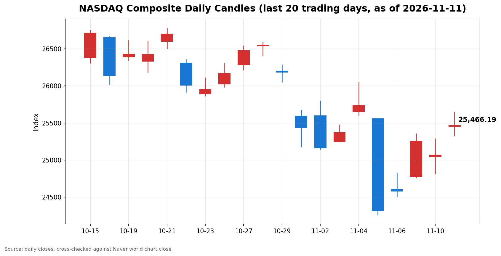

안녕하세요, [한국투자증권](https://securities.koreainvestment.com/main/Main.jsp)에서 [한투-한국투자증권](https://play.google.com/store/apps/details?id=com.truefriend.neosmartarenewal&hl=ko) 개발을 담당하고 있는 way입니다. 
2026년 11월 11일 나스닥 장 마감 흐름을 수치 중심으로 정리합니다. 

## 마감 요약

나스닥 종합은 전일 대비 1.60% 상승해 25,466.19로 마감했습니다. 
상승 폭은 400.31이었습니다. 
전일 하락분 187.27의 2배를 웃도는 상승으로, 전일 낙폭을 하루 만에 되돌리고도 남았습니다. 
종가는 지난주 금요일 종가 24,579.43보다 3.61% 높은 수준입니다. 
나스닥은 지난 10월 6일 기록한 사상 최고 종가 27,599.89 대비 7.73% 낮은 수준으로, 여전히 조정 구간에 머물렀습니다. 
S&P500은 1.31% 상승해 7,619.38로 마감했고, 다우지수는 0.49% 상승해 52,486.49로 마감했습니다. 
세 지수가 모두 올랐지만 상승 폭은 나스닥이 가장 컸습니다. 
이 글은 교육과 해설 목적으로 작성되었으며 특정 종목의 매수나 매도를 권유하지 않습니다. 

## 오늘의 마감 스냅샷

| 지수 | 종가 | 전일 대비 | 등락률 | 전일 종가 | 당일 고가 | 당일 저가 |
| --- | --- | --- | --- | --- | --- | --- |
| 나스닥 종합 | 25,466.19 | +400.31 | +1.60% | 25,065.87 | 25,649.85 | 25,326.69 |
| S&P500 | 7,619.38 | +98.45 | +1.31% | 7,520.93 | 7,646.35 | 7,575.70 |
| 다우지수 | 52,486.49 | +254.60 | +0.49% | 52,231.89 | 52,512.72 | 52,055.14 |

스냅샷 기준 시각은 미국 동부시간 2026년 11월 11일 16시 20분, 한국시간 2026년 11월 12일 06시 20분입니다. 
나스닥과 다우지수 수치는 네이버 월드 차트 페이지에서 직접 확인했습니다. 
한투 MTS 해외 대시보드의 나스닥 종가도 25,466.19로 네이버 값과 일치합니다. 
전일 대비 변동폭은 한투 MTS 기준 400.32로 네이버 기준 400.31과 소수점 둘째 자리 반올림 수준에서 일치합니다. 
S&P500 수치는 한투 MTS 해외 대시보드에서 확인했습니다. 
S&P500의 당일 고가와 저가는 한투 MTS 장중 시계열의 최대값과 최소값입니다. 
나스닥 당일 시가는 25,448.80, 다우지수 당일 시가는 52,196.35입니다. 
원/달러 환율은 한투 MTS 해외 대시보드 기준 1,337.50원으로 전일 대비 7.00원, 0.52% 하락했습니다. 
네이버 월드 차트 출처는 [네이버 금융 월드 시세](https://finance.naver.com/world/sise.naver?symbol=NAS@IXIC)와 [네이버 월드 차트](https://stock.naver.com/worldstock/index/.IXIC/price)에서 확인할 수 있습니다. 

## 차트

최근 20거래일 일봉 차트입니다. 
빨간 봉은 종가가 시가보다 높은 날, 파란 봉은 종가가 시가보다 낮은 날입니다. 

## 원인·촉매 분석

이날 반등의 가장 직접적인 촉매는 코어위브의 3분기 깜짝 실적이었습니다. 
AI 클라우드 기업 코어위브는 3분기 매출이 전년 동기 대비 168% 급증했다고 발표했고, 연간 매출 전망치도 기존 124억 달러에서 132억 달러 사이에서 130억 달러에서 133억 달러 사이로 올려 잡았습니다. 
AI 인프라 투자에 대한 과잉 지출 우려가 컸던 상황에서 실적이 예상을 크게 웃돌자, AI 지출이 꺾이지 않는다는 신호로 받아들여졌습니다. 
코어위브 주가는 장 초반 15%대 급등으로 출발했고, 종가 기준으로는 24.71% 올라 60.77달러로 마감했습니다. 
Yahoo Finance 기준 수치입니다. 
두 번째 촉매는 연방정부 셧다운 종료 기대입니다. 
상원은 월요일 밤 찬성 60표로 임시 예산안을 통과시켰고, 하원 표결이 수요일로 예정되면서 42일째 이어진 연방정부 셧다운이 이번 주 안에 끝날 수 있다는 기대가 커졌습니다. 
장기간 이어진 행정 공백이 해소된다는 전망은 항공 운항 차질과 식품 지원 지연 같은 실물 타격이 완화될 것이라는 기대로 이어졌고, 위험 자산 선호를 뒷받침했습니다. 
세 번째로 작용한 요인은 전일 낙폭에 대한 되돌림입니다. 
전일 나스닥은 10월 소비자물가지수가 예상을 웃돌면서 0.74% 하락했습니다. 
이날은 새로운 물가 지표 발표가 없었고, 연준 긴축 우려가 하루 만에 추가로 악화될 재료도 없었습니다. 
전일 하락이 과도했다는 인식 속에 실적 모멘텀이 더해지며 매수세가 기술주 중심으로 몰렸습니다. 
금리 쪽에서는 당일 채권시장이 재향군인의 날로 휴장해 국채금리 반응을 확인할 수 없었습니다. 
전일 10년물 국채금리는 4.98%까지 올랐던 만큼, 금리 수준이 높은 상태라는 점은 변하지 않았습니다. 
당일 반등은 금리가 내려서가 아니라 실적과 셧다운 기대가 금리 부담을 일시적으로 압도한 결과로 보는 것이 맞습니다. 
달러도 같은 방향이었습니다. 
원/달러 환율은 1,337.50원으로 전일 대비 0.52% 하락해 달러가 약세를 보였습니다. 
달러 약세는 해외 매출 비중이 높은 기술주에 우호적인 환경입니다. 

## 핵심 사건 3가지

첫째, 코어위브가 3분기 깜짝 실적을 발표했습니다. 
3분기 매출이 전년 동기 대비 168% 급증했고, 연간 매출 전망치를 130억 달러에서 133억 달러 사이로 올려 잡았습니다. 
AI 인프라 지출이 과도하다는 우려가 시장을 짓누르던 상황에서, 실제 수요가 꺾이지 않았다는 증거가 된 것입니다. 
코어위브 주가는 종가 기준 24.71% 급등했고, 네비우스와 아이렌 등 다른 AI 인프라 관련 종목도 동반 강세를 보였습니다. 
이번 실적은 AI 테마 전반의 투자 심리를 되돌린 사건입니다. 

둘째, 10월 소비자물가지수 충격이 연준 긴축 경로를 다시 그렸습니다. 
10월 소비자물가지수는 전월 대비 0.4% 상승해 예상치 0.3%를 웃돌았고, 근원 지수도 전월 대비 0.3% 올랐습니다. 
시카고상품거래소 페드워치 기준 12월 기준금리 인상 가능성은 100%로 반영됐고, 0.5%포인트 인상 가능성도 거론됐습니다. 
오스탄 굴즈비 시카고 연방준비은행 총재는 10월 물가 상승 압력을 우려를 넘는 충격적인 수준이라고 평가했습니다. 
이 사건은 전일 하락의 출발점이었고, 당일 반등이 금리 부담을 해소한 것이 아니라 실적 모멘텀이 부담을 덮은 것임을 보여줍니다. 
채권시장이 휴장이라 금리 반응을 당일 확인할 수 없었던 점도 함께 봐야 합니다. 

셋째, 연방정부 셧다운 종료가 눈앞에 다가왔습니다. 
상원이 월요일 밤 찬성 60표로 임시 예산안을 통과시켰고, 하원은 수요일에 표결을 진행할 예정입니다. 
예산안은 대부분 정부 부처를 내년 1월 30일까지 임시로 운영하는 내용을 담고 있습니다. 
42일째 이어진 셧다운은 항공 운항 차질과 식품 지원 지연, 연방 공무원 무급 휴직 같은 실물 타격을 남겼습니다. 
종료 기대가 커지면서 불확실성 해소에 대한 안도감이 위험 자산으로 흘러들었습니다. 
다만 하원 표결 결과와 대통령 서명이 남아 있어, 종료가 확정된 것은 아닙니다. 

## 지수·섹터 영향 체인

나스닥 상승률이 가장 컸던 것은 기술주 주도 반등이었기 때문입니다. 
코어위브 실적이 AI 지출 지속의 증거가 되면서 기술주와 반도체주로 매수가 몰렸고, 기술주 비중이 가장 높은 나스닥이 가장 크게 올랐습니다. 
S&P500 기술 섹터 지수는 장중 4%에 육박하는 상승률을 기록했고, 로이터는 8월 4일 이후 가장 큰 일일 상승폭이라고 전했습니다. 
반도체 섹터도 같은 체인으로 올랐습니다. 
엔비디아는 약 2.9% 올라 173.73달러로 마감하며 이틀간의 하락을 되돌렸고, 마벨과 마이크론 등 반도체 종목도 상승했습니다. 
전일 엔비디아 개별 악재로 눌렸던 반도체 심리가 실적 모멘텀으로 돌아선 것입니다. 
S&P500은 기술주 비중이 나스닥보다 낮아 상승 폭이 1.31%에 그쳤고, 가치주와 산업재 비중이 높은 다우지수는 0.49% 오르는 데 그쳤습니다. 
금리 인상 기대가 커지는 국면에서는 은행의 순이자마진 기대가 커질 수 있지만, 당일은 셧다운 종료 기대와 실적 모멘텀이 기술주 쪽으로 자금을 더 강하게 끌어당겼습니다. 
지수 간 상승 폭 차이는 이날 상승이 경기 전반의 회복이 아니라 AI와 기술주 중심의 반등이었음을 보여줍니다. 

## 다우·S&P500 마감 흐름

다우지수는 전일 대비 0.49% 상승해 52,486.49로 마감했습니다. 
상승 폭은 254.60이었고, 당일 고가는 52,512.72, 저가는 52,055.14였습니다. 
나스닥이 전일 낙폭을 두 배 이상 되돌린 것과 달리, 다우지수는 전일 하락분 157.86을 1.6배가량 되돌리는 데 그쳤습니다. 
S&P500은 전일 대비 1.31% 상승해 7,619.38로 마감했습니다. 
상승 폭은 98.45였고, 당일 고가는 7,646.35, 저가는 7,575.70이었습니다. 
S&P500은 전일 하락분 29.01을 3배 이상 되돌렸습니다. 
세 지수가 모두 올랐지만, 회복의 속도는 나스닥과 S&P500이 다우지수보다 빨랐습니다. 
이는 이날 상승의 중심이 기술주였다는 점을 다시 확인해 줍니다. 

## 단기·중기 전망과 다음 거래일 확인할 시나리오

다음 거래일에는 하원 셧다운 예산안 표결 결과를 가장 먼저 확인할 필요가 있습니다. 
표결이 통과되고 대통령 서명까지 이어지면 불확실성 해소가 확정되고, 반대로 표결이 미뤄지면 안도감이 되돌려질 수 있습니다. 
국채금리도 다시 봐야 합니다. 
재향군인의 날 휴장으로 당일 금리 반응을 확인하지 못했기 때문에, 다음 거래일 10년물 국채금리가 전일 4.98%에서 어느 방향으로 움직이는지가 중요합니다. 
금리가 5%선을 다시 넘어서면 성장주 밸류에이션 부담이 다시 커질 수 있습니다. 
연준의 12월 결정 경로도 확인 대상입니다. 
페드워치는 12월 인상 가능성을 100%로 반영하고 있고, 0.5%포인트 인상 가능성도 거론되고 있습니다. 
연준 인사들의 추가 발언이 나올 경우 인상 폭에 대한 시장의 평가가 바뀔 수 있습니다. 
가격 레벨로는 나스닥 당일 고가 25,649.85와 저가 25,326.69가 단기 기준이 됩니다. 
고가를 넘어서면 반등이 이어지는 흐름으로, 저가를 밑돌면 되돌림이 약해지는 흐름으로 볼 수 있습니다. 
전일 종가 25,065.87은 단기 지지선으로 작용할 수 있습니다. 
중기적으로는 물가 경로와 연준 결정이 방향을 가릅니다. 
인상 폭이 0.25%포인트 수준에서 정리되면 시장은 안도할 수 있고, 0.5%포인트 인상 쪽으로 기울면 성장주 부담이 다시 커질 수 있습니다. 
AI 지출이 실적에서 확인되는 한 기술주 반등의 재료는 남아 있지만, 금리가 높은 상태가 길어질수록 반등의 지속성은 약해질 수 있습니다. 
이날 반등은 하루의 흐름이므로, 다음 거래일 금리와 셧다운 표결 결과를 보고 지속 여부를 판단하는 것이 적절합니다. 

## 마치며

나스닥은 코어위브 호실적과 셧다운 종료 기대에 힘입어 전일 낙폭을 되돌리고 1.60% 상승 마감했습니다. 
다만 금리 부담이 해소된 것은 아니므로, 다음 거래일 국채금리와 하원 표결 결과를 확인하는 것이 중요합니다. 
