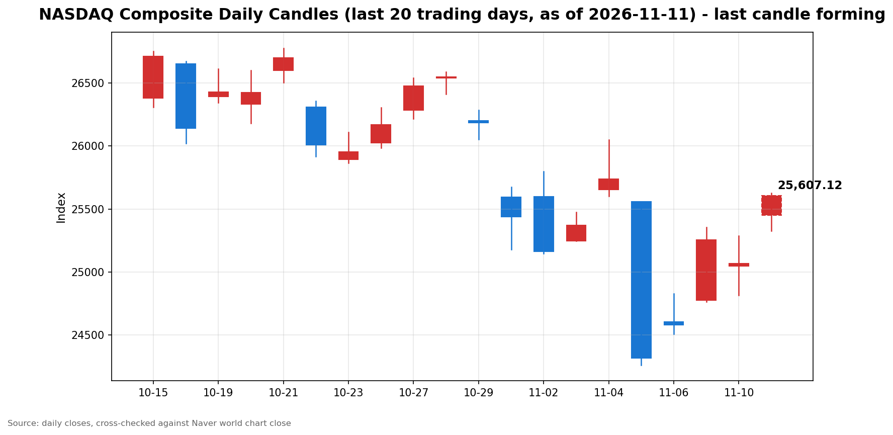

안녕하세요, [한국투자증권](https://securities.koreainvestment.com/main/Main.jsp)에서 [한투-한국투자증권](https://play.google.com/store/apps/details?id=com.truefriend.neosmartarenewal&hl=ko) 개발을 담당하고 있는 way입니다. 
2026년 11월 11일 나스닥 장중 흐름을 수치 중심으로 정리합니다. 

## 장중 요약

전일인 11월 10일 미국 증시는 하락 마감했습니다. 
나스닥 종합은 25,065.87로 0.74% 내렸고, 스탠더드앤드푸어스 500 지수는 7,520.93으로 0.38% 내렸으며, 다우존스 산업평균지수는 52,231.89로 0.30% 내렸습니다. 
11월 11일 장중에는 흐름이 반전됐습니다. 
나스닥 종합은 25,611.18로 전일 대비 2.18% 올랐고, 스탠더드앤드푸어스 500 지수는 7,636.33으로 1.53% 올랐으며, 다우존스 산업평균지수는 52,406.56으로 0.33% 올랐습니다. 
반등의 중심에는 인공지능 클라우드 기업 코어위브의 호실적이 있습니다. 
개장 당시 1.36% 올랐던 나스닥은 장중 상승폭을 2%대로 넓혔고, 개장 당시 약보합이던 다우는 장중 플러스로 돌아섰습니다. 

## 오늘의 스냅샷

| 지수 | 현재가 | 전일 대비 | 등락률 | 전일 종가 | 장중 고가 | 장중 저가 | 스냅샷 기준 시각 |
| --- | --- | --- | --- | --- | --- | --- | --- |
| 나스닥 종합 | 25,611.18 | +545.31 | +2.18% | 25,065.87 | 25,624.92 | 25,326.69 | 미국 동부시간 2026-11-11 12:57, 한국시간 2026-11-12 02:57 |
| 스탠더드앤드푸어스 500 | 7,636.33 | +115.40 | +1.53% | 7,520.93 | 7,636.33 | 7,575.70 | 미국 동부시간 2026-11-11 12:57, 한국시간 2026-11-12 02:57 |
| 다우존스 산업평균지수 | 52,406.56 | +174.67 | +0.33% | 52,231.89 | 52,408.92 | 52,055.14 | 미국 동부시간 2026-11-11 12:57, 한국시간 2026-11-12 02:57 |

당일 수치는 형성 중인 수치로, 마감 전에는 계속 변합니다. 
나스닥 종합의 시가는 25,448.80이었습니다. 
다우존스 산업평균지수의 시가는 52,196.35였습니다. 
나스닥 종합과 스탠더드앤드푸어스 500 지수 값은 한국투자증권 MTS 해외 대시보드에서 확인했습니다. 
다우존스 산업평균지수 값은 네이버 월드 차트 페이지에서 직접 확인했습니다. 
네이버 월드 차트 페이지는 직접 조회 시 일별 시세 표가 비어 있어 나스닥 종합 값을 추출하지 못했고, 나스닥 종합과 스탠더드앤드푸어스 500 지수는 한국투자증권 MTS 해외 대시보드 교차값으로 스냅샷을 채웠습니다. 
나스닥 종합의 장중 고가와 저가는 일봉 데이터 기준이며, 스탠더드앤드푸어스 500 지수의 장중 고가와 저가는 한국투자증권 MTS 시계열의 최대값과 최소값으로 산출했습니다. 
한국투자증권 MTS 시계열은 표본 수가 적어, 실제 장중 고가와 저가보다 좁게 나타날 수 있습니다. 
원·달러 환율은 한국투자증권 MTS 기준 1,336.30원으로, 전일 1,344.50원보다 8.20원, 0.61% 낮은 수준입니다. 
장중에는 1,331.40원에서 1,343.50원 사이에서 움직였습니다. 
참고로 [네이버 월드 차트 나스닥 종합](https://finance.naver.com/world/sise.naver?symbol=NAS@IXIC)과 [네이버 월드 차트 나스닥 종합 가격](https://stock.naver.com/worldstock/index/.IXIC/price) 링크를 함께 둡니다. 

## 차트

최근 20거래일 일봉 차트입니다. 
빨간 봉은 종가가 시가보다 높은 날, 파란 봉은 종가가 시가보다 낮은 날입니다. 
당일 봉은 형성 중인 봉으로, 마감 전에는 계속 변합니다. 

## 원인·촉매 분석

전일 하락의 직접적인 계기는 11월 10일 오전 8시 30분에 발표된 10월 소비자물가지수였습니다. 
10월 소비자물가지수는 전월 대비 0.4% 올라 시장 예상 0.3%를 웃돌았습니다. 
근원 소비자물가지수도 전월 대비 0.3% 올라 예상 0.2%를 웃돌았고, 3개월 연속 0.3% 상승을 기록했습니다. 
발표 직후 12월 연방준비제도 금리 인상 전망이 강화됐고, 미국 2년물 국채수익률은 17bp 넘게 급등했습니다. 
당일 반전의 촉매는 코어위브의 실적이 인공지능 수요와 수익성에 대한 의구심을 수치로 해소한 점입니다. 
코어위브는 3분기 매출 36억6천만 달러를 기록해 전년 동기 대비 168% 늘었고, 시장 전망치 35억5천만 달러를 웃돌았습니다. 
2026년 매출 전망도 130억 달러에서 133억 달러로 상향했습니다. 
시간외 거래에서 코어위브 주가는 15% 넘게 올랐고, 장중에는 21.12% 급등했습니다. 
이날은 미국 재향군인의 날로, 미국 국채 현물 시장은 휴장합니다. 
당일 10년물 국채수익률 움직임은 국채 시장 휴장으로 확인이 필요하며, 금리 부담이 사라진 것이 아니라 확인할 신호가 없는 상태에서 실적이 장을 주도한 것으로 해석됩니다. 
원·달러 환율은 1,336.30원으로 전일보다 0.61% 낮아, 달러 약세 흐름도 위험자산에 우호적으로 작용했습니다. 
당일 유가 움직임은 확인된 수치가 없어 확인 필요로 표기합니다. 

## 핵심 사건 3가지

첫째, 코어위브 실적과 인공지능 인프라 신뢰 회복입니다. 
코어위브의 3분기 매출은 시장 전망치를 웃돌았고, 연간 매출 전망 상향까지 함께 나왔습니다. 
네비우스와 아이렌 등 다른 인공지능 클라우드 기업도 동반 강세를 보였고, 엔비디아도 반등에 나서며 마벨과 마이크론 등 반도체주가 함께 올랐습니다. 
인공지능 과잉투자와 차입 부담에 대한 우려가 실적 숫자로 반박되면서, 전일 소비자물가지수 충격으로 위축됐던 투자심리가 기술주를 중심으로 되돌아왔습니다. 
시장에 준 충격은 심리적 측면이 큽니다. 
금리 인상 우려가 남아 있는 상황에서도 실적이 장을 끌어올렸다는 점이 확인됐기 때문입니다. 

둘째, 소비자물가지수 후폭풍과 금리 인상 우려의 지속입니다. 
10월 소비자물가지수와 근원 소비자물가지수는 모두 시장 예상을 웃돌았고, 12월 연방준비제도 금리 인상 가능성이 커졌습니다. 
그럼에도 당일 기술주가 반등했다는 점은 시장이 금리 경로보다 실적에 더 무게를 둔 하루였음을 보여줍니다. 
구조적으로는 인상 전망이 실적 모멘텀을 꺾지 못했는지를 확인하는 국면입니다. 
다만 국채 현물 시장이 휴장이라 수익률로 재확인할 신호가 없었고, 인상 우려 자체가 해소된 것은 아닙니다. 

셋째, 다우의 장중 양전환과 글로벌 위험선호 확산입니다. 
다우는 개장 당시 전일 대비 0.06% 내렸으나 장중 0.33% 상승으로 돌아섰습니다. 
같은 날 한국 증시도 코스피가 136.23포인트, 2.60% 오른 5,375.36으로 마감했고, 코스닥은 37.49포인트, 5.62% 오른 705.10으로 700선을 회복했습니다. 
외국인은 한국 시장에서 이틀 연속 순매수 우위를 보였습니다. 
반등이 기술주에 국한되지 않고 경기민감 쪽으로 번지는지를 가늠하는 신호이나, 다우 상승폭은 나스닥 상승률의 7분의 1 수준으로 확산은 아직 제한적입니다. 

## 지수·섹터 영향 체인

나스닥이 2.18% 오르는 동안 스탠더드앤드푸어스 500 지수는 1.53%, 다우는 0.33% 올랐습니다. 
기술주와 성장주 중심의 반등이라는 점이 지수 간 격차로 드러났습니다. 
밸류체인 관점에서는 코어위브에서 네오클라우드 기업으로, 다시 엔비디아와 마벨, 마이크론 등 반도체주로 온기가 확산됐습니다. 
금리에서 성장주 밸류에이션으로 이어지는 연결고리는 당일에는 실적 모멘텀이 앞섰습니다. 
국채 현물 시장 휴장으로 수익률 재확인 신호가 없었고, 인상 우려가 밸류에이션 부담으로 되돌아오지 않았습니다. 
다우에 비중이 높은 금융과 산업재, 경기민감주는 상대적으로 약했습니다. 
금리 인상 전망과 경기 둔화 우려에 직접 노출되는 구조라, 반등에는 동참했으나 상승폭은 제한됐습니다. 
에너지 섹터는 당일 유가 수치가 확인되지 않아 영향 판단은 보류합니다. 

## 다우·S&P500 흐름

다우존스 산업평균지수는 52,406.56으로 전일 대비 174.67포인트, 0.33% 올랐습니다. 
시가 52,196.35에서 출발해 장중 저가 52,055.14까지 밀렸다가 고가 52,408.92까지 회복했습니다. 
개장 전 다우 선물은 보합권에 머물렀으나, 장중에는 플러스로 전환됐습니다. 
스탠더드앤드푸어스 500 지수는 7,636.33으로 전일 대비 115.40포인트, 1.53% 올랐습니다. 
장중 고가가 7,636.33으로 현재가와 같아, 고점 부근에서 거래되고 있습니다. 
나스닥 대비 다우의 약세는 상승이 시장 전반으로 확산되지 않았음을 보여줍니다. 
다우의 상승폭이 오후에 더 넓어지는지가 확인할 지점입니다. 

## 오전과 오후 흐름 변화

나스닥 종합은 개장 당시 25,405.48로 1.36% 올랐으나 장중 25,611.18로 2.18%까지 상승폭을 넓혔습니다. 
개장 대비 205.70포인트, 0.81% 더 올랐고, 시가 25,448.80 대비로는 0.64% 오른 수준입니다. 
스탠더드앤드푸어스 500 지수는 개장 당시 7,585.26으로 0.86% 올랐으나 장중 7,636.33으로 1.53%까지 상승폭을 넓혔습니다. 
개장 대비 51.07포인트, 0.67% 더 올랐습니다. 
다우존스 산업평균지수는 개장 당시 52,202.48로 0.06% 내렸으나 장중 52,406.56으로 0.33% 상승으로 방향을 바꿨습니다. 
개장 대비 204.08포인트, 0.39% 올랐습니다. 
세 지수 모두 개장 이후 상승폭을 키웠고, 다우는 음에서 양으로 전환했습니다. 
오전의 기술주 중심 반등이 오후 들어 유지되고 확대되는 흐름입니다. 

## 마감까지 전망과 확인할 시나리오

확인할 가격 레벨은 나스닥 25,600선 안착 여부와 장중 고가 25,624.92 돌파 여부입니다. 
스탠더드앤드푸어스 500 지수는 7,600선 유지 여부, 다우는 52,400선 안착 여부가 확인할 지점입니다. 
상승 지속 시나리오에서는 인공지능 실적 모멘텀이 유지되며 기술주 중심 강세가 마감까지 이어질 수 있습니다. 
다우 상승폭이 더 넓어지면 반등이 시장 전반으로 확산되는 신호로 볼 수 있습니다. 
일시적 되돌림 시나리오에서는 국채 시장 재개가 변수가 됩니다. 
국채 시장이 내일 재개되면 10년물과 2년물 수익률 움직임이 다시 확인될 것이고, 수익률 상승이 재개되면 성장주 밸류에이션 부담이 되돌아올 수 있습니다. 
12월 연방공개시장위원회 금리 전망 변화도 함께 확인할 필요가 있습니다. 
리스크 관리 관점에서는 당일 수치가 형성 중이며, 한 종목과 한 재료에 기댄 반등은 변동성이 클 수 있다는 점을 함께 봐야 합니다. 
지수와 섹터 단위에서 분산과 변동성을 함께 확인하는 것이 필요합니다. 

## 마치며

코어위브 실적을 계기로 전일 소비자물가지수 충격에서 반등한 하루였습니다. 
다만 금리 인상 전망이 해소된 것은 아니어서, 마감까지는 지수별 확산 여부와 국채 시장 재개 후 신호를 함께 확인할 필요가 있습니다. 
이 글은 교육과 해설 목적이며, 특정 종목의 매수나 매도 권유가 아닙니다. 
